# Echoes of Spira — changelog

Every build that has gone live or to a preview, newest first, from the first alpha to today, and the day the
project began: 90 entries. Dates are US Eastern. FFX, FFX-2 or both tells you which game a change touches.
Each entry lists its changes as text and shows a picture from that build (from release 39.2 on, up to three,
kept under `docs/screenshots/`); where there is an "All pictures for this build" link it opens a page with every
picture, before and after where both exist. Engineering detail lives in `docs/handoff/release-NN.md`.

Echoes of Spira was called Pyrefly Reprise until 2026-10-04, so older pictures show the old name and the site
address still carries it.

## 2026-10-28 · Release 67 (r67), Bailey's six look picks become the defaults: a turn starts on the standing painting, painting changes cut inside the smear, a struck figure is knocked back, attacks and spells follow the real game's clips with a travelling strike, the girls run in at an even speed and a boss goes down in one motion; plus a hurried retry in Chapter I, the defeat card's cause at every speed, a two-line enemy-move read-out on the phone, CHAPTER SELECT on the public defeat card and an atomic browser lock (both games; the hurried retry is FFX only; the flowing run-in is FFX-2 only)

Address: none yet (branch `r67-rc`, built from `r63-release` at `origin/main` `bd5701835` (release 66's `2b48cee95` and its records, rounds 30 and 30b) and the branch `r67-picks` (`e2a84fbd3`, prepared from `e50a2b22d`, release 66 plus its records) merged `--no-ff`, merge `f5781ed18`; no textual conflict: what `origin/main` gained since the branch point is records only (the ledgers, `critic/`, `docs/LIVE.md`, `docs/handoff/NOW.md`) and the branch touches none of those hunks), then this entry, the player note and the newest-release pins. Tip: `git rev-parse origin/r67-rc`. The focused review of this candidate and the deep review of the live build it becomes are owed; the focused review's list is in `docs/handoff/r67-picks.md` ("What the release 67 focused review must look at"). Art: unchanged, `D:/pyrefly-art-r64`. No picture is attached to this entry.) Authority: Bailey, 2026-10-28, "keep going please ill go with all of your recommendations and I will go with your decision making for the couple days" (he accepted the six look picks; the retry skip and the defeat cause were round 30's proposals, taken under the same words, his to overturn).

Where it acts: the three painting picks (`?stance`, `?swapcause`) and the real-clip timing (`?curves=real-snappy` with its travelling strike) in **Chapter I (FFX) and Chapter IV (FFX-2) only, the pack on, a desktop-class screen** (`?pack=off`, a phone and every other chapter keep release 66's look; the painting picks also wait out a tablet); the knock-back (`?hit`) in **every chapter of both games**; the whole fall (`?rigko`) on the two rig bosses, Seymour Flux in Chapter I and Bahamut in Chapter IV; the flowing run-in (`?run=flow`) in **FFX-2 Chapter IV** (it needs the real-clip curves, so Chapter V, the pack off and a phone get the smooth run with today's strike); the hurried retry on the public address in **Chapter I only**; the defeat card's cause and button in Chapters I and IV (where the pro staging's card is on). Nothing in the art, the HUD (but the one phone line) or the engine's numbers moved. Every pick is ONE constant and every old look is one address word away (below).

- **Both games (Chapter I and Chapter IV): a turn starts the way Bailey picked (`?stance=v1a`, MF-05).** The command menu keeps the figure's standing painting, and the "ready" painting shows only as an attack's wind-up, so the figure no longer changes drawings the moment a menu opens.
- **Both games (Chapter I and Chapter IV): a change of painting that has a cause on screen is cut inside the smear (`?swapcause=pick`, MF-06).** The strike's contact, a hit, a spell's glow, an item toss and the critical stance cut inside the smear where the moment has a cover, take a 50 ms blend where it has none, and keep the old blend where the two drawings share too little for a blend to look right (the big-pair guard).
- **Both games, every chapter: a struck figure is pushed away from the attacker and springs back, sized by the blow, instead of shaking in place (`?hit=knock`, MF-03).** It reaches a struck rig boss too (Seymour Flux, Bahamut), which the lane never filmed. Reduce Motion keeps the shake.
- **Both games (Chapter I and Chapter IV): attacks, casts, a struck figure's recovery and the run home follow the real game's own animation clips scaled to about 1.1 seconds (`?curves=real-snappy`, MF-14), and the strike travels to the target (`?strikeshape=travel`, MF-14 V3).** The clip's own dash is one frame for some figures (Paine's is 34 ms, 228.5 px in one 60 Hz frame at 2,560 wide), so the dash is the game's house travel after a wind-up of at least 300 ms, with the total still 1.1 s: Tidus 308 / 250 / 300 / 176 / 66 ms, Paine 300 / 200 / 300 / 189 / 111, Rikku 300 / 200 / 300 / 197 / 103 (wind-up / travel / hold / return / settle). The contact (the hit, its number and sound) lands later than the clip's proportion puts it: Tidus 558 ms after the strike starts instead of 362, Paine 500 instead of 120. A figure that crouches into the lunge (Yuna, Auron, Kimahri, Lulu, every FFX-2 girl but Bahamut) shows a stand-and-pull-back and then a 250 ms (FFX) or 200 ms (FFX-2) dash; a figure whose clip leaps (Tidus 558 ms, Wakka 739, Seymour Flux 564, Bahamut 555) approaches in one leap. `?curves=today` still means the new curves OFF; release 66's timing is `?curves=new`.
- **FFX-2 only (Chapter IV, where the real-clip curves play): the girls run in at an even speed and start the strike as they brake (`?run=flow`, MF-04).** No stand before the lunge, and each attack is about a seventh of a second shorter. In Chapter V, with the pack off and on a phone, the run is the smooth one and the strike is unchanged. An open command menu (no run-in at all) is unchanged. FFX has no run-in.
- **Both games (Seymour Flux in Chapter I, Bahamut in Chapter IV): the boss goes down in one motion, with no sink and lift after the thud, and stands up from a strike only after the strike is over (`?rigko=whole`, MF-11).**
- **FFX only (Chapter I), the public address: after a lost fight the second and later attempts open hurried (round 30's PR-0481).** A short boss card (0.7 s instead of 1.9), no long sweep and no boss reveal, on the same engine and the retry's own seed; the demo's quick retry already did this. The first attempt is unchanged, and `?retryopening=full` brings the full opening back. Chapter IV (FFX-2) has no recorded opening and is unchanged. The party prep still comes up on a public retry and the stage loads cold, so the demo's 1.7 s is not the public figure: the expected saving is about 5 to 7 of the 16.5 s that round 30 read, a prediction, not a measurement.
- **Both games (Chapter I and Chapter IV): the defeat card names what felled the party at every battle speed, also at SKIP (round 30's PR-0546).** "Felled by <the foe's last move>" was written only when the staging layer was mounted, and there is none at SKIP; the note is now written whenever the ending piece is on for the chapter. The staging itself is unchanged at SKIP (no cue, no dim, no caption, today's black flash). Six of the eleven new tests fail on release 66's code.
- **Both games, the public address (backlog 58): after a lost fight in Chapter I or Chapter IV the second button on the defeat card says CHAPTER SELECT, because that is where it goes.** At the booth (demo mode) it stays OTHER FIGHT and starts the other fight. The results screen's own buttons were already right.
- **Both games, the phone (backlog 57): the enemy-move line under the rail is two lines at most, with an ellipsis (it was three).** CSS only, scoped to the phone held upright; desktop and a phone held sideways are unchanged, and the one documented exception (a line moved off a guarded feature, the Vegnagun leg's lens) keeps its five lines. jsdom has no layout, so the wrapping itself is a browser check owed (the focused review's).
- **Both games, tooling, nothing a player sees (backlog 60): the browser lock the measuring tools and the rig recorder share is taken atomically.** `tools/lock-atomic.mjs` (`createExclusive`, `replaceIfStale` under a takeover mutex) is used by `tools/measure/lock.mjs`, `tools/rig-record-lock.mjs` and the rig lane recorder (`tools/rig/lane/lane-lock.mjs`); with the recorder's old read-judge-write logic three of four racing processes won the lock, now exactly one does (`tests/unit/lock-atomic.test.ts`, real processes in the same millisecond). Each tool's stale rule is unchanged.
- **Put release 66's look back (nothing is removed).** `?stance=today&swapcause=today&hit=today&run=today&curves=new&rigko=today&strikeshape=today` (with `curves=new` the strike-shape word reads nothing, so it is for the reading word by word, not for the look); each word also takes its other values (`v1b`, `v3`, `cut`, `blend3`, `ramp`, `smooth`, `pace`, `real`). `tests/unit/release67-picks.test.ts` reads that address word by word AND through the live switches in both pack chapters. The retry is one gate (`PUBLIC_QUICK_RETRY_CHAPTERS` in `demoDefeat.ts`, or `?retryopening=full`).
- **Open or carried, not introduced here (disclosed, for the focused review).** The six picks together have never run in a browser or the continuity harness: the lane measured `v1a` + `cut` (Chapter I 101.5 to 14.3 ghost frames a minute, Chapter IV 86.7 to 11.4), `v1b` + `pick` (36.2 and 34.1) and `v3` + `pick`, never `v1a` + `pick`, and `real-snappy` was filmed on release 66's other defaults, so this entry quotes no continuity number of its own (release 66's read 100.2 and 107.8); the review's number replaces this sentence. Predicted, not seen: under `?run=flow` the strike is asked for from the house wind-up (140 ms), but the travelling strike's wind-up is at least 300 ms, so Paine and Rikku may stand about 150 to 160 ms between the end of the run and the dash (the stand `?run=flow` exists to remove; the fix, if seen, is `flowLeadMs` taking the real profile's wind-up); the knock-back (240 ms) is shorter than `real-snappy`'s hit recovery (Rikku 900 ms). `?run=flow` and `?rigko=whole` are not pack-gated, so they also reach a phone and `?pack=off` (a phone's FFX-2 run becomes the trapezoid, the smooth run).
- **Both games, the player note for 67 (`src/app/changelog/releaseNotes.ts`, 5 lines):** the turn start and the painting changes (Both); the real-clip strikes and spells, the knock-back and the boss falls (Both); the FFX-2 run-in (FFX-2); the hurried retry in Chapter I (FFX); the defeat card, CHAPTER SELECT and the phone line (Both). The lock has no line: no player sees it. The newest-release pins (`release-notes.test.ts`, `deploy-release-gate.test.ts`) now read 67.

## 2026-10-28 · Release 66 (r66), the motion-fluidity pass: the first sight of a pose no longer freezes the picture, every wait in a fight keeps one clock, a knocked-out body lands on the frame it arrives, and an FFX-2 spell no longer blinks through idle (both games; the spell interlude and the Bevelle light shafts are FFX-2 only; sixteen more looks wait behind address words and change nothing until one is asked for)

Address: https://echoesofspira.com (main 2b48cee95, bundle BwPs1UaV, live since 2026-10-28T06:50Z (02:50 EDT) under Bailey's standing words "deploy every release as soon as its review says it can ship"; branch `r66-rc`, built from `r63-release` at `origin/main` `ee0b8e31e` (release 65's `eaf599d0c` and its records) and the five lane branches of the motion-fluidity pass merged `--no-ff`, one merge commit each, in this order: `mf-l5-tools` (`46bb7fa37`, merge `585e61bb6`), `mf-l4-freezes` (`3127e65b3`, merge `5f91b53a9`), `mf-l3-timebase-ui` (`79fdbd847`, merge `78570fb8d`), `mf-l2-moves` (`cb9ba842a`, merge `991825043`) and `mf-l1-swaps` (`a85c49928`, merge `aa8d47ef5`); three textual conflicts in two merges, all resolved by keeping both sides (the doc sections of `docs/DEV.md` in the first merge; the import block of `src/engine/BattlePresenterBeats.ts` and the hurt-string line of `PaintedActor.flinch` in the last), then a reader rename, one test file of default pins, this entry and the player note. Tip: `2b48cee95`. The focused review `critic/reviews/2b48cee95-focused.json` is SHIP with the changed area UNVERIFIED (polish only: R66-P1, the pose-swap and motion continuity checks failing as on release 65; R66-S1, a suggestion: the defaults are proved by tests and loads, not by a frame strip); no major is disclosed. The live check `critic/reviews/2b48cee95-live.json` is PASS (7,169 files, 0 console errors), and the gap checks on the live address (lost fights, Chapter V and Chapter II won by real keys, a hidden tab, the phone first menu, the new words) found no defect from this release. The deep review of this live build is owed and carries 76 earlier builds.) Art: unchanged, `D:/pyrefly-art-r64`. No picture is attached to this entry; the lanes' blind A and B clip cards are under `D:/Tools/pyrefly-scratch/2026-10-26/fluidity/cards/`.

Where it acts: the first-sight freezes in every chapter (measured in FFX Chapter I; FFX-2 Chapter IV holds), the beat clock in every fight of both games, the knock-out landing in every chapter, the rig springs on the two rig bosses (Seymour Flux in Chapter I, Bahamut in Chapter IV), the spell and item interlude in every FFX-2 fight whose girls have a painted ready stance and a painted cast or item (Chapter IV measured). Nothing in the HUD, the art or the engine's numbers moved by default (the one tolerance, in the look's extents field, is disclosed under the first item); every change of how something LOOKS is behind a word.

- **Both games (felt in FFX Chapter I): the first time a figure shows a pose no longer stops the picture (mf-l4-freezes, MF-02, shared look and art-governor plumbing).** The aeons' summon and attack, an item throw, Cheer, Talk and the party swap used to freeze 50 to 280 ms while the look read the new painting. A worker now makes those readings when the painting loads (the extents field, its second opinion and the breathing rig's field), the high class's warm pool is 1,092 MB instead of 640 with a figure's likely poses (strike, spell, flinch, item) staged before its unlikely ones, and a late arrival's hot poses take the room of cold poses that were staged early. On the release route (the aeon summons, items, Cheer, Talk) Chapter I's frames over 33 ms in a fight fell from 64 to 21 on this PC (the builder's own runs 57 to 25), about a third of what they were, and the time the picture lost to them from 764 to 235 ms a minute; on a plain auto-played fight the gain is smaller (slow-read time 28 percent less). Chapter IV, the hold, holds (frames over 33 ms 6 to 5, p99 16.8 ms in both). A browser that cannot draw in a worker (no `OffscreenCanvas`, as Playwright's WebKit) makes no worker, and a worker that does not answer is given up on. `?alphathumb=off` and `?warmpool=old` are release 65's reading; `?alphathumb=exact` keeps only the exact breathing field (about half of the gain). **Disclosed:** the page's own read of a painting is Chromium's mip-filtered draw, which nothing in a worker reproduces (17 variants tried, 0 identical), so the extents field is a measured tolerance and not an identity: it gives the page's six extents numbers in 167 of 263 paintings, within one cell of 128 (0.8 percent of the painting's width, about 3.5 px of a 450 px wide figure at 1440p) in 95 more, and in 3 a second opinion refuses it and the page reads the painting itself as before; the breathing field is byte for byte the page's own. The wider pool keeps 0.4 to 0.7 GB more GPU memory resident in Chapter I from the start. `tests/unit/alpha-thumb.test.ts`, `alpha-thumb-pool.test.ts`, `alpha-thumb-giveup.test.ts`, `alpha-area.test.ts`, `engine/r391-stage-bands.test.ts`.
- **Both games: the picture's ambient clocks and the battle-entry cover no longer jump after a stall (mf-l4-freezes, MF-20 and MF-21, shared render plumbing).** The renderer's clocks step by the frame's own timestamp and never over the animation clamp, and the cover moves at most two frames' worth in a frame and owes the rest: after a 300 ms stall the clocks move 25 ms (they moved 100) and the cover 33 ms (it moved 300). `tests/unit/frame-clock.test.ts`.
- **Both games, and FFX-2 Chapter IV: less garbage per frame, the picture identical (mf-l4-freezes, MF-28).** Chapter IV's allocation fell from 437 to 268 KB a frame and its main-thread JavaScript from 3.68 to 2.44 ms a frame; Chapter I's from 299 to 240 KB a frame, with its major collections 7.5 to 2.0 a minute. The biggest allocator was three's program lookup, made 38.6 times a frame in Chapter IV and 13.7 in Chapter I for materials whose program had not changed (now 6.8 and 0.6): **FFX-2 only,** the eight additive light shafts of Bevelle underground are drawn in one pass; **both games (the two re-cut bosses),** the boss mask pass sees the scene's lights and the pro camera's `ndcRect` makes no array a corner. Same-page identity checks with positive controls: 0 pixels differ. `tests/unit/shaft-single-pass.test.ts`, `boss-mask-lights.test.ts`, `procam-ndc-exact.test.ts`.
- **Both games: one beat clock for every wait in a fight, and the turn cut-in settles on its own clock (mf-l3-timebase-ui, MF-08 and MF-16, shared presenter and Ink & Gold timebase; no look change).** The presenter's waits are counted in the frame clock: a pause keeps what is left of a sleep, a hidden window stops the fight, and a chain of waits and moves keeps its true length at 60, 120 and 144 Hz (a 1,905 ms chain takes 1,916.7, 1,908.3 and 1,909.7 ms, within 8.4 ms of each other and inside one display frame; the frame clock alone would take 1,966.7, 1,933.3 and 1,930.6 ms, a leftover lost per link, which the clock's lead removes). Beat to beat in Chapter IV the spread of the tight classes fell from 0.307, 0.405 and 0.371 frames to 0.226, 0.191 and 0.177 (three runs each; the two arms do not overlap); the fight does not start any later (the first menu at 18.95 and 18.56 s in Chapter I against 18.64 and 18.74, and at 11.75 and 11.79 s in Chapter IV against 11.73 and 11.75). The turn cut-in's slam and settle are one Web Animation, so a busy main thread cannot delay the settle: after a 100 ms stall that lands 90 ms into the entrance it ends at +184 ms against +250 ms, and with no stall the curves are identical. `?beats=wall` puts the `setTimeout` waits back and `?cutin=timed` the timer chain. **Disclosed:** each link is about a frame shorter than the wall waits, so a Chapter IV fight is a little denser per minute (ghost frames 156.7 against 152.3 a minute on the means, inside the 5 percent run-to-run spread; the same ghost ms per swap, 37 to 39). `tests/unit/beat-clock.test.ts`, `battle-screen-beats.test.ts`, `cutin-waapi.test.ts`, `turn-cut-in-hold.test.ts`.
- **Both games: a knocked-out body's thud, squash and ground shake land on the frame the body arrives, and the tails, manes and sashes of the two rig bosses move the same at 60, 120 and 144 Hz (mf-l2-moves, MF-09 and MF-25, shared plumbing).** The landing used to wait on a paced tween that finished 58 ms (FFX, Tidus in Chapter I) or 92 ms (FFX-2, Rikku in Chapter IV) after the lying painting was half drawn; the gap is 0 in the engine at 60, 120 and 144 Hz and in the real browser at 120 Hz, and the ground shake starts from phase 0. It is a party figure's topple and a plain cross; a foe's, giant's or aeon's buckle keeps the fall tween's end (358 and 325 ms, as before). The rig springs of Seymour Flux and Bahamut integrate on a fixed 1/120 s step with an accumulator and are drawn between substeps, so smooth targets read the same at every rate (0.02 to 0.16 px). **Disclosed:** the new spring lags the old integrator by a constant 8.3 ms substep, 1.45 to 1.75 px per 100 px of bone at the worst moment of a fast pulse, and a step target still differs by up to 2.6 px between rates; the v1 rig golden `v1-geometry-golden.json` is re-pinned (the control run with the old spring and the old golden passes on the lane's code, so the re-pin is the spring change only). `tests/unit/mf09-ko-landing.test.ts`, `mf09-foe-ko.test.ts`, `rig/mf25-spring-step.test.ts`.
- **FFX-2 only: a girl who casts a spell or uses an item from her menu goes ready, then the spell, in one dissolve (mf-l1-swaps, MF-01, the ATB turn start).** Before, she dropped to the idle painting for about 90 ms and then jumped to the cast or item painting (two dissolves in 0.2 s), as post-flicker's hold had fixed for her attack only. In Chapter IV's six minutes that was 31 casts and 5 items; now there is 1 left (an "other") and the chapter's see-through frames read 86.7 a minute against 99.7 (1,406 ms a minute against 1,632), no snap, the worst severity unchanged at 0.342. FFX, foes, REDUCE MOTION and `?motion=classic` keep today; `?interlude=attack` is post-flicker's attack-only hold. `tests/unit/ffx2-interlude.test.ts`.
- **Behind address words, release 65's look by default, nothing to see until one is asked for.** Both games: `?hit=ramp|knock` (the struck figure's rattle from zero, or a directional push), `?hurtstring=hold` (the struck figure stays in hurt through a string of blows and goes home once), `?rigko=whole` (a rig boss's ko key is the whole fall), `?kotopple=eased` (a party figure's topple and revive ease in and out), `?ramps=smooth` (the five stepped fades become one tween), `?shakeband=band` (both shake axes under 21 Hz), `?strikeshape=travel` (with `?curves=real-snappy`), `?stance=v1a|v1b|v3` and `?swapcause=cut|blend3|pick` with `?swapclass=` (the ready stance and the swaps on their cause, in the two pack chapters unless `?swapscope=all`); FFX as played: `?summon=leap` (an aeon's arrival as a leap), `?ctbslide=flip` (the turn-order list slides), `?gridease=on` (the Sphere Grid glides); FFX-2 only: `?run=smooth|flow|pace` (the run, leap and lunge), `?atbbars=smooth` (the ATB bars run), `?triggerhappy=smooth`; and `?fluidui=on` turns the four interface pieces on together. Also off: `?govern=fixed` (the frame-budget governor reads the display's own timestamps). Each word's tests pin the default, and `tests/unit/release66-defaults.test.ts` reads them all at once.
- **Both games, critic plumbing and tooling, nothing a player sees (mf-l5-tools, T-01 to T-05 and MF-26).** The continuity harness reports ghost milliseconds a minute as its primary see-through number, names the swap classes (the interlude family, hurt strings, the stance split, the designed blend) and reads the presenter's swap reasons (`window.__pyrefly.swapReasons()`); new measuring tools serve a built candidate read-only under the RIG-RECORD lock and stamp their identity: `tools/pace.mjs` (animation time lost a minute), `hz-matrix.mjs` (a scripted moment at 60, 120 and 144 Hz), `jolts.mjs` (velocity jolts per fight, judged on an exact 1/60 s grid and only as sets), `ab-clip.mjs` and `ab-video.mjs` (blind phone clip cards of look variants), `atb-shimmer.mjs` and `alloc-profile.mjs`. Reported, nothing gated, nothing shipped.
- **Both games, the merge notes (not in any lane).** L1's handoff asked for one follow-up after L5 merged, and it is done: the harness's probe reads `swapReasons()` (`critic/runner/lib/continuity-probe.mjs`, `continuity-why.mjs`, the lib README and `critic-continuity-probe-swaplog.test.ts`) instead of the older `swapLog()` record of `?swap=aligned`. Where L1's painting option (`?stance=v1a|v1b`: ready drawn on the idle painting) met L2's held string (`?hurtstring=hold`) the merge keeps both: `StringStance` also keeps the painting the string began from (`paint()` and a fourth argument to `begin()`), so a second blow of a string hands back `ready` on the idle painting, not on its own; with the default words nothing is held and the line is as before (`tests/unit/mf12-stance-paint.test.ts`). `PaintedActor.ts` (2,712 lines, 2,668 on release 65) and `BattlePresenterPorts.ts` (603, 598) were over the 400-line limit before and grew by the lanes' additive members; `BattlePresenter.ts` is 810 lines, as on release 65. `node tools/orphans.mjs` reports the same 24 orphaned modules, none new.
- **Both games, the player note for 66 (`src/app/changelog/releaseNotes.ts`, 5 lines):** the first sight of a pose (Both); the one beat clock (Both); the knock-out landing (Both); the rig bosses' tails and sashes on fast screens (Both); the spell and item interlude (FFX-2). The critic plumbing and the switches have no line: no player sees them. The newest-release pins (`release-notes.test.ts`, `deploy-release-gate.test.ts`) now read 66.

## 2026-10-27 · Release 65 (r65), the camera shake and the impact frame keep time on fast screens, the boss card stops being read twice and the field under it is ready, and a girl's attack no longer flickers: the motion fixes of the post-conference plan (both games; the ready hold is FFX-2 only)

Address: https://echoesofspira.com (main eaf599d0c, bundle 8rsIfOcP, live from 2026-10-28T01:00Z (21:00 EDT on 2026-10-27) until Release 66 replaced it at 2026-10-28T06:50Z (02:50 EDT) under Bailey's standing words "deploy every release as soon as its review says it can ship"; branch `r65-rc`, built from `r63-release` at release 64's `e9907cad8` plus `origin/main` `acbd815d3` (release 64's records, byte-identical to the files its deploy left here) and four branches merged `--no-ff`, one merge commit each, in this order: `post-tool-pin` (`adb44d675`, merge `cffb8a5c9`), `post-shake-time` (`c64ea0de6`, merge `fb5f1edc3`), `post-fight-start` (`3cf78ed2f`, merge `15776d1f0`) and `post-flicker` (`8d005bfb9`, merge `663763863`); no textual conflict, then this entry and the player note. Tip: `eaf599d0c`. The focused review `critic/reviews/eaf599d0c-focused.json` is SHIP with the changed area FAIL (polish only: R65-P1, the pose-swap continuity checks CHK-026 and CHK-027 failing in Chapters I and IV at the live build's own class and size, smaller in Chapter IV than on release 64, ghost frames 931 to 637; R65-S1, a suggestion, Chapter IV's out-of-band stature swaps read 4 against 1 in one run each); no major is disclosed. The live check `critic/reviews/eaf599d0c-live.json` is PASS (7,168 files byte for byte, 0 console errors), and the gap checks on the live address (phone first menu, a lost fight, the FFX-2 ready hold, the switches) found no defect from this release. The deep review of this live build is owed and carries 75 earlier builds.) Art: unchanged, `D:/pyrefly-art-r64`. No picture is attached to this entry; the frame strips of the opening cover are under `docs/screenshots/post-fight-start-opening-cover-*.jpg` and the girls' former flicker under `docs/screenshots/post-flicker-strip-*.jpg`.

Where it acts: the shake and the impact frame in **every chapter** (Chapters I and IV already ran this way since release 62's pack; this makes the other 17 the same), the fight start in every chapter that opens with the boss card, the ready hold in every FFX-2 fight whose girls have a painted ready stance (Chapters IV and V measured). Nothing in the Chapter I and IV look, HUD or art moved.

- **Both games (every chapter): the camera shake and the impact frame keep time on a 120 or 144 Hz screen (post-shake-time, shared presentation plumbing).** They were counted in drawn frames, so on a fast screen the shake ran about twice as fast (108 or 130 radians a second against 54) and the ink-and-paper frame on a big hit lasted 17 or 14 ms instead of 33. Both run on real time now: 54 rad/s at every rate from 60 to 240 Hz, and the frame lasts about 33 ms at 60, 90, 120, 144 and 240 Hz (a whole number of drawn frames, never fewer than two: 36 to 42 ms on a 50, 72, 75, 100 or 165 Hz screen). **At 60 Hz it is the same, except that the camera now holds still through a hit-stop instead of shaking while the picture is frozen (Chapters I and IV have done it since release 62; only Mega Flare, FFX-2, overlaps a blow's hit-stop).** `?timing=frames` (also `?timing=off`, `false`, `0`) brings the old frame count back. `tests/unit/feel-120hz.test.ts`, `feel-120hz-pins.test.ts`, `feel-switch.test.ts`. **Disclosed:** a drifting clock can draw a third impact frame; `?pack=off` in Chapters I and IV, and phones and tablets, now get the real-time shake too.
- **Both games: the fight starts without reading the boss card twice and without the pose pop (post-fight-start, shared opening plumbing; Chapter I is FFX, Chapter IV is FFX-2).** A fight that loads behind the entry shows the boss card over the ink for as long as it loads, and the battle's own card then held its whole 1.9 s again. The hold now counts the time the loading card has been up and is never under 1 second (the entry's reveal is measured 0.93 to 0.96 s in FFX and 0.70 to 0.79 s in FFX-2): the card part of a fast or human-pace press falls from 2.2 s to 1.3 s in both games, and a fight whose stage is ready is unchanged. The HUD and the party now go down under the card as it starts to leave, so it no longer fades onto a party standing at home with the full HUD up that the opening then took down (frames at five moments, all five chapters, `docs/screenshots/post-fight-start-opening-cover-*.jpg`). `?cardhold=full` is release 64's hold and `?opencover=off` is release 64's frames. In the demo, a press made while the warm is building the other fight's stage lets that step go (prevents; no time is claimed). `tests/unit/card-hold.test.ts`, `opening-cover.test.ts`, `post-fight-start-warm.test.ts`, `fight-start-split.test.ts`. **Carried, not introduced:** the camera's own hard cut to the opening's first shot at the card's end is still there; Chapter IV has a 33 to 70 ms stall at the opening's start in every build, release 64 included (the look's first-sight alpha read); the booth PC's cold and warm presses are still unmeasured.
- **FFX-2 only: a girl who attacks from her menu holds ready into the attack (post-flicker, the ATB turn start).** She showed `ready`, then `idle` for about a tenth of a second, then `ready` again, then lunged: 22 times in the 6.3 minutes of release 64's Chapter IV (295 of the chapter's 931 see-through frames), and 10 in Chapter V. A girl whose attack opens on a painted wind-up now keeps `ready` into it (no change of paintings): 22 flickers to 0 in Chapter IV and 10 to 0 in Chapter V (nothing else in Chapter V's continuity numbers moved). A girl who casts, uses an item or defends, a girl with no painted ready, REDUCE MOTION and FFX are as before (the sibling blip `ready, idle, cast` remains). **One thing a player can see:** the second weight-shift step at the start of the attack no longer fires, so the run-in's first hop is about 12 percent lower in Chapter IV (7 to 16 px at 1600x900); the arc, timing and sound are the same. `?motion=classic` shows the old sequence. `tests/unit/ffx2-ready-hold.test.ts`, `critic-continuity-flicker.test.ts`.
- **Both games, critic plumbing, nothing a player sees (post-tool-pin, step 0 of the post-conference plan).** The continuity harness now stamps which tools read a run (a digest of every file it runs, the policy block, the probe, the pose table), `critic-clear` and `critic-score` refuse a continuity report from 2026-10-27 on that has no stamp, a wrong one or one read by another tree's harness, the deploy gate says why it refused a report, and `node tools/continuity-id.mjs` prints, checks and embeds the stamp. The harness also reports the flicker class above (`summary.flickers`; reported, not gated). The plan's measure holds: the same kept recordings read byte for byte the same under this tree and release 64's (Chapter I 101.8 ghost frames a minute against 101.7, Chapter IV 147.9 against 147.4, 0 snaps).
- **Both games, the player note for 65 (`src/app/changelog/releaseNotes.ts`, 3 lines):** the shake and the impact frame on fast screens (Both); the fight start (Both); the ready hold (FFX-2). The critic plumbing has no line: no player sees it. The newest-release pins (`release-notes.test.ts`, `deploy-release-gate.test.ts`) now read 65.

## 2026-10-25 · Release 64 (r64), the Chapter IV declutter and the dim-plane edge fix: the first menu opens on less and the screen steps back in an action (both games; Chapter IV's second boss bar is FFX-2 only), and the spell dark wash covers the whole view with no hard edge (both games)

Address: https://echoesofspira.com (main e9907cad8, bundle BygGxbJE, live from 2026-10-25T13:16Z (09:16 EDT) until Release 65 replaced it at 2026-10-28T01:00Z (21:00 EDT on 2026-10-27) under Bailey's standing words "deploy every release as soon as its review says it can ship"; built from branch `r64-rc`, tip `e9907cad8`, from `r63-release` at release 63's `fa56fd4e3` plus the fast-forward to `origin/r63-rc` `db89c9b36`, which holds two branches merged: `r64-declutter` (`9e248aa12`) and `r64-dim` (`6fd078c58`), then this entry and the player note. The focused review `critic/reviews/e9907cad8-focused.json` is SHIP with the changed area PASS (polish only: R64-P1, the pose-swap continuity checks CHK-026 and CHK-027 failing in both chapters as in the release 63 pack, pose code untouched; R64-P2, Chapter I's enemy-move panel over the NOW tile); the live check `critic/reviews/e9907cad8-live.json` is PASS (7,168 files byte for byte, 0 console errors); the deep review of this live build is owed and carries 74 earlier builds.) Art: unchanged, `D:/pyrefly-art-r64`. No picture is attached to this entry; the headless frames of the fix are under `D:/Tools/pyrefly-scratch/2026-10-25/declutter/fix/evidence/` (first menu and an action, Chapters I and IV, 1600x900 and 2560x1440).

The defect, seen on live release 63 (the public address, a fresh profile, Chapter IV): two boss bars (the HUD's ribbon and FFX-2's own enemy strip), the strategy guide, the enemy-move read-out and Rikku's first-use card all up at the first menu, and the guide and the read-out staying up through an action. The approved target (decisions 191 to 193, "Less on screen" and "Steps back in action") has five groups at the first menu and four in an action.

- **Both games (Chapters I and IV): Intel starts folded and the first-time teaching cards stay out of the way (r64-declutter).** With the F1 HUD drawing, the guide and the enemy-move read-out start folded in every fight on the public address too (the booth already did); G (X on a pad) opens them for that fight and the answer is not written to the save. In-battle teaching cards (the first-use lines, the guided first run's battle step) are not drawn while the F1 HUD is on and are not marked seen by this, so every other chapter and `?pack=off` teach as before. The briefing, the guided first run's board and prep steps and the Sphere Grid card are untouched. Chapter I already folded its guide and read-out; this makes Chapter IV the same.
- **FFX-2 only (Chapter IV): one boss bar.** The ribbon is the only boss bar at the first menu. FFX-2's enemy strip is no second bar: it is invisible there, and behind Intel it is a small HP row under the ribbon (the numerals, or SCAN until Scan has read them, the charge pip, the status tab). Its box still covers the ribbon so the enemy-move slab and the damage figures keep clear of it. FFX has no such strip.
- **Both games: the screen steps back in an action.** What Intel opened (the guide, the advisor card, Chapter IV's HP row) slides out to the left like the command block, and the read-out, its chip, the status hint and the Sensor card drift and fade; they come back the same way. REDUCE MOTION fades instead of sliding. During an action the boss ribbon, the slim party cards and the damage number remain.
- **Both games: the spell dark wash covers the whole view (r64-dim, shared spell-effect plumbing).** Nine effects drew the dim tile as a square 1700 plate-pixels wide centred on the target, so for a target near one side the square's far edge stood inside the frame and its dark rim stopped dead: Bahamut's Curse on Yuna and his Mega Flare charge in Chapter IV (FFX-2), and the Lance of Atrophy, Full-Life, Total Annihilation, Slowga and the Cure column in Chapter I (FFX, fainter). The tile is now drawn as a cover quad that fills the view (`FxCover.ts`); inside the old square the look is the tile's own, outside it the rim is held, so it is continuous. No effect's timing, alpha or item count moved. Measured: the strongest column step in the dim windows fell from 27 to 31 grey levels (Curse) and 17 to 22 (the charge) to under 5. `tests/unit/fx-dim-cover.test.ts`.
- **Open or carried, not introduced here:** Chapter I's enemy-move read-out can cover the active turn-strip slot (as on live 63); a "Curse" plate, a battle line or Chapter I's opening dialogue box can sit on the first menu for 2 to 4 s, and Chapter IV's action frames carry the presenter's action-name plate and a skill chip (live shows the same; none of it is Intel). Whether a first-time public player should still get Rikku's one clock line is Bailey's call.
- **Both games, the player note for 64 (`src/app/changelog/releaseNotes.ts`, 4 lines):** the first menu opens on less with Intel folded (Both); the screen steps back in an action (Both); Chapter IV's one boss bar (FFX-2); the spell darkening with no hard edge (Both). The newest-release pins (`release-notes.test.ts`, `deploy-release-gate.test.ts`) now read 64.

## 2026-10-24 · Release 63 (r63), the conference build: the new battle look, motion and sound on by themselves in Chapters I and IV (both games), a rebuilt battle HUD, a directed camera and staged big moments (both games), cleaner boss edges (FFX Seymour Flux, FFX-2 Bahamut), repainted poses of Yuna and Kimahri (FFX) and Rikku and Paine (FFX-2), the fight prepared behind the title (both games), and the booth's end card, attract card and press page (demo mode)

Address: https://echoesofspira.com (main fa56fd4e3, bundle Bo7iMtyZ, live from 2026-10-25T06:52Z (02:52 EDT) until Release 64 replaced it at 2026-10-25T13:16Z (09:16 EDT) under Bailey's standing words "deploy every release as soon as its review says it can ship"; built from branch `r63-rc`, tip `fa56fd4e3`, assembled in `D:/pyrefly-rig-rikkudk` from `origin/main` `56efaf81c` (release 62, `c8ecbcb31`, plus its records) with five branches merged `--no-ff`, one merge commit each, in this order: `r63-play` (`03116347d`: the motion pack, the pro look, camera and staging, the F1 HUD, the sound pass, the boss re-cut, the frame governor, the fight prebuild, the booth screens and kit), `r64-fixes` (`145e2221c`), `r64-defaults` (`cf1c91876`), `r64-art` (`f819d4cde`) and `r64-numbers` (`1fa8a2d4c`); one textual conflict, in the import block of `src/app/screens/BattleScreenFlow.ts`, both sides kept. Then three small driver calls, each its own commit (201a, 201b, 201c below), and this entry. Tip: `fa56fd4e3`. The first candidate, `8ee3ca11b`, was held by its focused review (R63-P1, R63-M1) and fixed by `106e39447` and `fa56fd4e3`; the second focused review said SHIP and the driver deployed it.) Art: `D:/pyrefly-art-r64` (release 62's paintings with the re-cut Seymour Flux and Bahamut and the repainted poses installed).

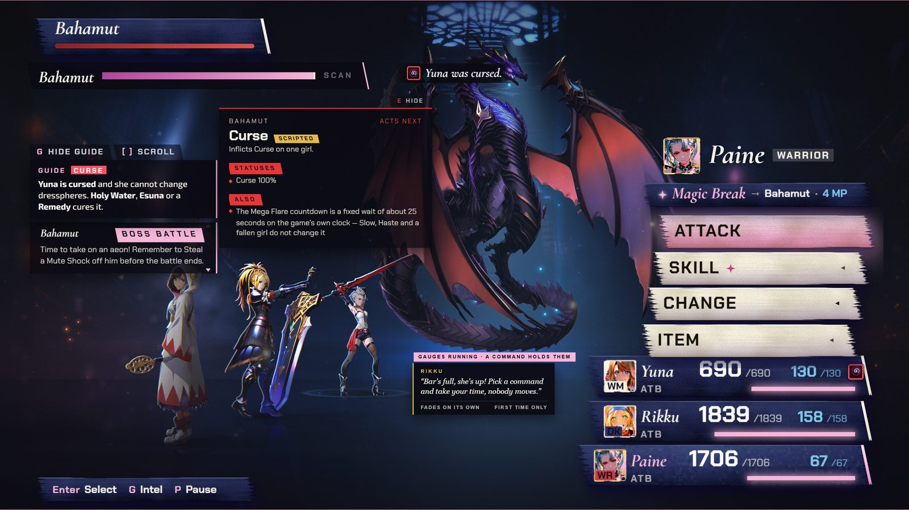

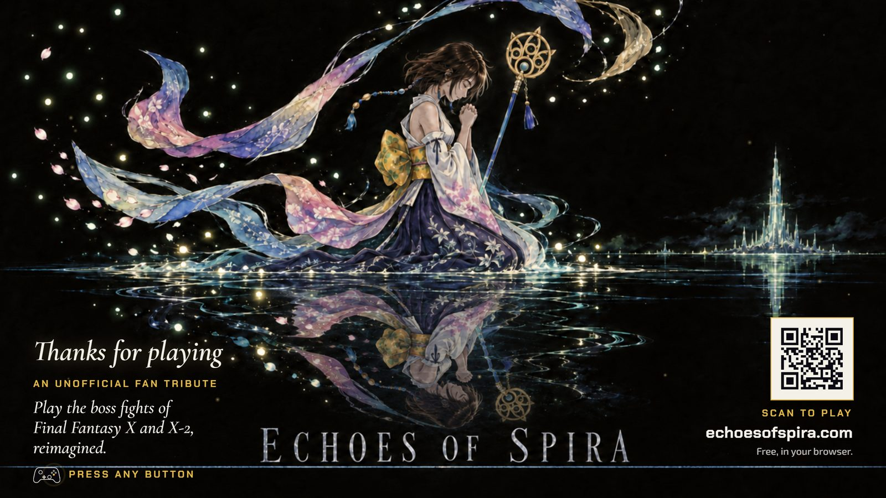

Every piece below acts in **Chapter I (`seymour-flux`, FFX) and Chapter IV (`ffx2-bahamut`, FFX-2) only**. Every other chapter, screen and the hidden doors play as release 62. Since release 62 the new pieces were behind `?pack=demo`; this release makes them the default in those two chapters (the first item).

- **Both games (Chapters I and IV): the pack is on with no word in the address (r64-defaults, items 200b and 200e).** **On a desktop screen only: a phone or a tablet opens with it off, so its battle screen is release 62's, PAUSE button and full command names included** (the first review of this build found the new HUD dropped PAUSE and cut the command names at 390 x 844; decided once when the page opens, so turning the phone never swaps the HUD mid-fight; `?pack=demo` still turns it on anywhere). `?pack=off` gives release 62's play back; each piece keeps its own off word (`?pro=off`, `?hud=today`, `?audio=today`, `?boss=today`, `?prebuild=off`, `?booth=today`, and the new `?partyswap=off`, `?retrytheme=off`). **The party's edge light is off by default** (it follows the pack; `?partyrim=on` brings it back, key `'` on the playtest board). The party's jointed rigs stay off (`?partyrigs=on` only). `tests/unit/r64-defaults.test.ts`, `r64-defaults-card.test.ts` (40 cases) and the 30 older files that pinned the old defaults.
- **Both games: motion (the motion pack, r63-play).** A physical attack has a wind-up, an arcing lunge and back, a slight squash and stretch, a recoil and a settle; casts lift the caster; a quick smear frame covers the swing (painting sets and rigs); the hit holds the screen for 3 to 4 frames on criticals, Overdrives and boss big attacks, the camera punches in 2 to 3 percent and settles, a gamepad rumbles lightly on the big moments, and the contact shadow follows the figure. Spells, hits and items get each game's own effect shapes with a painted finish. REDUCE MOTION turns off the shake, punch, freeze and rumble. Smooth at 120 Hz and above. FFX-2's rule that nothing new plays over an open command menu holds for all of it.
- **Both games: the battle HUD "F1 Brushed slab" (hud-f1, r63-play).** Less on screen and bigger text (28 px at 2560 x 1440 at the least), the screen steps back while someone acts, a boss ribbon, the acting hero's face and name over the command block, one cue line ("Magic Break -> Bahamut, 4 MP"), the four verbs and a faded fifth. Chapter I keeps its three-slot turn strip and Overdrive bars on the left (FFX); Chapter IV mirrors it to the right with ATB bars, a role chip and the pink accent (FFX-2). The strategy guide, advisor and Sensor card are behind Intel (G, or X on a pad). TEXT SIZE 115 and 130 turn it off. Gold serif damage numbers.
- **Both games: the sound pass (audio-pass, r63-play).** Layered hits (a base, a crack or body, a small accent per character), the base starting on its first audible sample, the music dipping just before a critical or a boss's big blow, a new menu sound family, spell sounds placed on the effect's marks, a new mix and limiter, results music (Chapter I's cue starts at the last blow; Chapter IV's win stays quiet, as the sources have no victory music after Bahamut). **FFX only: nine voiced lines in Chapter I's battle** (Tidus, Yuna and Auron); FFX-2 has no voiced battle line in the sources. Every pick is on `docs/audio/audition.html` for Bailey to overturn by ear; the agents cannot hear.
- **Both games: the pro look, camera and staging (r63-int).** The arena grade and the Chapter IV seam fix, "ink and light" hits with glass damage numbers, low-HP and KO marks, a directed camera on every action (FFX: the real game's shots; FFX-2: a follow camera; both with a soft background), the held breath for Total Annihilation (FFX) and Mega Flare (FFX-2), a full-painting boss card, a victory freeze frame, a defeat card with a quick retry. **FFX only:** the glove marker and the Overdrive opening, and the aeon's victory framing. **FFX-2 only:** the flower ring and the Change plate (the ribbon-spiral kept, now with a readable name plate). The frame-budget governor (perf-trim) trims the scene's supersample first, then the camera's soft background, then the particles, when a 120 Hz screen drops frames.
- **FFX (Seymour Flux) and FFX-2 (Bahamut): cleaner boss edges (boss-matte, r63-play).** 158 files re-cut to a clean cut-out with no pale rim; the boss is its own per-pixel mask in the look, its shadow sits under the footprint, and the boss card shows the clean figure. Mortiorchis (FFX) loses the screen-space rim but is not re-cut. The originals are archived in the private art repo (`archive/2026-10-23-boss-recut`, 158 files, every hash checked).
- **FFX (Yuna and Kimahri) and FFX-2 (Rikku in Dark Knight, Paine in Warrior): repainted poses (r64-art, items 200f and 200g).** Five poses each (20 paintings, 100 files with their 2x, 3x and 4x tiers and normal maps), locked to each figure's idle; the registration is re-measured and the five old art-pin tests follow it. Normal maps for the poses whose outline moved much are provisional ("map owed"). **Both games: the Echo title painting has a 2x master** (3364 x 1864; the 1x painting was stretched 1.5 times on a 2560 x 1440 screen), and the title, the end card and the attract card pick it on screens wider than 1682 px. The old paintings are in `D:/pyrefly-art-r64-replaced` and the private art repo (`archive/2026-10-24-2026-10-24-repaint-4-figures`); roll back by pointing `public/art` at `D:/pyrefly-art-r63`.
- **Both games: damage numbers never print over each other (r64-numbers).** Two glass numbers that start within 400 ms of each other and would overlap are kept apart in screen space (the later one moves, up first, then sideways, then down), sticky so nothing jumps. Measured in Chapter I's Total Annihilation: 176 overlapping frame-pairs before, 0 after. **FFX-2 only: Mega Flare's wash is held off while a command menu is on screen,** including a menu left standing by an answer that came over the HUD (a recorder, auto-battle); a menu answered by the player closes first and the breath plays in full. `tests/unit/number-spacing*.test.ts` (29), `pro-staging-ui.test.ts` (+1).
- **Both games: the fight is prepared behind the title and the picker (fight-prebuild, r63-play).** Each demo fight's figures are built and their programs compiled while the title or the picker is up, in steps that look at the pad first; the shared 84 MB backdrop master is uploaded once; a press stops the plan at its next step. Measured honestly: the first 9 s of a fight lose less frame time when the warm has finished (Chapter IV 691 to 475 ms), and at a human pace on the picker the warm is still the limit (a cold fight is release 62's fight). A race fix: a press that lands inside a figure's build keeps its demo chapter (5 of 13 before, 0 of 13 after).
- **Both games: the skeptic's fixes (r64-fixes).** (1) The picker's presses were swallowed when no frame ran inside a short tap: the pad is now read every 4 ms and a press is held for the next frame (7 of 256 timed presses swallowed before, 0 after); the warm's wait for a quiet pad is 150 ms with a 2 s budget. (2) **FFX only:** the party swap eases in the real game (the list renders twice; the arrival now resumes), `?partyswap=off`. (3) The retried fight's theme starts 0.2 to 0.35 s after the press (it was 1.9 s), `?retrytheme=off`. (4) The playtest label's pause class follows the `=` legend. Open: F5 (OTHER FIGHT from a lost fight takes 10 to 12 s, both builds), and `Input.ts`, `BattleScreenFlow.ts` and `demo.css` were over 400 lines before and still are.
- **Both games, demo mode only: the booth's screens (booth-screens, r64-defaults 200i).** The end card after a won fight, in the Echo painting's look, with "Press any button" at 28 px or more at 2560 x 1440: a press goes to the picker at once, and a card left alone for 8 s goes to the title. The attract card ("Pick up the controller", started by the title's 60 s idle count; a pad press wakes it on the very frame). A picker nobody touches for 60 s returns to the title. The press page (`public/press/`), the booth kit and its "Before visitors" checklist. `?booth=today` or `?pack=off` keeps release 62's cream thanks card and a picker that waits for ever.
- **Both games: the notice (r64-defaults 200h, driver call 201a).** "All code, art, music, and writing here are original." is gone from the credits notice, the README and the press page (a test holds the three equal). The README and `docs/ARCHITECTURE.md` no longer claim that the music is synthesised at runtime with no audio files, that nothing is ripped, or that everything is original; they say the project is an unofficial, non-commercial fan tribute, that Final Fantasy X and X-2 and their characters belong to Square Enix, and that the audio files, AI-generated voices and art, and third-party sources are listed with their licences on the Credits screen. Docs only.
- **FFX-2 only, driver call 201b (the review's m1): in Chapter IV, outside the booth path, the Intel slab no longer covers the active girl's name at the first menu.** The enemy-intent slab ("Curse ... ALSO ...") is placed by a list of boxes it avoids; the F1 HUD's hero header (`.f1-hero`) and cue (`.f1-cue`) were not on it, so it was drawn across "Paine WARRIOR" and brushed the cue (43,264 px squared at 2560 x 1440). They are on the list now (zero size, so skipped, when the F1 HUD is off or no menu is open); the slab lands to the left of Bahamut. Real run: 43,264 px squared before, 0 after (`docs/screenshots/r63-rc-intel-ch4-before.jpg`, `-after.jpg`). Chapter I has its own slab placement and had no overlap. `tests/unit/r63-rc-intel-hero.test.ts` (3).
- **Both games, demo mode with the booth screens on, driver call 201c (the review's m2): after the picker idles back to the title, the attract card is up at once.** The picker notes the idle return and the title that opens within 10 s starts its idle clock as already run out, so the card is not a second minute away. A visitor's Esc is not this (the title counts a minute from the press, as before). Real run: the title up at 258 ms, the card at 259 ms (`docs/screenshots/r63-rc-picker-idle-card.jpg`). `tests/unit/r63-rc-picker-idle-title.test.ts` (10).
- **Driver calls under items 200 and 201 that change nothing, recorded here:** B at the top of the command menu keeps today's behaviour (it opens the pause; the sources are silent, so it is left as it is); the party-swap ease (FFX) and the retry theme stay on by default (each has its off word); `?livingpre=on` (the room's dressing built behind the picker) stays off: the booth A/B pairs could not separate it from noise and two pages holding parked rooms crashed twice.
- **Both games, the player note for 63 (`src/app/changelog/releaseNotes.ts`, 6 lines, no hidden chapter named):** the whole new look on its own in Chapters I and IV (Both); wind-up, smear, held hits, gold numbers that never overlap, layered blows (Both); the music dip, the menu sounds, the fight prepared behind the title (Both); Chapter I's voices, Total Annihilation's held breath, the Overdrive opening, the cleaner Seymour Flux, Yuna's and Kimahri's repainted poses (FFX); Mega Flare's held breath, the Change plate, the follow camera, the cleaner Bahamut, Rikku's and Paine's repainted poses (FFX-2); the booth's end card, attract card and idle picker (Both). The newest-release pins (`release-notes.test.ts`, `deploy-release-gate.test.ts`) now read 63.

- **Checked on the assembled tree `r63-rc` (not a review; none has run):** `node node_modules/typescript/bin/tsc --noEmit` clean (exit 0); `node tools/orphans.mjs` lists 24 orphaned modules, the same 24 as before (none of the new files); `node tools/audio/qa.mjs --strict --quiet` exits 0; `node tools/candidate-build.mjs --dry-run` reads release 63; `node D:/Tools/promises/promises.mjs --release-check origin/main..r63-rc` (239 commits, 797 files): closes 0, names 0, touches 0, 26 built promises wait (the r395-int bundle of 19, four side-branch rows and the three r52-candidate rows, as before), 81 untouched. **The full unit suite** (`node node_modules/vitest/vitest.mjs run`, 1,649 files): the first run, on the merges plus 201a to 201c, had ONE red test, `number-spacing-layer.test.ts` "the old numbers are untouched", which pinned the old default (the pack, and so the glass numbers, is on by default in Chapter I now); it names the pro look's own off word (`setProMode('today')`) since commit `cb928dadb` (tests only, no source change). Two more full runs on that code each had only 15 s timeouts under load (another lane's Blender render held the machine): `advisor-floor` Mirror Aeons 15.2 s and 16.1 s, `advisor-menu` mirror-aeons 15.7 s, `tourist-trap-bench` 16.3 s, `demo-kit` "a process that is not there" 46.9 s; all five pass alone (4.5 s, 6.6 s, 6.1 s, 0.6 s). **A fourth full run with `--maxWorkers=8` on the final code (`cb928dadb`): exit 0, 1,623 files passed and 26 skipped, 25,802 tests passed, 112 skipped, 1 todo, 773 s.** The deploy preflight runs its own `npx vitest run`, so it is exposed to the same 15 s timeouts while a render holds the machine: stop the other lanes' renders first. The Playwright e2e specs were not run. Real-browser checks (headless GPU Chromium on a dev server): Chapter IV's first menu at 2560 x 1440 before and after 201b, and the picker's idle return at 1280 x 720 for 201c, 0 console errors in both.
- **Still open:** (1) the Playwright e2e specs were not run (r64-defaults m4): Chapters I and IV now play with the F1 HUD, the new camera and the sound pass by default in `tests/e2e/*` too, so a spec reading the old HUD's selectors there (`hud-collision`, `enemy-visibility`, `ffx2-wait-framing`, `advisor-*`, `sensor-immune-hidden`) may need `?pack=off` or the new selectors; (2) the sound pass's limiter chain is built on every page, Chapter II too (r64 review m7), not measured; (3) OTHER FIGHT from a lost fight takes 10 to 12 s to the first menu in both builds (r64-fixes F5: that fight's figures are not prebuilt); (4) `BattleScreenFlow.ts` (649 lines), `Input.ts`, `demo.css` and `DamageNumbers.ts` (912) were over the 400-line house rule before and still are; (5) Mega Flare's wash eases out over 260 ms when a menu opens mid-breath (r64-numbers question 1, not measured live); (6) the normal maps of the repainted poses whose outline moved much are provisional ("map owed", `r64-art.md`); (7) the real booth PC's own timings and a real pad's feel are still to be timed there.

## 2026-10-22 · Release 62 (r62), the last demo build for the conference: the Bevelle cathedral alive and a heavier Mega Flare (FFX-2), a gamepad's A or Start ends the opening sweep (both games), both demo fights prepared behind the title and the picker (both games), a demo win's results music (both games), the demo's controls card, thanks card with the QR code, TRY AGAIN and OTHER FIGHT after a loss, short voiced intro, Overdrive gauges at 50 and a reset that restores the settings (demo mode), Auron's first tip keyed by chapter (FFX), and the continuity review tool reading the candidate's own pose table (tooling)

Address: https://echoesofspira.com (main c8ecbcb31, bundle C9xPmvqR, live from 2026-10-22T12:53Z until Release 63 replaced it at 2026-10-25T06:52Z under Bailey's standing words "deploy every release as soon as its review says it can ship"; built from branch `r62-rc`, tip `c8ecbcb31`, assembled in `D:/pyrefly-rig-v2` from `origin/main` `3e520971e` (release 61, `660c19bbd`, plus its records) with two lanes merged, both branched from `660c19bbd`: `r62-fixes` (`7763b622f`: round 28's findings PR-0481 (parts 1 and 2), PR-0487, PR-0504 and PR-0512, the player note) and `r62-extra` (`4ea3e3ccb`: Bailey's picks of decision 173, 173a to 173d and 173f to 173i, handoff `docs/handoff/r62-extra.md`); the merges had no textual conflict. The focused review `critic/reviews/c8ecbcb31-focused.json` is SHIP with the changed area FAIL on the disclosed R62-01 (CHK-027 pose-swap jerks of 40 px or more, inherited and equal on live) and two polish items in new demo-only screens (R62-02 and R62-03); the live check `critic/reviews/c8ecbcb31-live.json` is PASS, 6,241 files byte for byte; the deep review it owes is still open.) Art: unchanged, `D:/pyrefly-art-r61`.

- **FFX-2 only (Chapter IV, wherever the HD-2D bold look is on), the Bevelle cathedral is alive (decision 173a; `engine/look/living/`):** pale dust drifts in the cyan skylight beam, the four lamps' flames flicker and throw moving light, and a hit sends a soft ring across the polished floor's reflection. It runs inside the HD-2D bold look, so VISUAL STYLE CLASSIC, `?look=off` and LOW EFFECTS take it away; REDUCE MOTION holds it still (the dust hangs, the lamps steady, no ring) and REDUCE FLASHES makes the flicker a third as deep. `lookq` medium and low drop the dust and the rings. `tests/unit/r62-living-cathedral.test.ts` (23 cases).
- **FFX-2 only, Mega Flare lands harder (173b; `engine/look/flare/`, `engine/MegaFlareImpact.ts`):** the beam's light floods the whole room in its own cold white-blue (the painted room's lit surfaces gain most, brightest at the blast, held a beat, then 1.7 s back to normal), the girls are lit by the same light (the relight point lights: Fire's orange at 1.2 before, the beam's colour at 2.1 over 2.4 times the reach), the camera shakes 0.4 for 1,300 ms (a form change, the loudest beat before, shakes 0.2 for 520 ms; measured on the camera in a recording of the real fight) and the frame whites out for about a third of a second. REDUCE FLASHES: no white-out and the flood capped at 35 percent over a 0.75 s ramp; REDUCE MOTION: no shake. The shake asks the game as well as the ability id, because FFX shares the id `mega-flare`. `tests/unit/r62-mega-flare.test.ts` (18 cases).
- **FFX only in effect, demo mode only: every party member of a demo fight starts with the Overdrive gauge at exactly 50 percent (173c; `app/demo/demoGauge.ts`).** Chapter I's own gauges (Tidus 50, Yuna 40, Kimahri 100, a sourced rule) are never written to; a demo sets all three to 50, as Bailey asked. FFX-2 has no Overdrive gauge (its engine says so, `battle/ffx2/triggers.ts`), so Chapter IV and the ATB gauge are untouched. `tests/unit/r62-demo-od-half.test.ts` (8 cases).
- **Both games, demo mode only: a 3-line controls card under the two picker cards (173d; `app/demo/demoControls.ts`).** The glyphs follow the device last touched; it replaces the strip under the cards in demo mode. Two words differ from Bailey's: NEXT for "gold" (the tip is gold in FFX and pink in FFX-2, so the line is in the card's accent) and "its art" for the Y key, which swaps the title's art only on the title. `tests/unit/r62-demo-controls.test.ts` (6 cases).
- **FFX only, demo mode only: Chapter I opens with a short voiced intro of about 10 seconds (173f; `app/demo/demoIntro.ts`).** Three lines of the real pre scene, word for word and in the recorded voices: Tidus, Yuna and Auron, then the Mortiorchis unfolds and the fight starts. It is the game's own `CutsceneScreen` on a trimmed script; A or Enter advances a line, holding it skips the rest. Once per fight picked from the picker (not on TRY AGAIN, not on RESTART ENCOUNTER, not for an automated run). Seymour has no recording and is left out; FFX-2's Bahamut has no recorded lines and keeps skipping its scene. `tests/unit/r62-demo-intro.test.ts` (14 cases).
- **Both games, demo mode only: a lost fight's panel offers TRY AGAIN and OTHER FIGHT (173g; `app/demo/demoDefeat.ts`).** TRY AGAIN is a new battle of the same chapter on the same demo seed (release 61 took the next seed); OTHER FIGHT starts the other demo fight at once and moves the picker's memory to it; Back (B or Esc) still goes to the picker. The defeat beat is the engine's own 1.1 s. `tests/unit/r62-demo-defeat.test.ts` (14 cases).
- **Both games, demo mode only: a "Thanks for playing" card with the QR code after a win (173h; `app/demo/demoThanks.ts`).** "Echoes of Spira, an unofficial fan tribute. Play it at echoesofspira.com"; it ends on any button after a 0.7 s guard, or by itself after 8 s, then the picker. Gold for FFX, pyre pink for FFX-2. `tests/unit/r62-demo-thanks.test.ts` (20 cases).
- **Both games, demo mode only: the hold-to-reset also restores the demo's default settings, and the Bahamut picker card is lifted (173i; `app/demo/demoReset.ts`, `demo.css`, `docs/BOOTH-SCRIPT.md`).** `SaveStore.reset()` is a fresh save, so every setting is `defaultSettings()` again (volumes 0.8 and 0.7, VISUAL STYLE HD-2D, TITLE ART The Echo, ATB Wait ...), in memory and on disk; nothing is pushed to the mixer before the reload, so a volume never jumps under a fading track. **A reset therefore also brings the game's own volume back: set the room's loudness with the headphones or Windows, not in OPTIONS.** The Bahamut card's lift is CSS on the picker's card only (the unselected card most), never the painting master (Bailey's pick of the PR-0505 mock, FFX-2's card). `tests/unit/r62-demo-card-lift.test.ts` (4 cases); `demo-mode`, `demo-flow` and `demo-reset` re-pinned to the new claims.
- **Both games (demo mode, `?demo=1`, and the one hidden experiment): a win reaches the results screen with its music (PR-0504, round 28's "demo wins play no music on the results screen").** A demo fight skips the story scene, so the battle screen was still up when the win's cue was asked for, and the screen's exit then stopped the cue. The cue is now asked for after the battle screen has gone: FFX Chapter I plays `victory-ffx`, FFX-2 Chapter IV plays the quiet `pause` cue (release 61's decision 168d, unchanged); a fight with a story scene after it, and a loss, ask when they did. `tests/unit/r62-demo-results-music.test.ts` (7 cases, 3 of them fail without the change).
- **FFX only, Auron's first-command tip is keyed by chapter (PR-0487).** Chapter I (`seymour-flux`) keeps "He strikes first. Weather it, then hit back." (Bailey's pick, decision 168c); the eight FFX chapters where the party moves first in every seed (Evrae, Natus, Omnis, Sin's fins, the Mirror Aeons, Sinspawn Gui, the Fayth, the Last Summoning) get "He moves after you. Not before. Use it." back; every other FFX chapter shows no line. FFX-2's Rikku lines are untouched. The engine counts that decide it are in `src/ui/coach/turnOrderLine.ts` and are re-run on 20 seeds by `tests/unit/r62-auron-turn-order-tip.test.ts`.
- **Both games, a gamepad's A or Start now ends the opening camera sweep, as Enter does (PR-0481 part 1; Bailey's "i need the demo done for the game conference by monday", the booth uses a pad).** The boss card already took a pad's A (the pad is read through `app/Input.ts`); the sweep after it ended on a key press only (`ui/common/transitions/confirmPress.ts` is a `keydown` listener), so a visitor on a pad sat out about 6.6 s. `BattleScreen.handleInput` now hands a pad's A or Start to the opening's watch (`app/screens/padOpeningSkip.ts`, `MomentOverlay.pressConfirm`): only a PAD press counts (`lastDevice`), the edge is taken so Start does not also open the pause (the card treats it the same way), and the keyboard path is unchanged. It is shared plumbing: normal play gets it too. `tests/unit/r62-pad-skips-opening.test.ts` (13 cases: a fake pad through the real `Input`, `MomentOverlay` and `playOpening`).
- **Both games, demo mode only: both fights are prepared behind the title and the picker (PR-0481 part 2).** Round 28 timed the picker's A press to the first command at 12 to 14 s with frames of 0.8 to 1.5 s. About 3.4 s of that was the battle loading under the entry's swirl; the rest is the authored opening. `app/demo/demoWarm.ts` now pays five costs before the press, one fight after the other, only while the title or the picker is on screen: the fight's paintings are preloaded in full, the scene is built and kept (`scenes/prebuilt.ts`; the battle takes it with `takeScene`, a fresh `loadScene` where none was built), its programs compile in the background and it is drawn once per program family into the composer's own buffer (never the canvas), and the depth plates' CPU half (0.65 s in one task right after the press) is cut ahead in separate tasks (`DepthPlates.precutPlates`, `PlateCut.ts`; the build takes the same arithmetic's result). `?demowarm=off` is the release 61 behaviour. Nothing about a fight differs: same scene, same art, same engine. Tests: `r62-demo-warm-stage.test.ts`, `r62-demo-warm.test.ts`, `r62-depth-plates-precut.test.ts` (a build that takes a cut made ahead gives byte-identical plates).
- **Measured on this tree (headless GPU Chromium at 2560x1440, `?demo=1`, a simulated standard pad that taps A, one cold page per run, the title left up 20 s so the warm has finished and the picker 3 s; release 62 on the dev server with the r61 art, release 61 as its production bundle `index-DwMQUoVh.js`; the machine was shared with other renders, so read the numbers as a range; the runs are in `D:/Tools/pyrefly-scratch/2026-10-22/r62/runs/`).** The picker's A press to the first command menu, with a pad tapping A on the card and in the sweep: **release 61 13.1 s (Chapter I) and 13.8 s (Chapter IV), worst frame gap 1.30 s and 1.18 s, four frames over 500 ms in each; release 62 5.2, 5.3 and 5.4 s (Chapter I, three runs, one with the CPU profiler on) and 5.5 and 5.8 s (Chapter IV, two runs), worst gap 0.40 to 0.58 s (Chapter I) and 0.47 and 0.50 s (Chapter IV), one frame over 500 ms in the five runs.** By cause (dev server): with the warm off and the pad skip on, 5.7 s and 6.0 s with worst gaps of 1.07 s and 0.77 s, so the pad skip is the 13 s to 6 s and the warm is the gaps and about 0.5 s; with nobody tapping (the authored card and sweep in full) the warm takes Chapter I from 13.1 s to 10.4 s and Chapter IV from 13.1 s to 11.2 s, and the worst gap from 1.10 s to 0.32 s and from 1.03 s to 0.38 s. The depth plates' 0.65 s task is gone from the first second (in the warm-only build before this step it was the worst frame, 0.65 s; the warm's log reads "depth plates cut ahead" for both fights). **What is left in the first 2.5 s, not moved:** the look's first-frame work (the room-light reading `LookRoom.findRoomLight` and the figures' extents `LookBold.extentsOf`, two getImageData tasks of 0.14 to 0.17 s), the battle's own texture uploads (about 0.4 s of `texSubImage2D`, spread over the first frames) and the entry swirl's capture (0.1 to 0.3 s); and, when nobody presses, the authored card and sweep (about 8 s).
- **Both games (tooling, no gameplay): the continuity review tool says which pose-measure table it read (PR-0512).** `--pose-measure`, else `--candidate-root`, else the tree it was started from; it reads the candidate's own table from the commit the title's build tag names, and makes CHK-026 UNVERIFIED with the reason, and leaves the chapter out of the run's totals, when the table is not the candidate's (round 28 read a 78-subject table against a 114-subject candidate and failed four chapters falsely). `tests/unit/r62-continuity-pose-table.test.ts`, with a real two-commit git repository.
- **Both games (a mock, PR-0505, built since as part of 173i): two pictures of the demo picker for Bailey.** Today's picker and the same page with the Bahamut card's art lifted (exposure on the backdrop and the figure, a violet glow, a gradient from the floor up) so it reads as well as Seymour's card, in `D:/Tools/pyrefly-scratch/2026-10-22/r62/for-bailey/`. Bailey picked the lifted card (173i), which this release builds as CSS on the card.
- **Both games, the player note for 62 (`src/app/changelog/releaseNotes.ts`, 3 lines, no hidden chapter named):** "A gamepad’s A or Start now ends the opening camera sweep before a fight, the way Enter does; the booth demo prepares both fights while you choose." (Both), "In Chapter IV the Bevelle cathedral comes alive (drifting dust, flickering lamps, ripples on the floor when someone is hit) and Mega Flare lands harder." (FFX-2), "Auron’s first tip now matches the fight: Chapter I keeps its warning, the chapters where your party moves first say so, and the others show none." (FFX). The demo-only items (173c to 173i, the demo win's music) are not player news and stay in this entry. The newest-release pins (`release-notes.test.ts`, `deploy-release-gate.test.ts`) read 62, and `node tools/candidate-build.mjs --dry-run` reads release 62.
- **Checked on the assembled tree `r62-rc` (not a review; none has run):** `node node_modules/typescript/bin/tsc --noEmit --singleThreaded` clean (exit 0); `node tools/orphans.mjs` lists 24 orphaned modules, none of them these lanes'; the 69 name-matched test files of the r62, r61, demo, release-notes, deploy-release, presenter-opening, look, results, candidate-build, battle-screen, critic-continuity and title-changelog groups pass (68 files, 1,027 tests, 2 skipped); the full unit suite ran once (1,562 files): 1,529 passed, 26 skipped and 7 failed (15 tests), every failure a timeout (15 s, one of 60 s) of a heavy advisor, bench or pause-stack test under the full suite's load on a shared machine, and all seven files pass when re-run alone (101 tests, 2 skipped); `node tools/candidate-build.mjs --dry-run` reads release 62. The merges of `r62-fixes` and `r62-extra` had no textual conflict (the two files both lanes touched, `app/demo/demoBoard.ts` and `app/screens/BattleScreenFlow.ts`, merged automatically by git and read through). Nothing was run in a browser on the merged tree: each lane's effects were checked in a browser on its own branch only.
- **Still open (round 28's other findings are not in this branch):** (1) a real pad's feel and the booth PC's own timings (this machine is not the booth's; the dev server is not a production bundle: the first press after a cold load on the candidate build still has to be timed there); (2) PR-0494 (fights run 5 to 7.5 minutes against the "2 to 3 minute" booth claim), PR-0506, PR-0507, PR-0508 and PR-0511 are untouched (PR-0509, the booth reset keeping the previous visitor's settings, is 173i; the Bahamut card lift that waited for Bailey's pick is 173i too); (3) the rigs and pose-swap findings (PR-0478, PR-0379, PR-0380, PR-0459) are another lane's; (4) 173c: FFX-2 has no Overdrive gauge to start at 50, so if Bailey meant the ATB gauge for Chapter IV that needs his word; (5) the intro's voiced lines are Tidus, Yuna and Auron only (Seymour, Kimahri, Lulu and Wakka have no recordings); (6) the lighting and Mega Flare effects were timed on the dev server in headless Chromium, not on the booth PC.

## 2026-10-21 · Release 61 (r61), the near-final conference demo build: The Echo as the title picture with a Title Art key (both games), a Visual Style option (both games), the booth flow in demo mode (two-card picker, hold-to-reset, attract loop, QR code), a gamepad pass (both games), Chapter I's wind, moon glitter and mist (FFX), lit boss figures (FFX Seymour Flux, FFX-2 Bahamut), Auron's corrected tip (FFX) and quieter Chapter IV results (FFX-2)

Address: https://echoesofspira.com (main 660c19bbd, bundle DwMQUoVh, live from 2026-10-21T20:04Z until Release 62 replaced it at 2026-10-22T12:53Z under Bailey's standing words "deploy every release as soon as its review says it can ship"; built from branch `r61-rc`, tip `660c19bbd`; it is `r61-repro` `07ccc0029` (live release 60 plus the build-parity fix) plus, in order and all with `--no-ff`: `r61-ux` `8d4906adc`, `r61-booth` `1a5b8af77` (one conflict, `BattleScreen.ts`), `r61-flow` `69513d948` (no textual conflict; the two lanes' "a win goes straight back" met here, see below), `r61-pad` `61040d213` (three conflicts, `App.ts`, `PauseScreenPanels.ts`, `titleInfoHtml.ts`, resolved as the `r61-pad-int` trial `ec7921a73` did), `r61-rigs` `a08267bf8` (one conflict, `docs/CONTRACT-CHANGES.md`), `r61-gagazet` `677741175` (clean). The deep review of the candidate before the deploy, round 28 (`critic/rounds/round-28.json`, the save-data class), is SHIP with the changed area FAIL and discloses PR-0478, PR-0380, PR-0379, PR-0459, PR-0504, PR-0481, PR-0148, PR-0099, PR-0295, PR-0461 and PR-0460; the deployed bundle equals the candidate's (the build-parity fix works); the live check was started and stopped by the account switch, so the live, focused and deep obligations stay open in `critic/pending/660c19bbd.json`.) Art: `D:/pyrefly-art-r61` (r60 plus the two new boss rigs with their lighting pieces and the Valefor and Ifrit rigs; `node tools/rig-gate.mjs --verify` passes for all six rigs against it).

- **Both games, the title opens on The Echo, and T (a click, a tap, or the pad's Y) switches to the Farplane painting (Bailey's picks, decision 168, 168a "A key in the bottom row"; branch `r61-ux`).** A player who never chose gets The Echo; a player who chose keeps the pick, the Gullwings painting included. The switch cross-fades in about 300 ms and is saved. SAVE-DATA CLASS, additive, no version bump: `Settings` gains `titleArtPicked` and `visualStyle`, each migrated in `SaveData.migrate` (`saveFrontend.ts`, new `saveVisualStyle.ts`), and every release's real save fixture loads unchanged.
- **Both games, OPTIONS has a VISUAL STYLE row: HD-2D (release 60's look in Chapters I and IV, the default) or CLASSIC (no look anywhere, as `?look=off`; a `?look=` address still wins) (168b).**
- **FFX only, Auron's first-run tip in the first command menu now reads "He strikes first. Weather it, then hit back." (168c).** The old line was wrong in about 88 percent of seeds. Only that line changes.
- **FFX-2 only, Chapter IV's results are quieter (168d; research/ffx-vs-ffx2-presentation.md section 2.2):** the win plays the sparse cue `pause` instead of `victory-bahamut`, and Rikku's face tile is the head of her Dark Knight painting (closed mouth) instead of her grinning portrait. One table (`ui/common/quietResults.ts`); going back is deleting its entry. Nobody here heard the cue (hard rule 13).
- **Both games, demo mode only (`?demo=1`; decision 169, "i need the demo done for the game conference by monday"; branches `r61-flow` and `r61-booth`):** Start on the title leads to a two-card picker (Seymour Flux, Chapter I, FFX; Bahamut, Chapter IV, FFX-2) and straight into the fight (no party prep, no story scene before or after); holding Home, or Select + Start on a pad, for 1.5 s resets to the title for the next visitor (the save keeps its settings, loses the run); the HUD is the command menu, the HP/MP plates and the advisor's one-row tip, with the guide and enemy-move panels folded; 60 s idle on the title starts a self-playing reel of the real game (Seymour, then Bahamut to the Mega Flare) that any input ends; a QR code to echoesofspira.com sits on the title and the picker, with a printable card (`docs/booth/qr-card.png`, `.pdf`); no teaching cards are shown. Without `?demo=1` none of it runs.
- **Both games, "a win goes straight back" was built twice, by `r61-booth` and `r61-flow`; the merge keeps one: r61-flow's.** A demo fight runs with `skipPrep` and `skipCutscenes` (`app/demo/demoFlow.ts`), the results panel is the last thing, and the picker opens with its cursor on the other fight after any fight (`demoBoard.ts`). r61-booth's version (`quickBack` in `BattleScreenFlow.ts`, `noteDemoWin` and `takeDemoBoardFocus` in `demoMode.ts`, the hook in `boardFocus.ts`) is removed and its three failing tests in `r61-booth-demo-polish.test.ts` now pin the kept behaviour. Reason: r61-flow's covers the picker, a retry and a backed-out fight, and skips the story before the fight too (decision 169's "straight into the fight"); r61-booth's skipped only the story after the panel and moved the cursor only after a win.
- **Both games, Esc closes a first-use card before it pauses, and the pad's B the same (the live release 60 check; `r61-booth`).** Before, one Esc did both.
- **Both games, the battle-start stall (PR-0481, PR-0495; `r61-booth`, `docs/handoff/r61-booth.md`):** the browser's staged-upload probe and the spell atlas are paid behind party prep, the field's first draw is sliced one program family at a time, optional GPU readbacks wait for the GPU (`engine/GpuSettle.ts`), and music cues go first on a slow line.
- **Both games, a gamepad pass (Bailey's decision 169f; branch `r61-pad`, `docs/handoff/r61-pad.md`):** one pad table (`app/padMap.ts`) and one "which input did the player use last" fact (`app/inputDevice.ts`); a stick points a menu one way at a time; every key hint draws its pad button in the pad's own names (A B X Y LB RB LT RT, the PlayStation symbols, the Switch letters), switching on the press. FFX only: the enemy-move slab moves from Back (the booth's reset chord) to R3, and L3 folds the enemy plate. The hint strips are sized for a 1440p monitor. Not judged by hand: a real pad's feel (simulated pad only).
- **FFX only (Chapter I) for the recipe, both games for the plumbing: Chapter I's stage inside HD-2D bold (decision 169m, "Add depth and life"; branch `r61-gagazet`, `docs/handoff/r61-gagazet.md`):** one wind for the room's weather (gusts that speed the snow and thicken the mist and brighten the moon's shafts), the moon's glitter on the ice that slides with the camera, two low mist banks, and the shafts start at the painted moon. LOW EFFECTS takes the glitter away; `?stage=off` is the release 60 look; CLASSIC takes all of it away.
- **FFX only (Seymour Flux) and FFX-2 only (Bahamut), and the Valefor and Ifrit aeon rigs for both games: the rigged figures are lit by the HD-2D look, their head size is held (FOC60-01) and a pose swap cross-fades in 40 ms instead of 110 (PR-0478) (branch `r61-rigs`, `docs/handoff/r61-rigs.md`).** Every rig part and variant carries a normal piece (rig format v2.2, `docs/CONTRACT-CHANGES.md`), so the key light, the rim and the spell lights that reach the party reach the boss; the new boss rigs hold the head to within 0.7 percent between poses (0 of 30 key changes fail on both). Lulu's rig and Pterya have no lighting pieces (the gate refuses Lulu's old stamp; Pterya has no maps).
- **Both games, the player note for 61 (`src/app/changelog/releaseNotes.ts`, 5 lines, no hidden chapter named):** "The title screen opens on The Echo, and T (or Y on a pad) switches to the Farplane painting; your choice is kept." (Both), "OPTIONS has a Visual Style row: HD-2D for the new look in Chapters I and IV, or Classic for the plain paintings." (Both), "Gamepad play is smoother: menus step one way at a time, and the key hints show your own pad’s buttons." (Both), "Chapter I’s mountain has gusts of wind, moonlight glittering on the ice and low mist; Seymour Flux is lit by the room, and Auron’s first tip is corrected." (FFX), "Bahamut is lit by the room too, and the results after his fight are calmer." (FFX-2).
- **Both games (tooling and docs, no shipped change): the demo kit (`tools/demo-kit`, `docs/DEMO-KIT.md`, `docs/BOOTH-SCRIPT.md`: an offline copy of the live site, a loopback server, a kiosk launcher with stop and a fresh-visitor reset) and the QR card tool (`tools/demo-qr-card.mjs`).**
- **Checked on the tree `r61-rc` (not a review; none has run):** `node node_modules/typescript/bin/tsc --noEmit -p .` clean; the full unit suite, **1,546 files: 1,518 passed, 26 skipped, 2 failed; 24,270 tests passed, 112 skipped, 1 todo, 3 failed**, the three failures being the 15-second load timeouts of the statistical files `advisor-floor` (Mirror Aeons, Yojimbo) and `chapters/tourist-trap-bench`, which pass alone with the timeout raised (23 and 9 tests; `advisor-menu` and a third `advisor-floor` row did the same in the first full run, so these three files are the flaky ones and nothing else); the three goldens pass (`ffx-engine-golden` 18, `ffx2-atb-golden` 6, `ff7-golden` 3); `node tools/orphans.mjs` 1,967 modules, 24 orphaned, the same 24 as release 60, none of them new; no new source file is over 400 lines (two new test files, `demo-attract.test.ts` 420 and `demo-kit.test.ts` 417, are over it, as 114 older test files are); no file under `src/battle/` or `BattlePresenter*.ts` changed in any lane (layering unchanged); `node tools/rig-gate.mjs --verify` passes for all six rigs (Bahamut, Ifrit, Lulu, Pterya, Seymour Flux, Valefor) against `D:/pyrefly-art-r61`; `node tools/candidate-build.mjs --dry-run` reads release 61 and shows the candidate's and the deploy's build inputs equal (base `/`, release 61, art WebP exact, thumbnails on). The first full run found 12 test files red that no lane's own run had caught: nine pinned words or markup the lanes changed on purpose (Chapter IV's results cue, the key-plus-pad-button chips, the CONTROLS row `H / Y`, Lady Luck's `PRESS A`, the booth's reset ring above the pause's z-index) and now pin the merged build's; see the commit `f1069d501`.
- **Real-input smoke on the candidate build (candidate built by `candidate-build.mjs`'s own environment and checks, served by `candidate-build.mjs --serve`, headless GPU Chromium at 2560x1440, a simulated standard gamepad plus the keyboard, one fresh profile per session; pictures in `docs/screenshots/r61-rc/`):** `?demo=1` title on The Echo with the QR plate (60 fps), T to the Farplane painting and back; Start by pad to the two-card picker (60 fps); Seymour Flux: the first command menu 31 s after the first press on a cold page (stage on: wind, glitter, mist; HD-2D bold; the rig `seymour-flux-body` "lit"), the first Attack opened its cursor on Seymour Flux and hit for 732, then the game's own `intended` line played by pad to the win (51 turns, 0 errors, 11:54), results to the picker in 0.2 s with the cursor on Bahamut; Bahamut: the first menu 14 s later (rigs `ffx2-bahamut`, `ifrit`, `valefor`, `seymour-flux-body` all "lit"), the win by pad (4:55, Mega Flare countdown banners, Rikku's calm face tile), back to the picker with the cursor on Seymour Flux; hold Home 1.7 s: the ring shows "HOLD TO RESTART" and the page comes back on the title in demo mode with the run gone (`chapters` empty) and the settings kept; 60 s idle on the title starts the reel (Seymour), no save write, a key wakes it to the title in 0.23 s and the title stays the title; OPTIONS > VISUAL STYLE flipped to CLASSIC by pad (saved), and after a reload Chapter I has no look and no stage (the rig stays, unlit); a non-demo run of Chapter II (no `?demo`): no QR, the full board of 19 chapters, Auron's briefing, party prep, the story scene, the first menu with the first-use guide card carrying the new Auron line, Esc closes the card without pausing, Attack opened its cursor on Yunalesca; **0 console errors and 0 failed requests (no 404) in either session.** Not run: a real pad in a hand; the Chapter IV `pause` cue by ear (hard rule 13: the cue is pinned by `r61-quiet-results.test.ts`, `results-music.test.ts` and `audio-cue-reachability.test.ts`); the Home hold during a fight or the pause (the unit tests and the picker run cover the key).
- **Still open:** (1) a real gamepad's feel, the analog trigger thresholds and a pad off the standard mapping (`docs/handoff/r61-pad.md`); (2) Lulu's rig has no lighting pieces (the current gate refuses her old stamp) and Pterya has none (no maps), and a rig's normal pieces do not turn with its bones (`docs/handoff/r61-rigs.md`); (3) the Sphere Grid's two pad-named buttons relabel when the pad is first used but not when a pad of another make replaces it in the same session (rare, cosmetic); (4) in Chapter IV's results the big picture on the right is still Yuna's smiling one: only Rikku's tile and the cue were made quieter (decision 168d's scope); (5) the first fight after a cold load of the candidate build took 31 s to its first menu (14 s for the second), the stall work of `r61-booth` is part 1 (`docs/handoff/r61-booth.md`); (6) `public/art` of the release tree must point at `D:/pyrefly-art-r61` (not r59 or r60) before the build, and the bundle name depends on the build commit (the build sha is inside it) as well as the art, so the candidate and the deploy must be built from the same commit with the same art.

## 2026-10-20 · Release 60 (r60), the conference demo build: the HD-2D look on by default in Chapters I and IV (FFX Chapter I, FFX-2 Chapter IV), smoother blends, breathing and hit feel, Bahamut (FFX-2) and Seymour Flux (FFX) as jointed figures, a demo mode that opens Chapter I with the party (FFX), a fix for a girl's skill hitting a girl (FFX-2), and the foe cursor on the original's first foe (FFX)

Address: https://echoesofspira.com (main 1cea6e937, bundle DwCdr0nf, live from 2026-10-20T21:06Z until Release 61 replaced it at 2026-10-21T20:04Z under Bailey's standing words "deploy every release as soon as its review says it can ship"; built from branch `r60-rc` (tip `bc943ac41`; it is `r59-rc` `6db09ac86` plus, in order and all with `--no-ff`: `demo-motion` `c9f4df395`, `rig-demo-bosses` `791f080a9`, `re-parity-x2-retarget-fix` `4c389df7f`, `r59-fixes` `0befa7935` (one conflict, `docs/CONTRACT-CHANGES.md`: both entries kept, newest first) and `demo-look` `ab9ebc0ff` as the integration branch `demo-int` (`8ce7feabc`), then `demo-look` `9a5bef47b` (the final bold pass), the defaults and the two hit fixes (`aced916e7`), demo mode (`7c5d54343`), the records, and `origin/re-parity-r60-t3b` `1bfbe7768`), then `origin/r60-art` `1cea6e937` (the lighting maps: the manifest's `lightMaps`, `tools/art-mirror-add-maps.mjs` and the art mirror `D:/pyrefly-art-r60`); the focused review `critic/reviews/1cea6e937-focused.json` is SHIP with the changed area FAIL on the disclosed FOC60-01 (the head-size gate on the two new boss rigs, inside brand-new features) but it did not settle the focused obligation, because its candidate bundle (`index-CXbIrsG6`) differs from the deployed one (`DwCdr0nf`): the candidate build had lacked the deploy's base path, found after the deploy and fixed in `r61-repro`; the live check `critic/reviews/1cea6e937-live.json` is PASS, 6,160 files byte for byte; the deep review of the live build, round 27 (`critic/rounds/round-27.json`), is SHIP with the changed area FAIL and discloses PR-0478, PR-0459, PR-0380, PR-0379, PR-0460, PR-0148, PR-0099, PR-0295 and PR-0461). Bailey's words behind it, 2026-10-20 about 11:00 EDT, on the morning package: the look "HD-2D bold (Recommended)", the boss rigs "Yes, both (Recommended)", the demo opening "Demo mode: party moves first (Recommended)"; before them, 2026-10-19, "I need a way to quickly improve the graphical fidelity of the game as well as the motion, animation, visual style. I demo my game in a week at a huge gaming conference." (2026-10-26), and the standing "deploy every release as soon as its review says it can ship". Driver decisions 150 to 158. Every paragraph below says FFX only, FFX-2 only or both.

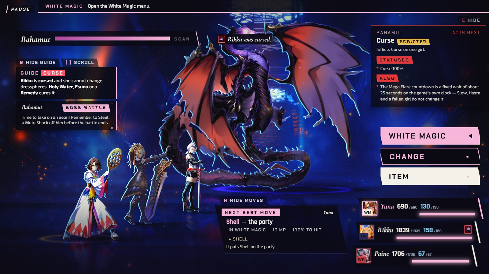

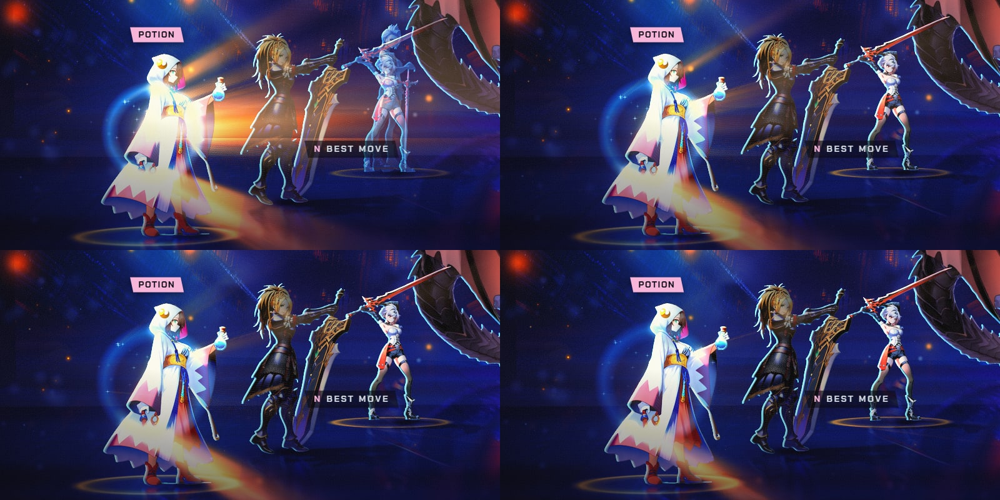

- FFX-2 (bug fix): a girl's skill aimed at a foe who falls before it lands now re-aims at another foe, or does nothing if no foe is left, as the original does. Before, it could hit one of the girls: after Bahamut fell, Paine's Armor Break could hit Yuna, and in Leblanc's fight it happened in about two-thirds of battles. A skill aimed at a fallen ally likewise re-aims at another ally. No fight's outcome changes. *(The case is FFX-2 only: `src/battle/ffx2/targeting.ts`, branch `re-parity-x2-retarget-fix` `4c389df7f`, from the RE session; `ffx2-atb-golden` carries the re-pin, Chapter IV D = 0 seeds 2, 3, 4, 6, 7, 14, 16 and 19; `ffx-engine-golden` and `ff7-golden` are untouched.)*
- **FFX (and FFX-2 for one chapter), the move advisor follows the chapter's own line (branch `r59-fixes` `0befa7935`, decision 145):** in FFX Chapter XIV and the Mirror Aeons card the advisor's card now follows the chapter's own tactic, names the aeon of a Grand Summon ("Grand Summon: Shiva") and reads it through the engine, as FFX-2's Trema's card does; Chapter XIV wins 35 of 40 engine seeds following the card where it won 13. A 40-seed sweep of every chapter found no other card clearly behind its line, and 160 listed-chapter and 90 hidden-chapter runs replayed with the new code are identical to the old. Also in this branch (both games, review tooling, no visible change): the continuity harness judges a rig key that brings in another head (Lulu's front view) by the head the player sees.
- **Both games, the HD-2D look is ON by default in Chapter I (FFX, `seymour-flux`, Gagazet) and Chapter IV (FFX-2, `ffx2-bahamut`, the Bevelle underground), and only there (Bailey's pick, decision 157a; the looks lane's `demo-look` through `9a5bef47b`).** At bold strength: a tilt-shift backdrop with the fighters kept sharp (the blur skips every actor's box, so a boss whose alpha a hit raised no longer blurs), light shafts from the room's own light, glowing motes, a per-room grade (Chapter I's blues pulled toward cyan so the ice stays luminous; Chapter IV's shadows violet, its lamps amber), a normal-map light on the painted figures with a rim from behind and coloured pools of light under a spell, a contact shadow under every figure, the floor reflection where the floor is glossy (Chapter IV) and embers over its four lamps. **How it is gated:** `src/engine/look/LookConfig.ts#CHAPTER_LOOKS` names the two chapters by id (three other chapters borrow those two paintings as placeholders and are NOT authored for the look, so the rooms are not the key); `applyChapterLook(chapter.id)` runs in `BattleScreen` before the figures load and turns it on for those two chapters and off for every other; with no `look` key in the address and nothing set by hand (`lookState.auto`). `?look=off` is off everywhere and any `?look=` (for example `?look=hd2d&lookstrength=bold`) is the address's word in every chapter; F6, F7 and F8 stay armed only by a `look` key. A chapter without the default has no armed flag, so no relight define is compiled and nothing is built: checked in the real game, Chapter II draws as it did (no look, no relight bound, no pass). Frame cost on the RTX 5070 Ti (the looks lane's numbers): about 1.2 ms (Chapter I) and 1.6 ms (Chapter IV) at 1600x900 and 3.2 and 3.4 ms at 2560x1440, against 0.7 to 1.5 ms today, locked at 60 fps. **The battle-start cost, measured in the real game (headless GPU, one sample each, `D:/Tools/pyrefly-scratch/2026-10-20/r60/tools/hitch.mjs`):** with the look on by default Chapter I's battle start has one frame gap of about 1.1 s (none with `?look=off`), the look's programs and room set-up in the first frame drawn under the battle entry; `Renderer.prepareLook` (new, called by `BattleScreen` before the shader warm-up; `LookRig.prepare`, `LookBold.prepare`; the warm-up now compiles each pass once instead of the chain once, `BattleScreenWarmup.ts`) builds the look's passes ahead of it so they compile while the figures load, which brought the gap to about 0.8 s in Chapter I and to none above 70 ms in Chapter IV. It is not gone. **The art it needs:** the figures' light and the backdrops' depth fog read the maps lane's PNGs (`<painting>.normal.png`, `@2x`, `backdrops/<room>.depth.png`, `D:/pyrefly-art-maps`); the art mirror `D:/pyrefly-art-demo` does NOT contain them, so a build made from it alone plays the look with unlit figures and the height fog and logs a 404 for each missing map (see "Still open").
- **Both games, the demo motion is ON by default (decisions 150 and 153a; branch `demo-motion` `c9f4df395`):** `?motion=off` (or `?motion=classic`) turns it off; where there is no page (the unit tests) it is off, so every test that pins today's numbers still does. Four parts: the pose blend is chosen from how well two paintings overlap (a cosine-eased capped cross-fade, 120 to 150 ms; the lesser painting never shows more than 0.382; measured in the real game, p90 double-image severity down about 22 percent and swap jerks 22 to 13 in Chapter I, 21 to 15 in Chapter IV); a figure breathes on a 3 to 4 s period of its own (a squash of 0.6 to 1.2 percent about the feet and a slight sway, phases dealt by the golden ratio so a party never breathes in step; today's squash measures 0.00 percent); the rig cross-fade (format v2.1, `fadeMs`) hides the pop of a part changing its image at half the move; and the hit feel grows with the blow (a stop of 50 to 80 ms on a strong blow and 100 to 150 ms on a finisher, a camera shake that grows with it, a 0.08 s white flash; the stop holds the presentation's field clock only, so the engine, the RNG and the ATB pump never see it). **Two fixes made for the default (found by the lane that built it):** (a) an ordinary hit holds at least what the shipped game holds on its first light hit, FFX 40 ms and FFX-2 28 ms (`SPECTACLE_TUNING.freezeLightMs`; the demo's own 17 to 30 ms made an ordinary hit feel lighter than today's), proved over the whole range of power in `demo-hit.test.ts`; (b) the white flash no longer stacks with option C's impact bloom into a white blob on a big boss: it is scaled by the struck figure's plane area (full strength to 3.5 world units squared, 0.4 from 9; measured in the real fights: Tidus 2.6, Yuna 2.1, Kimahri 3.7, Mortiorchis 16, Bahamut 17, Seymour Flux 23), and **REDUCE FLASHES skips it altogether** (the ACCESSIBILITY row; `ctx.moments.reducedFlashes`).
- **FFX-2 only, Bahamut is drawn as a jointed figure; FFX only, Seymour Flux is drawn as one (Bailey's pick, decision 157b; branch `rig-demo-bosses` `791f080a9`, `docs/handoff/rig-demo-bosses.md`):** Chapter IV's Bahamut (art id `ffx2-bahamut`, FFX-2 only: the FFX aeon Bahamut is another art id) is 5 parts on 22 bones with 6 keys; Chapter I's Seymour Flux (`seymour-flux-body`, FFX only) is 6 parts on 12 bones with 6 keys; each key's parts are cut from that pose's own painting, so a pose change moves one figure and the head keeps its size (Bahamut's KO box changes by 0.1 percent where the painting set's widens by 7.9 and jumps 142 px). Mortiorchis stays painted (its five paintings share no anatomy). Both are in the art mirror `D:/pyrefly-art-demo` (5,808 files, 5,541 hard-linked from release 59's, 266 rig files copied; manifest `rigs`: ffx2-bahamut, ifrit, lulu, pterya, seymour-flux-body, valefor), and `node tools/rig-gate.mjs --rig D:/pyrefly-art-demo/rigs/<name> --verify --art D:/pyrefly-art-demo` passes for all six: ffx2-bahamut "stamp ok (6 key(s), full coverage, 1 exempt), 1x tier proved (60 file(s))", ifrit "(6 key(s), full coverage), 1x tier proved (14 file(s))", lulu "(13 key(s), full coverage), 1x tier proved (22 file(s))", pterya "(6 key(s), full coverage), 1x tier proved (16 file(s))", seymour-flux-body "(6 key(s), full coverage), 1x tier proved (72 file(s))", valefor "(6 key(s), full coverage), 1x tier proved (16 file(s))". Checked in the real game (`__pyrefly.rigs()`): `ffx2-bahamut` "gate ok, 5 parts, 22 bones, 6 keys, 1x maps" on in Chapter IV, `seymour-flux-body` "gate ok, 6 parts" on in Chapter I, nothing else rigged in either, 0 console errors and 0 404s in both runs (the first Chapter IV run, with the girls' gunner dresssphere on screen, logged eight 404s for the missing `yuna-gunner` maps).
- **FFX only (Chapter I) and FFX-2 only (Chapter IV), demo mode: `?demo=1` (decision 157c; `src/app/demoMode.ts`, `docs/DEV.md` "The conference demo build's switches").** Opt-in, kept in the tab's `sessionStorage` so a reload keeps it (`?demo=0` clears it); off everywhere else. It changes ONE thing: which seed a fresh attempt of a demo chapter fights on, so the game's rules, engines and numbers are untouched. **Chapter I (FFX): the party acts first.** A fresh attempt takes the next of seeds **7, 10 and 12** (the RE audit's), a retry inside the run takes the one after (instead of `+ 1000`). Each is proved on the FFX engine in `tests/unit/demo-mode.test.ts`: the party's first command menu is Tidus's, after three log events (two sensors and his turn-start), with no enemy action, damage, status or KO before it, everyone alive; the shipped line then wins all three, and seed 7 loses no one in the whole fight (seed 10 loses Kimahri and seed 12 Yuna later). The audit is not vacuous: of seeds 1 to 6, 8 and 9 six or more open with an enemy act before the first menu. **Chapter IV (FFX-2): a clean win in about two minutes.** Seed **56**, picked on the engine at Wait over seeds 1 to 60 with the shipped line: all sixty win and none loses a girl, and 56 is the fastest (98.1 s of engine time, so with the menus a person at Wait lands in a two-to-three-minute slot) with the third-lowest damage taken (5,466), one Mega Flare in it. A seed the caller names or pins (`setSeed`) still wins; without `?demo=1` the draw and the retry's `+ 1000` are exactly what they were (tested). **Seen in the real game** (`?demo=1` and nothing else in the address, real keys): Chapter I on seed 7 opens on Tidus's menu with the log `sensor, sensor, turn-start`; Chapter IV is on seed 56 (`battleState().seed`); without `?demo=1` Chapter I draws a random seed (1,977,092,190) and the enemy acts before the first menu.
- **FFX only, the first attack in a fight with several enemies now opens its cursor on the enemy the original game opens on (for example Seymour, not his mount, in Chapter I), as measured in the real game.** *(Branch `re-parity-r60-t3b` `1bfbe7768`, decision 158, "measure first", measured live in RE session 8: `cursorStartFoe` is ON in `src/battle/ffx/target-step-parity.ts`; the arrows still step in on-screen order. `parity-ffx-shipped-switches`, `ui-ffx-shipped-switches` (a new real-key test) and `ui-ffx-doublecast-hud` are re-pinned; the goldens are untouched.)* **Seen in the real game on this build:** Tidus's first Attack opens with the cursor on Seymour Flux (`targeting().selectedIds` = `['seymour-flux']`, the HUD reads "TARGET Seymour Flux"), and the blow lands on him (732), not on Mortiorchis (`docs/screenshots/r60/ch1-first-attack-cursor-opens-on-seymour-flux-1600x900.jpg`).
- **Both games, the player note for 60 (`src/app/changelog/releaseNotes.ts`, 5 lines, no hidden chapter named):** "Chapter I has a new look: a soft backdrop with shafts of light and drifting motes, and fighters lit and grounded by the room." (FFX), "Chapter IV has the same look, with a gleaming floor that reflects the fighters and embers rising from the lamps." (FFX-2), "Poses blend more smoothly, figures breathe while they wait, and every hit holds and shakes the harder it lands." (Both), "Bahamut is now drawn as a jointed figure, and a skill aimed at a foe who falls first now picks another foe, never one of the girls." (FFX-2) and "Seymour Flux is now drawn as a jointed figure, and in Chapter XIV the move advisor follows the chapter’s own plan." (FFX). The newest-release pins moved to 60 (`release-notes` and `deploy-release-gate` tests; the deploy takes `--release=60`; `node tools/candidate-build.mjs --dry-run` reads "release 60 (the newest player note)").
- **Checked on the tree `r60-rc` (not a review; none has run):** `node node_modules/typescript/bin/tsc --noEmit` clean (exit 0, before and after the t3b merge); the three goldens pass (**3 files, 27 tests**: FFX engine 18, FFX-2 ATB 6, FF7 3; `ffx2-atb-golden` carries the retarget re-pin, as expected); the full vitest run on the merged tree (with the foe-cursor merge in, before the pre-warm commit below): **1,494 files passed and 26 skipped of 1,520; 23,863 tests passed, 112 skipped, 1 todo; 0 failed and no 15 s load timeout** (1,106 s); after the pre-warm commit the 34 test files that import the changed modules (renderer, look rig, battle screen, warm-up) were run again: 34 files, 512 tests, all pass; `node tools/orphans.mjs` 1,940 modules, 24 orphaned (the same 24 as release 59; `demoMode.ts` is imported by `runSeed.ts`); all 78 files this release adds under `src/`, `tests/` and `tools/` are under 400 lines (`BattleScreen.ts` and `BattleScreenFlow.ts`, over 400 before, grew by 2 and 1 lines); layering holds (`src/battle/**` changed only by the retarget fix and the foe-cursor switch, both pure; no DOM or `three` in `src/battle/**` or `BattlePresenter*.ts`; `DemoHit*.ts` and `DemoMotion.ts` import neither); `node tools/rig-gate.mjs --verify` PASS for all six rigs on `D:/pyrefly-art-demo` (above); the real-game checks above with the dev server serving `/art/*` from `D:/pyrefly-art-demo` and the maps from `D:/pyrefly-art-maps` (scratch: `D:/Tools/pyrefly-scratch/2026-10-20/r60/`). The switches checked in the real game: `?look=off&motion=off` gives look null, motion off, no relight bound and a random seed; Chapter II with no flag gives no look, motion on, nothing bound.
- **Still open:** (1) **The maps are in a new art mirror, `D:/pyrefly-art-r60` (branch `r60-art`, `docs/handoff/r60-art-maps.md`): 200 base normal maps of the 19 figures of Chapters I and IV and the two backdrop depth maps, +82.05 MB shipped, the manifest lists them so no figure asks for a map it lacks; the release must point `public/art` at it.** Until it does, `D:/pyrefly-art-demo` has no `.normal.png` or `.depth.png`, so a release built from it alone shows the look without the light on the figures or the depth fog, and logs one 404 per missing map (a figure the maps lane did not cover, such as the gunner dresssphere, logs one per pose even when the maps are shipped). The fix is an art step, not code: merge `D:/pyrefly-art-maps` into the release's art folder (and list the covered subjects in the manifest so an uncovered figure stops asking). (1b) **A 0.8 s frame gap at the start of Chapter I's battle remains with the look on** (above); the figures' relight program variant and the room's set-up (the light finder, the LUT, the depth map) are what is left; whether it is visible under the entry's swirl was not checked. (2) **The deep review of the presenter and renderer is owed**: this release changes the look of two chapters and the hit feel of every fight by default, which `critic-plan` classes deep; run `node tools/critic-plan.mjs` with the live record in place before the deploy. (3) **The looks lane's own limits** (`docs/handoff/demo-looks.md`): the normal-map light does not reach rigged figures (the two bosses and Lulu, Valefor, Ifrit and Pterya), the Fire Gem and Mega Flare flashes blow out on purpose, the zombie status draws dark discs round Yuna (in release 59 too), and the look is tuned for 16:9. (4) **Breathing is subtle, a double exposure remains where two very different paintings dissolve** and the rig cross-fade is the same for the same reason (`docs/handoff/demo-motion.md`, "What still looks wrong"). (5) **The first merge commit of this branch (`bde8cc862`, demo-look) lacks the Claude trailer**; no history was rewritten.

## 2026-10-19 · Release 59 (r59): Kimahri goes back to his paintings (FFX only), an item use draws each game's own picture (FFX an orb of light, FFX-2 a white-blue spark), and the review tooling reads a rig's pose changes and plays Lulu's Doublecast (both games for the tooling, FFX only for the Doublecast)

Address: https://echoesofspira.com (main 6db09ac86, bundle C-nLFLJH, live from 2026-10-20T04:15Z until Release 60 replaced it at 2026-10-20T21:06Z under Bailey's standing words "deploy every release as soon as its review says it can ship"; built from branch `r59-rc`: the live release 58 `2a1777281`, then `origin/r59-fixes` at `029618774` (a fast-forward: review tooling, tests and notes, 10 files, no `src/` file), the art mirror tool's `--without` option (`dfbb0efed`), `origin/anim-orb-ship` at `56c849a94` merged with `--no-ff` (`6e73f5328`; no conflict), the art mirror `D:/pyrefly-art-r59`, the notes and this entry; the focused review `critic/reviews/6db09ac86-focused.json` is SHIP with the changed area FAIL on the disclosed R59-F1 (Lulu's rig changes her head size by up to 15.8 percent between keys) and R59-F2 (Chapter III has 39 swap jerks of 40 px or more, cause unknown), neither introduced by this change, and the polish R59-F3 (Kimahri's painted poses jerk at swaps, a regression that follows from his rig going off by the owner's choice), and the live check `critic/reviews/6db09ac86-live.json` is PASS, 5,692 files byte for byte; the deep review it owed was carried to Release 60 and then Release 61). Bailey's words behind it: "how is this a good animation for kimahri? looks like crap..." (2026-10-19, about 20:40 EDT, with a screenshot of the live Kimahri rig mid-move), "I like the orb toss, keep going" and "i'll go with all of your recommendations" (2026-10-19, on the animation prototype's second pass), "no flask for items" (2026-10-18) and the standing "deploy every release as soon as its review says it can ship". Driver decisions 149 (Kimahri's rig goes OFF, Bahamut's new rig does NOT go on, Lulu's rig stays) and 142, 143d, 143e and 147 (the item gesture). Every paragraph below says FFX only, FFX-2 only or both.

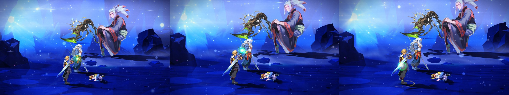

- **FFX only, Kimahri's rig is OFF: he is drawn from his paintings again, as before release 55 (Bailey's words above; driver decision 149).** The case is FFX only: all 13 of Kimahri's paintings are FFX's (`pose-gate --report`: `byGame {FFX: 13}`), and a rig is keyed by art id. The switch is the art manifest, not code: `tools/gen/manifest.mjs` writes `rigs`, the subjects that have `rigs/<id>/rig.json` in the art folder, and `RigLoad.chooseRig` asks a rig only of a listed subject (`ArtManifest.rigs`); the new art folder lists ifrit, lulu, pterya and valefor and not kimahri, so no `src/` file changed for this. **No code path assumes Kimahri is rigged:** a search of `src/` finds his name beside "rig" only in comments and in the rig format's examples; PR-0462 (the follow key's size) and PR-0463 (the knocked-out Kimahri covering Tidus) were findings about the rig's data (`docs/handoff/rig-kimahri.md`, "Release 56 findings"), not code, and are moot while the rig is off. **Confirmed in the real game** (headless Chromium, the candidate build, Chapter I at the first menu, the game's default rig switch, no `?rig=` in the address): `window.__pyrefly.rigs()` says `kimahri: on: false, reason: "no rig listed in the art manifest"` (the switch itself reads `on, default`; Tidus, Yuna, `seymour-flux-body` and Mortiorchis read the same reason), the art manifest the page fetched lists `["ifrit","lulu","pterya","valefor"]`, and Kimahri's actor has no rig `landmark` method (a `PaintedActor`): he stands in his painted `ko` at the first menu, is stood up by Yuna's Phoenix Down, and acts from his painted `ready` and `idle`. His paintings are checked as they were: `node tools/pose-gate.mjs --check --art D:/pyrefly-art-r59 --subjects kimahri` reads 13 paintings, 13 pass, 0 waived, 0 fail (every painting has its fresh pose record). The rig itself is untouched: `D:/pyrefly-art-rigs/kimahri` and the earlier release art folders (`D:/pyrefly-art-r55`, `-r57`, `-r58`) still hold it, and the rig lane's reworked animation can come back by adding him to a later mirror. Bahamut's new rig is not in this release; Lulu's, Valefor's, Ifrit's and Pterya's rigs stay on, byte for byte release 58's.
- **FFX only, an item use is an orb of light, not a flask (branch `anim-orb-ship`; `docs/handoff/anim-orb-ship.md`, `docs/plans/anim-orb-ship-review.md`; `research/re-ffx-party-motion-timing.md` section 6, read frame by frame on the Steam copy):** on an ally a green orb forms over the user's hand, is tossed overhand, arcs to the target with a short trail and bursts into sparkles on it; on the user a small glow forms at the hand and green motes rise around them. It depends on the target, not the character, so every party member does both, a Phoenix Down on a knocked-out ally included (the orb lands on the body; a knocked-out rig is aimed at through its key's box). The party's painted item poses hold a glass flask, so a figure drawn from paintings stands in a flask-free stance instead (its idle; Yuna keeps her open-handed item painting) and the orb leaves from the hand read off the painting (`ItemGestureTable.ts`); a rigged Lulu keeps her rig's item key and the orb follows the rig's `fist`. **With Kimahri's rig off he uses the painted hand anchor** (his fist in front of the sash, u 0.46, t 0.60 of his idle painting): `item-orb-stage.test.ts` pins the painted path (a figure with no rig landmark takes the table's pose and hand; the test "a rig that cannot say where its fist is" is Kimahri's own row: `idle`, the table's `t` 0.60), and in the real game the candidate's painted Kimahri (Chapter I, Items > Potion > Tidus, real key presses) went `ready` to `idle` (not the flask pose `item`) while the effect ran form (frame 28), flight (49), burst (80), rest (147), with one light in play, no console error and no 404; Yuna's Phoenix Down on the painted, knocked-out Kimahri stood him up (`ko` to `idle`) through the same phases. An item now takes 720 ms (on an ally) or 520 ms (on the user) before the heal lands, where it took 380; the engine is untouched.
- **FFX-2 only, an item use is a quick small toss and a white-blue burst, no orb (same branch; the RE session's live check of the real FFX-2, driver decision 147):** a small white-blue spark is tossed to the ally in half the orb's flight with no trail and bursts into white-blue sparkles on the target; on the user only the burst. The spell layer's green heal is not drawn for an FFX-2 item (the burst is its picture; nothing then cuts the camera to the target) and the heal's flash is white-blue. FFX-2's timing and poses are unchanged (+0 ms). Both games' switches are the chapter's deps (`itemGesture`: `'orb'` for an FFX chapter, `'spark'` for an FFX-2 chapter, none for FF7), and `item-gesture-presenter.test.ts` runs each branch against the other game's deps. Seen by the branch's own real-key check in a real browser: Tidus's Potion on Yuna, Yuna's Phoenix Down on the knocked-out Kimahri, the rigged Kimahri's Potion on Tidus and Tidus's on himself (FFX); a girl's Potion on an ally and on herself in the hidden Besaid chapter (FFX-2), against release 58's art (`D:/Tools/pyrefly-scratch/2026-10-19/anim-pass3/orb-ship/`).
- **Both games, the release's art folder (`D:/pyrefly-art-r59`, made by `node tools/art-mirror-add-rigs.mjs --from D:/pyrefly-art-r58 --to D:/pyrefly-art-r59 --subjects lulu,valefor,ifrit,pterya --without kimahri`; the rig sources are `D:/pyrefly-art-rigs/<name>`, each with its 1x tier):** the tool could add or replace a rig but not drop one (every file of the source folder was hard-linked, so a folder made from release 58's would have carried and listed Kimahri), so it gained `--without <rigs of the source folder to leave out>` (`planMirror` takes `without`, refuses a name the source does not hold or one that is also being added, and does not link the rig's folder; `verifyMirror` proves the folder is absent and the manifest does not list it; nothing is deleted and the source is untouched; one new test in `tests/unit/tools/rig-mirror.test.ts`, 10 tests). The folder: 5,401 files hard-linked from release 58's (none opened for writing; the non-rig file list is identical to release 58's), 140 rig files copied (Lulu 45, Valefor 33, Ifrit 29, Pterya 33), `manifest.json` rebuilt (`rigs`: ifrit, lulu, pterya, valefor; `rigTiers`: both tiers of each; the only keys that differ from release 58's manifest are `rigs` and `rigTiers`), **PROVED** (5,542 files). The four rig folders are byte for byte release 58's (`diff -rq` of each against `D:/pyrefly-art-r58/rigs/<subject>` is empty). `node tools/rig-gate.mjs --rig public/art/rigs/<subject> --verify --art public/art` with `public/art` pointing at the new folder: Ifrit "stamp ok (6 key(s), full coverage), 1x tier proved (14 file(s))", Lulu "stamp ok (13 key(s), full coverage), 1x tier proved (22 file(s))", Pterya "stamp ok (6 key(s), full coverage), 1x tier proved (16 file(s))", Valefor "stamp ok (6 key(s), full coverage), 1x tier proved (16 file(s))", PASS all four.
- **Both games (review tooling, no visible change), `origin/r59-fixes` at `029618774` (`critic/runner/lib`, `critic/CHECKS.md`, tests, notes; no `src/` file):** **R58-T1 (found by the release 58 focused review):** the continuity harness counted no rig swap in a real run. A `RigActor` builds its `PaintedActor` with `figure: false` (it draws no plane), so the probe read "not showing" for a rig's whole life, logged every change of key, stored no frame, and the analysis dropped all of them; the probe now takes a rig as showing when the actor is visible, its alpha is above 0.02 and the rig's own plane is visible. `tests/unit/critic-continuity-rig-real.test.ts` builds the engine's own `RigActor` and plays a fight's worth of key changes through the probe and the analysis (it fails with the reviewer's symptom against release 58's probe), and plays the shipped rigs from their own `rig.json` (6 of 6 swaps each counted, 0 of 6 before; it reads the rigs in `public/art/rigs`, so four here, not Kimahri's). On a real run of the possessed Ifrit in Chapter III the figure's four swaps read counted 0 of 4 before and 4 of 4 after. A rig that is counted can now fail CHK-026, which release 58's harness could not see. **FFX only, Lulu's Doublecast (CHK-022, Chapter III):** the review route looked for one advisor row containing the whole text after the colon ("firaga + firaga"), but the menu's rows are the spell names, so no Doublecast was ever played and every later one fell to Attack (84 of 368 picks in release 58's review run); `route-doublecast.mjs` plays it as Special > Doublecast > the first cast and its target > the second cast and its target (`tests/unit/critic-route-doublecast.test.ts`; 12 Doublecasts played on the real game, the first form down at about 7 minutes). The README also records why Chapter XIV did not finish in that review (the card is not the chapter's tactic: advisor code, a decision for the driver and Bailey).
- **Both games, the player note for 59 (`src/app/changelog/releaseNotes.ts`, 4 lines, no hidden chapter named):** "Kimahri is back to his hand-painted poses while we rework his animation." (FFX), "Using an item on an ally now tosses a glowing green orb to them, and on yourself shows a green glow, as the game draws it." (FFX), "Items now show a quick white-blue sparkle." (FFX-2) and "The other jointed figures are unchanged: Lulu, Ifrit and Pterya in FFX, and Valefor in both games." (Both). The newest-release pins moved to 59 (`release-notes` and `deploy-release-gate` tests; the deploy takes `--release=59`).
- **Checked on the tree `r59-rc` (not a review; none has run):** `node node_modules/typescript/bin/tsc --noEmit` clean (exit 0, after the merge too); `node tools/orphans.mjs` 1,913 modules, 24 orphaned, the same 24 as release 58, none of them new (the five new item-gesture modules are imported); `node tools/candidate-build.mjs --dry-run` reads release 59 from the newest player note; the three goldens pass (**3 files, 27 tests**, before and after the orb merge); `critic-continuity-*` and `critic-route-*` (20 files, 374 tests), the rig tests (`tests/unit/rig`, 14 files, 136 tests; `tests/unit/tools/rig-*`, 17 files, 207 tests), the release-notes, deploy-release-gate, candidate-build and rig-mirror tests, `item-gesture-presenter`, `item-orb-stage` and `ff7-judge-repair` (3 files, 62 tests), every presenter-named test (33 files, 265 tests) and `tests/unit/engine` (91 files, 1,152 tests) pass; `node tools/pose-gate.mjs --check` PASS (1,106 paintings of 146 subjects: 829 pass, 79 waived, 198 exempt, 0 fail, the same as release 58); a candidate build (`node tools/candidate-build.mjs`, `dist-gate`, release 59) with `public/art` pointed at `D:/pyrefly-art-r59`: `art-derive verify` PASS (3,957 masters: 567 WebP, 3,390 PNG, 3,614 pixel-compared, 0 problems; release 58's 4,015 less Kimahri's rig's 58 images), `art-derive audit` PASS (1,336 text files, 2 names in pages each a shipped file, bundle 628 literal names, 0 dangling), and the deploy's two rig checks (`enforceShippedRigs`, `enforceBuiltRigs`) PASS: 4 rigs verified (Ifrit 6 keys, Lulu 13, Pterya 6, Valefor 6), 140 files shipped under `art/rigs`, 0 problems, `art/manifest.json` listing exactly those four with both tiers. **Not run:** the full unit suite on this tree (the orb branch's own full run on release 58 had 3 files fail, advisor-floor and tourist-trap-bench by "Test timed out in 15000ms" and one ff7-judge-repair test that passes alone and passes here), `art-browser-load`, `art-play-audit` and the reviews (the deploy runs the first).
- **Still open:** (1) **Kimahri's animation is to be reworked** (his rig's keys read poorly in play: Bailey's words above; the rig's data and findings are in `docs/handoff/rig-kimahri.md`); until then he is painted in every chapter he is in. (2) The orb's own caveats (`docs/handoff/anim-orb-ship.md`, "What is not done"): painted figures do not raise an arm (the orb is what moves), a rigged Lulu lifts her hand only because her rig has the key, the foe case is the same toss in amber and is not sourced for FFX, the light is flat (additive sprites), and FFX-2's camera was not otherwise checked. (3) `src/engine/BattlePresenterBeats.ts` is exactly 400 lines after the merge (the house rule says under 400): its item wiring is four lines, and the file was 397 before. (4) The deep review release 58 owes is not settled by this release, and the orb merge touches the presenter, a shared system that `critic-plan` classes deep (a focused pass first, a deep one after the deploy); run `node tools/critic-plan.mjs` with the live record in place before the deploy.

## 2026-10-19 · Release 58 (r58): Ifrit and Pterya drawn as jointed figures (FFX only), the continuity harness reads a rigged figure's pose changes (both games, R57-002) and the diagnosis of Shiva's feet (FFX, R57-001)

Address: https://echoesofspira.com (main 2a1777281, bundle CEDFXO0J, live from 2026-10-19T22:56Z until Release 59 replaced it at 2026-10-20T04:15Z under Bailey's standing words "deploy every release as soon as its review says it can ship"; built from branch `r58-rc`: release 57 `ed5cf5224`, then `origin/rig-aeons` (`399c0b013`) merged with `--no-ff` (`a0ad25265`; one conflict, `tools/rig/lane/lane-subjects.json`, resolved by taking rig-aeons' file: its four existing entries, kimahri, lulu, valefor and rikku-dark-knight, equal this branch's, and it only moves valefor ahead of rikku), then the three RE research notes (`3e96992d2`, records only), the art mirror `D:/pyrefly-art-r58`, R57-002, the diagnosis of R57-001, the notes and this entry; the focused review `critic/reviews/2a1777281-focused.json` is SHIP with the changed area FAIL on the disclosed R58-T1 (tooling: the harness's new rig reader counted no swap in a real run), R58-F1 and R58-S1 (painted figures this release does not touch, the same on live), and the live check `critic/reviews/2a1777281-live.json` is PASS, 5,751 files byte for byte; the deep review it owed was carried to Release 59, then 60 and 61, and the deep reviews rounds 27 and 28 cover it). Bailey's words behind it: "Single-costume figures first" (2026-10-18), "ok looks good" (2026-10-19, about Valefor's rig) and the standing "deploy every release as soon as its review says it can ship" and "in advance i will go with all your recommendations ... i trust you". The release driver's delegated pick (item 138): **Ifrit's and Pterya's rigs go ON in this release and Shiva's stays OFF.** Every paragraph below says FFX only, FFX-2 only or both.

- **FFX only, Ifrit is drawn by its rig (branch `rig-aeons`, `docs/handoff/rig-ifrit.md`):** the idle painting cut into 7 parts on 19 bones, with 6 keys (idle, and attack 0.776, cast 0.973 and hurt 0.774 painted; the knocked-out 0.687 and Overdrive 0.686 keys authored with their landmarks), so a pose change moves one figure instead of swapping paintings. **The case is FFX only:** Ifrit is an FFX aeon (`characters/ifrit/*`); by the rig lane's fielding census it stands in Chapter III link 3 as the possessed Ifrit and is a summon in Chapters 1, 2, 7, 9, 10, 12, 14, 17, 18, 27 and the hidden 21h, and no FFX-2 chapter fields the art id (FFX-2's aeon art is `x2-*`). A rig is keyed by art id, so it is on wherever the art id is drawn. **What it fixes:** the painted knock-out is a smaller creature, so the figure jumped in size from hurt to knocked out. In the lane's recording of Chapter III link 3 (seed 1, 1600x900, real GPU) the painted head went from 357.6 px to 291.3 px at the swap (ratio 0.8147, an 18.5 percent cut), the centre moved 88.2 px in one frame and the worst one-frame step of the head was 124.9 px; with the rig the head mesh is 0.1594128 in hurt and 0.1594128 in knocked out (1.0000), the projected box moves 2.0 px at the swap (a blend of about 40 frames follows) and the worst head step is 25.2 px. The rig gate passes with full coverage (`rig-gate --verify`: 6 keys, 1x tier proved, 14 files; 3,593 vertices, 4.91 Mpx, 6.09 MB). **Not seen in the real game by this assembly:** the review browser flag was up, so the real-key check of the rigged Ifrit is the review's and the live check's.
- **FFX only, Pterya is drawn by its rig (`docs/handoff/rig-pterya.md`):** Pterya is Isaaru's Valefor in Chapter XIV (link 2, enemy actor `pterya`, art id `pterya`), and no other chapter fields the sprite. 8 parts on 24 bones, 6 keys (attack 0.884, cast 0.973 and hurt 0.901 painted; knocked-out 0.568 and Overdrive 0.481 authored). The keys are Valefor's, re-measured by the gate against Pterya's own paintings (a twin's paintings sit on canvases with 60 px more margin on every side, so the kit's `lane.py twin` now registers each twin painting onto the base's first; nothing was copied blind). In the lane's recording of Chapter XIV link 2 the painted head went from 344.1 px to 259.8 px at the knock-out (ratio 0.7551, a 24.5 percent cut, the largest head jump of the run's 20 swaps), the centre moved 90.7 px in one frame and the head stepped 84.8 px; with the rig the head mesh is 0.0238649 in both poses (1.0000), the box moves 4.1 px and the head steps 27.6 px. Gate: 6 keys, 1x tier proved, 16 files; 2,889 vertices, 5.79 Mpx, 7.79 MB.
- **FFX only, Shiva's rig stays OFF and is not in the art mirror (`docs/handoff/rig-shiva.md`; the driver's delegated pick):** it is built and gated (8 parts, 24 bones, 6 keys), but three of its six keys (attack, knocked out, Overdrive) are authored because they are other drawings than the idle's gown, its attack is the idle with a lean and an arm swing (overlap 0.328), and its hurt passes the 0.75 bar by 0.003. Its subject config is in the tree, so a later mirror can add it with `tools/art-mirror-add-rigs.mjs --subjects ...,shiva`.
- **Both games (tooling, no visible change), `origin/rig-aeons`:** brings the lane kit's changes (`lane.py twin` registers a twin's paintings first, `reach: {auto: true}` for an actor that is not on the field at the first menu, the `ko` recorder mode and `tools/rig/lane/ko-summary.mjs`, the sheet overrides and `lane.py hurtko`) and the subject configs and keys of Pterya, Ifrit and Shiva: 23 files, all under `tools/` and `tests/`; no `src/` file and no art.
- **Both games, the release's art folder (`D:/pyrefly-art-r58`, made by `node tools/art-mirror-add-rigs.mjs --from D:/pyrefly-art-r57 --to D:/pyrefly-art-r58 --subjects kimahri,lulu,valefor,ifrit,pterya`; the rig sources are `D:/pyrefly-art-rigs/<name>`, each with its 1x tier):** 5,401 files hard-linked from the release 57 art (none opened for writing), 199 rig files copied (Kimahri 59, Lulu 45, Valefor 33, Ifrit 29, Pterya 33), `manifest.json` rebuilt (`rigs`: ifrit, kimahri, lulu, pterya, valefor; the keys that differ from release 57's manifest are `rigs` and `rigTiers`), **PROVED** (5,601 files). Kimahri's, Lulu's and Valefor's rig folders in the new folder are byte for byte release 57's (`diff -rq` of each is empty). `node tools/rig-gate.mjs --rig <each rig> --verify --art D:/pyrefly-art-r58`, on the sources and on the copies in the mirror, gives: Kimahri "stamp ok (13 key(s), full coverage), 1x tier proved (29 file(s))", Lulu "stamp ok (13 key(s), full coverage), 1x tier proved (22 file(s))", Valefor "stamp ok (6 key(s), full coverage), 1x tier proved (16 file(s))", Ifrit "stamp ok (6 key(s), full coverage), 1x tier proved (14 file(s))", Pterya "stamp ok (6 key(s), full coverage), 1x tier proved (16 file(s))", PASS. Rikku Dark Knight, Shiva, Auron and Auron v2 stay out of it.
- **Both games (review tooling, no visible change), the continuity harness reads a rigged figure (R57-002 of the Release 57 focused review; `critic/runner/lib/continuity-rig-probe.mjs`, `continuity-rig.mjs`, `critic/CHECKS.md` CHK-026 item 9):** a rig draws no plane, so the probe read the idle painting the rig is mapped onto, which never changes pose: no swap, no stature, no feet, 0 px of motion, and CHK-026 and CHK-027 passed having measured nothing (the lane's handoffs for Kimahri and Lulu say so; the Release 57 review could not see a rigged knock-out). The probe now reads a rigged figure from the public surface of the running build (`pose`, `blending`, `landmark`, `feetPoint`, `contentQuad`, the part meshes: no engine hook, so it reads any rigged build, live ones included): the rig's key is its pose, so a change of key is a swap; every frame carries where its head, feet and centroid are drawn (the jerk detector, the strips' marks and the per-frame tracks read a rig as they read a painting) and where they are in the idle plane's own coordinates, where neither the stage's motion nor the camera is. A change of key is judged at the last frame before it and the first frame after it with no move in flight: the head part's mesh area (3 percent, the registered tolerance; the whole figure's mesh at 30 percent where a key hides the head), the planted feet's ground line (2 percent of the figure, never under 6 px at 1600 wide; the sideways gap is shown, not judged; a knock-out and the jump and overdrive keys are shown, not judged) and the key's box over the idle's in its class's band (a knock-out's length report-only); a cut that jumps the figure is a snap and a jerk at the swap. `continuity.rig: false` in the policy gives the earlier reading back. Game case both: shared plumbing, and the rigs it reads today are FFX's Kimahri, Lulu, Ifrit and Pterya and Valefor, which FFX-2's Besaid chapter shares. **Proof:** `tests/unit/critic-continuity-rig.test.ts` (the page-side reader against a fake rig actor, also stringified into a bare context as the page gets it, and the probe with and without it: 10 tests) and `critic-continuity-rig-analyze.test.ts` (11 tests: a rigged knock-out that shrinks the head by a seventh fails CHK-026 and is the worst swap, a good one passes, a key 24 px off the ground line fails, a pose at two thirds of the idle's height fails, a cut that jumps the figure is a snap and a swap jerk, an interrupted change is not read for its feet, `rig: false` reads nothing and says UNVERIFIED), and the engine names the reader depends on are pinned in `critic-continuity-contract.test.ts`. **Not yet run against a real recording:** no browser ran in this assembly, so the first real run is the review's (Ifrit in Chapter III, Pterya in Chapter XIV, Valefor in Chapter I).
- **FFX only, R57-001 (CHK-026, Shiva attack to idle moves the feet 80 px in Braska's final aeon fight): diagnosed, nothing changed (`docs/handoff/r57-001-shiva-feet.md`).** It is not a wrong value for the attack painting. The engine places Shiva's attack so that its registered stance (x 337, row 1193) sits on the idle's (x 304, row 1131), and they coincide to 0.0 painting px sideways and 1.0 vertically (the earlier Braska recordings read this pair at 0.4 to 0.5 px by the registration). The 80 px is the harness's silhouette reading, which takes the idle's stance at the tip of the gown's train (x 450) and the attack's at the ice star under her (x 339), 143.9 painting px apart sideways, about 80 px at the drawing scale of the review; with both stances registered the harness judges only the vertical gap (11.6 px against about 12.6), so by this reproduction 80 px was shown, not gated. What is really wrong is the stance rule: "the middle of the lowest thick part" lands on shoes plus train in the idle and on the ice in the attack, neither under her feet, so the feet really slide about 50 to 70 px at 1600 wide. Fixing that means hand stances at the feet for Shiva's five poses in `tools/posescale/overrides.json` and regenerated tables (it moves Shiva's planes in every FFX fight, so it wants a before-and-after for Bailey, and it is `tools/posescale/**`, which the policy reviews with the harness), not one attack value; Shiva's rig, when switched on, plants the feet by construction.
- **Both games, the player note for 58 (`src/app/changelog/releaseNotes.ts`, 3 lines, no hidden chapter named):** "Ifrit now animates as one jointed figure, in Braska’s last fight and wherever you summon him.", "Pterya, Isaaru’s aeon in Chapter XIV, is drawn the same way." and "Neither shrinks when knocked out any more." (all three FFX). The newest-release pins moved to 58 (`release-notes` and `deploy-release-gate` tests; the deploy takes `--release=58`).
- **Checked on the tree `r58-rc` (not a review; none has run):** `node node_modules/typescript/bin/tsc --noEmit` clean (exit 0); the continuity tests, the release-notes and deploy-gate tests pass (inside the full run below); `node tools/orphans.mjs` 1,908 modules, 24 orphaned, the same 24 as release 57, none of them new (the two new harness modules are imported by `continuity.mjs`); `node tools/candidate-build.mjs --dry-run` reads release 58 from the newest player note; the three goldens pass (**3 files, 27 tests**: FFX engine 18, FFX-2 ATB 6, FF7 3); `node tools/pose-gate.mjs --check` PASS (1,106 paintings of 146 subjects: 829 pass, 79 waived, 198 exempt, 0 fail); a candidate build (`node tools/candidate-build.mjs`, `dist-gate`) with `public/art` pointed at `D:/pyrefly-art-r58`: `art-derive verify` PASS (4,015 masters: 593 WebP, 3,422 PNG, 3,670 pixel-compared, 0 problems), `art-derive audit` PASS (1,349 text files, 2 names in pages each a shipped file, bundle 654 literal names, 0 dangling), and the deploy's two rig checks (`enforceShippedRigs`, `enforceBuiltRigs`) PASS: 5 rigs verified (Ifrit 6 keys, Kimahri 13, Lulu 13, Pterya 6, Valefor 6), 199 files shipped under `art/rigs`, 0 problems, `art/manifest.json` listing exactly those five with both tiers. the full unit suite on this tree: **"Test Files 5 failed | 1466 passed | 26 skipped (1497); Tests 11 failed | 23520 passed | 110 skipped | 1 todo (23642)"**; **every one of those failures is "Test timed out in 15000ms"** (advisor-floor, seven of its tests: Yunalesca, Braska's Final Aeon, Seymour and Anima, Yojimbo, Natus, Omnis and Mirror Aeons; advisor-menu, its mirror-aeons test; advisor-note, its Mirror Aeons test; tourist-trap-bench, its table-printing test; ui-ffx2-atbmode, its FFX HUD chip test), none an assertion, and this change touches no engine or HUD file (the only `src/` file is the player note). Run alone, four of the five files pass (90 of 91 tests); advisor-floor still times out at 15 s for one to four of its simulation tests on this loaded machine (the release 57 deploy's browser checks were running) and passes all 23 with a 180 s timeout, so they are load timeouts and not caused by this change. **Not run (the review browser flag was up):** `art-browser-load`, `art-play-audit` and every real-key check of the rigged Ifrit and Pterya in the game; the deploy runs the first.
- **Records only (FFX and FFX-2 research notes), from `origin/re-parity-r58-docs` (`28db83a2e`):** `research/re-ffx-spectral-keeper.md` (FFX), `research/re-ffx2-fallen-maesters.md` (FFX-2) and `research/re-ffx-party-motion-timing.md` (FFX; the item gesture measured live), brought in as three plain files in one commit (`3e96992d2`, 876 lines). The branch is not merged: it sits on an older base (built from `origin/main` `f86e8f3e9`), and a merge would have brought 493 files (review evidence, ledgers, `tools/live-record.mjs`) and not only these three. No code and no game data changed.
- **Still open:** (1) **R57-001** as above: Shiva's feet slide about 50 to 70 px between attack and idle in every FFX fight (a stance-rule fault, not a mistyped number), and the harness's silhouette stance reads the idle's train tip. (2) **Ifrit's and Pterya's knock-outs are authored, not painted:** Ifrit's is a ball (the body folds forward and the head tucks under the chest, 0.687) and its Overdrive a crouched fold (0.686); Pterya's is a crouch under the wing (0.568, Isaaru stands in front of it in Chapter XIV) and its Overdrive a balled-up swoop (0.481); the game never draws the painted Overdrive on the battle plane, so those keys may never be seen; the wing tips, plume and fur have crisp edges where the paintings feather them, and the painted glow, open beak and dust are not carried (`rig-ifrit.md`, `rig-pterya.md`, "What still looks wrong"). (3) **The harness's rig reading has not met a real recording** (see above). (4) FFX-2 prints MISS for its own immune misses (carried from release 57, untouched). (5) A deep review is owed by this line (the open ones of releases 56 and 57 stay open); `node tools/critic-plan.mjs` reads against the previous build `a061e9dc` here, so run it with the live record in place before the deploy.

## 2026-10-19 · Release 57 (r57): Valefor drawn as a jointed figure (both games), IMMUNE shown when a status move is resisted (FFX), and a correction to releases 55 and 56

Address: https://echoesofspira.com (main ed5cf5224, bundle IvYB9JEE, live from 2026-10-19T19:41Z until Release 58 replaced it at 22:56Z under Bailey's standing words "deploy every release as soon as its review says it can ship"; built from branch `r57-rc`: the live release 56 `5fae4e2bd`, then `origin/rig-rikku-dk` (`a956811b9`; tooling and Rikku's rig config only) and `origin/rig-valefor` (`2af625c95`), merged with `--no-ff` (`14f205275`, `7c9f72cd0`; one conflict, `tools/rig/lane/lane-subjects.json`, both subjects kept), then the R56-003 fix, the notes and this entry; the focused review `critic/reviews/ed5cf5224-focused.json` is SHIP with the changed area PASS and discloses R57-001 and R56-002 (neither introduced by this change), and the live check `critic/reviews/ed5cf5224-live.json` is PASS, 5,689 files byte for byte). Bailey's words behind it: "ok looks good" (2026-10-19, about 08:10 EDT, on Valefor's rig) and the standing "deploy every release as soon as its review says it can ship" and "in advance i will go with all your recommendations". Every paragraph below says FFX only, FFX-2 only or both; the IMMUNE fix has a unit test that fails without it and a headless real-key check at 1600x900 and 390x844.

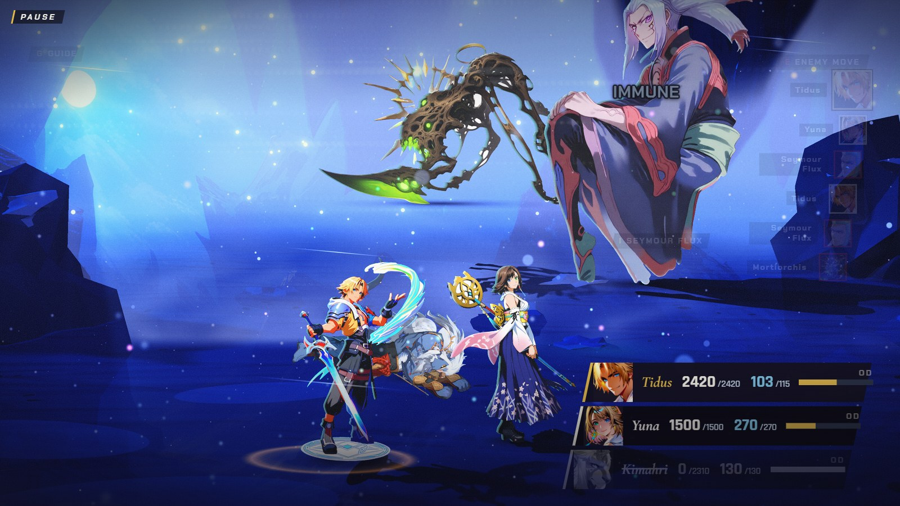

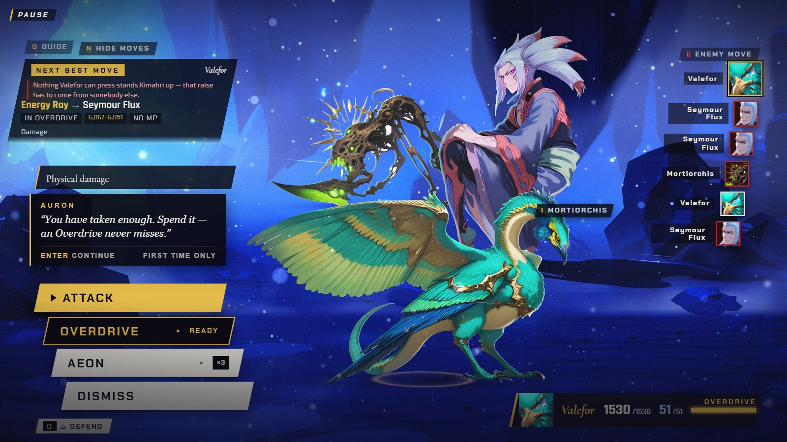

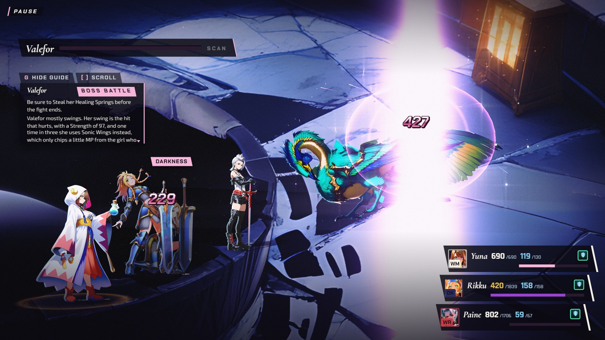

- **Both games, Valefor is drawn by its rig (Bailey, 2026-10-19: "ok looks good"; branch `rig-valefor`, `docs/handoff/rig-valefor.md`):** one painting (the idle) cut into 8 parts on 24 bones, with 6 keys (the idle, attack, cast and hurt painted; the knocked-out and Overdrive keys authored), so a pose change moves one figure instead of swapping paintings. **The case is both games because a rig is keyed by art id and Valefor's painting set is shared:** FFX's Valefor (by the rig lane's fielding census: summoned in Chapters 1, 2, 3, 7, 9, 10, 12, 14, 17, 18, 27 and the hidden 21h, and the foe in Chapter III, the possessed Valefor of Braska's chain, and in the hidden Chapter 24) and the Valefor of FFX-2's hidden Besaid chapter. The rig lane wrote it up as FFX only and flagged that the Besaid chapter reuses the painting set; there is no per-game switch, so the release driver took both. **What it fixes:** the painted knock-out is a smaller, close-up creature, so the figure used to jump about 25 percent in size from hurt to knocked out. In the rig lane's recording of Besaid (seed 1, 1600x900) the painted head went from 288 px to 214 px at the swap (a 25.8 percent jump) and the rig's head mesh is 1.0000 of itself from hurt to KO; the whole figure is 0.934 of its hurt size (painted: 0.746); the worst one-frame step at the swap is 25.7 px (painted: head 96.6 px and centroid 53.8 px in one frame); jerks of 40 px or more over the fight: 0 (painted: 1). The rig gate passes with full coverage (`rig-gate --verify`: 6 keys, 1x tier proved, 16 files; 2,638 vertices, 5.46 Mpx, 6.54 MB). **Checked in this build (real keys, headless Chromium on the real GPU):** `[rig] valefor on (gate ok, 8 parts, 24 bones, 6 keys, 1x maps)` in Chapter I at 1600x900 and at 390x844 (Yuna's Summon, then Valefor's Attack drawn through the swing on the phone: `valefor-ffx-attack-390x844-sheet.jpg`), and in the Besaid chapter (door word `valefor`), with 0 console errors and no 4xx response in any of the three runs. Rikku's rig stays off in that chapter (`[rig] rikku-dark-knight off (no rig listed in the art manifest)`).
- **FFX only, a status move a foe resists completely says IMMUNE on the HUD, not MISS (R56-003 of the Release 56 focused review; `src/ui/ffx/DamageNumbers.ts`):** since release 55 the engine has emitted a `miss` event with `reason: 'immune'` for a status move the target is wholly immune to (Slow on Seymour Flux, Shell on a Yu Pagoda), a revival that cannot stand its target up, and Scan on a foe that refuses it. In the live game the HUD owns the numerals (the presenter's numeral port is not supplied), and the FFX HUD's path (`FFXBattleHud.onEvent`, then `DamageNumbers.spawn`, then the shared `spawnEvent`) read only that the hit missed, so all three drew a plain MISS. A miss whose reason is `immune` now draws the same numeral a hit on an immune affinity draws (the `immune` kind: 12 px, 700 ms); `evaded`, `nullified` and `wrong-state` are unchanged (MISS, NULLIFIED and NO EFFECT as before). **FFX-2 is not changed:** its HUD draws through `DamageLayer`, which has the same blind spot for the immune misses its engine emits (`resolve-strike.ts`, `sensor.ts`), and whether FFX-2 should print IMMUNE there is a question for its sources; it is listed under "Still open". No engine file changed, so no golden moves. **Proof:** `tests/unit/ffx-immune-numeral-hud.test.ts` drives the real `FFXBattleHud` with the engine's event (4 tests; 3 fail with the new branch removed, and the fourth, that the other miss reasons still say MISS, passes both ways); and a headless run from the title by real keys (seed 1; Chapter I, Tidus's first menu, White Magic, Slow, the cursor stepped to Seymour Flux and read back, Enter): the log is `mp-damage, action-start, miss (reason immune, on seymour-flux), action-end`, the numerals recorded are `12` (the MP cost) then `IMMUNE` (class `dnum--immune`) and no MISS, at 1600x900 and at 390x844, 0 console errors (`docs/screenshots/r57/evidence-flux-immune-*.json`; the phone frame is `flux-slow-immune-390x844.jpg`).
- **Correction to releases 55 and 56, FFX only:** both entries said the HUD prints IMMUNE for a status move a foe resists, and release 56's player note repeats it ("a status move a foe resists completely still says IMMUNE"). It showed MISS in both builds, live; the engine half was right and the HUD half was missing. Each entry now carries a "Correction" line. The player note of release 56 is history and is not edited; the new note says the truth (next paragraph).
- **Both games, the player note for 57 (`src/app/changelog/releaseNotes.ts`, 3 lines, no hidden chapter named):** "Valefor now animates as one jointed figure and no longer shrinks when knocked out." (tagged Both: the same painting set serves both games), "IMMUNE now shows when a status move is resisted completely, as with Slow on Seymour Flux or Shell on a Yu Pagoda." and "Releases 55 and 56 said this already worked; it showed MISS until now." (both FFX). The newest-release pins moved to 57 (`release-notes` and `deploy-release-gate` tests; the deploy takes `--release=57`).
- **Both games (tooling, no visible change), `origin/rig-rikku-dk`:** brings `tools/rig/lane/lane_marks.py` (the marks-first search the Valefor handoff asks the next lane to use), Rikku Dark Knight's subject config and keys and its lane registry entry. **Rikku's rig itself stays OFF and is not in the art mirror**; only the files named above came with the merge (9 files, all under `tools/`, `tests/` and `docs/handoff/`).
- **Both games, the release's art folder (`D:/pyrefly-art-r57`, made by `tools/art-mirror-add-rigs.mjs --from D:/pyrefly-art-r55 --subjects kimahri,lulu,valefor --make-tiers`):** 5,401 files hard-linked from the release 55 art (none opened for writing), 137 rig files copied (Kimahri 59, Lulu 45, Valefor 33), 67 tier files written, `manifest.json` rebuilt (`rigs`: kimahri, lulu, valefor; apart from its timestamp, the keys that differ from release 55's manifest are `rigs` and `rigTiers` only), **PROVED** (5,539 files). Kimahri's and Lulu's rig folders in the new folder are byte for byte release 55's (`diff -rq` of each against `D:/pyrefly-art-r55/rigs/<subject>` is empty, 1x tier files included). `node tools/rig-gate.mjs --rig <the three rigs in the new folder> --verify --art D:/pyrefly-art-r57`: Kimahri "stamp ok (13 key(s), full coverage), 1x tier proved (29 file(s))", Lulu "stamp ok (13 key(s), full coverage), 1x tier proved (22 file(s))", Valefor "stamp ok (6 key(s), full coverage), 1x tier proved (16 file(s))", PASS.
- **Checked on the merged tree `r57-rc` (not a review; none has run):** `npx tsc --noEmit` clean (exit 0); `node tools/pose-gate.mjs --check` PASS (1,106 paintings of 146 subjects: 829 pass, 79 waived, 198 exempt, 0 fail); `node tools/orphans.mjs` 1,908 modules, 24 orphaned, the same 24 as release 56, none of them new; `node tools/candidate-build.mjs --dry-run` reads release 57 from the newest player note; the full unit suite on this tree, run twice, 1,492 files and 23,579 tests each time: the first run (while the real-key browser checks were running) **"Test Files 2 failed | 1464 passed | 26 skipped (1492); Tests 8 failed | 23460 passed | 110 skipped | 1 todo (23579)"**, the second (nothing else of this lane running) **"Test Files 3 failed | 1463 passed | 26 skipped (1492); Tests 9 failed | 23459 passed | 110 skipped | 1 todo (23579)"**; **every one of those failures is "Test timed out in 15000ms"** (advisor-floor, seven of its tests; tourist-trap-bench, its table-printing test; ui-pause-stack, its z-index inventory test), none an assertion, and run alone the three files pass (first set, advisor-floor and tourist-trap-bench: 2 files, 32 tests passed; then all three: 3 files, 38 tests passed), so they are full-suite load timeouts on this machine and not caused by this change (release 56 recorded 0 failed with no timeout; the machine was busier today); the three goldens pass (**3 files, 27 tests**: FFX engine 18, FFX-2 ATB 6, FF7 3); the rig tests and the files this release touched pass (`tests/unit/rig`, `tests/unit/tools/rig-*`, `rig-v1-unchanged`, `ffx-immune-numeral-hud`, `ffx-immune-status-miss`, `release-notes`, `deploy-release-gate`: **32 files, 354 tests passed**), including Valefor's own `rig-subject-valefor`.
- **Still open:** (1) **FFX-2 prints MISS for its own immune misses** (a status move an FFX-2 foe resists, Scan on a foe that refuses it): `DamageLayer` goes through the shared `spawnEvent`; fixing it is a game-aware question (does FFX-2 print IMMUNE for them?), not decided here and not touched. (2) **Valefor's knock-out is a crouch, not the painted lie-down, and is under the game's white KO flash for most of its life; the Overdrive key (a balled-up swoop, overlap 0.478) may never be seen, because the painted actor does not draw an Overdrive pose on the battle plane;** the wing and plume have crisp edges where the painting feathers them; the painted effects (the cast's glow, the attack's open beak, the KO's dust) are not carried (`docs/handoff/rig-valefor.md`, "What still looks wrong"). (3) Pterya, Chapter XIV's silhouette twin of Valefor, is not built and stays painted. (4) The Release 56 player note's IMMUNE line stays in the title's CHANGELOG panel as history. (5) A deep review is owed by this line (release 56's is open); `node tools/critic-plan.mjs` reads against build `a061e9dc` here and so lists release 55 and 56's files too: run it with the live record in place before the deploy.

## 2026-10-19 · Release 56 (r56): FFX-2 actions take the time their animation takes, small defects from release 55's deep review and its live check, the Pilgrimage prototype on a phone, and reviews that build the bundle the deploy ships

Address: https://echoesofspira.com (main 5fae4e2bd, bundle nuEMlU1w, live from 2026-10-19T11:57Z until Release 57 replaced it at 19:41Z under Bailey's standing words "deploy every release as soon as its review says it can ship"; built from branch `r56-rc`: `origin/r56-fixes` (`f601bde4b`; FFX only, except the review-build tooling, which is both) and `origin/re-parity-r56-re` (`9a235c808`; FFX-2 only), both built on `origin/r55-rc` = the live release 55 `b24614c05`, merged with `--no-ff` (`7bc2b7096`), with no conflict in any file; the focused review `critic/reviews/5fae4e2bd-focused.json` is SHIP with the changed area FAIL on the disclosed R56-001, R56-002 and R56-003 (none introduced by this change), and the live check never ran because Release 57 replaced the build, so its live obligation is closed as superseded-unverified). Bailey's words behind it: the standing "deploy every release as soon as its review says it can ship" and, for the FFX-2 action time and the Den of Woe line, "I'll go with all of your recommendations" (2026-10-19: the release driver adopted both as a delegated pick; **Bailey can veto them**, see the first paragraph). Every paragraph below says FFX only, FFX-2 only or both; the fixes are FFX only unless a line says both; every fix has a unit test that fails without it, and the ones a player sees have a headless real-input check at 1600x900 and 390x844.

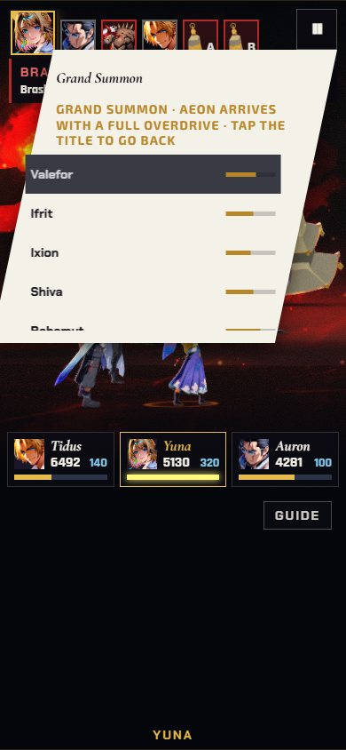

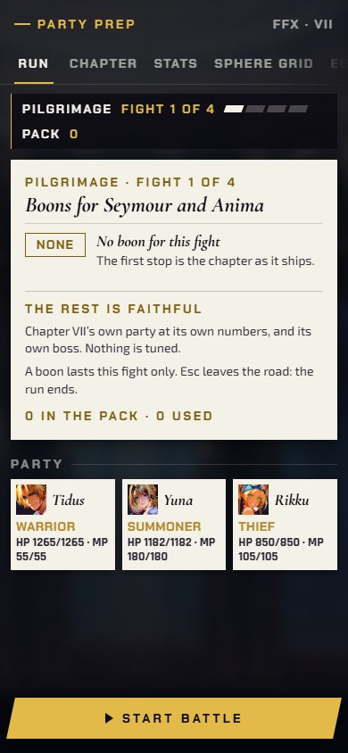

- **FFX-2 only, how long an action takes, and the Den of Woe drink (provisional; re-parity r56 RE, `docs/handoff/re-parity-r56-re.md`; code `fd3cc3a33` and `ec9c28ddc`, the independent check's fix `9a235c808`):** every command now holds its user for the time its own animation takes, taken from the game's files, instead of taking no time or, in six fights, a flat three seconds. A girl's Attack is the wait for her idle pose to break, the run to the target and the swing up to the blow (about two seconds); a spell, an item or a special is the effect from the moment it is released to its end. Five lengths were measured in the real game (Fire 75 steps, an item 80, Darkness 83, and two boss casts, Umbral Gaze 94 and Strength Up 84; a step is 1/30 of a second) and the frame each plain Attack lands on was read from the game's own data (Yuna 12, Rikku 4, Paine 11; Nooj 17, Trema 6, Tawrich 34, Bahamut 41, Leblanc 8, the Oversoul Paragon 33). **Still estimated:** Cure, a Hasted Fire, Angra Mainyu's Full-Life and Tawrich's Punch (they use the nearest measured length), every other boss cast (each takes a 94-step default, the Umbral Gaze length, and the Den of Woe result rests on it), the hit frame of the 31 bodies (19 girl and 12 monster sets) whose first-hit signal was not read (they use the end of the attack clip, an upper bound), whether Haste shortens an effect, the run to the target, and how long a cast waits in the game's queue. A boss that casts now holds itself longer than a girl's action holds her, so the girls get more turns between a boss's moves: the first-try win counts of 500 (Wait pace, Active, bench) are Vegnagun and Shuyin 463 -> 490, 417 -> 459, 482 -> 489; Leblanc 500 -> 500, 472 -> 497, 500 -> 500; Trema 288 -> 357, 167 -> 302, 336 -> 363; Tourist Trap 423 -> 481, 339 -> 460, 464 -> 484; Angra Mainyu 383 -> 491, 24 -> 348, 447 -> 500; and the Den of Woe 498 -> 482, 452 -> 487, 499 -> 499 (the five other chapters' cells come from 500-seed runs on the older r53 base and were re-checked at 200 seeds on the merged tip, within noise; the Den cells are from the tip). Ixion at Djose gets easier for a careless player: a naive line (no Shell, no Protect, the Recharge tell ignored) at the human Wait pace goes from 197 of 200 first-try wins with the flat 3 seconds (173 of 200 with no action time at all) to 200 of 200, and the sensible line stays at 200 of 200 (200 seeds). **Den of Woe:** with actions taking time, the two Dark Knights are still in their Darkness cast when Nooj's Lightfall (5,000 to everyone) lands, so the suggested line now drinks its Hero Drink when Nooj is down to about half his health (12,000 HP, not 4,500), the guide and the chapter tip say so, and the fight stays level at the bench pace, is easier at Active (+35 of 500), and is 3 percent harder at the Wait pace. **This replaces six of Bailey's 3-second picks** (Fallen Aeons' Road links D-187 and D-197, Trema's Cloister links D-151, Djose Ixion D-269, Tourist Trap and Valefor at Besaid D-846, Angra Mainyu D-857), adopted as a delegated pick under his advance yes ("I'll go with all of your recommendations"); he can veto it, and it is one line (`ACTION_TIME_PER_COMMAND`) plus the Den of Woe constant (and the two strings). No boss or party number was changed. FFX is untouched by it: the FFX engine golden (18 of 18) and the FF7 golden (3 of 3) pass as committed, the FFX-2 ATB golden (6 of 6) was re-pinned for the new timeline, and with the switch off the lane's own tree (before the merge with the fixes) played 432 of 432 chain-plays exactly as `b24614c05` did. **Open for Bailey:** both picks are the release driver's, and a veto is the one line and the one constant named above.
- **FFX only, four hidden chapters no longer ask the host for a voice file that does not exist (LV55-1 of the release 55 live check):** Biran and Yenke, Sinspawn Gui, the fayth chapter and the Last Summoning have no recordings, and each start asked for `audio/voice/<chapter>.json`, which the host answered with a 404 and the browser logged as a console error (5 times in the live check). The voice now reads the list of voiced chapters in `audio/voice/index.json` once and asks for a chapter's manifest only if it is on the list; a list that cannot be read changes nothing (the manifest decides, as before). Nothing a player hears or sees changes. Proof: `voice-bank`, `voice-director` and `voice-chapter-wiring` tests (no request for a chapter that is not in the shipped index; the 12 voiced chapters still ask for theirs).
- **FFX only, Yuna's Grand Summon picker answers a finger, and a greyed pick shakes (LV55-2, PR-0467):** on a phone a tap on an aeon did nothing and the frame had no way back. A tap or a click on a row now moves the cursor there and confirms it (as a tap on a command-menu row does), a tap on the title goes back (as a tap on a Doublecast list's title does), rows are 44 px tall at 14 px type on a touch screen, and the caption says so ("tap the title to go back"). Confirming a greyed aeon (one the fight took away, or one that is knocked out) shakes the list as a refused command-menu row does; the menu's `error` cue still plays only under the parity item f switch, which stays off as shipped. The caption no longer runs off the slab's slanted edge at 1600x900 (it takes its own line). The aeon gauges carry a label for a screen reader (the interface auditor's unlabelled gauge). Checked headless with real keys to reach the picker, then clicks (desktop) and taps (390x844): refused tap on Valefor shakes and changes nothing, tap on the title leaves with the gauge kept, tap on Ifrit summons it. `docs/screenshots/r56-fixes/grand-summon-*`.
- **FFX only, Yuna's Overdrive row says what it does (LV55-4):** its help line read "Timed input" (it is the Grand Summon, an untimed picker); it now reads "Open the Overdrive menu.", as every other one-entry opener's does, under the same t6 switch (so switched off it is what it was). Rikku's Mix row, the other Overdrive that is itself the opener of a picker, reads the same.
- **FFX only, an aeon's Defend no longer prints IMMUNE over your own aeon (PR-0383, a regression of release 55's immune-status miss):** an aeon is wholly immune to the Defend status, so its enabled-but-inert Defend row emitted an immune miss. The miss now fires only for a status move aimed at someone: never for Defend and never for a command whose ability targets its own user (an aeon's Shield, Boost). A foe-aimed move that bounces back onto its caster (Yunalesca's Blind counter reflected onto her) still says IMMUNE, so FOC54-003 stands: Slow on Seymour Flux and Shell on a Yu Pagoda still show it. No golden digest moved (the line's play never has an aeon defend); the switch-off proof of `ffx-immune-status-miss` (release 54's four digests come back with the switch off) still holds. The new test fails with the exclusion removed.
- **Correction (release 57, FFX only): the line above is wrong that Slow on Seymour Flux and Shell on a Yu Pagoda "still show" IMMUNE; they showed MISS.** The engine emitted the immune miss with its reason, but the FFX HUD drew every miss as MISS and ignored the reason (R56-003 of the Release 56 focused review: Slow on Flux in Chapter I read MISS on the live build). Release 57 prints IMMUNE for it (the Release 57 entry above); until it is live, a status move a foe resists completely shows MISS.
- **FFX only, Kimahri's follow key and his knocked-out pose are rig data, not code (PR-0462, PR-0463):** the follow key's whole mesh reproduces at 1.293 of the idle's height from the rig file (the spear bone is scaled 1.33 and lifted 618 px; head to soles is 0.904, inside the band), and in the live stage the rig's follow is 1.31 of the idle where the painting's is 1.06; the knocked-out rig is 2.1 by 1.7 world units where the painted KO is 1.5 by 1.0, centred in the same place, and the painted KO covers Tidus's footprint too (Kimahri's slot is 0.7 from his and a lying Ronso is wider), so a sideways shift in code only moves the overlap onto Yuna. No code or rig file was changed; the refit is written up for the rig lane in `docs/handoff/rig-kimahri.md`.
- **FFX only (hidden prototype), the Pilgrimage on a phone, and its music (PR-0465, PR-0466):** at 390x844 the road cut place names to "THE DECK OF THE FA...", ran the ELITE tag past its card, put BEGIN below the fold and drew the party prep as a 4 px shrunk board. Now every name wraps whole, tags wrap inside the card, the primary button (BEGIN, ON TO, AGAIN) is pinned to the bottom edge while the page runs, all text is 14 px or more and every card and tab is a 44 px target; the RUN tab of party prep takes the CHAPTER tab's stacked phone page (the strip of where the run stands under the tab bar, the pack's chips under the party, START BATTLE pinned). The look is the approved mockups' (desktop unchanged). The run's screens now play the chapter-select track chosen under CHAPTER MUSIC (A, B or C), as the board does. Audit at 390x844 (`pilgrim-390x844-after/pilgrim-audit.json`): 0 text under 14 px, 0 truncated names, 0 tags past their card, 0 targets under 44 px, the button in view on all six pages; before (`pilgrim-390x844-before/`): 9 to 62 small texts per page, 4 truncated names, 1 tag cut, the button below the fold on the road and the boon pick.
- **Both games, a review builds the bundle the deploy ships (decision 134 of the live check; tooling, no gameplay):** the deploy stamps its build with the release name of the newest player note, and a candidate built with a bare `vite build` carried none, so the reviewed bundle was not byte for byte the deployed one. `tools/candidate-build.mjs` builds a candidate with `PYREFLY_RELEASE` set from the newest note (refusing a name that is not it, as the deploy does); the three runner scripts (`focused.js`, `deep.js`, `release.js`) and the runner's self-test build through it, and `tests/unit/candidate-build.test.ts` fails if one goes back to a bare build.
- **Checked on the merged tree `r56-rc` (not a review; none has run):** `npx tsc --noEmit` clean; `node tools/pose-gate.mjs --check` PASS (1,106 paintings of 146 subjects: 829 pass, 79 waived, 198 exempt, 0 fail); `node tools/orphans.mjs` 1,908 modules, 24 orphaned, the same 24 as before, none of them new (the action-span modules are reached); `node tools/candidate-build.mjs --dry-run` reads release 56 from the newest player note and refuses `--release=55`; the full unit suite ran **1,489 files (1,463 passed, 26 skipped, 0 failed, no timeout) and 23,550 tests (23,439 passed, 110 skipped, 1 todo, 0 failed)**; the three goldens pass (FFX engine 18 of 18, FFX-2 ATB 6 of 6, FF7 3 of 3), and the 28 files of both lanes' own tests (the RE lane's `tourist-trap-bench`, `ixion-bench`, `den-of-woe-options` and `intent-committed-cast`; the fixes' Grand Summon tap, immune miss, Pilgrimage music and phone CSS, candidate build and the voice files; the release notes and the deploy gate) are 321 tests, all green. Two pins moved with the new player note (the newest release in `release-notes` and `deploy-release-gate` is 56). Each lane's own run before the merge: the RE lane in `docs/handoff/re-parity-r56-re.md` (sections 4, 6 and 10), the fixes' 1,485 files and 23,510 tests with one timeout that passed alone, and their immune fuzz (`immunefuzz.probe.ts`, 51,782 forked row submissions over 15 chapters), which reports 0 friendly immune misses where release 55 had 10, all an aeon's Defend.
- **Still open:** **Bailey's veto of the FFX-2 action time and the Den of Woe drink** (both are the release driver's delegated picks; undo is `ACTION_TIME_PER_COMMAND = false` in `src/battle/ffx2/action-time.ts` and `DRINK_FROM` back at 4,500 with the guide line and the chapter tip, which restores release 55's FFX-2 play byte for byte); the Den of Woe at the Wait pace is 16 of 500 first-try wins lower (96.4 percent against 99.6) with the new line, a drink threshold between 12,000 and 14,000 was not searched, and it rests on Nooj's three casts being the 94-step estimate; the still-estimated lengths and the hit that lands at the start of a command (`docs/handoff/re-parity-r56-re.md` section 9); the Kimahri follow and KO refit (the rig lane's); the Grand Summon row's "Open the Overdrive menu." and the greyed-aeon shake want a look on a real phone; the advisor card still calls an untimed picker a "timed input" in the Overdrive rows' own derived help where the t6 switch is off (unchanged, outside this release's list); nobody has heard the refusal cue (item f stays off).

## 2026-10-18 · Release 55 (r55): Release 54 and Release 39.5 together, the Fish Audio voices, the Kimahri and Lulu rigs, the FFX command menu and Chapter III rules of the reverse-engineering stack switched on, and three small fixes

Address: https://echoesofspira.com (main b24614c05, bundle Cokaxk4X, live since 2026-10-19T05:28Z under Bailey's standing words "deploy every release as soon as its review says it can ship"; built from branch r55-rc: the port `r395-port` (`28cc87148`), which is Release 54 (`4f4dc77bc`) plus Release 39.5, then `origin/rig` (`59c766ec0`), the Fish voices, `origin/re-parity-r55-re` (`0d67115d7`), the fixes, `origin/rig-v2` (`e027f779c`) and `origin/pilgrim-proto` (`de67ac6b4`), merged with `--no-ff` one at a time; the deep review of the candidate is `critic/rounds/round-26.json` (ship SHIP, changed area FAIL on the disclosed CHK-026, CHK-027 and PR-0460), because 39.5 touches `src/app/SaveData.ts`; the live check is `critic/reviews/b24614c05-live.json`: PASS, 5,656 of 5,657 files byte for byte, one minor, LV55-1). Bailey's words behind it: 2026-10-18, "can you place the different selectable title screens i mentioned to you before? i still dont see it in the live build" (Release 39.5, whose entry follows this one and ships in this release), "i'll go with the fish clone for all characters" (the voices; he holds the cast's and Square Enix's permission), "I like lulus new rigging, great job" (the rigs) and "I'll go with all of your recommendations" (the reverse-engineering switches). Every paragraph below says FFX only, FFX-2 only or both; Release 39.5's paragraphs keep their own tags in its entry. The assembly note is `docs/handoff/r55-assembly.md`.

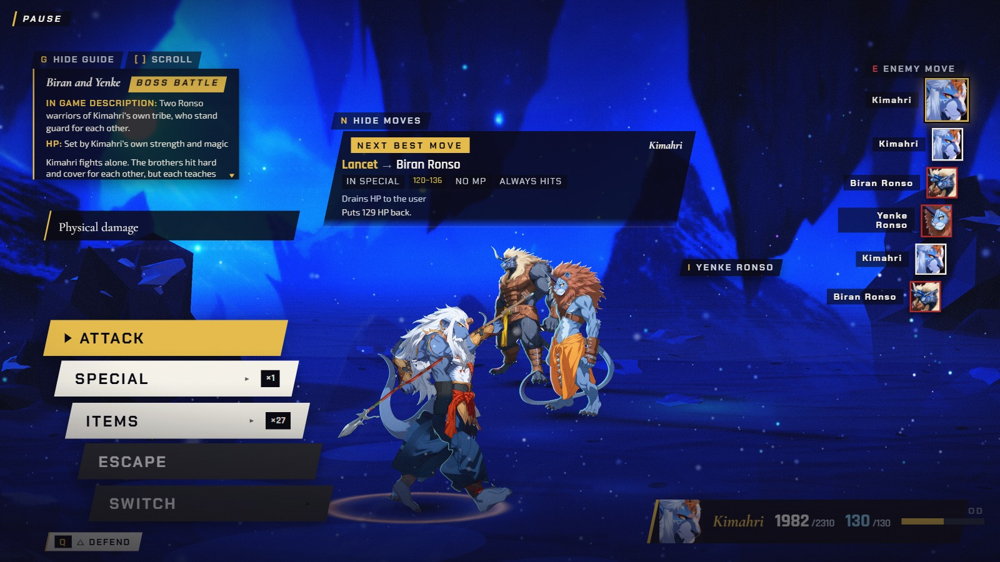

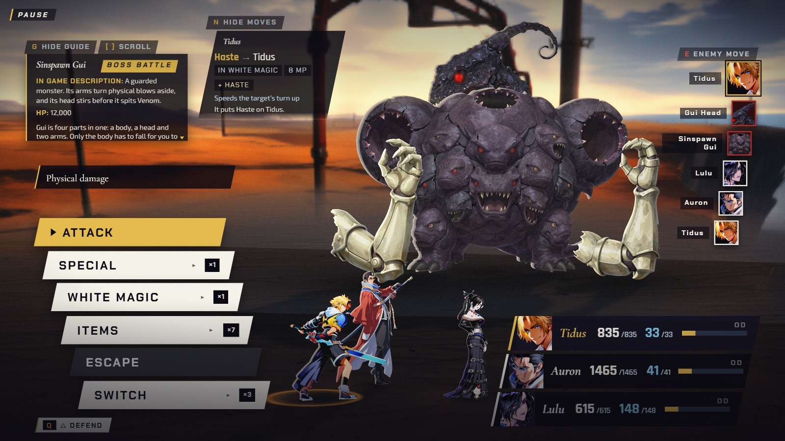

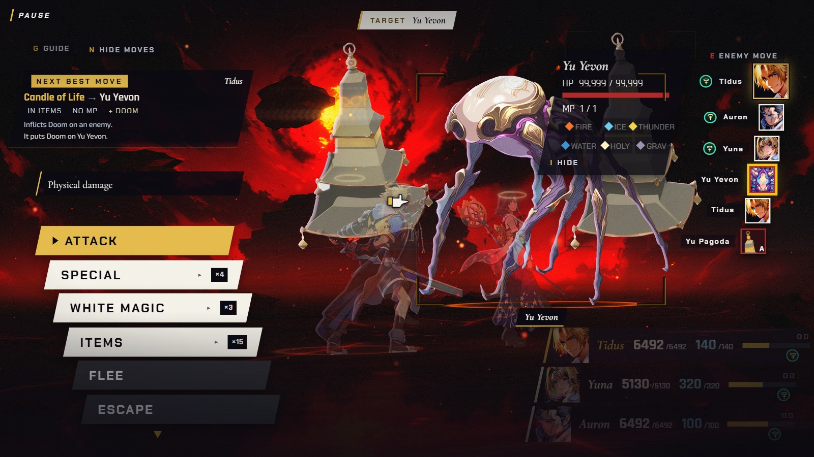

- **Both games, what this release carries:** everything in Release 54 (the FFX boss rows as the game's records have them, Doublecast as two picks, Isaaru's duels as the game's scripts set them, and Releases 50 to 53 under it) and everything in Release 39.5 (the second title screen The Echo, chapter-select tracks A and C, the PRESENTATION page in OPTIONS, a CHANGELOG entry and a build number on the title, the VOICE and VOICE-OVER rows, Behind the Scenes built and switched off; see the entry below). Nothing of Release 39.5 was changed to fit: the title screens are the ones Bailey asked for on 2026-10-18, chosen under OPTIONS > PRESENTATION, with Farplane the default. Pictures of both title screens are in that entry; this build's Echo title (1600x900 and 390x844, chosen by keys, then a reload) is `docs/screenshots/r55/title-echo-1600x900.jpg` and `-390x844.jpg`.
- **FFX only (the credits line is both games), the voices are Fish Audio Drama 3 clones of the cast, all 222 recordings (Bailey, 2026-10-18: "i'll go with the fish clone for all characters"):** Tidus, Yuna and Auron are rendered with Fish Audio Drama 3 from reference clips of the cast, two takes of each line, the take with the lowest word error by speech-to-text picked, a pronunciation lexicon on the text sent to Fish (aeon, fayth, Yevon, Seymour, Auron and the rest), any pause over 370 ms cut to 340 ms or less, and finished to the project's -19 LUFS by the same ship tool as before. The 200 recordings of the 39.5 build are replaced take for take, and Chapter XXVII (Mirror Aeons) gains the 22 it had no recording for (11 lines and their stand-ins), so the shipped set is 222 recordings in 12 manifests, 4.04 MB of the 20 MB voice line, 487 s of speech, **0 missing**, 3 muted as before (Braska's Valefor beat). The variant is `fish-drama3-clone` in `tools/audio/voice-variants.json` and is the default; the two ElevenLabs variants stay for comparison. The 22 cost about $0.015 on Fish. Nobody has heard any of it (agents cannot hear): the takes are on `review.html` and `pronounce.html` in the voice scratch folder. A credit line, `Voices: Fish Audio (Drama 3)`, is in the Credits panel now (the Fish licence asks for it when the product ships), and the switched-off Behind the Scenes page and its AI-tools list name Fish for the voices instead of ElevenLabs.
- **FFX only, Kimahri and Lulu are drawn as rigs (Bailey: "I like lulus new rigging, great job"; the rigs are branch `rig`):** each is one painting (the idle) cut into parts on bones, with a key for every pose the game paints it in (13 keys each; Kimahri 15 parts and 32 bones, Lulu 11 parts and 25 bones), so a pose change moves the figure instead of swapping two paintings. Both passed the rig gate with full coverage (`node tools/rig-gate.mjs --verify`, as the deploy runs it, PASS for both) and are the only two rigs in the release's art folder, a new mirror made by `tools/art-mirror-add-rigs.mjs` (5,401 files hard-linked from the r50 art, 104 rig files copied, manifest rebuilt, `PROVED`). **The switch is the art manifest's `rigs` list**: a subject that is not in it is the painting set, so Auron's rig (still in progress) and every other figure draw as before, and `?rig=off` turns the rigs off. Seen in the real game (`window.__pyrefly.rigs()`): Kimahri `on` in Biran and Yenke, Lulu `on` in Sinspawn Gui, everyone else `off: no rig listed in the art manifest`, at 1600x900 and 390x844. The look is Bailey's to judge (the rig's costume is the idle painting's; Lulu's defend and Overdrive show the paintings' own front-view upper bodies on the idle's skirt, a mixed costume, and her KO is a small full figure; Kimahri's six authored keys, `docs/handoff/rig-kimahri.md`, `rig-lulu.md`).
- **FFX only, the battle command menu follows the game, and Chapter III's last battles lose the aeons you have given up (the reverse-engineering stack for release 55, `docs/handoff/re-parity-r55-re.md`; Bailey: "I'll go with all of your recommendations"):** The menu now follows the original more closely. A caster who is Silenced or out of MP still opens Black Magic, White Magic, Skill, Special and Summon; the entries inside are greyed instead of the whole command refusing to open. A Cursed character with a full Overdrive gauge keeps the Overdrive row, greyed, and Yuna's Summon list keeps a knocked-out or recovering aeon as a greyed row. Escape, Flee and Switch are shown greyed, with no reason, in the fights that forbid them, and Talk appears only where the game gives it: Tidus no longer has a greyed Talk in Chapters I and II or in the last Chapter III fights, and Yuna has none in Isaaru's duels. Guard, Sentinel, an aeon's Shield and Boost and the Magus Sisters' orders open a cursor on the user and wait for a confirm, Talk and Evrae's Pull back open a cursor on the foe, an Overdrive that strikes random foes (Slice and Dice, the reels, the Gems, the Furys) opens a cursor even against a single foe, and a list with one entry opens instead of running its entry (Skill, Special, the magic lists, Summon, Items, and the Overdrive of Tidus, Kimahri, Auron, Wakka and Lulu). A cure or a potion starts on the caster, and a revive starts on the first fallen ally. In Chapter III's last battles the aeons you have given up are gone for good: each aeon Yu Yevon takes leaves Yuna's Summon list and Grand Summon's choices, so the possessed aeon you face and every aeon taken before it can no longer be called, and when none is left Summon and Grand Summon are unavailable. Grand Summon no longer lets you pick an aeon that has been knocked out (it used to spend your Overdrive and your turn on nothing). In the Last Summoning, a taken aeon is no longer shown greyed with a "Taken" tag; it is simply not in the list. Nothing about the rolls, the damage or the length of any fight changed: sixteen FFX chapters at twelve seeds play out event for event as before, and a player who answers a possessed aeon by calling another aeon needs about a tenth more turns in Chapter III. Read from the game's code and its files, not run. The switches as shipped: the menu draw items a to e, the Chapter III roster removal, the Grand Summon refusal and the target steps are on; the resting cursor and its refusal cue (f), the reasonless help slab (H), the foe-first cursor start (t3b) and the side switch (t5) stay off. On this line the Doublecast list opens onto grey spells as an opener does (the two-pick menu of Release 54 took the lane's change), and its header reads "Doublecast · 1 of 2". Words a player sees that changed: the help line of a one-entry list now reads "Open the Special menu." (and the other lists' names); "Can't escape" on the Flee row and "Nothing left to say" on Talk are gone with the rows they sat on; Sinspawn Gui's guide says "no bench, so Switch is greyed out (locked)" and the Last Summoning's two guides say the taken aeons are gone from the list.
- **FFX only, a status move the target is wholly immune to now says IMMUNE (FOC54-003 of the Release 54 focused review):** Slow on Seymour Flux, Shell, Protect, Reflect and the Nul spells on a Yu Pagoda, and any other status move against a target that resists the status completely, landed nothing and showed nothing, which read like a broken button; only Scan on a Pagoda said "immune". They now emit the same immune miss, which the HUD prints as IMMUNE. It is a new event after the status step, drawn from no random stream: no roll, no number and no turn moves. One switch (`IMMUNE_STATUS_MISS`, on); **four of the eighteen engine goldens moved** (`yunalesca` and `seymour-anima-macalania`, both seeds: the line's Darkness and Sleep items against Yunalesca and Rikku's Petrify Grenade against Seymour now log the miss) and were re-pinned, and with the switch off the four old digests come back exactly (`tests/unit/ffx-immune-status-miss.test.ts`, which also shows the on and off logs differ by those miss events and nothing else); every outcome is still a victory.
- **Correction (release 57, FFX only): this line's "which the HUD prints as IMMUNE" was not true.** The miss event carried the reason, but the FFX HUD drew every miss as MISS, so Slow on Seymour Flux and Shell on a Yu Pagoda showed MISS in release 55 and in release 56 (R56-003 of the Release 56 focused review). Release 57 prints IMMUNE for it (the Release 57 entry above). The engine half, the event and its reason, was right and is unchanged.
- **FFX only, Chapter XIV's warning no longer says "Guard first" with Defend switched off (FOC54-004):** when Grothia's gauge is full the line is "Yuna. His aeon is ready. Shield first.", the aeon's Shield being the real answer (it quarters Hellfire, the guide's own rule) and an option of the duel's menu; Yuna's stand-in line is re-recorded with Fish.
- **FFX only, Yu Yevon's Sensor plate reads like the rest of the game (FOC54-005):** HP prints `99,999 / 99,999` in the house number style (it was `99999 / 99999`), a read-out too long for the plate is set a size smaller so it no longer runs out of it (the target bracket's right stroke had stood over the last digit), and a scanned enemy shows its MP beside its HP (`MP 1 / 1` for Yu Yevon; the plate drew none). Every enemy's plate now prints thousands separators and an MP line; the phone card gets the same numbers.
- **Both games, a player note for every live release since 39.4.2, and one for this one (`src/app/changelog/releaseNotes.ts`):** the title's CHANGELOG panel lists 39.4.3, 39.4.4, 39.4.5 (RC2), 40 to 48, 50, 50.1, 51 to 54 and 55, each three to six plain lines tagged FFX, FFX-2 or Both, with nothing about the hidden chapters (Release 49 carried nothing else, so it has no note); the deploy takes `--release=55`.
- **Both games, the stand-in "no" cue is on the listening page:** `docs/audio/audition.html` has the menu's refusal cue (the `error` cue, `public/audio/sfx/parity-ffx-core.mp3` at 0.677 s for 0.43 s) with a player that starts and stops on those marks, for Bailey's ear; it is switched off in the build (item f), so nothing plays it.
- **Both games, rig format v2 and the rig lane kit (tools and engine plumbing, no visible change):** `origin/rig-v2` adds a second version of the rig file format, additive (a key may show or hide a part, or swap a part's image; the reader accepts versions 1 and 2, and a version 1 file reads and draws exactly as it did) and the `tools/rig/lane/` kit that cuts, fits and checks the next rigs. The two rigs that ship are version 1 and are unchanged: `rig-gate --verify` passes on both with the same digest, and `tests/unit/rig-v1-unchanged.test.ts` hashes all 26 of their keys equal to the old engine. `D:/pyrefly-art-rigs/lulu-v2` is NOT in the release's art folder: Bailey approved the version 1 sheets. The deep review before the deploy covers the version 2 engine files once, so later rigs can ship as data.
- **FFX only, The Pilgrimage (prototype, hidden): type `pilgrim` on chapter select (Bailey, 2026-10-18, "it needs a really addictive aspect and tighter core gameplay loop"; he picked "Option 2 + B: branching, boons" as a playable prototype only, rule 10):** no card, no sound and no sign appears on the board; the word starts a four-stop run of existing FFX fights (Seymour and Anima, then Evrae or Yojimbo, then Seymour Natus or the Mirror Aeons elite, then Braska's Final Aeon), each with a RUN tab in the real Party Prep, one of three boons (a real item or auto-ability, or the one new "Overdrive charged") after each win, a run-over page with Again in two presses, and a best run. It keeps its state in its own storage keys (`pyrefly-reprise:pilgrim:v1` and the experiments key) and never touches the save; no engine rule or boss number changed (a test runs every boon on every stop and compares the shipped record before and after). `src/app/pilgrim/` is classed with the front-end screens in `critic/policy.json` (focused review). Its four unit files and the door suites pass on this line, and its end-to-end spec passes at 1600x900 and 390x844 by real keys (against a dev server). A player who never types the word sees nothing, so it has no player note. Handoff: `docs/handoff/pilgrim-proto.md`.
- **The four merges, so a reader can tell them from the lanes (no new rules):** `origin/rig` conflicted in `src/main.ts`, `tools/pose-gate.mjs` and `docs/CONTRACT-CHANGES.md` (both sides kept in each); `origin/re-parity-r55-re` conflicted in `src/ui/ffx/CommandMenu.ts` and `commandMenuRows.ts`, because the lanes were written against the old Doublecast wrapper and Release 54 had replaced it with the two-pick flow (the two-pick flow stays and takes the lane's target-step start, refusal and opener rules; one pin moved: the opened list is headed "Doublecast · 1 of 2"); `origin/rig-v2` conflicted only in `docs/CONTRACT-CHANGES.md` (both entries kept); `origin/pilgrim-proto` conflicted in `src/app/screens/BattleScreenFlow.ts` (the run's armed-door block kept, and the chapter's release keeps its voice-over wrapper). What the merges needed on top, each proved by switching the cause off: the stage makes a painted figure with the one `await PaintedActor.create` it always had and asks the rig first (`tryRigFigure`), because the rig's awaits before the figure moved which microtask the entrance census's virtual clock slid on, and the census now judges a figure added mid-fight by the first thing the presenter tells it (the original run passes with the rig choice bypassed; the census failed the same three tests on `origin/rig` itself); the two art-sidecar tests count one `rig.json` per rig in the art folder; a recovering aeon's Summon row in `parity-ffx-engine-k-aeons-more` stays greyed under the menu-draw parity (it never could be picked); the rig deploy dry-run fixture copies `src/app/changelog` (the 39.5 deploy tools read it). Details in `docs/handoff/r55-assembly.md`.
- **A finding the deploy's gate does not see, for the driver:** the rig gate's full check (`node tools/rig-gate.mjs --rig <folder> --art <art>`, which renders every key against the approved paintings) says **OK, 13 of 13 keys, for Kimahri on `origin/rig`'s own tools and REFUSED on this line** (attack overlap 0.725 against the 0.75 bar, hurt and jump landmarks 0.081 and 0.086 against 0.06), and refuses Lulu on this line for four keys (attack, defend, Overdrive, sleep). The cause is the pose sizing rule of Release 53 (`tools/posescale/pose-ruler.mjs` and the changed bands and geometry), which registers the approved paintings differently from the line the rigs were fitted on. The deploy runs the cheap check (`--verify`: stamp, coverage, digest, costume, tier), which passes for both rigs, and the game draws both. The rigs are shipped as briefed; the fit and the stamp were not touched, and a refit on this base is the rig lane's.
- **Checked on this branch (not a review; none has run):** `npx tsc --noEmit` clean; the full unit suite on the assembled tree, **1,481 files (1,456 passed, 25 skipped, 0 failed) and 23,468 tests (23,359 passed, 108 skipped, 1 todo, 0 failed)** (the first run, before the merges' interactions were fixed, was 1,470 files with 5 failing: the rig deploy dry-run fixture, the entrance census, two art-sidecar counts and one aeons pin, all listed above); `node tools/orphans.mjs` lists 24 old modules and none of this release's; `node tools/pose-gate.mjs --check` PASS (1,106 paintings of 146 subjects: 829 pass, 79 waived, 198 exempt, 0 fail) and with `--rigs auto` PASS but `0 rigged` (the finding above); `node tools/rig-gate.mjs --verify` PASS for Kimahri (13 keys, full coverage, 1x tier proved) and Lulu (13 keys, full coverage, 1x tier proved) against the new art mirror, before and after the rig-v2 merge, and the deploy's own `enforceShippedRigs` reads 2 verified, 0 problems; `node tools/audio/qa.mjs --strict`: 0 cues with findings, 0 sound-effect findings, voice-over 222 recordings in 12 manifests; the Pilgrimage's end-to-end spec 2 of 2; real keys in headless Chromium on the real GPU, with no console error and no page error: Kimahri and Lulu drawn as rigs at 1600x900 and 390x844, The Echo title chosen by keys, a recorded line started in Chapter I with the voice director's own log (started 3 of 3 asked, lines heard to their end), Yu Yevon's Sensor plate with the cursor on him. `node tools/critic-plan.mjs`: a DEEP review before the deploy (the save data, as the entry below says).
- **Still open (Bailey's, or the driver's):** nobody has heard the Fish takes or the stand-in "no" cue; the look of the two rigs is his to judge; he reads the Behind the Scenes page's copy (it now names Fish) before that page goes live; the Auron rig is still in progress and not in the release; and the deep review's settlement on the live build is still owed (round 26 ran before the deploy).

## 2026-10-18 · Release 39.5 (ported onto Release 54): a second title screen you can choose, two more chapter-select tracks, one PRESENTATION page in OPTIONS, a CHANGELOG and a build number on the title, and Tidus, Yuna and Auron speaking in the FFX chapters (branch r395-port; live inside Release 55)

Address: https://echoesofspira.com (main b24614c05, bundle Cokaxk4X, live since 2026-10-19T05:28Z inside Release 55; built from branch r395-port: release 39.5, built on 7 to 9 October on top of live 39.4.1 (`04cdcd45`) as branch `r395-int` (`fbff68c54`, 20 commits) and never merged onto the line that went live, merged with `--no-ff` onto the Release 54 candidate `r54-rc` (`4f4dc77bc`, which carries the live Release 42 and Releases 50 to 53); it shipped inside Release 55, whose deep review (round 26) covered the save-data class, see "Saves" below). Bailey's words behind it, 2026-10-07 for the title: "go with this as a new selectable title screen, and once selected it hides echoes of spira since it's already in the image itself. it will look neater that way. current title screen is still the default."; for the board's music: "I'll go with B", "but C as a selectable alternate", "and A as a selectable alternate as well", "B as the default"; 2026-10-08: "go with C" for the OPTIONS layout, and, for the title, "Include a changelog button on the title screen and build number should be shown on the title screen." with "I'll go with all your recommendations" and, on the page's name, "Scenes not screens."; for the voices: "add tidus, yuna, and auron voiced lines in the game stat!" and "Tidus: B / Yuna: B / Auron: B"; and 2026-10-18, asking why none of it was in the live build: "can you place the different selectable title screens i mentioned to you before? i still dont see it in the live build". The merge had conflicts in 22 files; every one was resolved by keeping both sides (the list is at the end of this entry). Every paragraph below says FFX only, FFX-2 only or both.

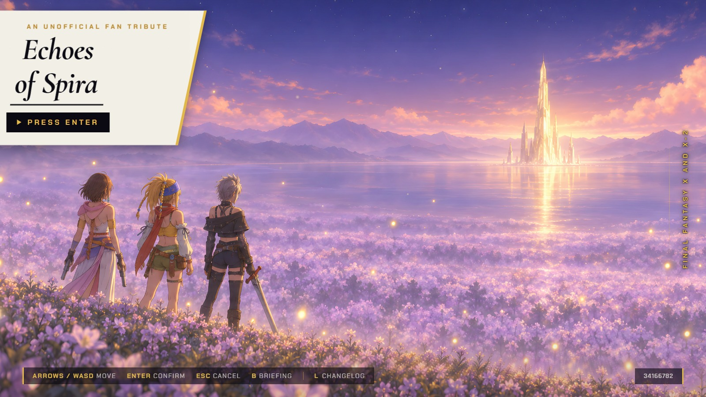

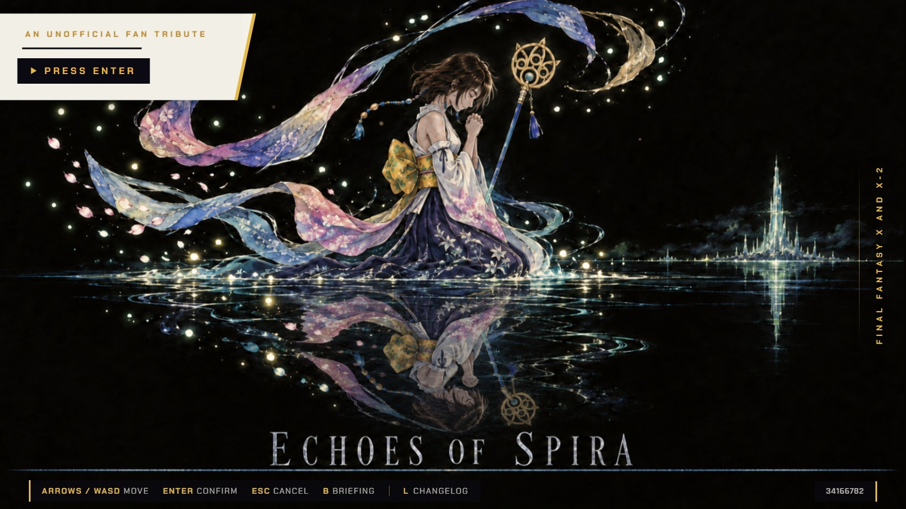

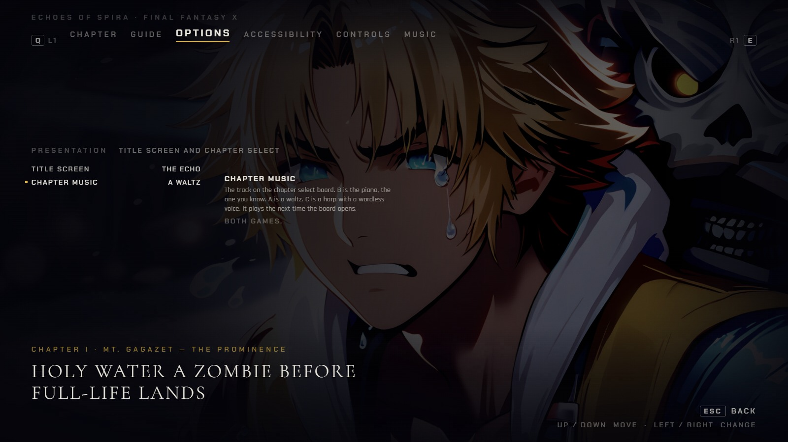

- **Both games, TITLE SCREEN: The Echo is a second title screen you can choose, and today's Gullwings title stays the default (D-548, D-561):** The Echo is Yuna kneeling in still water, with the words ECHOES OF SPIRA painted into the picture, so when it is chosen the game's own "Echoes of Spira" lettering is not drawn (the picture's alt text carries the words for a screen reader); the press-Enter slab, the strap, the key-hint row and the tap target stay. The choice is a list of title screens, Farplane (today's painting) first and the default, so a third can be added later; it is read every time the title is drawn. The painting is `public/art/title/echo.png` (1682 by 932; the pick's six grey capture-border columns cropped, nothing else touched), local like all art, with a lossless WebP made from it at build time like every other master; The Farplane title's markup is byte for byte what it was. It has no 2x master, so a 2x screen upscales the 1x file. What keeps Yuna and the painted lettering clear: from 0.8:1 to 1.9:1 windows (1600x900) the picture covers and is anchored 65 percent down; 1.9:1 and wider show the whole picture on its own black; a portrait window that is not a phone draws it 140 vw wide in the middle; a portrait phone (390x844) draws a box of the picture's aspect 192 vw wide and keeps the middle 52 percent, which holds Yuna whole and all the lettering. Known limit carried: `index.html` still preloads the Farplane plate for everyone, so a player who chose The Echo fetches one unused picture on a cold load.
- **Both games, CHAPTER MUSIC: A and C are two more chapter-select tracks you can choose, B stays the default (D-551, D-592):** `chapter-select-a` is the waltz (3/4 at 84 BPM, loop of 42.80 s after 27 s that plays once) and `chapter-select-c` is the dreamy one with a wordless voice (3/4 at 66 BPM, loop of 54.53 s after 22.8 s); B keeps the cue `chapter-select`. Both are ElevenLabs takes, shipped at LAME V4 (about 146 and 140 kbps; 2.74 MB for the pair, D-592) so they would fit the old 90 MB line, and they still fit the 105 MB line of this build (`node tools/audio/qa.mjs --strict`: 0 findings, shipped audio 71.61 MB of 105 MB). A browser that cannot load an MP3 plays B's synthesised score for A or C (stand-ins in `src/audio/tracks/index.ts`, so the sound test lists B once). Disclosed, as on the 39.5 build: chapter select A fails the project's stereo gate as picked (0.529 correlation, -5.1 dB side over mid, -1.2 dB mono loss) and ships wide as picked, with a narrow variant that passes staged one command away (`node tools/audio/music-elevenlabs.mjs install --cue=chapter-select-a --variant=narrow`, then `measure`); no agent has heard either loop (agents cannot hear, rule 13), so the loop points are measured, not heard.
- **Both games, OPTIONS has one PRESENTATION row that opens a page with TITLE SCREEN and CHAPTER MUSIC (layout C, D-603):** the row reads both choices at a glance (`THE ECHO · A`) and opens a page in EYE CANDY's look: two rows, one help line for the focused row ("Both games." under it), its own `Esc BACK`. Left and Right step a value through its list and wrap, Enter steps forward, a tap steps the row it lands on; Esc, Backspace, X, the pad's Circle and Start, and the prompt go back with the cursor on the PRESENTATION row. On this line the OPTIONS list is ten rows in both games (MASTER VOLUME, MUSIC, SOUND EFFECTS, VOICE and VOICE-OVER in FFX, TEXT SPEED, EYE CANDY, X-2 BATTLE and ATB SPEED in FFX-2, STRATEGY GUIDE, BATTLE HELP, PRESENTATION), not the thirteen it was built against, because TEXT SIZE, REDUCE MOTION and LOW EFFECTS now live on the ACCESSIBILITY tab.
- **Both games, the title screen has a CHANGELOG entry and a build number (D-615, D-616, D-622, D-623):** CHANGELOG is an entry in the key-hint row (key L, a click or a tap) that opens an Ink and Gold panel of player notes, releases newest first, each line tagged FFX, FFX-2 or BOTH; Up, Down, PageUp and PageDown scroll, Esc, X, Backspace, Enter, Space, Z or L close it, and Enter never starts the game from inside it. A small build number, "Release <name> · <commit>", sits at the bottom right on a desktop window (top right on a phone and under 1330 px wide; under the "we've moved" note on the old address); a dev server shows the commit alone and a preview shows "Preview · <commit>". The words come from one typed file, `src/app/changelog/releaseNotes.ts`, 3 to 6 lines a release in player words with no hidden chapter or secret word (a validator refuses them). **That file ends at Release 39.4.2 and has no note for 39.4.3, 39.4.4, 41, 42, 39.5 or anything after, so the panel would read as stopped at 39.4.2 and `npm run deploy` refuses until the newest note is the release being cut: the notes are owed before any deploy** (the 39.5 lines the lane drafted: a second title screen chosen under OPTIONS > PRESENTATION; two more chapter-select tracks; Tidus, Yuna and Auron speak; the OPTIONS list with one PRESENTATION row; the title's CHANGELOG and build number).
- **FFX only, Tidus, Yuna and Auron speak in the FFX chapters (D-556, D-593, D-594; the plumbing is both games, the recordings FFX only):** 200 recordings in 11 chapter manifests (3.60 MB of the voices' own 20 MB line; 433 s of speech; 74 Tidus, 62 Yuna, 64 Auron), installed as "pauses shortened" because that is the only variant that passes the 400 ms inner-pause gate (the longest pause is 397 ms); "as recorded" is one command away (`node tools/audio/voice-variant.mjs recorded`). A line's recording starts as its text starts typing, an auto-advancing line waits for its voice and 200 ms, Confirm finishes the text and the voice fades in 60 ms on the advance, the music dips 3.5 dB under a line, the pause menu freezes the line, and a missing, late or undecodable recording is just the text as before. Mid-battle callouts and victory lines are voiced too; a beat costed with its recordings may be extended (three are, each by under a second) and three lines of Braska's Valefor entrance are left text only so the scene keeps its length. OPTIONS gets VOICE (a level) and VOICE-OVER (ON by default) in FFX chapters and neither in FFX-2 or FF7, which have no voices (rule 14). **Found by the port:** this line's Chapter XXVII added 31 spoken lines (`docs/audio/voice-line-inventory.json` regenerated, 993 to 1,024 lines, none retired, so all 200 recordings still match their lines); 22 of them are Tidus, Yuna and Auron (693 characters), so the plan now reads 225 recordings (was 203; 6,203 characters, about $0.50 at the API list price for the whole pass, about $0.06 for these 22) and the ship report lists the 22 as `missing`. Nothing was recorded or spent; until someone with Bailey's yes records them (rule 11) Tidus, Yuna and Auron are text only in Chapter XXVII. Nobody has heard the take; the level (-19 LUFS), the 22 length warnings and the choice between the two variants are Bailey's ear.
- **Both games, BEHIND THE SCENES is built and switched OFF, and `npm run deploy` needs a release name and a player note (D-625 to D-630, D-639):** the page (five cards, then six chapters, the critic's real scores, the AI tools named, the community sources thanked, "measured from the real game on Bailey's own copy" once) is behind one constant, `BTS_LIVE = false` in `src/app/changelog/behindTheScenes.ts`; with it off the title has no entry, no key and no words of the page, its sixteen pictures (`public/bts/`) are pruned from every build, the in-game Credits are as they were, and the page's own chunk is not emitted (proved by bundling the title's real module graph in memory with the switch off and with it on as the control). Its numbers are a snapshot of 8 October printed with that date; the tests that compare them with the repository are floors on this line (the page may be behind, never ahead) and the numbers are refreshed, every sentence re-read, when Bailey approves the finished page, which only he can. `npm run deploy -- --release=<name>` (`39.5`) is refused unless that name is the newest note in `releaseNotes.ts`; a `--preview` asks for no note; the name travels `PYREFLY_RELEASE` to `__PYREFLY_RELEASE__` to the chip and into `docs/deploys.log` as a trailing `release=`.
- **Both games, saves: four new settings, all additive, `SAVE_VERSION` still 1:** `titleArt` (`farplane` default), `chapterSelectMusic` (`b` default), `voiceOn` (ON) and `voiceVolume` (0.9) join `Settings` in `src/app/SaveData.ts` (the front-end pair's list and its migration live in `src/app/saveFrontend.ts`); a save that predates them, or holds a value that is not on the list, reads the default. All twelve real saved exports from releases 20 to 37.1 load unchanged, keep every chapter record and gain only the defaults. This is why the change is the save-data class: `node tools/critic-plan.mjs` on the 39.5 paths says DEEP before the deploy because of `src/app/SaveData.ts` alone (without that one path it says a FOCUSED review before the deploy and the DEEP one after, on the live build).
- **What the port itself changed, so a reader can tell it from the 39.5 build (no game code; test pins and one record):** the OPTIONS-row pins say ten rows (above); the music cap pins say "at least 90 MB" because the cap is 105 MB on this line (driver item 53a); batch 2's and the stereo-gate record's music totals add the two alternates' 2,737,739 bytes (`alternates395Bytes` in `tests/unit/helpers/musicBatch2.ts`); the alternates' exemption and retired-cue checks accept the line's later ElevenLabs batches and batch 2's retired cues; the Behind the Scenes repository counts (chapters, research notes, tracks, critic rounds) became floors; the four new settings joined the settings lists in `access-save`, `save-comfort-migration`, `save-fx-looks` and `save-fx-parts`; and the voice documents were regenerated by their own tools (`voice-line-inventory.{json,md}`: 31 new lines, none retired; `voice-ffx-plan.md`: 225 recordings; `voice-ffx-ship-report.json`: the 22 `missing`; the 200 installed files and their manifests are byte for byte as installed).
- **Checked on this branch (not a review; none has run):** `npx tsc --noEmit` clean; the full unit suite, 1,437 files (1,411 passed, 25 skipped, 1 failed) and 22,908 tests (22,798 passed, 108 skipped, 1 todo, 1 failed): the one failure, `art-sidecar-redact` (the guard that lists every source file reading an art JSON saw the voice manifests' reader, which reads audio JSON, so `src/story/voice/` joined the audio exclusion), was fixed after the run and passes alone, 19 of 19; `node tools/orphans.mjs` lists 24 old modules and none of 39.5's; `node tools/pose-gate.mjs --check` PASS; `node tools/audio/qa.mjs --strict` 0 findings (shipped audio 71.61 MB of 105 MB, the voices 3.60 MB of their own 20 MB line). Real keys in headless Chromium on the real GPU, a dev server stopped by its PID after: 43 checks, 0 failed, no console error, no page error, no failed request (`docs/screenshots/r395-port/evidence.json`): at 1600x900 and at 390x844 (a touch phone) Enter on the Farplane title reaches chapter select, Chapter I (and, at 1600x900, FFX-2 Chapter IV) opens, Esc opens the pause, E reaches OPTIONS, Down reaches PRESENTATION, Enter opens the page, Right steps TITLE SCREEN to THE ECHO and CHAPTER MUSIC to A WALTZ, both are written to the save, Esc returns to the row reading `THE ECHO · A`; after a reload the title is The Echo (its class on, no HTML wordmark, the echo plate, the alt text "Echoes of Spira"), and L opens the CHANGELOG panel. The pictures are in `docs/screenshots/r395-port/`. Not run: a production build, `art-browser-load`, a listen to any recording or loop, the deep or focused review.
- **The 22 merge conflicts, each kept on both sides:** `docs/CONTRACT-CHANGES.md` (39.5's deploy-gate entry placed by date among the line's, newest first), `docs/audio/THEMES.md` (the line's ending and defeat rows kept, the two alternates added), `docs/target/approved-hashes.json` (`title:echo` added by parsing, not by text), `public/audio/manifest.json` (the two alternates beside the line's cues), `BattleScreenFlow.ts` (the chapter's release is the line's music warm around the SFX voice around the voice-over), `BattleScreenCutscenes.ts` (the Mirror Aeons seam's `data-midbeat` line kept, the voice-costed deadline added), `CutsceneScreen.ts` and `ResultsScreen.ts` (the voice imports and `voice.stop()` beside the line's own code), `TitleScreen.ts` (the line's prefetch-on-first-input kept, the art choice and the Echo's no-2x-upgrade added), `PauseScreenPanels.ts` and `pause/panels.ts` (the line's ACCESSIBILITY rows kept, VOICE rows and PRESENTATION added), `audio/tracks/index.ts` (the line's stand-ins and retired cues kept, the alternates added as stand-ins), `tools/audio/manifest-io.mjs` (the line's `addMusicEntryText` and boolean entries kept, exported under 39.5's names `musicEntryLines` and `musicEntryBody`), and nine audio and save tests whose lists both sides had extended. Files over the 400-line house cap in this merge were all over it before (`SaveData.ts` 601, `BattleScreen.ts`, `BattleScreenCutscenes.ts`, `BattleScreenFlow.ts`, `CutsceneScreen.ts`, `ResultsScreen.ts`, `AudioManager.ts`, `tracks/index.ts`, `manifest-io.mjs`, `qa.mjs`, `deploy-pages.mjs`), plus the new proof script `tools/audio/voice-browser-proof.mjs` (423).
- **Still open (Bailey's, with what the build cannot decide):** which voice variant ships (his ear); whether chapter select A ships wide or narrow, and whether A and C loop well (his ear, rule 13); whether The Echo wants a 2x master; whether the unused Farplane preload for an Echo player matters; the hint row's and slab's place under The Echo is the lane's inference, not his words; and his approval of the finished Behind the Scenes page before `BTS_LIVE` is switched on. Records owed: the 39.5 and later player notes (above), and the release name this build is cut under.

## 2026-10-18 · Release 54 (r54): the Release 53 contents plus the FFX boss rows as the game's records have them, Doublecast as two separate casts, and Isaaru's three aeon duels as the game's scripts set them

Address: https://echoesofspira.com (main 4f4dc77bc, bundle CLLPzAAR, live since 2026-10-18T19:14Z until Release 55 replaced it on 2026-10-19; built from branch r54-rc: the Release 53 candidate (r53-rc, `9c91a8c3a`) merged into the reverse-engineering assembly `re-parity-r54` (`94012a68d`), which is the FFX boss-data build with all six switches on, then the Doublecast lane, then Isaaru's formation flags and command lock, then the follow-up that draws Yuna's switched-off rows greyed, then the two-pick Doublecast menu (branch dcast-hud, `4c1bf5461`, merged without a conflict) and the docs-only research notes (re-parity-r54-docs-c, `4697bb72a`); the one merge conflict was `docs/CONTRACT-CHANGES.md` (every entry of both sides kept, newest first), and no pin overlapped, so none was re-derived: the FFX golden (18 of 18), Chapter III's pin (17 of 17) and the FFX-2 Den of Woe carry pins (7 of 7) pass as committed on the merged tree; the focused review `critic/reviews/4f4dc77bc-focused.json` is SHIP with the changed area PASS, and the live check `critic/reviews/4f4dc77bc-live.json` is PASS, 5,309 files byte for byte). Bailey's words behind the new parts: 2026-10-08 "It needs to be a 1:1 parity."; 2026-10-17, asked which boss-data fixes should match the game, "All six (Recommended)", and, asked whether Isaaru's duels should match the game, "Match the game (Recommended)"; and the standing "deploy every release as soon as its review says it can ship" and "i'll go with all your recommendations". Everything the reverse-engineering lanes added is FFX only; the FFX-2 and FF7 engines and data are untouched by them (`ffx2-atb-golden` 6 of 6 and `ff7-golden` 3 of 3 pass unchanged), and the Release 53 contents (both games, FFX-2 only and FFX only as its own entry says) are carried as they were. Every paragraph below says FFX only, FFX-2 only or both.

- **FFX only, the boss rows are the game's own records: all six boss-data switches are on (re-parity RC10, lane FFX boss data; Bailey, 2026-10-17: "All six (Recommended)"):** six places where a boss's sheet in our data differed from the monster record the game reads are now the record's values (one paragraph each below). Each switch changes one table of numbers on the battle's own copy of the enemy group, once, as the battle is built; the data files themselves are not edited. Turning them on moved exactly one thing in the tests, and it is the stat floors (D1): 12 of the 18 digests of the FFX golden and 11 of the 12 seed rows of Chapter III's pin were re-pinned, with every golden outcome still a victory and no outcome and no number of links won moved in Chapter III (seed 3, its defeat on the first link, is the one seed that does not move). Each re-pin was proved on a scratch run of nine switch sets: with all six switched off the tables equal Release 53's exactly (0 of 18 differ), D1 alone gives the new tables, and D3, D7, D8, D9 and D10 alone and together move none. The six switched off remains a tested state (the unit files keep the off state as its own proof).
- **FFX only, D1, stat floors (Chapters III, VII, VIII, IX, X and XIV):** a boss whose sheet carries a 0 in Defence, Magic Defence, Magic, Agility, Luck or Accuracy is now treated as the game treats it, as a 1. The only one that touches a fight is the Defence and Magic Defence floor: each blow or spell on such a boss lands about 0.7 percent weaker, so fights in Chapters III, VII, VIII, IX, X and XIV play out a little differently from seed to seed. It is a small deterministic effect, not random noise: over 2,000 paired simulated fights Chapter XIV loses 16 fights and wins none back (about 0.8 point lower), and Chapter VII loses 6 and wins 20 (about 0.7 point higher); across 6,000 fights the line wins 95.0 percent before and 94.9 percent after. Chapters I, II, XII, XVII and XVIII are unchanged.
- **FFX only, D3, Zanmato level:** Evrae's Zanmato level reads 4, as the game's file says (it read 3), and Mortibody, Ginnem (Mira) and Isaaru carry theirs. Only a player's Yojimbo reads it and no chapter pairs him with them, so nothing in play changes.
- **FFX only, D7, Seymour Flux cannot be Slowed:** as his record says, Slow now fails on him and Haste still lands. The shipped line never Slows him.
- **FFX only, D8, Evrae can be Doomed:** as his record says. A Doom that lands puts a marker on him that never runs out, because his 30-turn countdown cannot finish in the fight. Nothing in the line casts Doom.
- **FFX only, D9, the Life flag:** nine bosses (Evrae, Sin, Seymour in Macalania, both Fins, Sinspawn Genais, the Sin Core and both Yu Pagodas) are immune to Life as the game has it: a revival no longer kills them if they are Zombies. No fight differs.
- **FFX only, D10, the records' remaining immunities and flags:** the Yu Pagodas, Braska's Final Aeon, Yu Yevon, the Mortiphasm, Cid, Mira, Isaaru and Daigoro take the immunities and flags their records carry: the Pagodas are immune to Shell, Protect, Reflect and the four Nul spells, which now fail on them as an immune miss; the Pagodas and the Mortiphasm are no longer immune to Curse; Auto-Life fails on Braska's Final Aeon, Yu Yevon, Mira, Isaaru and Daigoro; the Scan marker is refused by Yu Yevon, Cid, Isaaru, Mira, Daigoro and the Mortiphasm. Two changes a player sees: **Scan on a Yu Pagoda stops working** (before, a Scan revealed it and the Scan status landed; now nothing is revealed and the status is refused, so it shows as an immune miss), and **Sensor on Yu Yevon reveals him** (before it showed the plate "Immune to sensors."; now it shows HP 99,999 and MP 1), in Chapter III's last link and in Chapter 28. No fight the line plays differs.
- **FFX only, Lulu's Doublecast is two separate choices, in the engine and now at the menu, and each cast pays its own cost (re-parity RC10, lane FFX Doublecast, and branch dcast-hud, Option A "Second round", picked by the driver under Bailey's standing "i'll go with all your recommendations"):** in the game a Doublecast is two separate choices, a spell and its target and then a second spell and its target, and each spell's MP is taken when that spell is cast, at that spell's own price. We measured it on the Steam copy: Lulu with Half MP chose Doublecast, then Fire, then Firaga, and her MP went 452, then 450, then 442 (2 for Fire, 8 for Firaga). The engine now plays exactly that. Fire then Firaga costs 4 then 16 (2 then 8 with Half MP), Firaga then Fire costs 16 then 4, and a second spell the MP that is left cannot pay is dropped and costs nothing, so with 19 MP the order decides which of the two you get; a second spell aimed at a target the first one killed is dropped at no cost too (both drops are inferred from the game's sub-action rule, not watched). Two different spells show as two banners in a row ("Doublecast: Fire", then "Doublecast: Firaga"). The menu now composes it the same way: pick a spell and its target, and the list comes back for the second cast, headed "Doublecast · 2 of 2", with the first cast shown on its target, the MP it holds on Lulu's card ("20 -8 -> 12") and every spell the MP left cannot pay greyed (the engine's own verdict, not a sum in the menu). One spell can now go on each Yu Pagoda, or Firaga then Fire; the second target commits both. Esc steps back one stage at a time; on a phone a tap on the list's title goes back, and a greyed tile says "Not enough MP". Also fixed in every FFX chapter: backing out of an aim with Esc no longer leaves the folded "I YU PAGODA" chip standing over the list. The advisor card now names both casts ("Doublecast: Fira + Blizzard"; "Doublecast: Firaga + Firaga" for the shipped lines, which still cast one spell twice). The menu was driven with real key presses in headless Chromium at 1600 by 900 and 390 by 844 (screenshots under `docs/screenshots/dcast-hud-*.png`); Bailey has not been shown it, since the end state is the driver's delegated pick. Chapter III and Chapter XVIII, the two fights whose line uses Doublecast, play event for event as before on 500 seeds each (479 and 500 wins, as before: 12,475 and 6,529 Doublecast commands), and every other FFX chapter, which never Doublecasts, plays event for event as before too (12 seeds each, and 500 seeds each for the thirteen others, 6,500 of 6,500 chains identical). Chapter III gives Lulu One MP Cost, so every spell costs 1 MP there and nothing greys in the shipped fight; Chapter XVIII's Lulu pays the full costs.
- **FFX only, Chapter XIV, Defend is off in Isaaru's three aeon duels (re-parity RC10, lane FFX formation-script flags):** in Grothia's, Pterya's and Spathi's duels the duel's own script switches Defend off for the whole battle, so Yuna and the aeons have no Defend and the Defend tab under the command window (Q or Triangle) is not shown there. In the original, Triangle at that window plays a refusal sound and does nothing; ours stays silent for now. Nothing else about the duels changed through this flag: twelve seeds of every FFX chapter and 500 seeds of Chapter XIV with two different lines play out the same, event for event, because the suggested line never uses Defend in that chapter. Read from the game's code, not run. The other flags the game's fight scripts set (counters off, Anima's chains off, escape always) are not fought by any chapter, or are only a drawing, and were not built.
- **FFX only, Chapter XIV, Yuna's menu in Isaaru's duels is the game's own: Summon and Grand Summon (re-parity RC10, lane FFX Isaaru commands; Bailey, 2026-10-17: "Match the game (Recommended)"):** in Isaaru's three aeon duels (Grothia, Pterya, Spathi) the duel's own script switches off Yuna's Attack, Item, Weapon, Armor, Skill, Special, Black Magic and White Magic (and Switch, Escape and Flee for everyone), so she can no longer attack, heal, cast Nul spells, use Pray or Scan, or use items between aeons; those rows stay on her menu, greyed, and only Summon and Grand Summon can be picked. The window opens with the cursor on the Overdrive row (Grand Summon), the first row she can pick, with Summon just below it. Her aeons' menus are unchanged apart from Defend, which the duel switches off for everyone. This replaces our earlier estimate (her attacks greyed and everything else open). Nothing else about the duels changed: twelve seeds of every FFX chapter and 500 seeds of Chapter XIV, with the bench's line and the app's line, play out the same, event for event, because the suggested line only ever summons in that chapter. A player who healed Yuna, used a Phoenix Down, cast Pray or waited out an aeon's death with Cura is moved, and that is the game's own rule. Read from the game's code and scripts, not run.
- **FFX only, Chapter XIV's strategy guide says what Yuna's menu is now (the driver's text fix):** the first rule of the Isaaru guide said Yuna "can summon, heal herself and use items, nothing else". It now says she can do one thing in the duel, summon: Summon and Grand Summon are the only rows she can pick, every other row stays on her menu greyed and refuses a pick, and Defend is switched off for everyone in the duel. The source line names the duel's formation scripts and the two notes that read them, in place of the old "our estimate for the greyed rows".
- **Disclosures this release carries (what a player or a bench can now see, each with its game; every one is FFX only):**
  - **Sensor on Yu Yevon** (Chapter III's last link and Chapter 28) now shows HP 99,999 and MP 1 where it showed "Immune to sensors." (D10).
  - **Scan on a Yu Pagoda** misses as immune: nothing is revealed and the Scan status is refused (D10; Chapter III and Chapter 28).
  - **Slow on Seymour Flux** never lands now. Through the engine's own path it landed in 198 of 200 casts before (the rest are the status roll's misses) and lands in 0 of 200 now; Haste still lands. The shipped line never casts Slow at him (D7).
  - **Doom lands on Evrae** and sticks with its counter at 30 (it never landed before; 50 of 50 land now), and the counter cannot run out in the fight, so it shows as a marker that stays. The shipped line casts no Doom (D8).
  - **Shell, Protect, Reflect and the four Nul spells fail on a Yu Pagoda,** each showing an immune miss; Shell and Protect landed in every one of 200 casts before and in 0 of 200 now (D10).
  - **When Lulu's remaining MP cannot pay for any second spell,** the list opens with every spell greyed and only Back leaves it, as the game does (read from the game's menu code and emulated).
  - **The command window's cursor and the greyed rows (Isaaru's duels, Doublecast's second list):** the game, as read from its menu code (and, for Doublecast's second list, run in an emulator), draws a disabled command's row greyed with no reason text, lets the cursor rest on it, and plays refusal cue 3 when it is confirmed. Our window's cursor lands on the nearest offered row and skips greyed rows, and a refused pick shakes the row with no sound (cue 3 has no counterpart in our audio). This is pre-existing command-window behaviour; it waits for Bailey's decision. The Defend tab, a separate control, is absent rather than greyed in Isaaru's duels. The phone's new reason line ("Not enough MP", "Silenced") appears only where the engine gives a reason: the rows Isaaru's duel switches off carry none, as the game prints none, and the one reason left in those duels is the game's own mirror lock, which names the foe on the locked aeon's tile ("Mirror of Grothia").
  - **Every outcome is unchanged by the Doublecast, Defend and Isaaru-lock lanes:** the assembly's identity run (all sixteen FFX chapters, seeds 1 to 12, 192 plays, played on the boss-data build and on the assembled tree) gives 192 of 192 identical outcomes, links won, party turns, engine turns and party KOs, and 192 of 192 identical whole event logs; the only difference in the whole run is Chapter XIV's command menus (Yuna's greyed rows, no Defend tab), 0 of 12 identical there and 180 of 180 identical in the fifteen other chapters. The menu merged after that run adds one read-only question to the engine (`doublecastPicks`) and no rule. The one thing that does move outcomes is D1, in the paragraph above, and its numbers are those of the boss-data lane.
- **Still open (Bailey's, or the driver's, with the checks a real keyboard still owes):** whether the Defend tab should be greyed rather than absent in Isaaru's duels; the refusal cue 3 (the shake stands in; the grey flag is a reading of the game's menu code, not a watched screen); Yuna's Talk row in the duels (left greyed with its older reason, the game's scripts never touch it there); the monster scripts that switch commands off mid-fight (a row for the gap scan); and the real-input checks owed in a headed browser with screenshots: Scan on a Yu Pagoda, Sensor on Yu Yevon (Chapter III and Chapter 28), the Doublecast menu with a real pad and a phone (the browser run was keyboard and touch emulation), and Isaaru's greyed rows in Chapter XIV at 1600 by 900 and 390 by 844 (the cursor on Grand Summon, a pick of a greyed row shaking, no stray dash in the help slab on a greyed row). Notes: `docs/handoff/re-parity-r54.md`, `re-parity-rc10-ffx-boss-data.md`, `-doublecast.md`, `-formation-flags.md` and `-isaaru-commands.md` (all under `re-parity-rc10-ffx-`), and `doublecast-hud.md`.
- **Records (no player-visible change):** research notes: raw byte listings replaced by values with their sources (the Dark Aeons note and the Angra Mainyu note, hard rule 8; docs only, nothing reads them).

## 2026-10-17 · Release 53 (r53): the Release 52 contents plus one rule that sizes every standing pose, the FFX hit order, the FFX-2 chain windows that follow each body's flinch, Chapter VI's fresh-battle openings, the FFX-2 minigames, a gentler lunge, an opening that waits for its framing, and the Garment Grids' statuses

Address: https://echoesofspira.com (main 9c91a8c3a, bundle D9wTDH4W, live since 2026-10-18T07:43Z until Release 54 replaced it; built from branch r53-rc: release 52 (r52-rc) with Chapter VI's fresh-battle openings and the FFX-2 per-body chain windows (re-parity-rc9-x2-hit-reaction-r52, merged and checked by the RE session), then the FFX-2 minigames lane (re-parity-rc10-x2-minigames), the FFX hit-order lane (re-parity-rc10-ffx-hit-order) and the pose sizing rule (pose-ruler), then the pose motion lane (pose-swap, with the driver's decision that the 1/40 s clamp is the animation clock's alone), the Chapter IV opening lane (ch4-camera) and the Garment Grid status lane (re-parity-rc10-x2-grid-status, nine den-of-woe-carry pins re-recorded on the merged tree), merged one at a time with each merge's tests run, then the driver's text and small fixes; the focused review `critic/reviews/9c91a8c3a-focused.json` is SHIP with the changed area FAIL on the disclosed FOC53-001 (swap jerks), and the live check `critic/reviews/9c91a8c3a-live.json` is PASS, 5,309 files byte for byte). Bailey, 2026-10-17: "deploy every release as soon as its review says it can ship" and "i'll go with all your recommendations". Every entry below says FFX only, FFX-2 only or both.

- **Both games, one rule sizes every standing pose; FFX-2's dresspheres change most (branch pose-ruler):** a painting whose head and body are not the idle's proportions cannot match the idle in both lengths, so until now each pose was sized to match one of them (the head, which drew Lulu hurt at 0.67 of her height, or, for nine FFX poses, the height). Now a pose is drawn at the geometric mean of the two sizes, lifted to 0.90 of the idle's height (0.75 for the low poses) where the mean falls under it, with the head cost on record; a raised sword or staff (victory, defend) is measured head to soles. 354 of 908 poses are drawn more than 2 percent differently (FFX-2 296, FFX 58; 272 larger, 82 smaller): most of the dresspheres' hurt, attack, ready, follow, item and victory poses that stood at 0.55 to 0.75 of their idle's height now stand at 0.90 to 0.98 (Paine's Black Mage defend 0.69 to 0.98, Paine's Thief attack 0.65 to 0.90), with a head up to 1.4 times the idle's, which only a repaint removes. FFX: Yuna's follow 0.67 to 0.90, Auron's item 0.69 to 0.90, Tidus's victory body 1.26 to 1.10 (it was a giant); six of the nine poses held in release 50.1 are unchanged to within 0.012 (Lulu hurt and critical, Auron attack and hurt, Yuna hurt, Rikku attack) and three move to the mean (Auron low HP 0.75 to 0.78, Wakka cast 1.10 to 1.06, Yuna attack 0.90 to 0.94). The pose gate passes on the r50 art with 829 paintings in band, 79 waived (254 before: 175 waivers removed, none added), 198 exempt and 0 failing, and 73 paintings still out of band, listed for repaint. The generated pose tables were regenerated on the merged tree, not merged by hand, and came out identical.
- **Both games, a strike starts more gently, and a slow frame is a slow frame (pose motion, branch pose-swap; the motion half of the pose continuity fix):** a pose swap is two flat paintings trading places, and most of the jerks a player sees at a swap came from the first frame of a lunge, which covered 28 percent of the distance from a standing start. The house part of the lunge now rides the velocity-continuous curve the reach step already used (its first moving frame covers about 5 percent; the distance and the beats are the same), and the battle field's animation clock advances at most 1/40 s in a frame, not 1/20 s, so a hitch is a slow frame, not a skipped one. `?motion=classic` brings back the old lunge and the old clamp. **The 1/40 s clamp is the animation clock's alone:** every timer in a battle (the stall watchdog, the play-time total, the formation settle window) and the game's own frame clamp stay at 1/20 s, and the battle engines are not on the frame clock at all (the FFX-2 ATB pump and the FFX CTB steps read the wall clock), so a slow phone does not run the ATB slower than real time; the price is that a device drawing fewer than 40 frames a second plays the battle field's animation slower than real time (the old limit was 20). The aligned dissolve built beside it (the two heads brought together mid-blend) stays off, behind `?swap=aligned`: it slid the feet apart for 120 ms and read as a registered-feet shift in every chapter; the held-frame cut was removed (it fired 0 times in 180 s of any fight once limited). Game case: both (shared plumbing; measured on FFX Dark Mirror, Seymour Flux and Sinspawn Gui and on FFX-2 IV Bahamut).
- **Both games, the battle-start card waits for the framing (branch ch4-camera; reproduced in FFX-2 Chapter IV):** on a fresh profile the first command menu could open before CHAPTER FRAMING's first plan had landed, and the plan then re-sized a boss and moved the party on figures already on screen at the first confirm (Bahamut 420 to 629 px, Yuna a step sideways). The opening now owns that plan: the battle-start card is held past its usual hold until the plan has landed on the figures (a press still dismisses it), the first decision is not asked for until it has landed, and the camera, if it was resting, moves onto the framing with the opening's own motion before anything is offered. If the plan has not landed after a bounded wait (3 seconds of frame time, and never more than 15 seconds on the wall) it is retired and the base presentation stands for the fight, consistent, with nothing landing later as a jump. Nothing waits at skip speed. The FFX CTB and FFX-2 Active and Wait clocks do not run before the first decision, so no battle timing moved. When the plan is early (a warm profile, the usual case) nothing changes. Game case: both (shared opening plumbing); the numbers are in the disclosures.
- **FFX only, an action that hits several targets now lands the way the game's code lands it (re-parity RC10, lane FFX hit order):** the game works out every hit of every target first, the lowest character first (Tidus, Yuna, Auron, Kimahri, Wakka, Lulu, Rikku, then the aeons, then the monsters), and only then shows the hits across all the targets at once: the first hit on everyone, then the second, and each target falls, pays its loot and triggers its boss's reaction in the round of its own last hit. Our fights now do the same. A group spell or attack goes through your party by character rather than in the order you lined them up in, so the damage, critical-hit and status rolls land on other characters than before (the same fight on average: over 2,000 simulated fights of each of three chapters it wins 89.4 percent before and 89.8 percent after, which is noise); the numbers of a multi-target attack come in rounds; and in Chapter I the Fire Gem and Ice Gem throws, which spread five hits over Seymour Flux and the Mortiorchis, now let the one that takes fewer hits fall first. Drain, Osmose, Lancet and Lulu's Drain and Osmose Furies now give their caster everything in one go after all targets, and an attack that would turn on its own caster does nothing. No boss or party number changed, and no chapter's win rate moved beyond the noise of 500 fights. Chapter III's twelve recorded seeds all read differently from their first link and none changes its outcome (11 victories and the one defeat as before); that pin is re-recorded with the proof that the three rollback switches bring every release 52 row back.
- **FFX only, the Overdrive finishing-blow accent follows the last blow shown (the driver's item on the hit-order lane):** the heavy hit-stop, the impact frame, the shake and the camera kick of an Overdrive's last blow used to be keyed on the last hit the engine calculated, which with unequal hit counts is not the last one on screen: Lulu's Fire Fury over two foes that take five and two hits fired it on the fourth of seven blows shown and gave the real last blow nothing. It now fires on the last blow the action shows (a miss, an IMMUNE or zero number, a heal and another source's counter are not blows). FFX-2's accent keeps the rule it had. A check of the damage numerals on a long spread (eight targets of three hits, shown round by round) found the ladder and the fan identical to the same hits shown target by target, so the 800 ms burst gap stays as it is.
- **FFX-2 only, a chain lasts as long as the target's flinch (re-parity RC9, lane X2-A, first slice):** The chain window is no longer two seconds (three after a critical) for everything. In the game it is the time the target spends in its own flinch animation, so it is different for every body: about a second for a girl (0.8 to 1.7 seconds, by dressphere), 1.7 seconds for Bahamut and 2.7 after a critical, a second for Yojimbo, 0.7 for Nooj, 0.8 for the Experiment, half a second for Trema, and a third to a half of a second for the parts of Vegnagun (the two Bulwarks, whose game data has no flinch clip, keep the old two and three seconds). The flinch carries the rest of what the game ties to it: a girl who is hit has her ATB bar filling at half speed for as long as her flinch lasts (about a second, where it was half a second), a target in its flinch cannot dodge, Haste makes the flinch half as long, and a Stopped or Petrified target is never chained. A hit girl can act again after about a second instead of two. What you will feel: chains on enemies with a short flinch break sooner, so the girls' hits have to come closer together, and the fights where the girls are hit all the time are somewhat harder. No enemy or party number was changed. The lengths are the game's: they come from its own animation tables, and one rule fits three flinch lengths measured in the real game on 2026-10-13 (Yuna's Moogle Mascot 31 steps, Paine's Tonberry Mascot 37, a Hasted Rikku's Black Cat Mascot 15). The measured cost is in the disclosures below.
- **FFX-2 only, Chapter VI, Acts II and III start like fresh fights (re-parity RC9, lane X2-L, PR-0107; Bailey, 2026-10-17: "yes turn on chapter VI opening, keep going full speed"):** the game starts every link of the Chateau as a new battle, so Act II and Act III now open the way Act I does: each fighter's first wait is a random quarter to three quarters of a full bar and the quickest one's wait is cut to a third, instead of every wait starting whole. The first bar fills in about half a second instead of 2.7 seconds (Act II) or 4 seconds (Act III), and the chapter runs 5 to 7 seconds shorter. In Logos's room the Syndicate still moves first almost every time; in the Last Room Rikku no longer always goes first, and Leblanc's side moves first about two fights in three at the live Wait pace, which costs the girls about 140 HP in that act. Together with the per-body windows above, Chapter VI is unchanged beyond noise (Wait 499 to 500 of 500 first tries, Active 465 to 472, instant decisions 200 of 200), and its fights run 5 to 11 percent longer.
- **FFX-2 only, Trigger Happy and Lady Luck (re-parity RC10, lane X2 minigames):** Trigger Happy now follows the game when you press nothing: a window you never press in fires no shot, so the turn is spent and nothing is hit (it used to fire all 60 shots, a bug that only a player who pressed nothing could ever see; one press or more play exactly what they played). Lady Luck's Dud no longer counts as gravity damage, as in the game's own table, so a girl's gravity affinity no longer changes how much of her HP it takes (75 percent of whatever she has left, for everyone), and its hit burst on each girl is now the white slash burst where it was the plain impact. Lady Luck's Two Dice, which did nothing at all, now rolls two dice, hits as many times as the dice add up to (2 to 12 hits, each with its hit sound), hits harder when the two dice agree (twice as hard on a pair of 2 to 6, twenty times as hard on two ones) and costs 4 MP; the game's dice are not fair, so low faces come up more than high ones. Its charge is about 3.85 times longer than the placeholder it replaces, and its target picker offers only enemies. The automated line of every chapter replays byte for byte, because it never casts these; a player who picks them sees the changes. Nobody has watched these effects play (the Two Dice hit sequence, the longer charge, the enemy-only picker, the Dud's burst, the empty Trigger Happy): the tests and the harness read the event log, never the picture.
- **FFX-2 only, the Garment Grids keep the statuses the game's plate rows give them (re-parity RC10, lane XD1b):** of the ten grids the game gives such a row, the build has three, and a girl who has crossed the gates one names now has it: Highroad Winds, once she has gone through all four gates, gives her SOS Haste (Haste comes on while her HP is under a third, goes off when she is healed past it or knocked out, and returns at a revive that leaves her under a third); Downtrodder, through all three gates, and Tempered Will, through its green gate (Double HP) or its red gate (Double MP), double her maximum HP or MP in the very change that crosses the gate, for the rest of the fight, out of a Dispel's reach (a girl at full HP stays at full; a Stamina Tonic on top does not stack). In the shipped chapters only Tempered Will is worn (Yuna, from Chapter V on): where the intended play changes her dress out of Itchy through the red gate (Chapter XI) her maximum MP is twice as large from that change on, with the generic buff sound as it lands (there is no icon or message line for Max HP x2 or Max MP x2), and nothing else about those fights changes; every other chapter plays exactly as before. The seven other grids the game gives such a row (Mounted Assault, Selene Guard, Helios Guard, Shining Mirror, Wishbringer, Peerless, Last Resort) are not in the build, so they are not yet in play. Nobody has watched a girl cross a gate in a browser: the tests read the engine's state and event log, never the picture. Game case: FFX-2 only (Garment Grids and dress changes exist only in FFX-2).
- **FFX only, the enemy-intent slab's Berserk and Confuse lines are true for a boss with no attack of its own:** nearly every boss of the story chapters has no default attack (its forced-action word is 0), so a Berserk or Confused one loses its turn exactly as a Provoked one does; the slab said it strikes someone. It now says "it has no attack of its own, so it loses its turn" and keeps the old lines for a monster that has one. No engine behaviour moved.
- **FFX only, Yojimbo's starting values are the game's own (read at boot, 2026-10-17):** the live session of 2026-10-17 read it before any save was loaded: FFX itself writes Yojimbo's compatibility 128 and his hire answer 2. Everywhere the chapter data, comments, handoffs and plans called 128 or 2 an estimate or "strongly indicated by a community save pack, live confirmation pending", they now say it is the game's own starting value, and the old "default 0" comments say the image holds 0 because the game writes both at boot. Chapter XXVII uses 128 and 2; Chapter 28 (the Last Summoning) keeps hire answer 1, a player's Cavern answer, on purpose (aligning it would move that chapter's Zanmato odds). No value changed. This supersedes "provisional" and "both are estimates" in the Release 52 entry below.
- **FFX only, Chapter 28 (and Chapter III), the Sensor chip no longer prints over the ENEMY MOVE header while you aim (FOC52-002):** aiming in a fight that has the Yu Pagodas folds the Sensor card to its one-line chip and lifts it to the top strip, where the `E ENEMY MOVE` chip is parked at the turn list's top-right corner; a chip pushed to the right (a steered card, a long name) was printed across it (`I POSSESSED VALEFOR` over `E ENEMY MOVE`, the target-select frame of the first fight). The card was already kept off the turn list's names; it is now kept to the left of that chip as well. Real-key frames of the first fight's target-select (the door word `summon`, headless) before and after are under `docs/screenshots/foc52-002/` at 1600x900 and 390x844: at rest the two sit 64 px apart at 1600x900 on this tree and the phone has no such chip, so the overlap itself shows in the pair named forced (the steer's own property set to 110 px): before, 165 px of the chip is covered; after, the card rests 10 px to its left.
- **Both games, the critic can open a hidden chapter (FOC52-003):** the route that plays a chapter from the title by real key presses walked the chapter board looking for a card, and a hidden chapter has none ("ASSERT-FAIL card sinspawn-gui got yunalesca"). It now types the chapter's word (`summon`, `yojimbo`, `mushroom` and the others), one key at a time, and types it again if party prep is backed out of. A test holds the harness's table of words equal to the board's own, row for row, and feeds every word into the real board at the route's pace. Nothing in the game changes.
- **Disclosures this release carries (the majors, each with its game):**
  - **FFX-2 only, Trema (Chapter X) is harder with the per-body chain windows:** first-try wins over 500 seeds go from 337 to 288 at the Wait pace and from 244 to 167 at Active (the Paragon link takes about a quarter more damage over all the seeds, but that is mostly the lost fights; among the won fights it is about 7 percent more).
  - **FFX-2 only, the Den of Woe (Chapter XII):** 484 to 452 first-try wins at Active.
  - **FFX-2 only, the hidden Tourist Trap:** 449 to 423 at Wait.
  - **FFX-2 only, the hidden Experiment:** 362 to 272 on the instant-decision bench (at the other two paces it stays within noise); the cause is not isolated.
  - **FFX-2 only, the hidden Angra Mainyu:** 190 to 179 of 200 on the instant-decision bench (marginal, p = 0.043; within noise at Wait and Active).
  - **FFX-2 only, Chapter VI, the Last Room and Logos together with the new link opening:** Wait 499 to 500, Active 465 to 472 (no harm), fights 5 to 11 percent longer.
  - **FFX only, the hit-order change:** over 2,000 simulated fights of each of three chapters, 89.4 percent won before and 89.8 percent after, which is noise; every chapter that moves at 12 seeds is within the noise of 500.
  - **Both games, the sizing rule moves 354 paintings (FFX 58, FFX-2 296):** most of the FFX-2 dresspheres' non-idle poses are drawn larger (272 larger, 82 smaller overall), with a head up to 1.4 times the idle's that only a repaint removes; 73 paintings stay out of band and are on the repaint list.
  - **Both games, the lunge (pose motion):** swap jerks of 40 px or more per minute, `?motion=classic` against the new default, on the continuity harness's 16 ms virtual clock (three runs of 180 s each, seed 1): Dark Mirror (FFX) 3.2 to 0.9, Sinspawn Gui (FFX) 6.0 to 2.0, Seymour Flux (FFX) 0.4 to 0.4, IV Bahamut (FFX-2) 0 to 0; mid-move dashes of 40 px or more: Dark Mirror 6.9 to 8.0 (slightly worse), Seymour Flux 0.7 to 0, Sinspawn Gui and IV Bahamut unchanged; double images of 0.30 or more unchanged and none of 0.40 or more in 24 runs; CHK-026's height and feet pass in every run with no snap. The harness's frames never reach 25 ms, so these numbers are the lunge's alone: the 1/40 s clamp's own effect was not measured. CHK-027 still fails in every chapter. Nobody has watched the new lunge in a browser with real keys. On a device that draws fewer than 40 frames a second the battle field's animation plays slower than real time (below 20 before); every timer and the ATB do not.
  - **Both games (measured in FFX-2 Chapter IV), the opening:** with a fresh profile and real keys from the title, Chapter IV's first menu opened with Bahamut unfitted (408 to 412 px, where his settled size is 570 to 580) in 7 of 19 runs before and 0 of 19 after; the plan, which used to be written onto figures already on screen after the first menu in 7 of 10 driven runs (Bahamut 416 to 623 px), now lands under the card in all 10; Chapter XIII (Paragon), 3 of 3 first menus off their settled framing before and 0 of 3 after; phone width, 2 of 3 before and 0 of 3 after; an FFX fight (Seymour Flux and Natus) was fitted before and after. The cost: **the battle-start card stays up until the plan has landed, about 3 frame-seconds longer on a slow first load** (a warm profile is unchanged). Frame seconds are the animation clock's, at most 1/40 s a frame, so on a page drawing fewer than 40 frames a second 3 frame-seconds last longer than 3 seconds on the wall, and the wait ends at 15 seconds whatever the frame clock says, after which the plan is retired and the base framing stands. Bailey has not been shown it (it adds time to a card, never a new picture); the lane's tables are in `docs/handoff/ch4-camera.md`.
  - **FFX-2 only, Chapter XI, Yuna's Tempered Will doubles her maximum MP in about 4 of 10 fights, and no outcome moves:** where the intended play changes Yuna's dress out of Itchy through the red gate she has twice her maximum MP from that change on: 210 of 500 fights at the bench pace on the merged tree (42 percent; the lane measured 213, 220 and 233 of 500 at three paces on its own tree). All 500 are still won with and without the rule, with the same 23,805 party turns, 36,816 engine turns, 1,114 minutes and 38 party KOs in total; the only difference in those 210 event logs is the one extra `status-add` event. Nine of the 32 recorded chain logs of Chapter XI and the Sisters changed on the merged tree (seeds 2, 3, 6 and 7 and seeds 1, 3, 4, 7 and 8) and were re-recorded with the proof that, with the rule off, all 32 equal the old pins hash for hash. A player sees only the buff sound and the larger maximum in the party strip: there is no icon or line (an icon needs a mockup and Bailey's yes).
- **Still open (Bailey's, with pictures ready):** the aligned dissolve of the swap smoothing (built, off behind `?swap=aligned`), the KO band, the 73 paintings still out of band (4 that no single size can fix, 10 with a stance or head box to fix, 28 with no face box, 31 of the hidden chapter), and whether to gate a move's dash. The hit-order lane's larger split (HP written when a hit is calculated, not when its round comes), the animation scripts' own frame for each hit, and a look at Fire Fury, Fire Gem and Photon Spray with real keys. A look at the new lunge and the held battle-start card with real keys. An icon or a message line for Max HP x2 and Max MP x2 (a mockup and Bailey's yes, hard rule 9), the seven grids the engine lacks (content: a decision), and Chapter XV's carry of Double HP and Double MP into links 2 and 3, which differs from the checked note's "no gate bonus at the start of a chained fight" (the earlier pick, everything carries, stands until Bailey or the driver rules; the intended play never crosses Tempered Will's gates there).

## 2026-10-17 · Release 52 (r52): the hidden Chapter 28, The Last Summoning; the permanent fix for pose continuity; the nine reverse-engineering lanes of Release 51; and the follow-ups

Address: https://echoesofspira.com (main 3c92b60cc, bundle NmzXqL9o, live since 2026-10-17T23:46Z; built from branch r52-rc: the pose fix (branch pose-gate, from the live r50.1 line), release 51 (r51-rc), the RE follow-ups (re-parity-rc9-followups) and Chapter 28 (ch-last-summoning, RE review PASS), merged one at a time with each merge's tests run; release 51 itself went live first, as d6dc0bdd7 with bundle zpfxlH3Y at 2026-10-17T16:41Z, and is folded into this entry). Bailey, 2026-10-16: "pose continuity is the strongest recurring issue we need a permanent fix for this please."

- **FFX, hidden chapter:** The Last Summoning, a variant of Dream's End in which the thing in the light reaches for your aeons one at a time and **you choose the order**. Type `summon` on the chapter board; there is no
  card. You hold all eight aeons (Valefor, Ifrit, Ixion, Shiva, Bahamut, Anima, Yojimbo and the Magus Sisters) with Tidus, Yuna and Auron. This chapter does not change Chapter III: its twelve measured fights read byte for byte as they did before the chapter was built (on this release three of them read differently for another reason, Energy Rain's limit in the Overdrive bullet below; no outcome moves).
- **FFX, the offering:** a new screen before the first fight and after every win: Yu Yevon above "reaches for one of your aeons", a row of eight cards, what each copy will do and what you lose. Left and Right choose, Enter
  gives (a tap focuses, a second tap gives); what is taken is crossed out. Whichever you give up **is fought next, as a copy of your own** (your aeon's Strength, Magic, Defense and HP, at full HP), and it is gone from Yuna's Summon
  list for the rest of the chain, marked TAKEN. Nothing heals between battles. Nine battles in all: eight possessions, then Yu Yevon with nothing left to call.
- **FFX, the two aeons the game's chain has and ours did not:** the possessed **Yojimbo** (Kozuka or Wakizashi each turn, never Daigoro, and when his gauge is full Zanmato: a flat 9,999 on everyone at the front, not an instant
  kill; he wears his approved painting) and the possessed **Magus Sisters**, who are one battle with three bodies: Cindy mends and drains and calls the Delta Attack (six hits on everyone) once all three are alive with full gauges,
  Sandy hastens and shields her, Mindy flares; the Yu Pagodas feed the Sister whose gauge is lowest. All of it is the game's own, read from its files.
- **FFX, your own Yojimbo and Sisters:** you can summon them. Yojimbo's menu is Pay, on Chapter XXVII's ladder (1,000, 10,000, all your gil): a bigger payment buys a better stroke, and a Zanmato, rare, kills the twin and both
  Pagodas at once. The Sisters come as one summon (the row says Magus Sisters) and give their orders, Combine among them: the Delta Attack on every foe in reach, six hits each. The three Sisters stand on the party's three places,
  each with her own status row.
- **FFX, guide and advisor:** the guide card and page for this chain, and the move advisor: Chapter III's line for the ordinary turns, **Cindy first** in the Sisters' fight (aimed at the weakest first, the party left her alone
  to drain as fast as it hurt her and the fight stalled in one chain of eight; aimed at her first it was won every time), and an aeon called when Yuna has a Grand Summon and nothing urgent. On Yojimbo's and the Sisters' menus the
  card stays off, as in Chapter XXVII.
- **FFX, provisional:** no painting is new (the twins are your own aeons' paintings; Yojimbo's is the approved one; a copy of Dream's End's plate under the chapter's name is the one new file, a backdrop, already in the r50 art folder); the stage places of the new bodies are
  estimates; the music is Dream's End's and Yu Yevon's own cues (nobody has heard it or judged the chapter's look yet: the offering screen follows the approved frame, the Pay ladder is Chapter XXVII's and the paintings are the ones the game already has); Yojimbo's starting compatibility 128 (the game's own starting value, read at boot on 2026-10-17; it was "strongly indicated by a community save pack, not the owner's" when this entry was written) and hire answer 1, a player's Cavern answer (Chapter XXVII uses 2, the game's own start; the two are not aligned on purpose, because aligning moves a chapter's
  Zanmato odds and no source picks between two legal histories) and the Sisters' motivation 50 and full starting bars are estimates, named in one place; that the Pagodas count toward a Zanmato's byte is emulated from the game's spawn code and is unproven once a Pagoda is destroyed.
- **FFX only, Chapter XXVII and the Last Summoning, the Magus Sisters' row in the Summon list reads "Magus Sisters" (it read Cindy), and Chapter XXVII's Grand Summon list goes from nine entries to seven:** the label is the game's own (its command table, row 0xFF, "Summon the Magus Sisters."); in battle the three keep Cindy, Sandy and Mindy. The Grand Summon list of the live Chapter XXVII showed Sandy and Mindy as two more entries beside Cindy; it now shows the Sisters once, as the game's list does, because both chapters give the engine the Sisters as one entry. A taken Sisters row in the Last Summoning reads "Magus Sisters TAKEN" (greyed; on a phone the word TAKEN sits under the name and nothing is cut). Nothing else of Chapter XXVII moves (its fights, odds and advisor are the same). The game's own choice window for the Last Summoning event is a different list, and its label was not read, so the offering screen's wording is unchanged.
- **FFX only, the Last Summoning, under the hood:** two details of the possessed Sisters' scripts now match the game's (Sandy's Haste turn first makes a search that takes a random number and throws the answer away; a Sister whose bar is already full takes no gain roll after her turn). They change which random numbers are used, not any odds: the bench of 120 chains still has the guide's line winning all 120 and a plain swing winning 92 where it won 90 before.
- **Both:** the eleven hidden and listed words (`limit`, `leblanc`, `experiment`, `mushroom`, `fayth`, `daigoro`, `valefor`, `gagazet`, `angra`, `yojimbo` and the new one) all work and none begins, ends or hides inside
  another, a wrong word opens nothing, and the chapter writes only its own record, never the save. Apart from Chapter XXVII's Grand Summon list (the Magus Sisters bullet above), this chapter changes no other chapter: its own work moves none of the 18 FFX goldens or Chapter III's twelve seeds (the Overdrive bullet below is why three of those seeds read differently on this release).
- **Proof:** the whole chain played on the real engine, 120 chains over five orders: the guide's line wins all 120 (a link takes a few turns to about a hundred; the Sisters fight is the longest), a plain swing wins 92 and
  loses the other 28, every time at the Sisters; a landed Zanmato of your Yojimbo wins the first link outright, tested; played in a headless browser against the dev server with real key presses (the word, party prep, the
  opening, the offering at desktop and phone size, a link, the Pay ladder, the Sisters called with Combine in their orders, the Delta Attack) and the whole chain to Yu Yevon's fall and the results screen at skip speed; the greyed Magus Sisters row with its TAKEN badge is pinned by a test (the engine's command, the row's view-model and the list the HUD draws) and was looked at in a headless browser at 1600x900 and 390x844.
- **FFX-2 only, five Lady Luck poses stand on the floor:** Paine's hurt, her follow and both of her Overdrive reels, and Rikku's attack, drawn in the Lady Luck dressphere, were planted at the knees and drawn at 0.43 to 0.49 of their idle's height (the tool that registers the paintings had deleted the thin boots of a wide lunge and put the floor at the knee). They now stand on their soles at 0.85, 0.99, 1.13, 1.13 and 0.72 of their idle's height, the numbers the record always had; the feet gap that Chapter IV's Djose showed (up to 93 px under the floor line, 24 swaps over 6 px in one fight) is 2.3 px at worst. Two of the five (Paine's hurt and Rikku's attack) are still shorter than their idle by more than a tenth; that is the ruler question below, not a defect of this change.
- **FFX only, Chapter XXVII, the four Dark Aeons are registered and stop sliding (FOC501-01 of the r50.1 review; the pose fix and Release 51's lane both did this, so it is said once here):** Dark Sandy, Dark Mindy, Dark Cindy and Dark Yojimbo were the one set of foes whose paintings had no stance record, so every change of pose moved them over the feet line (263 swaps over 6 px in one fight, the worst 30.8 px, up to 0.24 of the idle's height in the review's harness, and 22 double images in the same fight). They are registered now with a stance and a head box, through the same `tools/posescale` flow as every other foe (the records in `docs/target/pose-measure.json`, the table in `src/data/art/poseRegistrationFoes.ts`; `node tools/pose-scale-check.mjs` passes): 0 swaps over 6 px (worst 6.0 px) and no double image. The continuity harness on this chapter is the acceptance check and runs in this release's focused review; if it still reads over tolerance the cause is the paintings themselves (the attack painting holds a different stance and a scythe), which is Bailey's to judge, not a registration gap.
- **Both games, no painting ships without a pose record or a waiver:** a new installer (`tools/art-install.mjs`) is the only way a character painting goes in; it measures the figure, writes its status and refuses a painting that is out of its band. The same gate runs in the tests and twice in a deploy (it is not covered by the owner override), and a waiver needs Bailey's own quoted words, checked against the decisions ledger. 1,106 paintings read: 654 pass, 254 are waived as they were drawn in r50.1 (awaiting his pick of the ruler, below), 198 are exempt (twirl and FF7 stills), 0 fail. It also reads each painting's `@2x` to `@4x` masters and refuses a degenerate painting a height band alone let through (a transparent file, an opaque slab, a small figure holding a full-height pole).
- **Both games, a painting nobody vouched for is not drawn:** the game now treats a character painting with no registration, or one marked blocked, as missing, so the figure shows the next pose down its chain (the idle at the end) instead of swapping to a figure the engine cannot place. On the day this lands none is withheld: all 908 shipped character paintings that are not exempt have a row.
- **Both games, a pose request in mid-blend no longer drops a painting that still shows:** it waits until the fading painting is under 5 percent (a hole in the figure and a step of the head, 4 of 177 FFX requests in the survey). The cost is measured: Tidus's attack to follow lands 29 frames after the blow, was 27.
- **FFX and FFX-2, 36 painted figures that had no record are registered** (Valefor, Ixion and X2 Ixion, Seymour Guest, Pterya, Paragon, Yunalesca's third form, Sin and its fins, Sinspawn Genais and Gui and their parts, Vegnagun's body, head and tail, and the idle-only hidden figures). Registering them applies the stance slide and the head lock to them and stops the engine laying their wide poses on the floor: measured, Sinspawn Gui's hurt draws 0.15 of the idle's height shorter, Overdrive Sin's hurt 0.115 taller, and X2 Ixion, X-2 Valefor and Vegnagun's tail move by 3 to 6 percent. Nobody has looked at these in a browser yet.
- **Both games, the critic reads what the player sees:** CHK-026 (a figure keeps its size and its feet) now reads each pose's height against its idle and its feet from the pixels, not from the table the engine draws with, which is how Lulu's hurt stayed at 0.67 of her height for ten releases with the check green; CHK-027 separates a jump at a pose change from a move's own dash. Every candidate build gets the static pose census.
- **Still open (Bailey's, with pictures ready):** the ruler per pose class (a painting's head and body cannot both match the idle's, so one size is right for one of them), the swap smoothing, the KO band, 55 poses no size can fix, and whether to gate a move's dash. Nothing here changes a number of the game, the save, or a chapter.
- **FFX only, the Overdrive minigames are the game's own controllers (re-parity RC9, lanes FFX-A and its results follow-up):** Tidus's Swordplay moves its marker in whole steps thirty times a second, faster for the stronger moves, and the gold zone is the game's narrower one (about 9 percent of the bar for Spiral Cut instead of 22, 7 percent for Slice and Dice and Energy Rain, 6.5 for Blitz Ace); a press is judged on the marker as it is drawn, a miss still sends it back to the left, and Energy Rain now gives 3 seconds and Blitz Ace 2 (they gave 2.6 and 2.2). In all three screens a key that is held down counts once, as the game reads a button as newly pressed (a held arrow used to feed Bushido and Fury a stream of presses). Three of Auron's four Bushido button orders are the game's: Dragon Fang ends Cross, Circle; Shooting Star is Triangle, Cross, Square, Circle, Left, Right, Circle; Tornado starts with Circle (Banishing Blade is as before), and two buttons pressed in the same instant count as one wrong press. Lulu's Fury casts from the game's table for each spell and her Magic, and always at least once; on a keyboard or a d-pad a Left press and a Right press make a step and two steps are a turn, and a half-finished pair is forgotten after half a second, so for the same key presses a keyboard Fury casts the same or fewer times than before (about half as many at a brisk pace); the three points the old model matched (15 turns at Magic 0, 128 and 255) are unchanged. A pair of Aurochs symbols on Wakka's Aurochs Reels is now a Power Shot. A failed Blitz Ace or a failed Tornado now makes Tidus or Auron wait as long for the next turn as a clean one does (rank 7, as the game charges), where a fail let them act a rank point sooner: at agility 14 the wait is 13 ticks longer, at agility 5 it is 16, from agility 170 up it is 3, doubled under Slow and halved under Haste; the other six Overdrives already cost the same on a fail and on a success. The time bonus of Swordplay and Bushido is now worked out from the game's own clock reading, in seconds and single precision, instead of milliseconds: the bonus is the same size (up to about +49 percent), but about one timed hit in a hundred shows a number one point away from before, usually one lower. Not changed yet: the bonus still reaches all nine hits of Blitz Ace; the game most likely applies it to the last hit only, which will take about 4 to 17 percent off a successful Blitz Ace (about 11 percent on average) once one look at the running game settles where the move's minigame starts. No boss number and no party number changed; Chapter III (Energy Rain) and Chapter XVII (Fire Fury) are the only fights that go differently.
- **FFX only, counters, reach and a monster's own attack follow the game (re-parity RC9, lane FFX-G):** Counterattack, Evade and Counter and Magic Counter answer a hit the way the game decides it: any single-target attack that could hurt arms the counter, including one that misses (and the miss Evade and Counter forces), while healing, buffs, attacks on a whole group and attacks that do nothing never do; the wearer answers once per attack, however many hits it has (read from the game's code; that part of the game was never run in the emulator), with its own normal Attack, only if it can still act, and a counter never meets another counter. No build in the game wears these abilities yet, so no chapter plays differently through them today. A command now reaches a far target only when its own reach, read from the game's 979 commands, is at least the target's distance: the Mortiphasm discs in Chapter XII sit at distance 2 and Sin's Core in Chapter XVII at distance 3 until Genais falls, so Steal, Spare Change and most Overdrives can no longer be aimed at a disc, and Auron's Dragon Fang, items and Valefor's Energy Ray no longer reach the Core while Genais stands (spells, Lancet and the Attack of Wakka, Valefor and Anima still do). A monster the game gives no attack of its own, nearly every boss, now loses the turn Berserk, Confuse or Provoke would have forced on it (from the game's records and a read of its code, not run; no recommended line and no measured fight reaches it); the five Dark Aeons of Chapter XXVII are in that table too (word 0, none, from the game's record; they are immune to all three, so it changes nothing there). Chapter XVII is the one fight both Overdrive and reach lanes move: the recommended line won 437 of 500 simulated fights before, 433 with the Overdrive lane alone and 428 with this lane alone (the Core's reach; within the noise, and every other chapter plays out identically on all 500); the merged tree's own figure is measured in this release's check and reported with it. Nothing about any boss or party member's numbers changed.
- **FFX only, what a boss leaves behind is the game's own roll (re-parity RC9, lane FFX-M):** read from the game's own monster files (43 records). Each monster's death pays at once, the way the game does it: its gil (doubled while a living party member in the fight wears Gillionaire), its AP into every character's own running total, and up to two items, each rolled against that monster's own chance, with the game's one-in-eight rare entry, its own list on an overkill, and a Distiller's sphere in place of the item. Gil, AP and Sphere Levels come out exactly as before in every chapter (500 seeds each: the same wins, the same turns, the same fights move for move). What changes is the items: Seymour at Macalania leaves a Special Sphere one time in eight in place of his Blk Magic Sphere; Seymour Natus now leaves two Lv. 2 Key Spheres (four on an Overkill), which the older table left out; Seymour Omnis leaves two Lv. 3 Key Spheres one time in eight; the Ronso brothers' Friend Sphere is the same one in eight, rolled the game's way. Equal items stack in one line. No gear drops (the roll's draw is made, no piece is given). The Dark Aeons of Chapter XXVII are not among the 43 files read, so they keep the rewards their own file lists (AP, and one Dark Matter with the Master Sphere one time in eight); no record was invented for them.
- **FFX-2 only, kill rewards pay the way the game pays them (re-parity RC9, lane X2-C):** A monster's EXP, AP, gil and loot arrive the moment it falls, not when the battle is won, so a monster still standing at the end pays nothing: the three Nodes of the Vegnagun Leg, which the fight never asks you to kill, no longer add 24,000 EXP and 9,000 gil to that battle. Loot is now a roll with the game's own numbers: Dr. Goon, Fem-Goon and the two Bulwarks drop about half the time, Logos in the last room about four times in five, every other boss's item is certain, and where a monster carries a rarer second item (Shiva's Regal Crown, Sandy's Crystal Gloves, Cindy's Pixie Dust, Paragon's Dark Matter, Trema's second Dark Matter, the Nodes' Hero Drink, the Bulwarks' X-Potion) it turns up about one time in eight, more after a long chain; the Bulwarks no longer hand over both of their items at once. Each girl is credited her own AP, at most 99 in a battle, and a girl who is down or turned to stone when the fight ends loses the EXP she earned. The reward abilities now do what they say: Gillionaire doubles the gil for every girl who has it (times eight with three), Double Items doubles potions and the like the same way, Double EXP and Double or Triple AP count for the girl who has them, Item Hunter raises the chance of a drop, and Butterfingers makes the rare item certain. Ormi's first fight pays 220 EXP, 1 AP, 220 gil and a Black Choker, and Ormi and Logos in the second room pay 1 AP each and a Defense Veil and a Favorite Outfit. The hidden chapters (the Experiment, Tourist Trap, Valefor at Besaid, Angra Mainyu) pay what they paid. The results screen is unchanged for now (the per-girl lines wait for its mockup), and nothing a shipped build wears uses the reward abilities yet.
- **FFX-2 only, a Confused girl acts on her own (re-parity RC9, lane X2-H):** You are no longer asked for her command: at her turn the game's own random pick chooses one of the things a Confused girl may do (her Attack, one or two of her dress's direct skills, or an item from the bag, if there is one) and aims it at anyone it can reach, her friends and herself included, so a swing can land on Rikku, a Potion can heal the monster, and a Megalixir or a curtain can fall on the monsters' side instead of ours. When the Confusion wears off, about 70 seconds on, her menu comes back; Berserk still wins if a girl somehow has both, and a Confused monster keeps its script. You will not meet this in the chapters as they ship: no enemy there puts Confusion on a girl (the Paragon's Confusing strike belongs to the normal Paragon that Chapter XIII does not open with, and Tawrich's Bloody Breath in the Angra Mainyu chapter cannot land on girls this far above him), so you see it only when you Confuse a friend yourself with the Dark Knight's Confuse. Every chapter plays exactly as before: the fights are the same event for event on all twelve FFX-2 chapters, on 12 seeds and on 500 seeds each. No boss number and no party number changed.
- **FFX-2 only, the Garment Grids are the game's own, all 44 of them (re-parity RC9, lane X2-I):** A girl can change to a dress whose node is joined to hers on the real grid, directly or through one gate: the hub grids (Protection Halo, Hour of Need, Bum Rush, Flash of Steel, Valiant Lustre), Tempered Will, Pride of the Sword and First Steps offer more Changes than the old rings did, and nothing the rings offered is gone. A Change through a gate crosses that gate, and a stat grid's gates pay by the game's gate numbers (Rikku's first Change on Flash of Steel pays Magic +20; Paine's first Change on Pride of the Sword is a direct join and crosses no gate). Gate colours are as before. Six grids that no chapter uses yet carry the game's own numbers too: Ray of Hope has six nodes and pays Luck +30 at every gate, Seething Cauldron and Strength of One have four nodes (not five) and pay Magic or Strength +15 at every gate, Howling Wind pays Agility +5 (the data said Magic +10), Healing Wind has two gates and pays Cure, Cura and Curaga, and White Signet pays Magic +15 at every gate and the White Magic wait-down once all four are crossed. In the chapters as shipped only Chapter XI plays differently: a girl changing out of Itchy takes the dress she always took but crosses another gate.
- **FFX-2 only, the Alchemist's Mix has its real rules (re-parity RC9, lane X2-G):** Any two items make one of 53 results (the grenades and bombs, the fire, ice, thunder and water storms, Gravity's Black Hole, Holy's White Hole, and the healing, reviving, curing, wall and drink mixes), the game's own table decides which, there is no failed Mix, and the order you pick the two items in changes the result for about a fifth of the pairs (a Hero Drink and then a Potion is a Hero Drink, a Potion and then a Hero Drink is a Hi-Potion mix). Both items leave the bag the moment the Mix is picked, so a second girl cannot take them, come back if the cast is interrupted, and stay spent when it goes off; the result has its own cast time and effect. The screen that lets you choose the two items is not in this build, so in play the Mix row waits for it (see the next item). Nothing in any chapter changed: every chapter replays byte for byte.
- **FFX-2 only, the Alchemist's Mix row is greyed until its picker exists (the driver's item 88e):** the row stays in the Alchemist's command list but is greyed with the reason "Not built" (short enough to show whole beside the name on desktop and phone; the first wording, "needs the item picker", was cut to "NEEDS THE ITE..." and read as a missing item), so nobody picks a Mix that would do nothing and an unattended Alchemist never Mixes; the engine itself is unchanged and a test or an AI can still submit a Mix. One switch (`MIX_PICKER` in `src/battle/ffx2/constants.ts`) turns it back on when the picker screen is built. No chapter's line of play ever Mixed, so no fight changed.
- **FFX-2 only, the script stat setter (re-parity RC9, lane X2-E):** The game's script stat setter, the function its boss scripts use to change a monster while a fight runs, is now ported and proven against the game's own answers (4,209 real-setter vectors and 3,120 real group-mask calls, all identical), and the engine uses it where the chapters do. When Vegnagun's Core falls it now sets both Bulwarks to 0 hit points the way its script does: a Bulwark already down stays down, and one still standing is left at 0 HP, where the game stops its Regen and timers until the next hit knocks it out. In the Chapter V fight as the intended line plays it both Bulwarks are down by then, so nothing changes there; you see it only when a Bulwark has just been revived as the Core falls. Every boss also carries the death pattern its script writes at the start: the Bulwarks and the Redoubts, which the game raises again, stay raisable; every other boss of the chapters leaves the battle when it falls, and an Auto-Life cannot bring it back (the game's check wants the raisable pattern); that a Raise cannot find it either is inferred, not shown by running the game (nothing in the shipped chapters tries either). At zero decision time every shipped chapter plays the same, event for event, on 12 seeds and on 500; on the Active clock at 1.5 seconds a menu, about 3 percent of Chapter V fights play out differently, all still won. Ormi's and Logos' protection during No Love Lost, Leblanc's Agility during the combo and the Act III revives are not in yet: they depend on how long the combo lasts, which the engine does not know. No boss number and no party number changed.
- **FFX only, Chapter XXVII, words and a missing file (FOC50-03, FOC501-03, LIVE-R50-01):** the results strip's location is whole, "Mushroom Rock Road and the Cavern" (it read "MUSHROOM ROCK ROAD, AND THE CAVERN OF ..." cut by an ellipsis); the board card's BOSS row names both acts, "Dark Sandy and Dark Mindy, then Dark Yojimbo" (it listed only Act I's pair); neither Dark Aeon boss card quotes an "In Game Description" any more: the Dark Magus Sisters' named Cindy, who is not on the field in Act I, and Dark Yojimbo's said "in the wrong colours, called up by a Yevon soldier" (both sentences were ours and no file or guide in hand gives the Dark Aeons' own text, so there is no quote). The board card's title stays "Mirror Aeons", the chapter's one player-facing title. Nothing asks for the missing `art/backdrops/mirror-aeons.png` any more: the chapter's scene key is a code key and eight places built a file name from it (the board had a private fix; the party prep, the cutscene stage, the battle's start and entry cards, the pause tab's arena and the preload did not), and one shared record now says the scene draws Mushroom Rock Road's plate, the one Act I opens on. Disclosed: the party prep's wash and the pause tab's arena asked for the missing file and drew nothing; they now draw the road, as the board's plate and every other chapter's prep and pause already do.
- **Under the hood, the merge's repairs (none changes how a fight plays):** the kill-rewards lane pays every monster that dies, so each death a Zanmato causes now rolls its loot draws and the Zanmato tests count the action's draws without the loot streams 10 and 11; two lanes were built before Chapter XXVII and before each other, so the loot-record tests name the Dark Aeons as the one set without a record, the Evrae gaze-class fixture gains the four sphere rows the rewards lane added (formula byte 0 in the game's own command table), and the Mix lane's pinned XE6 note ("the engine has no Mix") moved on purpose, as its title said it would, to the Hero Drink and Miracle Drink Mix rows with their 15 counts; pinned FFX-2 logs were re-recorded on the merged tree with the reason written beside each (the kill-rewards lane's victory payloads, Chapter XI seeds 1, 3, 4 and the Sisters' seeds 2, 4, 5 for the grids, Chapter V Active seed 8 for the Core's death entry), each proved by switching the lane's rule off and getting the old digest back.
- **FFX-2 only, follow-ups after the nine lanes (comments, notes and one bench; no behaviour moved):** the Garment Grid node counts in the data's comments follow the game's cards (Ray of Hope has six nodes, Seething Cauldron and Strength of One four) and the constant listing the six-node grids gains Ray of Hope (nothing reads it); Chapter VI's chained links are described as the full battle starts the game makes (comments in the ATB opening, the engine's options and the group type's doc comment, one contract entry); the script stat setter's notes say which statements are the game's own and which are inferred (that a Raise cannot find a boss that left the battle is inferred; the arena Trema wears the story Trema's row and is inert); and a measure-only bench now counts its minutes at the logic step's own rate.
- **FFX only, follow-ups after the nine lanes, and the enemy-intent slab's Provoked line:** the Mortiphasm discs' reach of 2 cites its real source (the formation script's battle-start worker) and two comments no longer say a Provoked enemy attacks its provoker; and the slab itself is now true for a boss with no attack of its own: since the counters lane a monster whose game record has no default attack (nearly every boss of the story chapters) loses a Provoked turn, so the slab says "it has no attack of its own, so it loses its turn" for it and keeps "it spends its turn attacking whoever provoked it" for a monster that has one (a monster that keeps control of its script still gets no line). No recommended line Provokes such a boss and no measured fight reached it; Berserk's and Confuse's lines say what they said.
- **How it was checked (the release tree, branch r52-rc):** three merges, never a rebase: release 51 into the pose fix, then the RE follow-ups, then Chapter 28, each followed by its tests (after the follow-ups: the FFX engine golden, the FFX-2 ATB golden, the FF7 golden and the stat-setter engine test; after Chapter 28: the command-record count test, 512 abilities, 509 records and 3 without where the two lines meet). Type check clean. `node tools/pose-gate.mjs --check` PASS on the r50 art: 1,106 paintings of 146 subjects, 654 pass, 254 waived as legacy, 198 exempt, 0 fail; the waiver ledger is unchanged at 254 rows and none was added (Chapter 28 adds no character painting, only a backdrop plate that is already in the r50 art folder, so it needs no pose record). `node tools/pose-scale-check.mjs` PASS. The orphan check shows 26 older modules and none new. The full unit suite (1,372 files, 21,863 tests): 21,750 passed, 86 skipped, 1 todo, 26 failed, and none of the 26 is a defect: 23 were 15-second timeouts in 11 files on a machine at full load, every one of which passes alone with a long timeout (advisor-floor 23 of 23 among them), and 3 were Chapter III's twelve-seed pin, whose seeds 1, 2 and 4 read differently on this tree because of release 51's Energy Rain limit (the Overdrive bullet above): putting the limit back to 2.6 s restores all twelve rows, no outcome moves, and the pin now records both tables (`docs/handoff/ch-last-summoning.md`). For the pose fix a verifier tried to ship a bad painting past the gate (nine holes got through, the ones inside scope are closed, each a test) and another played r50.1 and the pose branch by real keys on the real GPU, 14 fights and a 21-chapter pose gallery of 1,143 poses. Not yet run for this release: the full production build, the focused review (the continuity harness on Chapter XXVII, the combined Chapter XVII bench the counters bullet refers to, the Chapter XXVII and 28 fights), and a browser look at the 36 newly registered figures and at the greyed Mix row. Handoffs: `docs/handoff/pose-continuity.md`, `docs/handoff/ch-last-summoning.md` and `docs/handoff/re-parity-rc9-*.md`.

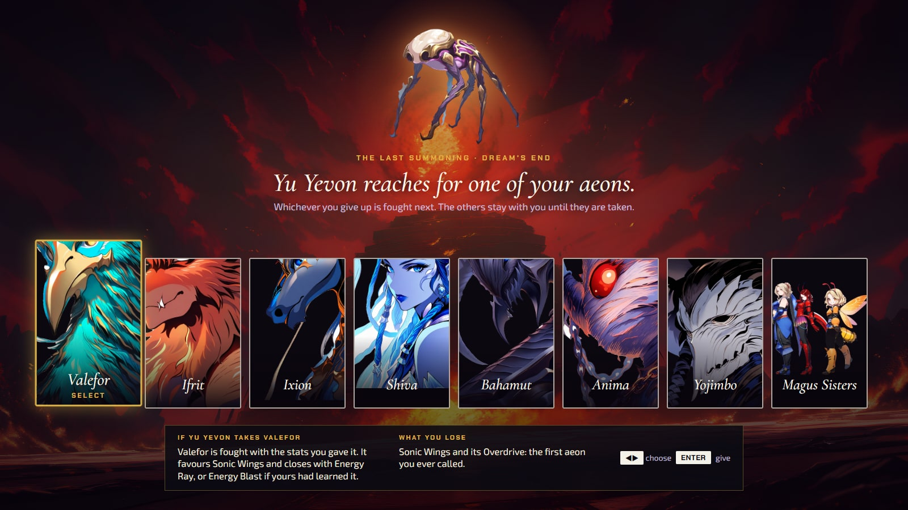

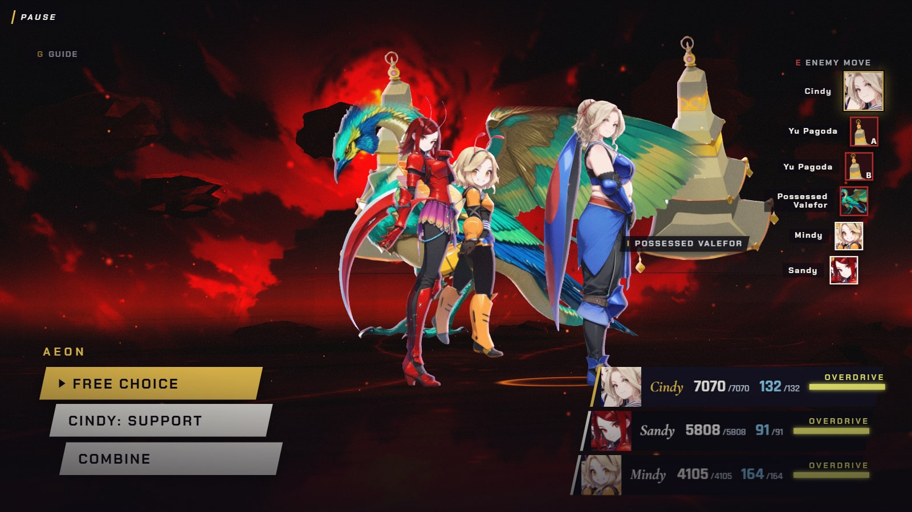

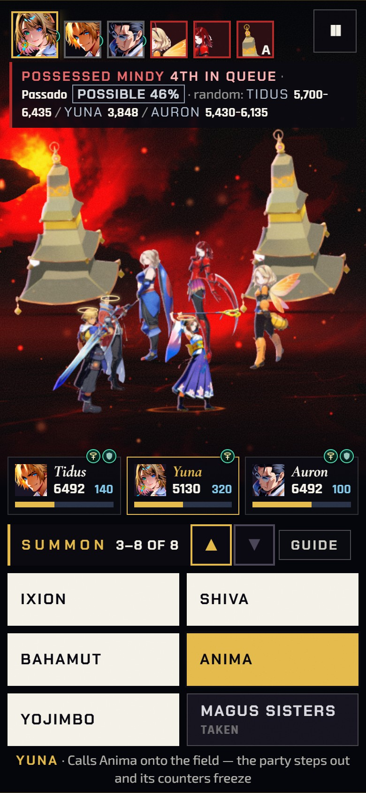

## 2026-10-16 · Release 50.1 (r50.1): the Dark Aeons wear their own paintings, a hurt Lulu is no longer tiny, Yuna's Yojimbo has his approved painting and a face, and the Dark Mirror's words corrected

Address: https://echoesofspira.com (main 6b638df95, bundle B_bQDjUG, live since 2026-10-17T00:44Z; built from branch r50-release: the live release r50 8a3e8eff7 plus the text branch r50-text e5c63934e, which is words and comments only, plus three FFX-only fixes with their tests and pictures)

- **FFX only, Chapter XXVII, Yuna's own Yojimbo wears the approved painting and has a face (FOC50-01 of the r50 review):** when Yuna calls Yojimbo he stood in the navy painting that decision D-054 says is not approved and is not used, and his turn-bar tile and his HUD card showed a Y monogram instead of a face (desktop and phone). He now draws `characters/yojimbo-cavern`, the approved gold, orange and purple painting (the one Chapter IX's Yojimbo wears; idle, attack, cast and hurt), and his tile and card cut his face from it. Behind it: the stage staged a summoned aeon under the id the summon event names and ignored the combatant's own art (every other aeon's art is its id, so nobody noticed), so it now reads the combatant's art first. `portraits/yojimbo.png` is the navy bust and is not wired; a dedicated face for him, painted from the approved painting, would be a picture for Bailey to pick. Frames: `docs/screenshots/r50-1/yojimbo-desk-summoned.jpg` and `yojimbo-phone-summoned.jpg`.
- **FFX only, a hurt Lulu is no longer drawn at two thirds of her height (every chapter):** Lulu's hurt painting came out at 0.67 of her idle's height and her low-HP slouch (the pose she rests in under half HP) at 0.54, read through the stage camera in Chapter XXVII and Chapter IX alike; the cast's poses are sized so each pose's head matches the idle's head, and Lulu's hurt and low-HP paintings are squat, big-headed figures of a slender idle, so matching the head shrank the whole body. Nine poses of the party were drawn more than about a tenth off their idle's height and now stand inside it: Lulu hurt (0.67 to 0.91 in the game) and low HP (0.54 to 0.75, a slouch may bend), Yuna hurt (0.77 to 0.90) and attack (0.88 to 0.91), Auron attack (0.70 to 0.90), hurt (0.73 to 0.91) and low HP (0.61 to 0.75), Rikku attack (0.80 to 0.89) and Wakka cast (1.12 down to 1.10). **What it costs, said plainly:** each of these figures' head is now bigger than its idle's, by x1.35 for Lulu's hurt and x1.38 for her low HP (Auron x1.29 attack, x1.24 hurt and x1.23 low HP; Yuna hurt x1.16; Rikku attack x1.12; Wakka cast x0.985 and Yuna attack x1.03 are inside the old 3 percent). No painting was touched: the sizes are `stature` holds in `tools/posescale/overrides.json` (floor 0.90 of the idle's height for hurt, attack and cast, 0.75 for the low-HP slouch, ceiling 1.10), written to the pose record with whose word it is and what the hold cost, and carried by the generated table. A KO (lying) is not changed: a fallen Lulu is 0.43 of her standing height long (Auron 0.48, Wakka 0.57, Yuna 0.61, Kimahri 0.61, Rikku 0.63, Tidus 0.89) and a fix would make every KO head x1.7 to x2.5 the idle's, which is for Bailey to say. Frames: `docs/screenshots/r50-1/lulu-before-after-ch27-1600x900.jpg` and `lulu-before-after-ch9-1600x900.jpg`.
- **FFX only, Chapter XXVII, the Dark Aeons wear their own Dark paintings:** Dark Sandy, Dark Mindy, Dark Cindy and Dark Yojimbo used to be drawn with the paintings of Yuna's own Sandy (red), Mindy (yellow), Cindy and Yojimbo (the navy one) under their Dark names: the four enemy records named the aeons' art, and the presenter reads an enemy's art key before anything else. Each now names its Dark painting (`characters/dark-sandy`, `dark-mindy`, `dark-cindy`, `dark-yojimbo`: red and black, all five enemy poses, and `portraits/dark-<name>.png`), so Act I's pair and Act II's blade stand on the road and in the cavern as the black-and-crimson twins they are, and the chapter's card shows the same two paintings. Yuna's own Sisters and Yojimbo are unchanged. Pinned by `tests/unit/chapters/mirror-aeons-art.test.ts` (every formation of both ladders through the real engine). Frames: `docs/screenshots/r50-1/desk-3a-act-i-menu-clear.jpg`, `desk-5-act-ii-first-menu.jpg`, and the phone's `phone-3a-act-i-menu-clear.jpg`, `phone-5-act-ii-first-menu.jpg`.
- **FFX only, Chapter XXVII, Mirror Aeons, the first fight is the pair:** the guide and the chapter card's second picture caption now say what the fight is. Act I is Dark Sandy and Dark Mindy; Cindy does not take the field there, so there is no joint attack, and each sister uses Mega Graviton once her own gauge is full (the guide used to describe the full trio opening with the joint attack). The guide's advice follows: blades for Sandy and spells for Mindy, an aeon sent in as a Mega Graviton nears, the Steal list without Cindy's Return Sphere, Auto-Life's line without the joint attack, and the card caption "two in the wrong colours" (it said three). No fight changed.
- **FFX only, Chapter XXVII, the heal between the acts (moved here from the Release 50 entry, which stays as it shipped):** at Act II everyone, the bench and the aeons included, returns at full HP and MP with statuses and KO cleared and fallen aeons standing; the bag, the gil, Yojimbo's compatibility and the Overdrive gauges carry over, and the Sisters' motivation resets and any standing order clears. The game has two separate fights here; the full heal is our own design choice. The guide says it now, in its Strategy card and its document.
- **FFX only, Chapter XXVII, Zanmato from Yuna's own Yojimbo is a real chance, not a long shot:** the guide now gives the odds the reverse-engineering review worked out: about one Pay in six at 100,000 gil and one in four at 1,000,000 (Pay all is about the same), and a full Overdrive gauge makes it better than one in two. The odds assume Yojimbo's hire answer 2 and compatibility 128, the game's own starting values (read at boot on 2026-10-17; this entry first called both estimates, the guide's recommended reply, not read from a save). The Release 50 entry's "it is rare" is superseded by this line; the engine's numbers did not change.
- **FFX only, Chapter XXVII, Ribbon:** the guide no longer says Ribbon stops everything the Dark ones land. Ribbon turns away Petrify, Poison, Sleep, Silence, Darkness and Slow, but not the four Breaks or Curse: Calamity and Kozuka land all four Breaks, and Calamity lands Curse even on a Ribbon party.
- **FFX only, under the hood:** stale comments and notes corrected (the engine's hire-answer and Zanmato comments, the proof tool's and bench's notes, a mis-joined line in `battle/common/types.ts`, the research note, the handoff, the plan and the contract-change entry that still said no Dark script was registered); the tests that pinned the old words follow. That text branch changed no behaviour; the three fixes above it are the only behaviour in this entry, and none touches the save, FFX-2 or a number of the game.
- **How it was checked:** type check clean on the merged tree and after each fix; the orphan check again 28 older modules, none new; `node tools/pose-scale-check.mjs` PASS (the held poses included). Each fix was seen in a browser (headless, the dev server, no new production build): the Dark Aeons in Act I and Act II at 1600x900 and 390x844 by the chapter's real-key walk; Lulu's idle, hurt and low-HP poses measured through the stage's camera before and after in Chapter XXVII and Chapter IX (hurt 0.67 to 0.91 and 0.67 to 0.90, low HP 0.54 to 0.75 of her idle's height, her idle and attack and cast unchanged), and the other changed poses after, in the chapters that field them (Yuna, Auron, Wakka and Rikku, all inside 0.90 to 1.10 of their idles' height, Rikku's attack 0.89 once the camera's 1 percent is read); Yuna's Yojimbo summoned by the keys in Chapter XXVII on a desktop and a phone, the figure, the turn-bar tile and the HUD card. Tests: 1,275 unit files without the long bench files (20,296 tests passed the first time; of the 11 that failed, 7 were advisor walks that ran past their 15 s limit on a loaded machine and pass alone, and 4 were the board's strip list and card warm-up, a real consequence of the first fix: the list of paintings that get a small copy named Dark Mindy's old painting, repaired in `src/data/art/strip-art.json`, then all pass), the 32 bench files (27 passed, 5 skipped) and the Fallen Aeons content file. New files: `tests/unit/chapters/mirror-aeons-art.test.ts` (21 tests: each Dark Aeon's subject by id for every formation of both ladders, the files and manifest rows, and Yuna's Yojimbo) and `tests/unit/engine/pose-stature-hold.test.ts` (9 tests). Nothing is built into a production bundle, deployed or reviewed. Engineering detail: `docs/handoff/r50-1.md`.

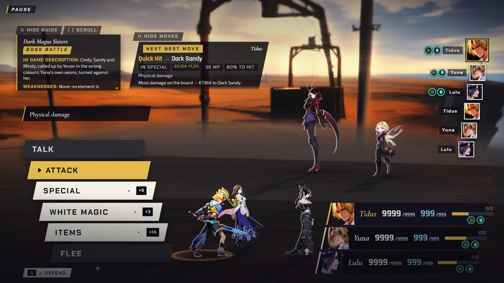

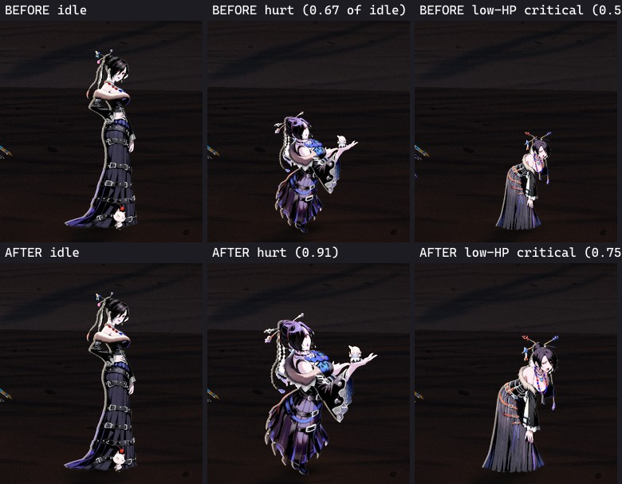

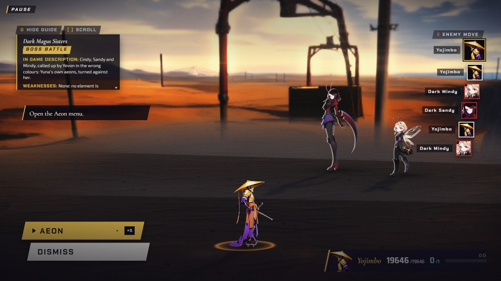

The rest of the pictures are under `docs/screenshots/r50-1/`: Act II's Dark Yojimbo, the phone's frames, and Lulu in Chapter IX.

## 2026-10-16 · Release 50 (r50): Chapter XXVII, Mirror Aeons, on the board; battles start and end the way the game's do; a phone way into the hidden chapters; five repairs

Address: https://echoesofspira.com (main 8a3e8eff7, bundle CDwyZHD2, live since 2026-10-16T19:18Z; built from branch r50-release: the live release r49 f939b87f2 plus release candidate r50-rc 71625df2f, which carries the two reverse-engineering lanes of re-parity-rc8, the two r50-fixes and five repairs, plus the chapter branch ch-mirror-aeons c1ed918eb with the reverse-engineering session's final Yojimbo and Magus Sisters engine)

- **FFX only, a new chapter on the board: Chapter XXVII, Mirror Aeons (branch ch-mirror-aeons):** Yuna's own aeons against their dark twins, in two acts. Act I is on Mushroom Rock Road against Dark Mindy and Dark Sandy (2,000,000 and 2,500,000 HP, both Overdrive gauges at 0); the sisters go with the light, and Act II opens in the Cavern of the Stolen Fayth with the whole party and whole aeons (the party and every aeon are healed between the acts) against Dark Yojimbo and his dog, a blade that fills ten a turn and a first Zanmato on his eleventh turn. Yuna's Summon list holds seven (the five story aeons, Yojimbo, and Cindy, who stands for the three Magus Sisters), and Yuna's own Yojimbo and Magus Sisters can be called in both acts, as the game allows. The Sisters take all eight of their orders, and Combine powers plays the Delta Attack. Yojimbo's Pay is a ladder of amounts (1,000, 10,000, 100,000, 1,000,000 and Pay all); the ladder is a stop-gap, the screen for it is still Bailey's to pick. A landed Zanmato from Yuna's Yojimbo ends a Dark Aeon fight at once, as in the game, but it is rare. Every enemy number is read from the game's own files by the reverse-engineering session (the Dark Aeons' five scripts, the Zanmato row, the Sisters' formations), and the difficulty was measured and set, never tuned on a boss row: with 17 Phoenix Downs the advisor's line wins the whole chapter about three runs in four (74 percent, 147 of 200; 69 percent if it never pays Yojimbo) and a careless line wins none (0 of 200). The chapter is **listed**: it is the last card of the Final Fantasy X group, the board reads "of 19", its clear, best time and attempts are recorded in the save (the save format is unchanged), and the word `yojimbo` still opens it. The two backdrops (existing plates), the Dark aeons' paintings, the music and the Overdrive gauges of the dark aeons are provisional or not drawn yet. Engineering detail: `docs/handoff/ch-mirror-aeons.md`, the measured table in `docs/plans/ch-mirror-aeons-bench.md`.
- **FFX only, the start of a battle (re-parity-rc8, lane FFX-L):** Battles now start the way the game's do. Every battle spends the game's start-up roll, and in Seymour's fight with the two Guado Guardians (Chapter VII), Seymour Omnis's discs (Chapter XII) and the hidden Sinspawn Gui fights the game also shuffles the linked monsters before the first turn, so the monsters' dice stand where the game's would: in Chapter VII the Guardians' hits land for slightly different numbers than before (nobody wins or loses more often), and Chapters XII and the Gui fights look the same because their linked monsters never roll. Victory Overdrive now runs at every ending, as in the game, so a Victor-mode Wakka still standing when a fight ends in a flight gains his 20 points as after a win (no shipped line reaches it). Yojimbo's all-target Wakizashi carries the game's command number; nothing changes in play.
- **FFX-2 only, items and the end of a fight (re-parity-rc8, lanes X2-F and X2-K):** The girls' items and the end of a fight follow the game now. An item leaves the bag the moment a girl picks it, so the Item list shows the lower count at once and two girls can no longer both take the last Phoenix Down; if the spell never goes off (she is knocked out, Stopped, Petrified or ejected, changes dress, is interrupted, or the fight ends first) the item goes back, up to 99. A fight no longer ends the instant its last blow lands: the menus close and nothing new starts, but the spells and items already under way finish first (a Cure still heals, a Phoenix Down still raises), and the fight ends once they have (a lost fight too: the enemy's spells under way finish, and in Chapter XIII the last blow plays its three seconds); if something is raised in that moment the end is cancelled and the fight goes on. A sleeping, Stopped or petrified girl's unfinished cast does not hold the end. Enemies that are all turned to stone now end the fight in a victory. A side effect of the new item rule is that Chapter VI's party can no longer throw more Grenades than the four it owns, so that chapter plays about 8 percent longer and a little rougher (it still wins every seed). No boss number and no party number changed; every chapter's line wins as often as before at zero decision time (Chapter XIII, the hardest line, wins 369 of 500 where it won 363, the Vegnagun chain 490 of 500 as before, the rest 500 of 500), and the Vegnagun chain at 1.5 seconds a menu is easier because the heals in flight at the end of a link now land.
- **FFX-2 only, under Itchy (r50-fixes):** the greyed White Magic row now says why, like its siblings: its reason drops under a long name when there is no room beside it, and the top line and the phone's footer lead with it ("Itchy — spherechange first — Open the White Magic menu.").
- **FFX-2 only, Osmose (r50-fixes):** the party's Osmose, and the enemy move slab that names the same row, now say "MP damage", read from the game's own row; no FFX line changed.
- **FFX only, Biran and Yenke (F939-01):** the two brothers no longer stand under the Sensor card at Kimahri's first menu (it hid Yenke completely at 1600x900 and 2000x1012): they stand shoulder to shoulder to the right of Kimahri, Yenke in front, Biran behind and to the left of him, with the card beside them on empty ground; Kimahri's place is 0.6 further left to make room, and no further, because the camera planner slid the whole picture 64 px right in half the runs when he stood 0.2 further left (with him there it never did in 28 runs). The cursor still opens on Biran and the card still names Yenke. Windows narrower than 16:9 are not covered. Provisional, like the rest of the chapter's look.
- **FFX-2 only, the phone's enemy header (F939-02):** Angra Mainyu's arms no longer print "TAWRICH" over "SCAN" at phone width. The cause was in the shared phone header, so the same repair reaches Vegnagun's Bulwarks and Redoubts, whose names overflowed the same way; every row that fits (Vegnagun's Nodes, the other eleven FFX-2 chapters' headers) is where it was, to the pixel.
- **FFX-2 only, the end wait:** while those last spells finish, the screen now says so: the command window, the advisor card and the help line close on the last blow (they used to stay up for the whole 1.5 to 4.5 seconds, with a menu nobody could answer), and the party's gauges stop counting toward a turn that cannot come (a girl whose spell had just gone off used to fill to READY and shimmer); the spells still on their purple bars run to the end of their cast. Nothing was added to the screen.
- **Both games, phones:** the hidden chapters can now be opened on a phone. Press and hold the small "Chapter select" label at the top of the board for about half a second: a small field appears, and any hidden chapter's word typed in it opens that chapter, exactly as the same word typed on a keyboard does (all ten words: limit, leblanc, experiment, mushroom, fayth, daigoro, valefor, gagazet, angra, yojimbo; yojimbo opens Chapter XXVII, which also has its card). Enter, putting the keyboard away or Escape closes it; a wrong word opens nothing and leaves nothing behind. Nothing shows until you press and hold; the seven taps on the label, the keyboard words and the pad sequence work as before. Tried in a phone-sized browser with touch events, not yet on a real phone.
- **How it was checked:** on release candidate r50-rc's own tip (before Chapter XXVII joined): type check clean after each merge and each repair; the orphan check (28 older modules, none new); the whole suite on the final commit (20,098 tests; the 29 that timed out under load, in the longest advisor and bench files, all pass when run alone); a production build whose files name no local path and whose art matches its masters (3793 masters checked, 0 problems); and a headless walk of that build: the board says "of 18" and all nine words open their chapters by keyboard and by the phone field, a wrong word opens nothing, FF7's seven taps still open its door, Biran and Yenke's first menu at three window sizes and played to its results, the Itchy and Osmose lines, the twelve FFX-2 phone headers, Vegnagun link by link and the end wait before and after, with the pictures below. Nothing past the first menus was played in a browser for the reverse-engineering lanes, whose own handoffs list what they proved. Engineering detail: `docs/handoff/r50-rc.md`. On the assembled release tree (r50-release, the two joined with no conflict in a file): type check clean; the orphan check again 28 older modules, none new; the whole unit suite on the final commit (1,290 files, 20,484 tests passed, 81 skipped, 1 to do, none failed or timed out), whose first run found five test files that held a count or a pin that Chapter XXVII's listing had moved, brought to the new truth (the Trema card's place from the end of the pause cards, the one long white-out in the cutscene scripts, the one Act II flag the Experiment shared with Dark Yojimbo, Dark Cindy's HP on the sisters' guide page, the chapters that carry Kimahri's Stone Breath), plus one real gap closed (Lulu's Ultima in Chapter XXVII had no recorded sound loaded, so that chapter now loads the Final Aeon's sound pack); the chapter's measured table re-run on the assembled tree (the advisor's line 40 of the first 60 whole runs, a careless line 0 of 20, the line that never pays Yojimbo 40 of 60); and the phone's hidden-chapter field now types `yojimbo` into Chapter XXVII like the other nine words. Chapter XXVII was walked end to end in a production build of its own branch before the merge (the whole run, 29 of 29 checks on a desktop and on a phone, and a lost Act II retried, 22 of 22), board of nineteen included; the assembled release has had no browser walk yet.

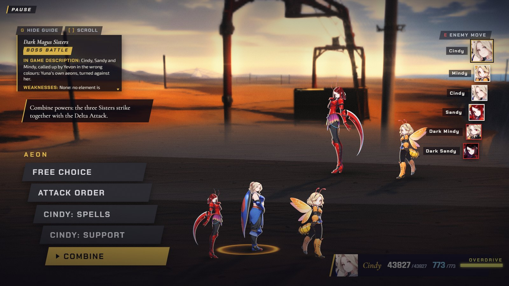

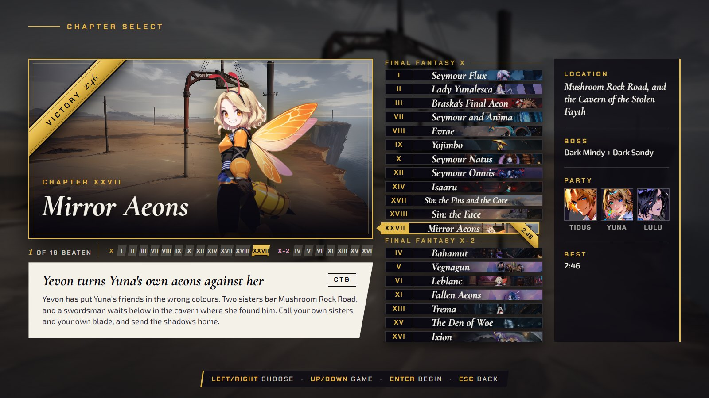

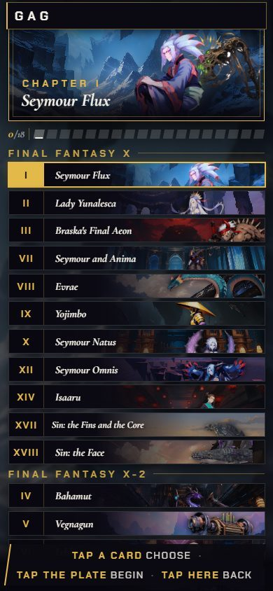

The pictures of the release candidate's other repairs (Biran and Yenke's first menu, the phone's enemy headers, the end wait, Itchy and Osmose) are under `docs/screenshots/r50-rc/` and `docs/screenshots/r50-fixes/`; the rest of Chapter XXVII's run is under `docs/screenshots/ch-mirror-aeons/`.

## 2026-10-15 · Release 49 (r49): two more hidden chapters, Biran and Yenke (FFX) and Angra Mainyu (FFX-2), and no more black openings for Tourist Trap and the fayth chapter

Address: https://echoesofspira.com (main f939b87f2, bundle 4LVgaz0l)

- **FFX only, a hidden chapter, Biran and Yenke:** Kimahri goes in alone against the two Ronso brothers at the Mountain Gate of Mt. Gagazet. Type `gagazet`
  on the chapter board; there is no card and the board still says "of 18". One fight, Kimahri against both brothers. The numbers, the moves and the rules of
  both are the game's own, read from its files by the reverse-engineering lane. Their HP is not a fixed number: it is set from Kimahri's own strength and
  magic when the battle begins (3,208 for Biran and 2,406 for Yenke for the Kimahri this chapter fields). Kimahri starts without the three Rages the fight
  teaches (Mighty Guard, White Wind and Self-Destruct).
- **FFX only, what the fight teaches:** Lancet learns a Ronso Rage from each brother, one a cast, and a new Rage fills Kimahri's Overdrive gauge. Biran gives
  Thrust Kick, Self-Destruct and Doom, and Mighty Guard once he has cast it himself (at half strength); Yenke gives Fire Breath, Aqua Breath and Stone Breath, and
  White Wind once he has cast it. Self-Destruct ejects Kimahri, who is alone, and the fight ends as a withdrawal.
- **FFX only, how the brothers fight:** Biran Thunder, Bulldoze, Blizzard, Bulldoze; Yenke Fire Breath, Aqua Breath, Bulldoze; every Bulldoze carries its user to
  the other side of the arena. While the two stand on the same side a plain Attack on one makes the other stand guard and does 8 damage (against about 450 when
  they are apart); Jump, the Rages and Lancet are not turned aside. When one falls the other grows stronger: Yenke Hasted, Biran Berserk. A Berserk Biran never
  offers Mighty Guard, so learn what Biran carries before Yenke falls (the game's file says he still teaches Thrust Kick, Self-Destruct and Doom; a written
  guide says he cannot teach at all, so the guide card says only what is true under both).
- **FFX only, rewards:** each brother pays 1,500 gil and 4,500 AP (6,750 on an Overkill) and one item from one slot: a Return Sphere, or one time in eight a Friend
  Sphere in its place (twice as many on an Overkill). Never none, never both; before this build the engine rolled the two as separate drops.
- **FFX only, art and sound (provisional):** the two brothers are new paintings drawn locally, blue-furred like Kimahri (Biran heavy with a blond mane, Yenke lean
  with an auburn mane), with faces in the turn order and a pause painting of Biran; their stage spots are swapped, Yenke at the front right and Biran behind him on
  the left, so the first menu's Sensor chip sits over the brother it names. The opening scene and the party prep draw Chapter I's Mt. Gagazet (a copy of the approved
  painting: no painting of the gate exists) and the music is the generic boss cue. None of it is Bailey's pick and no approved painting was replaced.
- **FFX-2 only, a hidden chapter, Angra Mainyu:** the Chapter 5 mission "Showdown in the Sands" at the Al Bhed dig in the Bikanel Desert. Type `angra` on the chapter
  board; it is not in the board's "of 18" and is not listed. Three bodies on the sand: the fiend and its two arms. Zarich, the left arm, takes no physical damage and
  Tawrich, the right arm, takes no magic; Darkness is neither, so it reaches all three. The fiend opens with Perdition's Flame (ten hits on random girls, each taking
  three sixteenths of that girl's full HP, so keep everyone high; Protect halves it), raises a fallen arm with Full-Life, drinks the party's MP with Osmose once its
  own runs low, and rolls Flare, Curaga, Bio or Demi in between; Zarich saps MP and strength, Tawrich punches and breathes. Its numbers, its moves and its three
  scripts are the game's own (read from the game files: monster rows 268 to 270, the move rows, the start positions and the three AI scripts); the party is the
  Chapter V party carried over, which is an estimate. **At that level (46 / 48 / 50) the guide's line wins none of 240 measured fights, and the boss is not tuned**:
  the girls' three levels are raised by 20 (66 / 68 / 70), the one measured option, on in this build. It is a party-side estimate; the boss rows are untouched; the
  Chapter V preset is one constant away. With it the guide's line wins 18 of 20 measured fights at bench speed and 16 of 20 at a patient menu pace, but 1 of 20 on the
  Active clock at 1.5 seconds a decision, so the fight stays very hard for a quick player. By Bailey's pick the 3 seconds a move that the Road, Ixion, the Cloister,
  Tourist Trap and Valefor carry on top of the game's own pacing are kept here too.
- **FFX-2 only, art and sound (provisional):** the fiend and its two arms are new paintings drawn locally for this chapter, on a new desert backdrop (dunes, a buried
  arch, a dug-in camp and a mesa under a bright sky), with a pause painting. None of it is Bailey's pick and no approved painting was replaced; none of the three
  has a hurt or knocked-out painting. The fight plays the aeon theme the other FFX-2 hidden chapters play.
- **Both, the black openings are gone:** the hidden Tourist Trap (`daigoro`, FFX-2) used to open on a black screen and had no painted wash in its party prep, and the
  hidden fayth chapter (`fayth`, FFX) had no deck plate; both now draw their painting (copies of approved paintings under the names their scenes ask for: the Cavern
  of the Stolen Fayth for Tourist Trap and the Evrae airship deck for the fayth chapter). This closes FOC48-01 and FOC46-04.
- **Both, the hidden words:** `limit` (the FF7 experiment), `leblanc`, `experiment`, `mushroom`, `fayth`, `daigoro`, `valefor`, `gagazet` and `angra` each open their
  chapter, a wrong word still opens nothing, nothing is remembered, and the two new chapters write only their own record, never the save. Both stay hidden until
  Bailey has played them and says to list them.
- **Disclosed by the focused review and the live check:** F939-01 (major, new): the open Sensor card still covers Yenke completely at the first menu of Biran and Yenke
  at 1600 by 900 and 2000 by 1012 (the I key closes it; a phone is fine); the next release moves the brothers so the card covers neither. F939-03 (major, new): Angra
  Mainyu is very hard on the Active clock and the review could not finish it by real keys in 15 minutes; it reached the results only with the boss's HP set low through
  the debug state. CHK-027 / PR-0380 (major, carried): figures and some bosses still jump 40 pixels or more in one frame (118 jumps on existing figures; no new
  figure reaches 40 px). F939-02 (polish): at 390 by 844 Angra's enemy header prints TAWRICH over its SCAN label. F939-05 (polish): one of three runs of the word
  `fayth` did not reach party prep (not reproduced; the live check opened it first time). Self-Destruct, a Rage Kimahri can learn here, was proved in the engine but not
  in a browser run; a Berserk Biran swings the engine's ordinary attack (Bulldoze's numbers) and never changes side; the gear the brothers drop and Kimahri's Steal are
  not modelled. The majors carried from earlier deep reviews (PR-0295, PR-0148, PR-0099, PR-0421) were not re-examined by these reviews.
- **Not in this release:** listing the hidden chapters on the board (he plays them first); the reverse-engineering lane's accuracy fixes and two small FFX-2 text fixes
  (the next release, r50, is code only); the Sinspawn Gui and Dark Aeon paintings (installed in a newer art mirror for a later release); a theme of their own for either
  new chapter.
- **Deploy notes:** shipped at 14:49 EDT on 2026-10-15 (docs/deploys.log: 2026-10-15T18:49:25Z) under Bailey's owner override (his words "ok keep going we have full usage!
  republish all artifacts here. I'll go with all of your recommendations") because deep reviews are owed on earlier builds; the focused review's SHIP came first (140
  minutes; changed area FAIL on the disclosed majors; 23 of 23 same-seed pairs identical with the last build). The deploy compared the live files with the build, and a
  live check then found all 5,251 downloadable files identical, the board still saying "of 18", `gagazet` and `angra` opening their chapters to the first command menu by
  real keys (Lancet on Biran taught Thrust Kick) and no console error. The deep review is owed (58 builds carried).
- **How it was checked:** tsc clean; the whole suite once on the assembled candidate (19,844 passed, none failing in the end: 16 files had failed first under
  full CPU load, 19 timeouts and one real failure, and all re-ran green); the orphan check (the same 28 older modules, none from the lanes) and the build gates (the art matches its masters, no file names a local path); a
  headless walk of the production build (the board of 18, nine door words, both chapters at 1600 by 900 and at 390 by 844, no console error or missing file). Both
  chapters were also reviewed by the reverse-engineering session against the game's files (Biran and Yenke: 132 of 132 same-seed runs of the other FFX chapters
  identical; Angra Mainyu: 264 of 264 FFX-2 rows identical) and played on their own branches before they joined: Biran and Yenke in a production build in headless
  Chromium (the word by real keys, Lancet through the real menu, a win in 0:56, a loss with Retry, a phone), Angra Mainyu the same (its win only with the boss's HP set low).

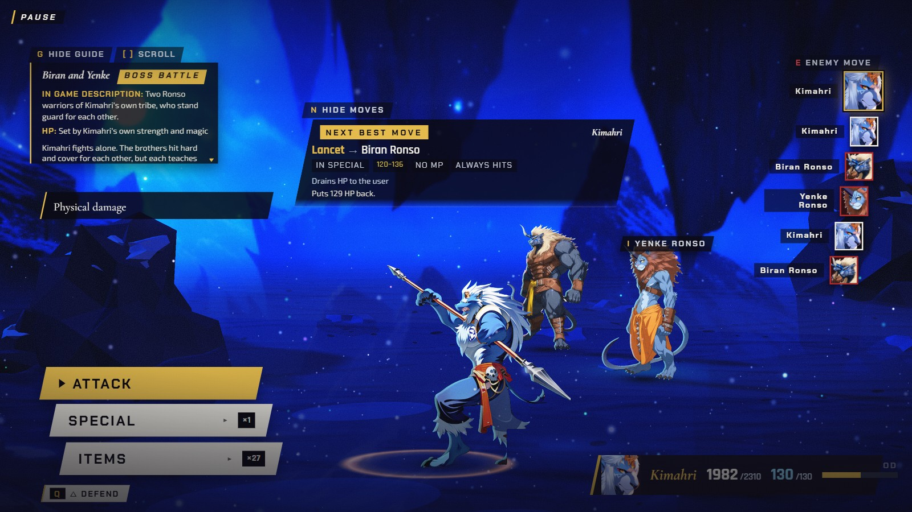

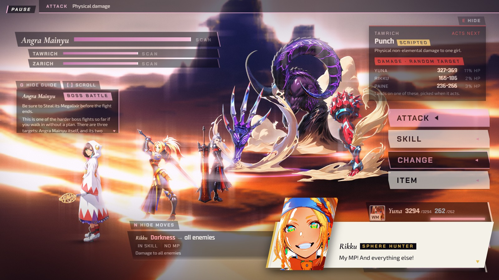

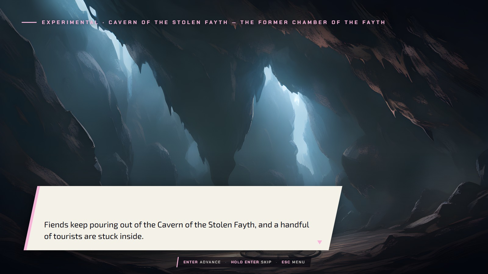

*Top: the first menu of Biran and Yenke. Middle: the first menu of Angra Mainyu. Bottom: Tourist Trap's opening, no longer black.*

## 2026-10-14 · Release 48 (r48): Rikku's Mix and the FFX-2 battle menu follow the game, and two hidden FFX-2 chapters

Address: https://echoesofspira.com (main ea431aa0, bundle DzeCyPSw)

- **FFX only, Rikku's Mix:** works the way the game's does. Any two items make something (the game has a result for
  every one of the 6,328 pairs), and the 21 Mixes that were missing are in (Pineapple, Blaster Mine, Hazardous Shell,
  Calamity Bomb, Heat Blaster, Brimstone, and the ice, thunder and water families from Snow Flurry to Dark Rain; they
  borrow the nearest family's effect, so their picture and sound are that family's). Both ingredients are used up the
  moment the Mix goes off, a Mix with nobody to aim at costs the ingredients but not Rikku's Overdrive, and who a Mix
  lands on is chosen as the game chooses (one random member for the single-target ones, a whole side otherwise).
  Stacks of items stop at 99 wherever they grow, a stolen item and a refund included, and a Spare Change offer is paid
  in full or not at all. The Mix list shows what it showed before: the recipes it has always listed, and "? ? ?" for
  any other pair; such a pair now makes the game's real result where the last build said "Mix failed!". No chapter
  plays a Mix, so no fight changes. No boss number and no party number changed, and every chapter wins as often as
  before.
- **FFX-2 only:** The girls' automatic abilities now work the way the game's do, and the battle menu follows the
  game's own rules for what a girl can use. An accessory or dressphere ability that keeps a status on her for good
  (the Moon, Shining, Defense, Star, Recovery and Speed Bracers, Adamantite, Ragnarok, Bloodlust, Wring, Minerva's
  Plate, Shmooth Shailing, Lady Luck's Critical, the Mascot's Auto-Shell and Auto-Protect) puts it on and keeps it,
  out of a Dispel's reach, and the SOS abilities (Warrior's SOS Protect, Samurai's SOS Critical, the Wall Ring, the
  Regen and Haste Bangles, Cat Nip) switch their statuses on when her HP drops under a third and off when she is
  healed past it. The Berserker's Counterattack, Magic Counter and Evade & Counter, which did nothing until now,
  answer a blow with her own Attack at the attacker (Evade & Counter makes a physical swing miss her outright).
  Nothing a shipped build wears uses these yet, so the chapters play as before until a player masters the abilities or
  wears the accessories. The commands a dressphere gives you from the start are there before you learn anything (Pray,
  Cure, Power Break, Fire, Blizzard, Thunder and Water), the passive abilities you learn no longer appear as commands
  you can pick, and Yuna, Rikku and Paine each have their own Trainer moves. While a girl is Itchy every command stays
  on the list but greyed out, with Escape and changing dressphere the ways out. Silence stops everything the game
  stops, every Dance and Song and the Dark Knight's spells included, and leaves Pray, Vigor, Focus and MP Absorb
  alone. Moves that cost MP follow Half MP Cost, One MP Cost and Magic Booster the way the game does, and a girl in a
  Special dressphere has no Item or Escape command. The Samurai gains Magicide, Dismissal, Fingersnap, Momentum,
  Shin-Zantetsu and Clean Slate, the Alchemist gains Dispel Tonic and Mega Phoenix, and the order in which commands
  unlock now matches the game for the Samurai, Thief, Berserker, Warrior, White Mage and Alchemist.
- **FFX-2 only, the status guide and the move slab:** the status guide's Silence card says "no spells, Dances or
  Songs" (it listed White Magic, Black Magic and Arcana, which is too few now that Silence stops every Dance and Song
  and the Moogle, Cait and Eraser spells too); the FFX card still says "no White or Black Magic". The enemy-move slab
  says "MP damage" for every move that drains MP (Valefor's Sonic Wings, Lacrimosa, Magical Attack Detected, Osmose,
  Waning Moon, Yojimbo's Kozuka), and Leblanc's Osmose is no longer called "Magical", because the game's row for it is
  neither physical nor magical. Delta Attack says it "leaves the whole party at 1 HP" (the old line added "and 0 MP",
  but the game's row is HP only and the fight has always kept the girls' MP), and Looming Glacier says it "empties one
  girl's MP and inflicts Stop". Words only: no number and no fight changed.
- **FFX-2 only, the desktop battle menu while a girl is Itchy:** the three greyed commands (Attack, Skill and Item)
  show their names again, with the reason cut short beside each ("ITCHY — …") instead of the 26-character reason
  squeezing the name out of the row; the full reason still names the highlighted row in the top bar. The same squeeze
  hit any greyed row whose reason did not fit beside its name (a 13-character "Not enough MP"), and the reason gives
  way there too. A reason that fits ("Silenced") lays out exactly as before, and the phone layout is untouched (its
  command area is pixel for pixel the same as in the last frame taken before the change).
- **FFX-2 only, a hidden chapter, Tourist Trap:** the optional mission in the Cavern of the Stolen Fayth: Yojimbo (possessed) and his small
  stone dog Daigoro against Yuna (White Mage) and two Dark Knights at levels 32 to 34 (the party's level is an estimate). Type `daigoro` on the
  chapter board; there is no card and the board still says "of 18". The numbers are the game's own rows (Yojimbo is row 170, Daigoro row 174),
  read by the reverse-engineering lane, which also checked the chapter against the game's AI scripts. Yojimbo keeps a count that rises by 8 every
  time he looks at it, and what he picks changes as it climbs. Calling Daigoro is one of the picks, and it is not a move of Yojimbo's own:
  Daigoro is a second fighter with his own gauge who bites one girl when he is called (a call is not a turn, so the Defeat screen's TURNS leaves
  it out). When the count is full he gathers himself for Zanmato, which leaves the whole party at 1 HP and 1 MP and which nothing softens, so the
  answer is a heal the turn after (a Mega-Potion from the bag needs no MP). Kozuka takes a quarter of one girl's MP and poisons her, and both
  Wakizashi fall on one girl (strongly indicated by the game's script, not yet confirmed by a play). The paintings are Chapter IX's (FFX)
  Yojimbo and Daigoro and its cavern plate, and the music is the "Aeons" cue the Road and Ixion play; all provisional.
- **FFX-2 only, a hidden chapter, Valefor at Besaid:** the compulsory Chapter 3 mission "Protect Besaid Temple!", where Shuyin's pyreflies have
  taken the temple's aeon. Type `valefor` on the chapter board; it is not in the "of 18" and is not listed. One fight in the Chamber of the Fayth:
  her gauge fills with every swing of hers (the plain Attack and Sonic Wings, not the Rays or the Blast) and every blow she takes, two Energy Rays
  (the whole party) on the way up, then the Energy Blast, which no Shell or Protect softens; Sonic Wings drains MP from the girl farthest from her.
  Her numbers, her script and her targets are the game's own (monster row 164, her AI script and the temple's start positions, checked by the
  reverse-engineering lane); the party is the Chapter 2 party carried forward, which is an estimate. It is the gentlest of the aeons: the guide's
  line wins every seed, and the chapter is not tuned. Her paintings are the FFX aeon's (approved) on the Chamber of the Fayth you already know
  from Ixion, with its pit (which belongs to Chapter 5), and there is no painting of her knocked out; the music is the aeon theme of Chapters
  XI and XVI. Six candidate backdrops for Besaid's own chamber were drawn locally; none is in the build.
- **Both, the hidden words:** `limit` (the FF7 experiment), `leblanc`, `experiment`, `mushroom`, `fayth`, `daigoro` and `valefor` each open their
  chapter, a wrong word still opens nothing, nothing is remembered, and the two new chapters write only their own record, never the save. By
  Bailey's pick the 3 seconds a move that the Road, Ixion and the Cloister carry on top of the game's own pacing is kept in both new chapters
  (the first Zanmato then comes about 58 seconds in; without it, 34), and both stay hidden until he has played them and says to list them.
- **Disclosed, FFX-2:** one FFX-2 golden digest moved, Chapter V (Vegnagun and Shuyin), because of the wider Silence
  scope above: it wins exactly as often (490 of 500 seeds before and after, every seed the same outcome) and plays
  about 0.07 party turns longer a fight. The White Mage's Pray is a free, 0 MP heal of the whole party on her opening
  menu, as the game lists it; no shipped chapter changes because of it, but a White Mage who only prays is now very
  hard to wear down, which a later balance pass should expect.
- **Disclosed by the focused review and the live check:** FOC48-01 (polish): Tourist Trap's scene key names a painting that does not exist, so its
  party prep has no painted wash and the pre-battle scene plays on black (the fight itself draws as usual); FOC48-02 (polish): the two chapters'
  data files cite a research note that was not in the repository, and it is now. CHK-027 (major, carried): figures and some bosses still jump 40
  pixels or more in one frame, on the last build and on every build measured since the check began. Carried from the deep review of Release 47 and
  not re-observed here: the heavy party-prep tabs on a phone (PR-0295), no numeric listening score for the shipped mix (PR-0148), nine chapters
  still on borrowed or stand-in music (PR-0099) and a possible plate edge in Chapter IV's wide camera pull (PR-0421). At 1600 by 900 Tourist Trap's
  enemy-move slab can cover part of Yojimbo's hat and, while Daigoro is about to bite, part of the first command row. LV48-1 (polish, found live):
  under Itchy the greyed White Magic row shows no reason.
- **Not in this release:** listing the hidden chapters on the board (he plays them first); a visible "can't cast" beat when a silenced boss's turn is
  refused and an explanation for the COLOUR VISION rows, both waiting for his pick; the scene-music-first change (set aside by his pick of "change
  nothing now").
- **Deploy notes:** shipped at 20:38 EDT on 2026-10-14 (docs/deploys.log: 2026-10-15T00:38:27Z) under Bailey's owner override (his words "I’ll go with
  all of your recommendations keep going !") because deep reviews are owed on earlier builds; the focused review's SHIP came first. The deploy compared
  the live files with the build, and a live check then found 5,221 of 5,222 files identical, 69 browser checks green, the board still saying "of 18",
  the words `daigoro` and `valefor` opening their chapters to the first command menu by real keys, and no console error beyond the two known
  missing paintings. The deep review is owed.
- **How it was checked:** tsc clean after each of the three merges and after the fixes; the files of both hidden
  chapters, their doors, the chapter numbers, the three goldens, the random streams, every parity-ffx and parity-ffx2
  file, the intent, status-word and menu tests (123 files, 2,333 tests, 14 skipped by their own flags); then the whole
  suite once (1,249 files, 19,619 tests: 19,544 passed, 74 skipped, 1 todo, none failing); the orphan check (28 older
  modules, none from the merged lanes) and the audio check (no findings, 68.87 MB of 105 MB); a production build whose
  files name no local path and whose art matches its masters (3,778 masters checked, 3,462 compared pixel by pixel, no
  name left dangling); and a headless walk of that build (the board still says "of 18" with no new card, the words
  "daigoro" and "valefor" each open their chapter to its first command menu against Yojimbo and Valefor, no console
  error or failed request), with three Itchy frames (the desktop at two sizes and the phone) and a look at the first menus of both hidden chapters.
  Each chapter was also played on its own branch before it joined: Tourist Trap in a production build in headless Chromium (the word by real keys, the
  opening line and the first menu on a desktop and on a phone, a win with Zanmato on the 14th and 28th look, a loss with no answers, and the other
  hidden words still opening their chapters), Valefor the same (a win, a loss with Retry, Sonic Wings landing on the farthest girl every time). The
  focused review of the exact build (93 minutes) then played Tourist Trap to a win in 5:21 and a loss in 1:41 and Valefor to a win in 7:56 and a loss
  in 3:55 by real keys, and found 25 of 25 same-seed pairs identical with the last build.

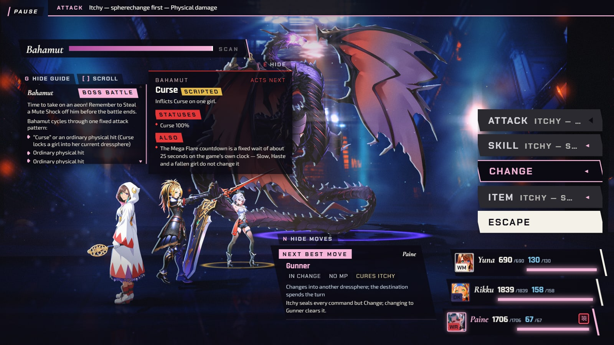

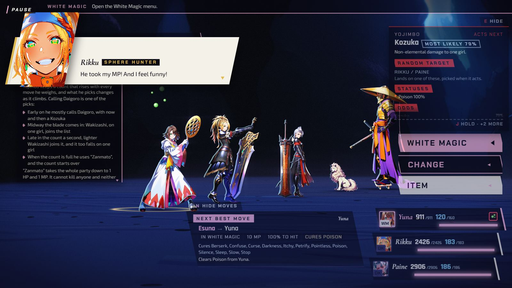

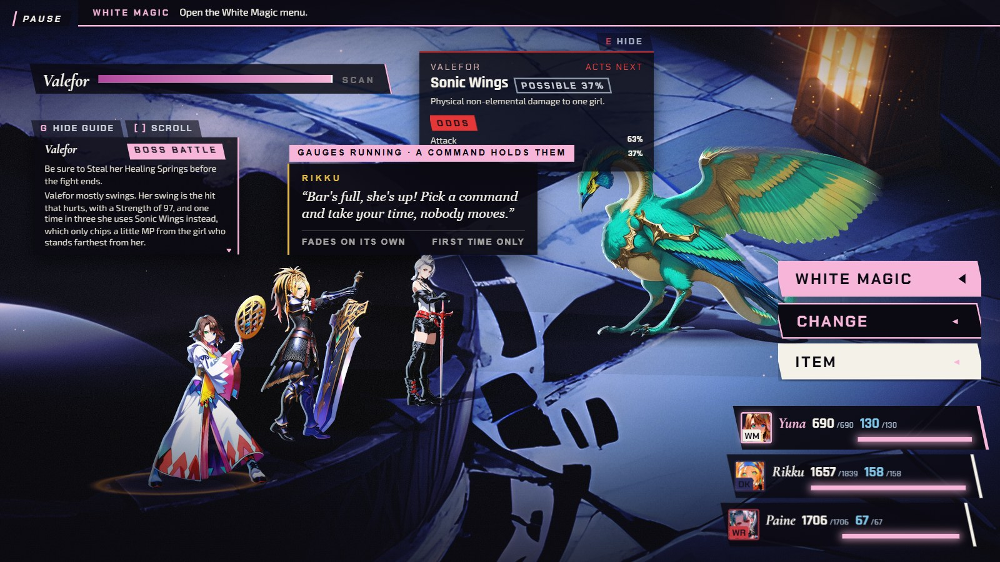

*Top: the desktop battle menu while Paine is Itchy, the command names kept and the reason cut short. Middle and bottom: the first menus of the two hidden chapters.*

## 2026-10-14 · Release 47 (r47): the ACCESSIBILITY tab with REDUCE FLASHES and COLOUR VISION, Rikku's colours calmed, and the site's small painting files cut to what the game reads

Address: https://echoesofspira.com (main b8aa6f96, bundle DA6NOD0r)

- **Both games, the pause menu:** a ninth tab, ACCESSIBILITY, sits right after OPTIONS and holds five rows: TEXT SIZE,
  REDUCE MOTION, REDUCE FLASHES, LOW EFFECTS and COLOUR VISION. The first, second and fourth moved there from OPTIONS
  with the same names, values and keys, so OPTIONS is shorter. The two new rows start OFF and are kept in the save
  (nothing that was saved before is changed, and a save from an older build loads with both off). Remapping keys is
  not part of this build.
- **Both games, REDUCE FLASHES:** softens 22 things that flash. Every flash peaks at about a third of its strength,
  white turns a warm ivory, a full-screen white wash that hides a change of scene stays opaque but dim, an action's
  first blow is the only one that flashes, and a warning that pulses becomes one soft fade or a steady glow. It covers
  hit, heal and status flashes, elements, spell effects, big-attack warnings, impact frames, lens flares, the lighting
  of a boss's phases, cutscene flashes and the Overdrive splash. The closing flash when a boss or an aeon finishes
  gathering out of pyreflies is left out.
- **FFX only, REDUCE FLASHES:** the summon's wash, a boss changing form, the target bracket that flashes on a group,
  the party card when a member is hurt and the Overdrive timing flash.
- **FFX-2 only, REDUCE FLASHES:** Spherechange, the girl's card when she is hit, the Save Sphere's wash in Chapter XI
  (an opaque dim cover, so the next link still hides its swap), the ready gauge's shimmer and the chain counter's
  veil from chain 20 up.
- **COLOUR VISION, three values (OFF, RED-GREEN, BLUE-YELLOW):** changes only the four things that blur together
  under colour blindness, and gives each a second cue besides its colour. **FFX only:** the Berserk and Curse tints (a B or a C
  over the head). **Both games:** the ally and self marks on the targeting brackets (a diamond, a plus or a ring on
  each corner) and the heal and MP numbers (an MP number says "MP"; BLUE-YELLOW makes it violet). **FFX-2 only:** the
  four colours of the Garment Grid's gates, in the Spherechange wheel, its flourish and the Party Prep pages (each gate
  prints R, G, B or Y), including the Party Prep pages on a phone, which this build covers as well.
- **Both games, the small files beside the paintings:** the 1,261 small files that sit beside the paintings on the site
  now hold only what the game reads from them (sizes, feet lines, scales, facings, focal points, heads, and the seed
  and the prompt text the loader copies). The notes on how each painting was made, who approved it and links to
  private pages no longer go out, and the deploy refuses a build in which any file of the site names a folder of the
  build computer or links to a private page, or any of these small files has anything else in it. Every value the game
  reads is the same; no picture, sound or screen differs.
- **FFX only:** The command rules now follow the game's own checks. Silence cuts off White and Black Magic, and Scan,
  which the game files as White Magic, is now cut off too; calling an aeon is not on the game's Silence list. Half MP
  Cost rounds up as the game does (a 5 MP spell costs 3, not 2), and One MP Cost with the Magic Booster costs 2. An
  action is checked again for Silence, MP and a full Overdrive gauge as it starts, and costs nothing if it cannot
  start. A target that has died or gone by the time its attacker acts is no longer swapped for a random one. Lulu's
  Doublecast no longer fires its second spell, or spends its MP, at a foe the first spell already killed. Flee counts
  only party members still in the battle. Bosses now obey Silence as in the game: a silenced boss cannot cast its magic until the Silence wears off.
  Entrust now costs 8 MP and the Magus Sisters' Nul-All costs 4 MP, as in the
  game; neither is offered in any chapter yet, so no fight changes. No boss or party number changed, and every chapter
  wins as often as before.
- **FFX-2 only, Rikku's dressphere paintings:** the eight dresspheres that were louder than Yuna's (Alchemist, Berserker,
  Black Mage, Gunner, Lady Luck, Songstress, Thief and White Mage; 443 painting files, every pose at every size it has) are
  brought down to the colour strength of Yuna's painting of the same dressphere, as chosen (option A; the pick between
  the sheets was left to the driver). The hot red-orange tops, boots and skirts turn coral, the orange skin a rosy tan
  inside the skin colour of her FFX painting, and the glare of the orange fills eases. Her hair and the yellow fills
  keep their gold (the one change the driver made to the pick: the hair stays golden, not cream; the orange strands
  underneath go sandy), and eyes, beads, outlines, dark shading, whites and transparency are untouched, as is every
  pixel's place, so nothing moves on screen. The Songstress goes from saturation 0.74 to 0.57 (Yuna's: 0.58) and the Alchemist from 0.75 to 0.56 (Yuna's
  Thief: 0.54). The Dark Knight and Warrior were already quieter than Yuna and are unchanged; so are her FFX painting
  and the hidden Leblanc chapter's own copies. The old paintings are kept (a backup, the private art repository, the
  old art folder). Checked here with the art, pose, manifest, chapter, engine, effects and continuity tests (191
  files, 3,194 tests passed), the approved-art check (916 ok) and the pose-scale check; the whole suite was run once
  after the art changed (19,187 tests: 19,106 passed, 73 skipped; seven timed out on a busy machine and pass run
  alone). Before and after: `docs/screenshots/r47-rikku-colour/rikku-final-before-after.jpg`; the
  numbers and the way back are in `docs/handoff/r47-rikku-colour.md`.
- **Disclosed by the deep review of this build (round 26, 190 minutes, SHIP):** CHK-027 (major, carried): 141 jerks of 40 pixels or more in the motion
  check, the worst 195 pixels, as on the last build; PR-0295, PR-0148, PR-0099 and PR-0421, the same carried majors listed under Release 48. Chapter II
  had no real-key win on the review's stock route (that route throws a Phoenix Down at Yunalesca; the Wakka line was proved separately on the live
  build). Three layout checks at 130 percent TEXT SIZE clip two small pieces of the FFX battle screen (the command list's "more below" arrow and the
  sensor's element chip), on the last build too. New and minor: the COLOUR VISION rows carry no explanation or preview (PR-0454, a mockup comes first)
  and the FFX-2 target ring overprints the intent card text (PR-0456).
- **Not in this release:** the key-remap row (not part of this build) and an explanation and a preview for the COLOUR VISION rows, which wait for a
  mockup.
- **Deploy notes:** shipped at 06:08 EDT on 2026-10-14 (docs/deploys.log: 2026-10-14T10:08:44Z) under Bailey's owner override (his words "yes absolutely
  YES!", given for the next build on a deep review's SHIP) because deep reviews are owed on earlier builds; round 26's SHIP came first (its changed area
  was UNVERIFIED, so it settles no deep obligation, and no focused review ran on this build). The deploy compared the live files with the build, and a
  live check then found 5,221 of 5,222 files identical, the tab working by keys in FFX and by mouse in FFX-2, REDUCE FLASHES softening real hit
  flashes, the settings surviving a reload and Rikku's served paintings equal to the corrected ones. The deep review is owed.
- **How it was checked:** tsc clean; every test of the accessibility lane and of the files this build touched passed
  (151 files, 2,511 tests), then the whole suite once (1,224 files, 19,144 tests, none failing); a production build,
  whose art matches its masters pixel for pixel and whose 3,863 images all load in Chromium and WebKit; and a real-key
  walk of that build (title, board, Party Prep, the first command menu of FFX Chapter I and FFX-2 Chapter IV, the
  ACCESSIBILITY tab, both rows switched on, a reload that keeps them, an old save, a phone) with 120 art data files
  requested, every one answered, and no console error. Three layout checks at 130 % TEXT SIZE in the browser test files
  fail on two small pieces of the FFX battle screen that this build did not touch (the command menu's "more below"
  arrow and the sensor's element chip); they are listed for the review.
  A deep review of the exact candidate (round 26, 190 minutes) then proved the save (an old live save loads with both settings off, a reload keeps
  them, two tabs merge per key, a reset clears them, blocked storage does not crash), found the FFX-2 engine per-seed identical to the last build
  over 7 chapters and 60 seeds each and an FFX 200-seed paired bench identical, and won 17 of 18 chapters by real keys.

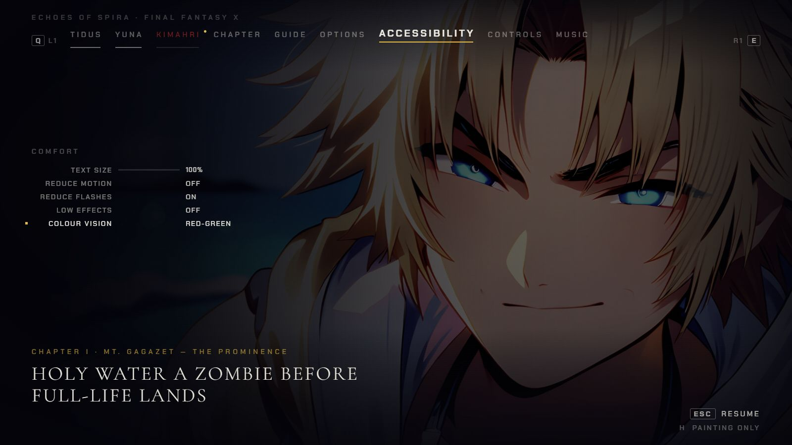

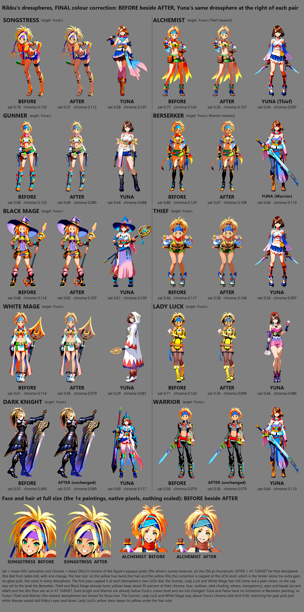

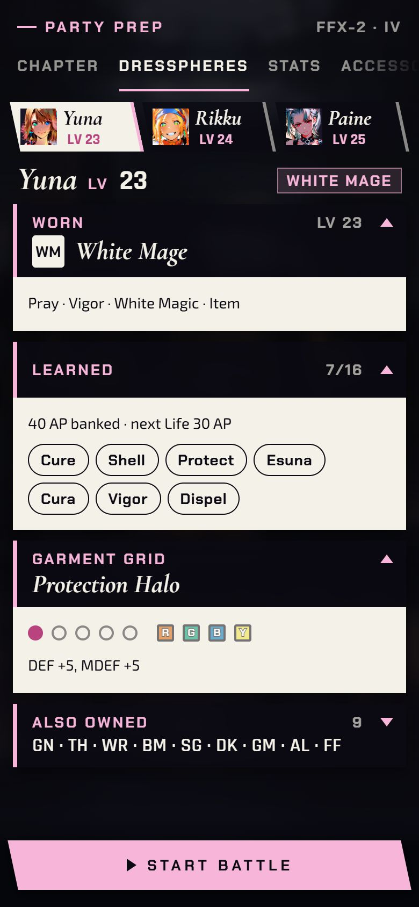

## 2026-10-14 · Release 46 (r46): 29 more recorded sound effects, the phone Party Prep's four colour shades, Chapter II's Wakka turn and the hidden fayth chapter

Address: https://echoesofspira.com (main ca9fd0b4, bundle Cg05Z3H_)

- **FFX, sound effects (every chapter):** 14 more of the game's everyday sounds are recorded originals instead of
  the stand-ins: Slow, a fiend dissolving, Petrify, Cure and Cura (also Potion and Hi-Potion), Auron's katana
  blow, Kimahri's spear blow, Grenade, Ether, Life and Phoenix Down, Waterga, Thundaga, the menu's cancel sound
  and the refused-action sound.
- **FFX, Seymour Flux and Braska's Final Aeon (Chapters I and III):** Seymour Flux's attack and his Cross Cleave
  have their own recordings (Chapter I only), and so does the final aeon's Power Wave and Gravija (Chapter III
  only).
- **FFX-2, sound effects (every chapter):** the Warrior's and the Gunner's hits, the spell chant, the
  Trigger Happy shots, Death, Cure, and the menu's cancel, refused-action, window-open and window-close sounds
  are recorded originals. Dark Shiva's attack (Chapters XI and XVI) and Vegnagun's leg strike (Chapter V) have
  their own recordings, and Shuyin's attack plays a newer, closer recording.
- **Both games, what did not change:** 24 sounds keep today's recording because the new take was no better, and
  11 wait for a second look.
- **FFX-2, every chapter (fixed before this went out):** an ordinary enemy defeat plays the recording it has
  always played. The first version of this lane took that sound out of the shared set because FFX had a new
  recording of its own, and FFX-2's defeats briefly fell back to an older, different sound. FFX keeps its new
  recording; FFX-2 is back on the old one.
- **Both games, levels (fixed before this went out):** each new recording now plays within 1.5 dB of the sound
  it replaces, measured as the game plays it. Eleven of the thirty were moved to get there: eight FFX sounds
  (Cure, Cura, Life, Waterga, Thundaga, Auron's katana blow, Grenade and Petrify), the final aeon's Power Wave,
  and two FFX-2 sounds (Death and the spell chant). Most were too loud, not too quiet;
  Petrify was 8 dB too quiet and was raised under a limiter, which makes its crack less sharp than the
  recording was. The ear has not judged any of it.
- **FFX-2 only, the Gunner's hit (fixed before this went out):** it keeps the level it was recorded at. The
  girls' hits keep today's level, never a quieter one (your decision 52n: a quiet hit was heard as no attack
  sound at all), and on the loudest 400 milliseconds the new recording already matches the sound it replaces; only
  its long tail makes the overall figure 2.6 dB higher. A first pass had cut it 1.6 dB; that is undone.
- **Both games, the small data files beside the paintings (fixed before this went out):** about 950 of the
  1,263 small files that sit beside the paintings (notes on how each painting was made) named folders of the
  computer the game is built on, and went out with every release. The build now writes each such name as the
  file's own name alone, and the deploy refuses to go out if any file of the site still names a folder of that
  computer. Everything the game reads from these files (sizes, feet lines, scales, facings, focal points, heads) is
  the same, checked on all 1,263 files and in the browser against the live site; no picture, sound or screen
  differs.
- **FFX-2, Chapter IV (Bahamut):** the quiet victory tune now stops when you press Continue after the tally.
  It used to loop on under the whole scene that follows, which this chapter keeps silent. In Chapter XI (the
  Glen) and Chapter XV (out of the Den of Woe) the scene's own music now comes back after the tally instead of
  the victory tune looping under the last lines.
- **Both games, the results tunes:** the victory tune of FFX, of FFX-2 and of Chapter IV no longer fades to
  near silence at the end of every pass and re-enters at full level. The loop now closes inside the music
  (the level across the join moves by less than 2 dB, where it moved by 13 to 24 dB). The first time through
  sounds as it did; FFX-2's loop is 32 seconds instead of 38.
- **Both games:** on a phone, the Party Prep page's small coloured text now uses the colours of the approved mockup
  page, after Bailey saw them beside the first version and went with the recommendation. In FFX the small
  gold "+10% dmg" note on the Stats tab, and the gold bag counts on the Items tab, are a deeper
  brown-gold that reads clearly on the ivory card (5.4 to 1; it was 3.4 to 1). In FFX-2 the pink
  bag counts on the Items tab are a deeper raspberry (6.1 to 1; it was 4.5 to 1). Nothing else moves:
  no layout, size or other colour changes, and the same colours are in the Ink & Gold style sheet under
  their own names, so the next screen can use them.
- **FFX-2 only (the dressphere plates on the Stats tab):** the count after the up triangle is a pale green
  and the count after the down triangle a pale red, where both were ivory. Both read at better than
  8 to 1 on the dark plate, and the triangles stay in front of the numbers, so direction never depends on
  the colour alone.
- **FFX only, Chapter II (Yunalesca):** since the game's own rule that a knock-out takes a character's Zombie away (Release 43), the suggested way to fight her
  lost about one fight in five, because the party often reached her Mega Death with nobody zombified. The suggested line now has Tidus step out for Wakka
  at the start of her last form: Wakka wears no Zombie Ward, so her Hellbiter always zombifies him, and his Death Ward gives him a fair chance against
  Mega Death even when it has not. Following the card, the fight is won 453 times in 500 (it was 398), and the guide says so and says why. Yunalesca's
  own numbers and the Zombie rule are unchanged.
- **FFX only, Chapter III (the fayth's Auto-Life):** when a party member is knocked out in the last chain of fights and the fayth's Auto-Life stands him
  back up, its icon no longer disappears from his row for the length of the revive. Nothing about the fights themselves changed.
- **FFX only, a hidden chapter, fayth:** type `fayth` on the chapter board (no card; the board still says "of 18"). It is the Evrae fight on the Highbridge
  airship deck, replayed with the timing and framing of the game's own battle camera, as a table of our own numbers on a painted scene (74 action shots
  and the default, defeat and victory views); the camera keeps the party and Evrae in frame (over three seeds the time spent losing track of a target is
  0.56 percent of the fight). The game's models and its camera programs stay on Bailey's PC; nothing of them is on the site. The plumbing it touched
  (battle moments, presenter beats and ports, the shot director) is shared by both games.
- **Disclosed by the focused reviews:** FOC46-05 (major, inside the new fayth chapter): on a 390 by 844 phone the boss is out of frame at the first command
  menu (a sliver of him at the right edge) where Chapter VIII, the same fight, frames him. FOC43-06 (major, carried): jerks of 40 pixels or more remain in the
  motion check. FOC46-04 (polish): the fayth chapter's party prep and pre-battle scene ask for a painting that does not exist (six 404s in the browser's
  log). FOC46-06 (polish): the small data files still carry an approval note with the owner's first name and a link to a private page; closed in Release 47.
  FOC45-03, FOC45-04 and FOC45-05 (polish, carried from Release 45).
- **Not in this release:** the ACCESSIBILITY tab (it adds two settings to the save and waits for a deep review); the scene-music-first change (it did not help in
  measurement and was left out).
- **Deploy notes:** shipped at 00:33 EDT on 2026-10-14 (docs/deploys.log: 2026-10-14T04:33:27Z) under Bailey's owner override (his words "yes deploy it, ill go with
  all your recommendations") because deep reviews are owed on earlier builds. Two focused reviews came first: the candidate (SHIP, which found the lost FFX-2
  defeat sound, the level mismatches and the paths in the small data files, all fixed before the deploy) and a review of the fixes (SHIP). The deploy compared the
  live files with the build, and a live check then found 5,221 of 5,222 files identical, 114 browser checks green, the FFX-2 defeat sound back, Chapter IV's
  victory cue gone 394 milliseconds after Continue and the phone shades reading exactly the four colours. The deep review is owed.
- **How it was checked:** tsc clean; the whole suite once on the candidate (18,796 tests, none failing) and once after the fixes (18,896 tests: 18,825 passed, none
  failing); a production build whose files name no local path (the new deploy gate: 0 hits in 1,291 text files) and whose 3,863 images load in Chromium and
  WebKit; two focused reviews (135 and 45 minutes); and a live check. The ear has judged none of the new sound effects.

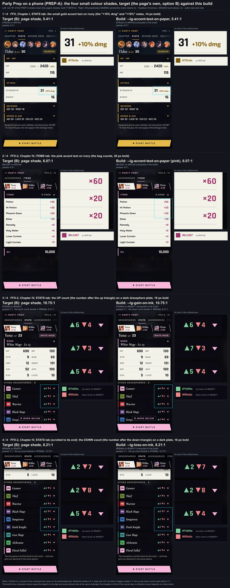

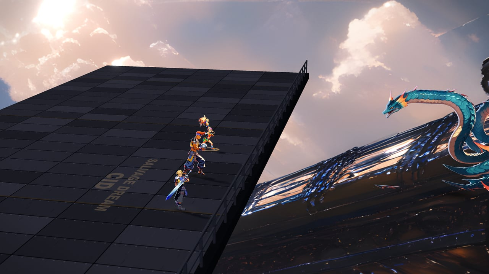

## 2026-10-13 · Release 45 (r45): 27 new music cues, recorded sound effects, results and defeat tunes, and a cleaner Paragon entrance

Address: https://echoesofspira.com (main d5bf2206, bundle Cnc9DuSS)

- **Both games, music:** 27 original cues made to resemble the mood and atmosphere of the real tracks, one original for each distinct real-game track. The
  stand-in scene beds are replaced (Gagazet, the Zanarkand dome, Dream's End, the Macalania temple, the Fahrenheit, the Farplane, both endings); Chapter XII
  (Seymour Omnis) and Chapter XV (out of the Den of Woe) get battle cues of their own and the Sinspawn Gui chapter stops borrowing Seymour's; Chapter II
  (Yunalesca) and the second Gui fight share a new "Challenge" cue; the Bevelle bed plays in Chapters IV, XIII, XV and XVI and the Experiment's scene; the
  chateau bed plays in Chapter VI and the hidden Leblanc chapter. The Seymour battle theme of Chapter I and the chapter-select music are untouched. Which
  cue goes with which game is decided cue by cue: the FFX cues are FFX only and the FFX-2 cues FFX-2 only.
- **Both games, the results screen:** the victory fanfares are an intro plus a loop; each game has a defeat tune that plays once after the results screen; and
  FFX-2 Chapter IV gets a quiet victory cue under its silent results screen (FFX-2 only).
- **Both games, sound effects:** 18 recorded originals replace stand-ins, nine in FFX and nine in FFX-2, in six packs that each chapter loads for its own
  game; the rest of the set is still the older synthesised sprite.
- **Both games, size:** the shipped audio goes from 100.80 to 68.23 MB (the budget is 105); three older MP3s are retired (the Aeon, Dread and Yunalesca stand-ins).
- **Both games, two fixes from the last review:** Paragon's size step (FFX-2 Chapter XIII) now lands before the figure is on screen in every ordering of a hurried
  or slow opening (0 of 23 hurried or slowed runs resized a visible figure, against 20 of 22 on the last build); and on a phone's first launch the first-run
  guide's chevron no longer hides the middle letters of the MORE BELOW cue.
- **Disclosed by the focused review:** FOC43-06 (major, carried): jerks of 40 pixels or more remain in the motion check, on both builds. FOC45-01 (polish): FFX-2
  Chapter IV's victory cue keeps looping under the scene after the results screen; FOC45-02 (suggestion): the three results loops dip to near silence at each
  wrap; both fixed in Release 46. FOC45-03 (polish): the SOUND TEST shows id-derived titles for the new cues; FOC45-04 (polish, low confidence): the first menu
  comes a median 192 ms later when Enter is pressed 600 ms after the battle screen; FOC45-05 (polish): the board plays no music after leaving a fight by the
  pause, on the last build too. The ear has judged none of the new music or sound effects; Bailey's verdict on the music is 7 out of 10 and it stays as installed.
- **Not in this release:** the ACCESSIBILITY tab, the 29 more sound effects, the phone Party Prep shades, the Chapter II Wakka turn and the hidden fayth chapter.
- **Deploy notes:** shipped at 18:02 EDT on 2026-10-13 (docs/deploys.log: 2026-10-13T22:02:42Z) under Bailey's owner override (his words "I’ll go with all of your
  recommendations") because deep reviews are owed on earlier builds; the focused review's SHIP came first. The deploy compared the live files with the build, and a
  live check then found 5,217 of 5,218 files identical, 78 browser checks green, the right boss cue at each first menu and the new victory and defeat tunes playing.
  It also found the scene's music playing at the first spoken line in 17 of 17 runs of the chapters that start one (the smaller files helped). The deep review is owed.
- **How it was checked:** tsc clean; the full suite read 1,146 files (17,914 tests) with no failure; the audio budget check found no finding (68.23 MB of 105); a focused
  review of the exact build (345 minutes) and a live check.

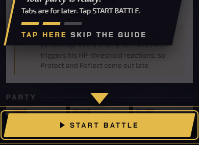

*No picture of the music: it changes sounds, not what is on screen.*

## 2026-10-13 · Release 44a (r44a): party prep on a phone, bosses that gather from pyreflies, and a lighter chapter board

Address: https://echoesofspira.com (main 7758791e, bundle CKOVah7-)

- **Both, party prep on a phone:** the eight heavy tabs (FFX Stats, Equipment, Items and Overdrive; FFX-2
  Dresspheres, Stats, Accessories and Items) used to draw the desktop board shrunk into a band across the
  screen, with letters about 3 pixels tall on a 390 by 844 phone. Each is now one long page you scroll: the
  tab bar and the faces stay pinned, the sections fold and keep a one-line summary of their numbers when
  folded, and START BATTLE stays at the bottom. Nothing on any of the eight tabs is under 14 pixels at five
  phone sizes, and the desktop screens look the same as before. Four small accent shades use the nearest
  Ink & Gold colours for now; the four tabs the mockup had no picture for went to Bailey to look at.
- **Both, bosses and aeons arrive from pyreflies:** the figure that used to be on the field whole from the
  first frame, then jump to its full size in one frame, now gathers out of pyreflies over about 0.9 seconds
  (fiends, the unsent and aeons) or fades in over 0.3 seconds (people and machines). 89 figures in 21
  chapters; the first menu comes at exactly the same time as before. The size jumps of Overdrive Sin
  (FFX, Chapter XVIII), Paragon (FFX-2, Chapter XIII) and Anima at the Fallen Aeons seam (FFX-2, Chapter XI)
  are gone from the motion check. It plays at every fight opening, not only those three, and has no sound
  yet. REDUCE MOTION gives a plain 0.2-second fade.
- **FFX-2, Chapter XIII (Paragon and Trema):** the Move Advice card now puts the chapter's own plan on top.
  A player who follows the card at a human pace wins about 63.5 times in 100 on our practice line, where it
  was 45.5; Chapters V and XV and every number on a boss or a party member are unchanged.
- **Both, the chapter board:** the strips on the chapter list paint small copies of their paintings (made when
  the game is built, from the same approved pictures), and the big picture loads when you stop on a card. The
  strips' files go from 79 to 12 MB and a board session from 129 to about 93 MB; every strip is painted
  before the board is up. The pictures you see are the same.
- **FFX-2, Rikku, and FFX, Yuna:** Rikku's three knocked-down paintings (White Mage, Alchemist and Berserker)
  replace the old ones, and a fallen Rikku now lies about 0.9 to 1.0 of her standing height long where it
  was about 0.5 to 0.6 (FFX-2 only). FFX Yuna's item pose is repainted (black boots, darker hair, lilac
  hem); one eye came out purple instead of blue (FFX only).
- **Both, two small fixes:** on a first launch the party prep's hint strip no longer runs under the first-run
  guide, and the FFX Overdrive mode rows on the party prep take a mouse click on a desktop.
- **Disclosed by the focused review:** FOC44A-05 (major, both games, inside the new entrance, not worse than
  the last build): Paragon's size step can still show on a visible figure when Enter is pressed in the first
  second or the machine is slow; the fix is already built for the next build. FOC43-06 (major, carried):
  jerks of 40 pixels or more remain in the motion check, 67 against 63 on the last build (the Sin and
  Anima entrance jerks are gone). FOC44A-03 (polish): a fast scan down the chapter list shows soft plates
  for about 0.4 seconds. FOC44A-01 (polish): on a phone's first launch the guide's chevron sits over the
  MORE BELOW cue; fixed in the next build. FOC44A-02 (polish): two differences from the last build too small to
  see on a desktop. FOC44A-04 (suggestion): about 12 MB more is downloaded before the first key.
- **Not in this release:** the ACCESSIBILITY tab (REDUCE FLASHES and a colour-vision setting), built but
  waiting for a deep review because it adds two settings to the save; the new music and sound effects, in
  review; the Chapter II Wakka turn and the scene-music-first change.
- **Deploy notes:** shipped at 07:06 EDT on 2026-10-13 (docs/deploys.log: 2026-10-13T11:06:09Z) under Bailey's
  owner override (his words of about 23:15 EDT on 2026-10-12: "I’ll go with all of your recommendations", and
  "Install" for the four paintings) because deep reviews are owed on earlier builds; the focused review's
  SHIP came first. The deploy compared the live files with the build byte for byte, and a live check then
  found all 5,205 files identical, opened the party prep of FFX Chapter I on a first launch, played the boss
  entrances of FFX Chapter XVIII and FFX-2 Chapter XI to the first menu by real keys (Chapter XI on a phone
  too) and found no console error. The deep review is owed.
- **How it was checked:** tsc clean; the full suite read 1,153 files (17,813 tests) with no failure; a
  focused review of the exact build (about 230 minutes) measured the eight phone tabs at five widths, the
  entrance in 10 chapters, the move advice over 165 decisions and the thumbnails against the live site.

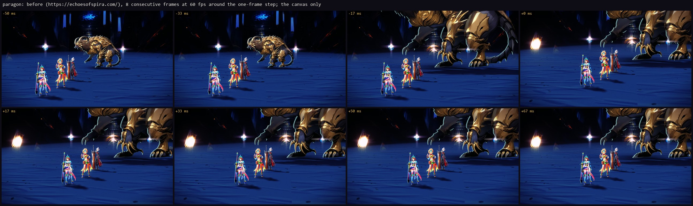

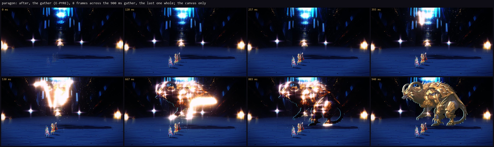

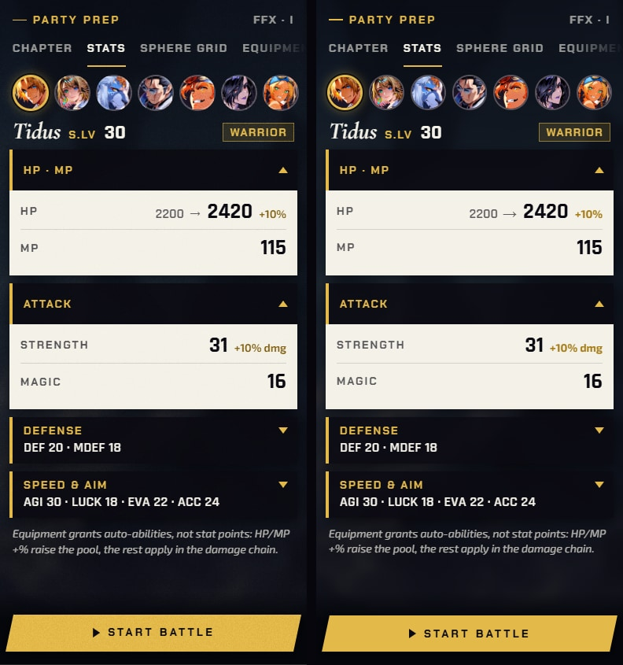

*Top and middle: eight consecutive frames each of Paragon's opening in FFX-2 Chapter XIII, the last build above and this build below. Bottom: the FFX Stats tab of the party prep on a phone, the approved target beside the build.*

## 2026-10-13 · Release 43 (r43): the game's own KO rules, a 14-pixel text floor and faster repeat loads

Address: https://echoesofspira.com (main 7b2582e7, bundle 1ntEYvFO)

- **FFX, knock-outs (every chapter):** a KO clears Zombie and Scan, as the game's own status reset does. The
  death check now runs after the target's last hit of an action, so a multi-hit attack no longer lets a dead
  character be raised in the middle of it; Auto-Life is removed at the moment of death and its revive
  comes from the base maximum; and overkill counts the damage of the whole action. **Chapter II is harder
  because of the Zombie rule:** on our practice line the wins fall from 476 to 398 in 500 (about 95 to about
  80 in 100), and Bailey accepted that until the line is reworked. Chapter III is unchanged at 479 in 500.
- **FFX, Chapter II guide, and FFX-2, Bahamut's note:** the guide gains one line, do not Haste a Reflecting
  character (the spell bounces off Reflect and lands on Yunalesca). Bahamut's on-screen note no longer says
  Slow slows the Mega Flare countdown: it is a fixed wait of about 25 seconds that Slow, Haste and speed leave
  alone (FFX-2 only).
- **Both, a fix for the new KO rule:** a status that lands on a character who the same action knocks out now
  plays no flash, sound, message or icon; Chapter III's Curse had played five such beats, about 1.5 seconds.
  (Today only FFX's death check produces the pair.)
- **Both, text you can read:** the party prep, the results screens, the first-run guide, the Chapter IX and XII
  battle screens and the Sensor chips now use text of 14 pixels or more at 1280 by 720, 1600 by 900, 2000 by
  1012 and 3840 by 2160. Still under the floor: the FFX Sphere Grid tab below 1600 by 900, windows as small
  as 1024 by 768, and the heavy party-prep tabs on a phone (fixed in the next release).
- **FFX, bosses on the airship and Sin (Chapters VIII and XVII):** Evrae's Inhale and the Left and Right Fins
  no longer cut from casting to standing in a single frame, and the Right Fin no longer slides.
- **Both, loading:** when you confirm a chapter's card the game starts fetching its scene, boss and victory
  music and keeps it ready until it plays, and files named with their content (the bundle, the style sheet,
  the workers) are cached for a year, so a repeat visit asks for none of them. On the live site the scene
  music was still not playing at the first spoken line in most of our measured runs (2 of 9 fast runs, 0 of
  6 at a human pace): the music is requested at once but competes with the art. The fix, fetching it first,
  is built next.
- **Disclosed by the focused review:** FOC43-06 (major, carried): the motion check still finds jerks of 40
  pixels or more, 94 against 174 on the last build in Chapter XVII. FOC43-07 (major): Chapter II is harder,
  above. FOC43-11 (major, carried): on a phone the heavy party-prep tabs draw their text from 3 pixels
  (fixed in release 44a). FOC43-01 (polish): on a first launch the party prep's hint strip runs under the
  first-run guide (fixed in release 44a). FOC43-04 (polish): Tidus's Auto-Life icon is missing for a moment
  after the Curse (fix built for a later build).
- **Not in this release:** the Right Fin's attack painting, which still stands 154 painting pixels above its
  idle (needs Bailey's yes).
- **Deploy notes:** shipped at 01:56 EDT on 2026-10-13 (docs/deploys.log: 2026-10-13T05:56:02Z) under Bailey's
  owner override (his words of about 17:50 EDT on 2026-10-12: "I’ll go with all of your recommendations",
  which accepted the Chapter II change) because deep reviews are owed on earlier builds; the focused
  review's SHIP came first. The deploy compared the live files with the build byte for byte, and a live
  check then found all 5,169 files identical, played FFX Chapter I and FFX-2 Chapter IV by real keys, ran
  the six cache checks and found no console error. The deep review is owed.
- **How it was checked:** tsc clean; the full suite read 1,121 files with no failure; a focused review of the
  exact build (about 250 minutes) played Chapters I, III, VIII and XVII from the title and ran Chapter II over
  500 seeds on both builds.

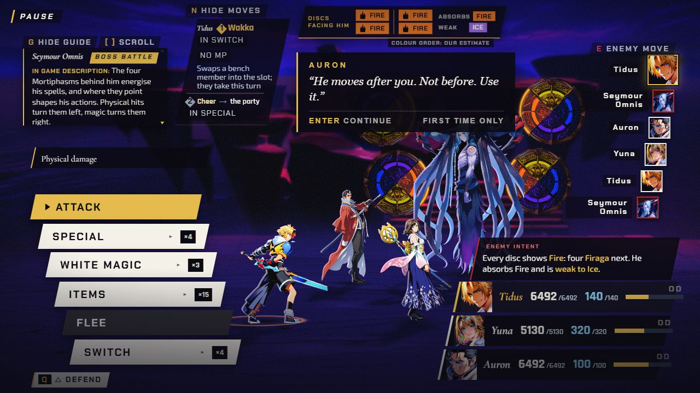

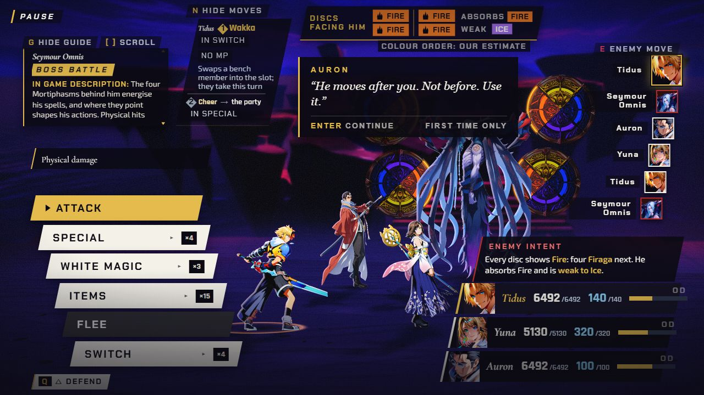

*FFX, Chapter XII (Seymour Omnis), the first menu at 1280 by 720: the last build (top) and this build (bottom).*

## 2026-10-12 · Release 42 (r42): the games' own battle rules on echoesofspira.com

Address: https://echoesofspira.com (main a061e9dc, bundle Chs9J3OY)

- **FFX-2, battle time and gauges (every chapter):** fights keep time the way the game does, read from
  Bailey's Steam copy: a clock of about 30 steps a second, the three ATB speeds, each command leaving
  its own recovery (an attack, an item, and a spell's wait is its cast), the game's cast times (Fire,
  Fira and Firaga all take about six seconds at Rikku's speed), randomised opening gauges, Delay hits
  that push a gauge back and close an open menu, and Haste, Slow, Shell, Protect, Regen, Sleep, Doom
  and Poison wearing off on the game's own counters. Most fights come out a quarter to a third
  shorter, because the clock no longer waits for animations.
- **FFX-2, Bahamut, Vegnagun and Shuyin (Chapters IV and V):** they fight by the game's own scripts.
  Bahamut casts Curse once as his first move and then repeats a six-move cycle; after the second
  Impulse he stands still for 25 seconds while the numbers 5, 4, 3, 2 and 1 count down to the Mega
  Flare (Slow and Haste do not change the wait). Vegnagun's Leg has three Nodes in three colours from
  the start, the Head wakes only when both Redoubts are down and acts much faster, a Redoubt raises
  its fallen twin a heartbeat after it falls, and Shuyin stops to speak more often and no longer picks
  on Yuna.
- **FFX-2, Shiva, the Magus Sisters, Anima, Paragon and Trema (Chapters XI and XIII):** Shiva's Triple
  Attack is three separate attacks, and Shiva and Anima charge their big moves with every hit and miss
  that lands on them. Only Cindy casts Delta Attack, and only once Mindy and Sandy are charged. The
  Oversoul Paragon answers on its next turn, sends a copied spell back at whoever cast it, waits 40
  seconds untouched, and a party that keeps hitting it keeps it from answering, which makes Chapter
  XIII much easier (about 70 fights in 100 won on our practice line, 43 before). Trema's two fights
  share one set of odds.
- **FFX-2, Leblanc, the Den of Woe and Ixion (Chapters VI, XV and XVI):** the Syndicate follows the
  game's scripts: Ormi's Concussive Blast belongs to the last room, Logos fires Hail of Bullets a
  quarter of the time there, Russian Roulette has five outcomes, and Leblanc's Guard goes up on her
  first turn and again much later. In the Den of Woe, Baralai counts every hit and answers at eight,
  and Gippal aims his low-HP Attack at the girl with the least HP; Ixion's count rises five a hit or a
  miss. With the new gauges the Den of Woe is won on every try of our practice line (about 1 in 2
  before); Leblanc and Ixion are won as often as before.
- **FFX-2, the hidden Experiment:** it keeps working at the game's pace and is harder: a girl's cast
  now takes the game's time, and on the builder's test bench it is won 380 times in 500, where it was
  500.
- **FFX, luck (every chapter):** battles now draw their luck the way the game does. The game keeps 68
  separate random-number streams: each party member rolls on their own, all the aeons share one, each
  monster has its own, and hit rolls, status rolls, steals, the monsters' decisions, random targets
  and Reflect bounces each have a stream of their own. A battle starts from the game's own seeding
  routine, so the luck inside a fight is a different but fair deal of the same odds. Chapter VIII also
  counts the voice lines and camera shots the real fight rolls for. Nothing about the bosses or your
  party changed.
- **FFX-2, luck (Chapters IV to XVI):** the same for FFX-2 with its own 68 streams: one per character
  for damage, hit and status rolls, plus shared ones for first strikes, random targets, theft and the
  bosses' scripts. Every fight is a different but fair deal of the same odds, and the chapters keep
  their win rates.
- **FFX, gear (every chapter):** bonuses of one kind on a piece now add up (Magic Def +10% and +5% on
  Yuna's Blessed Ring is 15%, two HP +10% are HP +20%). Every weapon and every armour adds 3 to your
  critical chance. Curse Ward stops Curse completely and two Wards against the same status add
  together. Rikku's Shell Targe gives her Shell while she is under half HP and takes it away when she
  is healed, and auto-statuses come back after a revive or when Petrify wears off. In the Garden of
  Pain (Seymour Omnis), Braska's Final Aeon and the two Sin fights the party hits a little harder and
  more often, and the Garden of Pain is noticeably easier.
- **FFX, targets and Reflect (every chapter):** a spell aimed at an enemy wearing Reflect comes back
  at whoever cast it, and a Reflect on your own side sends the spell to a random enemy; that now
  includes Hastega, Slowga and the Nul spells, so a Haste meant for a Reflecting party member goes
  across to an enemy. Guard and Sentinel cover for whoever is best placed, once for the whole attack.
  Multi-hit random attacks choose all their targets up front. A Confused fighter strikes only its own
  side, a Berserk one only the other side, and a Provoked monster spends its turn on whoever provoked
  it, unless it is one of the few that keep their own head. Chapter II's recommended opening changed
  with it: Tidus casts Hastega before Yuna puts Reflect up.
- **FFX, Auto-Med, Auto-Potion, Auto-Phoenix and two Overdrives:** Auto-Med reaches for a cure only
  when a hit gives you Poison, Zombie, Darkness or Silence you did not already have, and no longer
  burns a Remedy on Petrify, Sleep, Confuse, Berserk, Slow or Curse. Auto-Potion drinks at half HP or
  below, after a hit that took HP off, and is lost if the same blow knocks the character out.
  Auto-Phoenix raises a fallen friend once, with a Phoenix Down only, using the first able wearer in
  party order. Each now spends one item, not two. Auron's Banishing Blade, Shooting Star and Dragon
  Fang take their stronger strike against a foe that already has the status they would inflict, and
  Slice & Dice and Lulu's Fury spread their hits over the foes first.
- **Disclosed by the focused review (FOC42-01 to FOC42-03):** FOC42-01 (major, both games, carried,
  not introduced by this build): the motion check CHK-027 still fails, with 173 jerks of 40 pixels or
  more, mostly at camera cuts, the same as the live build (Chapter IV 3 against 11 before). FOC42-02
  (polish, FFX-2): Bahamut's on-screen note about the countdown is out of date (Slow does not slow it)
  and will be rewritten. FOC42-03 (polish): the difficulty shifts above: the hidden Experiment is
  harder, and Chapter XIII and Chapter XII (Omnis) are easier.
- **Not in this release:** the key orders for Bushido, Swordplay and Fury, the Mix chart, FFX-2 chain
  windows and menu changes (accepted, not built); the new music batch and the retail sound-effect
  packs, which wait for the ElevenLabs key's own credit limit.
- **Deploy notes:** shipped at 02:19 EDT on 2026-10-12 (docs/deploys.log: 2026-10-12T06:19:38Z) under
  Bailey's owner override (his words of 23:08 EDT on 2026-10-11 in the reverse-engineering chat: "ok
  keep going ill go with all your recommendations please", answering its first item) because deep
  reviews are owed on earlier builds; the focused review's SHIP came first. The deploy compared the
  live files with the build byte for byte. A live check was still running when this was written; the
  deep review is owed (round 25 judged fcecfa74 and could not settle the debt without Bailey).
- **How it was checked:** tsc clean; the full suite read 1107 files (17,205 tests) with no failure; a
  focused review of the exact build (about 100 minutes) said SHIP, changed area PASS: Chapters IV,
  XIII, XV, II and XII were played with real keys, Bahamut's 25-second Mega Flare countdown ran inside
  a real fight to victory, and the move advisor answered in 3 to 6 milliseconds.

## 2026-10-11 · Release 41 (r41) on echoesofspira.com

Address: https://echoesofspira.com (main 455c524c, bundle CFPPHeRS)

- **FFX-2, Chapter IV (Bahamut):** the opening shot no longer shows two dark slabs down the sides of
  the picture. They were the two foreground pipes of the Bevelle scene, which the wide opening camera
  pulled into the frame; they now follow the pull-back out to the edge. Bahamut stays whole and the
  girls readable in every frame of the move, on a desktop at three sizes and on a phone. A thin strip
  (3 to 6 percent) still shows on the right edge, and the right pipe stands in for a moment mid-move.
- **Both, behind the scenes:** the hooks for the games' own sound effects at each moment (the
  encounter opening, the results loop and ping, flow sounds) are in, and silent: the review played the
  same cues as the live build in an FFX fight and an FFX-2 fight. Nothing sounds different yet.
- **FFX-2, Trema (Chapter XIII):** a Paragon win that leaves one girl standing is now covered by tests
  through the whole flow. No change to the game.
- **Disclosed by the focused review (neither is introduced by this build):** FOC41-01 (major, both
  games): the motion check CHK-027 still fails, with jerks of 40 pixels or more (Chapter IV 11,
  Chapter I 5), the same as the live build. FOC41-02 (polish, FFX-2): the right-edge strip above.
  FOC41-03 (polish): a test-harness path only.
- **Deploy notes:** shipped at 23:29 EDT on 2026-10-11 (docs/deploys.log: 2026-10-12T03:29:33Z) under
  Bailey's owner override (his words of about 23:10 EDT: "ok keep going ill go with all your
  recommendations please") because deep reviews are owed on earlier builds; the focused review's SHIP
  came first. Its live check was skipped to save usage, and r42 replaced it 2 hours 50 minutes later.
- **How it was checked:** tsc clean; the full suite read 1061 files with no failure; a focused review
  (about 95 minutes) played the Chapter IV opening at four window sizes with real keys and compared
  the sound log of one FFX and one FFX-2 fight with the live build.

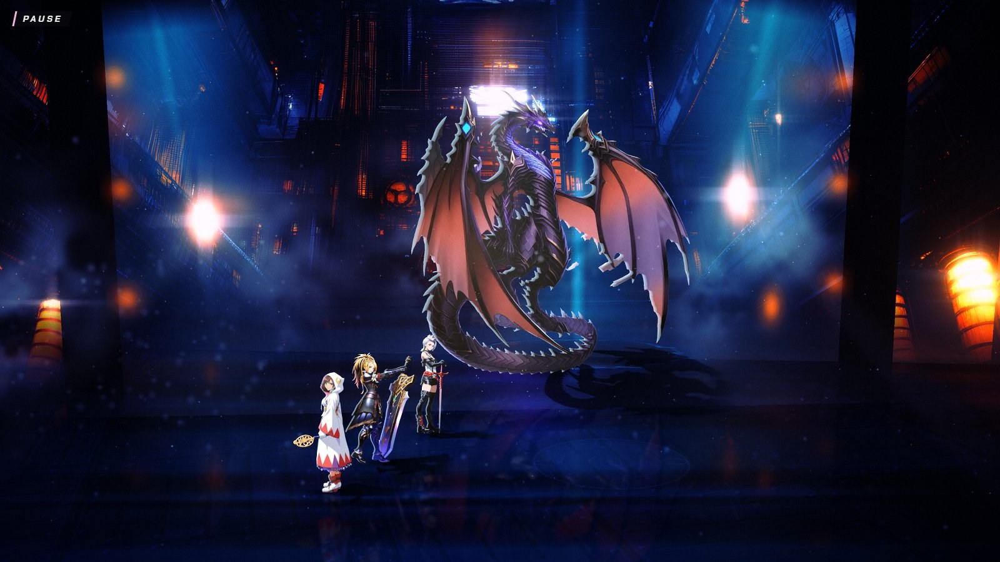

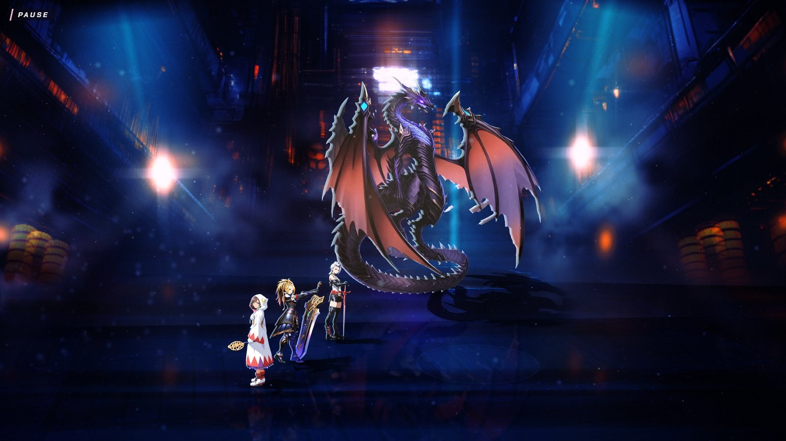

*FFX-2, Chapter IV, the opening hold at 1600 by 900: the live build before (top) and this build (bottom).*

## 2026-10-11 · The motion and music build on echoesofspira.com

Address: https://echoesofspira.com (main fcecfa74, bundle CvOwYJX5)

- **Both:** a knocked-out party member now falls. The figure buckles, tips over toward the side it
  lies on, the two paintings cross over under a puff of dust, and it lands. A revive plays it back:
  the figure rises from the floor instead of showing two copies of itself for a moment. Foes, aeons
  and giants get a short cross-fade. With REDUCE MOTION on, a knock-out stays a plain cut.
- **Both:** a hit now pushes the figure back over 80 milliseconds from where it stands, instead of
  throwing it the whole way on the hit's first frame; it holds still at contact during the hit-stop
  and then moves.
- **Both:** pose changes now run on the real clock, so a hit-stop or the pacing option no longer
  freezes or stretches a blend. The double image on the attack and follow-through chain is shorter.
- **Both, built but off:** Bailey's pick of the stepped dissolve (P2-A) is in the build and switched
  off. The review's own measure reads it as 78 of 560 pose swaps jumping 40 pixels or more, against
  none for the plain dissolve, and the options page never showed that cost. New clips of three
  versions (the stepped dissolve at its cap of 0.30, at 0.39, and the plain one) are coming for his
  pick.
- **FFX-2:** two new battle themes, original music made with ElevenLabs: one for the Fallen Aeons
  (Chapter XI) and Ixion (Chapter XVI), which share a track in the game, and one for Trema's second
  phase (Chapter XIII).
- **FFX:** four new battle themes: Seymour Natus (Chapter X), Isaaru (XIV), Sin's fins and core
  (XVII) and Sin's face (XVIII). The Evrae theme (Chapter VIII) keeps its music, but its loop is
  re-cut so it no longer clicks where it repeats.
- **FF7, hidden chapter:** the Guard Scorpion fight in the `limit` chapter, silent until now, has
  its own battle theme. The shipped audio budget goes from 100 MB to 105 MB to hold it.
- **Both:** eight of the nine ElevenLabs battle themes (the Bahamut and Leblanc themes of 39.4.4 and six
  of the new ones) are narrower in stereo, so they pass the project's stereo gate and lose less on
  one small speaker or a phone; the FF7 theme already passed. The loop points are unchanged. Nobody
  but Bailey can judge any of the new music by ear.
- **Both:** sound-effect levels follow the games' measured balance (FFX-2's party hits keep today's
  level), and the menu cursor and confirm share one tick, about 5 dB louder, inside a chapter. The
  title, chapter select and the FF7 chapter keep their own.
- **Disclosed by the focused review (FOC40-01 and FOC40-02; neither is introduced by this build or a
  regression against the live one):** FOC40-01 (major, both games): the motion check CHK-027 still
  fails: jerks of 40 pixels or more remain in every chapter measured, fewer than on the live build
  (Chapter I 5 against 8, FFX-2 Chapter V 7 against 36, Chapter III 28 against 80, Chapter XVIII 31
  against 54, FFX-2 Chapter XI 26 against 47), and knock-out snaps are 0 a minute against 0.2 to 0.4.
  FOC40-02 (major, FFX-2): Chapter XI (Fallen Aeons) has a 960 pixel one-frame jump, 966 on the build
  before. FOC40-03 (polish, a test-harness path only, not a player path).
- **Not in this release:** the rest of the music (batch 2 and the victory fanfares as an intro plus a
  loop) and the sound-effect packs, which wait for the ElevenLabs key's own credit limit; the stepped
  dissolve (off, above); release candidate 3 and the random streams.
- **Deploy notes:** it shipped under Bailey's owner override (his words of 2026-10-10 22:46 EDT,
  "i'll go with all your recommendations even as to music and sound effects. you recommend an
  dchoose it please. this is extremely important."; the deploy log calls them his 23:05 words)
  because deep reviews are owed on earlier builds; the focused review's SHIP came first. The deploy
  ran with the preflight tests skipped and the dirty tree allowed; 15 files were uploaded (5,155 were
  already there) in 61 seconds, the Worker version is c95a0d2a, and 56 files were compared on each
  address byte for byte. docs/deploys.log records 2026-10-11T14:44:38Z, which is 10:44 EDT. The deep
  review is owed on this build, which carries the deep debt of 49 earlier builds.
- **How it was checked:** tsc clean; the full suite on the release branch read 1,067 files with no
  real failure (advisor-floor timeouts pass alone); a focused review of the exact build (235
  minutes) said SHIP, changed area FAIL (CHK-027, above): on the same instrument the build is better
  than the live one in every chapter re-measured, the changed themes route to their chapters and only
  those, the stereo gate and the Evrae seam pass when decoded, and layout holds at three sizes. A
  live check then verified all 5,169 files on echoesofspira.com byte for byte and played Seymour Flux
  (an attack, a knock-out and a revive, pause), the Fallen Aeons and Ixion themes and the hidden
  `limit` chapter with real keys: 0 console errors.

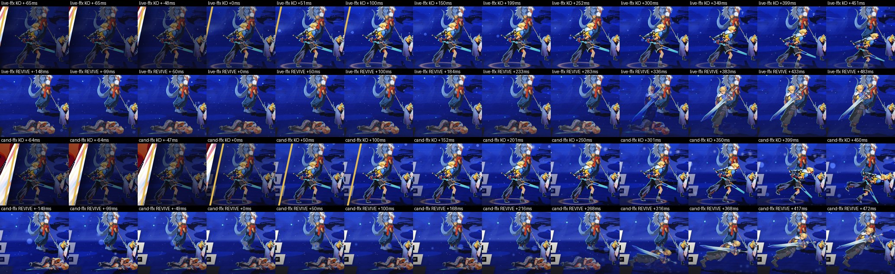

*FFX, Seymour Flux, Tidus: frames about 50 milliseconds apart from the focused review, the live
build before (knock-out, then revive) above this build (knock-out, then revive). On the live build the
revive briefly shows two copies; here he rises from the floor, one figure the whole way.*

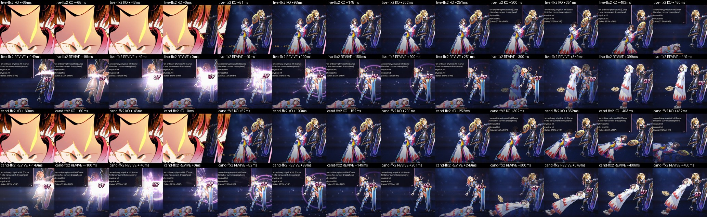

*FFX-2, Bahamut, Yuna: the same four rows. The strip's framing caught the cut-in, the big close-up
in the first frames of rows 1 and 3; the fall itself is at the right-hand end.*

## 2026-10-11 · Release candidate 2 (RC2) on echoesofspira.com

Address: https://echoesofspira.com (main 2ae1a9e4, bundle Dh42HgH0)

- **FFX, Chapter XVIII (Sin: the Face):** Sin's last attack comes on his twelfth turn, as in the
  game, and the old way of fighting him ran out of time. The suggested line now has Lulu cast two
  Firagas a turn with Doublecast, drinking a Turbo Ether when she runs low, and the party starts the
  fight in armour that carries the Stone, Confuse and Zombie Wards, so Sin's Gaze no longer
  petrifies, confuses or zombifies anyone. Following the card wins the fight with turns to spare
  (every test fight, from 1 percent); skip the Wards or the Doublecast and it is a real race again. The
  in-battle guide says twelve turns and explains the new steps.
- **FFX, Chapter X (Seymour Natus):** Natus's Flare comes every third turn or so, as in the game,
  and the old line, which sends all five aeons, lost guardians to it. The suggested line now sends
  Bahamut alone for his Overdrive and has Rikku step in for one turn to put Reflect on Natus, so
  Mortibody's Cura bounces onto one of you instead of healing him. Fights end in about 35 turns
  instead of 57, with far fewer guardians falling (60 to 97 percent in test fights). The guide, the
  pause tip and the move advisor all teach it.
- **FFX, Overdrive bars, aeons and Steal (every chapter):** the bars follow the game's own rules:
  every hit adds at least a point, a healer's bar counts only the hit points actually restored,
  Shield stops a bar from filling and Boost doubles it, and an aeon's bar is a short one that fills
  in steps of five percent. When an aeon leaves, Yuna still owes the recovery of her Summon, so she
  no longer acts the instant it goes; a fallen aeon stays away as long as the game keeps it away and
  returns at full health; aeons wear the gear the game gives them. Stealing uses the game's odds:
  each steal from a monster is about half as likely as the one before, but never impossible. Chapter
  VII (Anima and Macalania) is easier for it and Chapter II (Yunalesca) somewhat harder (99 to 94
  percent). A battle that begins with a hurt party member no longer stops the game.
- **FFX, Chapter IX (Yojimbo):** as hard as before, but it plays differently. Because Yuna now pays
  for her Summon, she can no longer call an aeon in front of Zanmato and heal in the same breath.
  The advice changed to match: call the aeon late, when Yojimbo's gauge reaches 96, and have the
  party healed first. The guide and the move advisor say so.
- **FFX, the strategy guide:** the cards for Evrae, Yojimbo, Seymour (Flux, Macalania, Omnis),
  Yunalesca, Braska's Final Aeon and the Fins and Genais are rewritten from the game's own scripts:
  how Evrae's Stone Gaze fills (and that a retreat does not clear it), the real odds inside each of
  Yojimbo's gauge bands, how the game scores Negation on the Fins, that Genais starts inside its
  shell and spends its first turn coming out, and the cycles and counters of the Seymour and
  Yunalesca fights. Nothing about a fight changes; the words are more exact.
- **FFX, the Orders and Talk menus:** on the airship (Chapters VIII and XVII), Cid is offered one
  order at a time: Pull back when the ship is near, Close in when it is far, and Cancel while an
  order is standing, which gives him his turn back. In the fight with Braska's Final Aeon
  (Chapter III), Talk is greyed while a Talk is waiting on his turn, the third Talk is offered and
  only speaks, and then the row is spent.
- **FFX-2:** nothing changes: the FFX-2 sources are byte for byte what 39.4.4 shipped (a docs-only fix
  to the theme table aside).
- **Disclosed by the focused review (FOC3945-01 to FOC3945-03; none is a regression against 39.4.4):**
  FOC3945-01 (major): the motion check (CHK-027) still fails on four FFX chapters: jerks of 40
  pixels or more, double-image pose swaps and some knock-out snaps, the same as on the live build
  and in presenter code this release does not touch. FOC3945-02 (polish, introduced by this build):
  the approved Evrae order-widget tile still describes two rows, and the build shows one, as Bailey
  decided. FOC3945-03 (suggestion): the menus screenshot tool expects Tidus first in Chapter III;
  Auron acts first on the live build and on this one.
- **Worth knowing:** the engine now simulates a fight 1.7 to 2.3 times slower on the new Overdrive
  gauge. Nothing at one fight a time notices; the move advisor looks ahead by running the engine, and
  the review saw the advice card appear within one frame after real key presses, no slower than
  before. Chapter XVIII is now the easiest chapter for the suggested line.
- **Not built yet:** Pilfer Gil, Nab Gil, Bribe, item drops, Double and Triple AP, gear drops and the
  Magus Sisters.
- **Deploy notes:** it shipped under Bailey's owner override (his answer to the question about the
  overnight build, "Yes, deploy on SHIP (Recommended)") because deep reviews are owed on earlier
  builds; the focused review's SHIP came first. The deploy ran with the preflight tests skipped and
  the dirty tree allowed; 5 files were uploaded (5,158 were already there) in 62 seconds, the Worker
  version is 3c39b7fd, and 46 files were compared on each address byte for byte. docs/deploys.log
  records 2026-10-11T11:24:11Z, which is 07:24 EDT. It was live for three hours and twenty minutes,
  until the motion and music build replaced it; the deep review it owed moved to that build.
- **How it was checked:** tsc clean; the assembled branch's whole unit suite read 1,052 files with
  1,014 passed, 22 of the 23 failing files art-only (the assembly tree had no art) and the 23rd the
  theme table's test, fixed in the release; the FFX-2 and FF7 engine goldens held and the FFX one moved
  two Natus digests on purpose. A focused review of the exact build (115 minutes) said SHIP, changed area FAIL (CHK-027,
  above): every FFX chapter reached its results screen by real keys, the Chapter XVIII line won
  where the live one lost and Chapter X won, and the menus passed on real keys at three sizes. A
  live check then verified all 5,162 files byte for byte and played Chapter VIII (Evrae) with real
  keys: the one-order widget, its cancel, pause, hide, music and a reload; 0 console errors.

## 2026-10-11 · Release 39.4.4 on echoesofspira.com

Address: https://echoesofspira.com (main 72973096, bundle CECt6LNe)

- **FFX-2:** Chapter IV: Bahamut is drawn at his in-battle size, about 3.3 times the girls (0.66 of his
  model), on a desktop and on a phone, where release 39.4.3 drew him at the full model size. The girls
  are back to 95 to 97 percent of their pre-giants height on a desktop (they were at 55) and 82
  percent on a phone. Paragon and Anima are unchanged.
- **FFX-2:** two new battle themes, original music made with ElevenLabs: a slow piano lament for
  Bahamut (Chapter IV) and a brass parade into a funk groove for the Leblanc Syndicate (Chapter VI and
  the hidden Leblanc chapter). Nobody but Bailey can judge them by ear.
- **Both:** the "two soundtracks at once" bug is fixed. In a fight that chains into more links the
  victory fanfare used to play at the end of every link, over the theme that was still running, a
  semitone off; now only the last link plays it, and the theme fades out under it. It touches every
  chained fight: Chapter VI (FFX-2), the Fallen Aeons and the Den of Woe (FFX-2), Isaaru, Sin's Fins and
  Braska's Final Aeon (FFX).
- **FFX-2:** Yuna's White Mage hurt and knocked-out paintings are the old approved ones again, hood up,
  at Bailey's word; Rikku's Dark Knight hurt keeps its new painting.
- **FFX, every chapter:** who acts next and what a status does follow the game's own program: the
  opening turn-order draws, the tick clock, Haste, Slow and Delay, one roll for each status a move can
  cause, and the status timers. **Chapter X is harder:** Natus waits less after casting Flare, as in the
  game, and the shipped line wins 302 of 500 seeds (386 before). Every other chapter stays inside the
  sampling band; Chapter XVIII's built-in line still wins only 7 of 500 seeds.
- **FFX, hidden chapter:** Sinspawn Gui at Mushroom Rock Road. Type `mushroom` on the chapter board; it
  is not in the board's "of 18" and is not listed. Two fights as in Operation Mi'ihen: the arms and
  head and body of Gui with the full party, then the weakened body with Yuna, Auron and Seymour on
  your side. The numbers are the game's own rows; the party at the Ridge is an estimate. The art is
  provisional.
- **FFX-2, hidden chapter:** the Experiment (Djose Temple, "Masterpiece Theatre"). Type `experiment` on
  the chapter board. The machine's two acts as the game has them, first at 1/1/1 and then at 5/5/5,
  with no upgrade menu before the fight. It is easy, as it is in the game: its numbers are the game's
  own and are not tuned. The art is provisional.
- **Both:** the hidden words `limit` and `leblanc` still work, a wrong word still opens nothing, and
  the two new chapters write only their own save key.
- **Disclosed by the focused review (F7297-01 to F7297-04; none is a regression against 39.4.3):**
  F7297-01 (major, feel): the motion-continuity check (CHK-027) still fails: knocked-out characters
  snap to the lying pose and some frames jerk 150 to 284 px, as on 39.4.3 and the live game before it.
  F7297-02 (major, balance): the review's advisor-driven route lost Chapter II at seed 1 after the new
  turn order, as it did on 39.4.3. F7297-03 (polish): at 1600x900 the command menu overlaps Ixion on
  the right edge. F7297-04 (suggestion): Chapter IV's layout still differs from the approved mockup.
- **Not in this release:** the rest of the battle-rules work (the Overdrive and aeon batch, the reworked
  Chapter IX, X and XVIII lines, the stale guide cards and the two menu changes, release candidate 2),
  the visual and feel fixes, the other ElevenLabs themes and the sound-effect parity.
- **Deploy notes:** it shipped under Bailey's owner override ("i'll go with all your recommendations
  even as to music and sound effects. you recommend an dchoose it please. this is extremely
  important.") because 47 builds already owe a deep review and the deploy gate refused the first try;
  the focused review's SHIP came first. The deploy ran with the preflight tests skipped (the suites had
  run in the release tree) and the dirty tree allowed; 58 files were uploaded (5,105 were already
  there) in 65 seconds and the Worker version is b133fe36. docs/deploys.log records
  2026-10-11T04:43:53Z, which is 00:43 EDT on 2026-10-11. The live check and the deep review are
  owed on this build, which carries 47 earlier builds.
- **How it was checked:** on the exact build that shipped (main 72973096, dist bundle
  index-CECt6LNe.js): tsc clean (3,409 files); the full suite on the release branch before the
  Bahamut size, the fanfare fix and the music went in read 1,020 files passed and 5 failed (6 of
  16,149 tests, load timeouts and Windows file-lock races that pass alone), and the audio and fanfare
  files after them 379 tests passed (two render timeouts pass alone); a focused review of the exact build (about 170 minutes) said SHIP, changed area FAIL
  (CHK-027 and Chapter II, named above): art verified, verify-approved 916 ok, 20 first menus, the
  typed words, and four fights played with real keys (Chapters I and III in FFX, IV and VI in FFX-2,
  all won; Chapter II lost as before). The deploy compared 137 files on each address byte for byte.

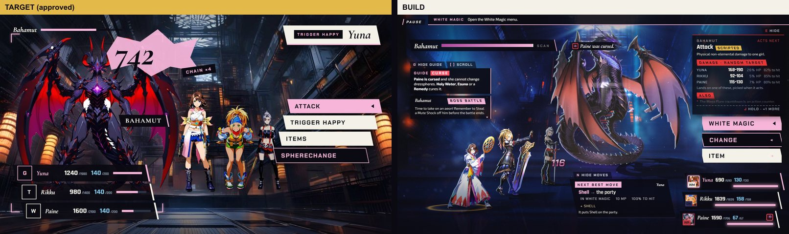

*FFX-2, Chapter IV on the 39.4.4 candidate (right) against the approved mockup (left), 1600x900, from the focused review: Bahamut at his in-battle size with the girls readable. The layout still differs from the mockup (F7297-04).*

## 2026-10-09 · Release 39.4.3 on echoesofspira.com

Address: https://echoesofspira.com (main 931613a8, bundle KHicpkvR)

- **Both:** this release is two builds in one tree. The presentation half is the real heights, the
  real boss sizes, the folded guide, Yunalesca at her wing tips and Bailey's picked poses; the
  battle-rules half is release candidate 1 of the work that reads the games' own programs: FFX's and
  FFX-2's hit, critical-hit and damage rules, the compiled boss scripts of every FFX chapter, and
  three of his answers (Sin's 12 turns, Evrae's Delay, Mega Flare at the game's power). The
  presentation half moves no battle number, and the battle half changes no art, audio or save.
- **Both:** the party stands at the real games' heights, measured from Bailey's own copies of FFX
  and FFX-2: Kimahri is the tallest and Yuna and Rikku the shortest. Several first-wave bosses now
  stand at their real sizes too, in the spots where they always stood, which is his pick "Old
  spacing, real sizes": Trema, Isaaru's aeons, the Den of Woe shades, the Magus Sisters, Shiva and
  Ixion.
- **FFX:** the giants at Bailey's picked sizes. Seymour Flux is at 60 percent of his real size, with
  Mortiorchis scaled with him (Chapter I); Braska's Final Aeon is at 75 percent, with the Yu Pagodas
  behind him as the game arranges them (Chapter III); Seymour Natus is at his real size (Chapter X);
  Sinspawn Genais and Sin's Core are at their real sizes, 20 percent bigger and 27 percent smaller
  (Chapter XVII). No fiend stands nearer the party than before.
- **FFX-2:** the giants. Bahamut (Chapter IV) and Paragon with Oversoul (Chapter XIII) are at their
  real size on a desktop, with the camera drawn back to fit them, and at 70 percent on a phone;
  Anima is at 70 percent (Chapter XI).
- **FFX:** Lady Yunalesca's first form is drawn at her model's full height, wing tips included, so
  she stands about as tall as the party (about 0.93 of it on a desktop and 1.02 on a phone; she was
  about one and a half times it). This is Bailey's pick 3. Her second and third forms are unchanged.
- **FFX:** Seymour Omnis's painted discs turn through the game's own ring, Fire, Ice, Water, Thunder
  (the old order had Ice and Water swapped): a spell turns a disc one step forward and a physical
  blow one step back. The rules behind it are in the Chapter XII line below.
- **FFX:** in Chapters I and III on a desktop or laptop the strategy guide starts folded, so the
  full NEXT BEST MOVE card has room beside the bigger bosses. Press G to open the guide; while it is
  open the card becomes a one-line tip. This is Bailey's pick 2. Phones and the other chapters are
  unchanged.
- **FFX-2:** on a phone the cure hint card is a single line, so in Chapter IV it no longer covers
  the girls.
- **Both:** 112 of Bailey's 115 picked poses from the overnight art are in the game: the FFX heroes'
  Defend paintings for Tidus, Wakka, Lulu and Kimahri (with Kimahri's broken horn) and 108 FFX-2
  dressphere poses for Yuna, Rikku and Paine. Three of those 108 replace earlier approved paintings:
  Yuna's White Mage hurt and knocked-out poses and Rikku's Dark Knight hurt pose; they await
  Bailey's word (see Disclosed, presentation).
- **FFX:** every attack, spell, item and Overdrive now decides whether it hits, whether it is a
  critical hit and how much damage it does the way the game's own program does, read from Bailey's
  Steam copy and checked against it: the game's accuracy formula for each command, its order of
  steps, its random draws in its order. Spells, items, Overdrives, aeon specials and several boss
  attacks have no hit roll in the game and never miss (Seymour's Cross Cleave is one; the party
  could dodge it before). Only the commands the game marks can land a critical hit: no spell does
  any more (Lulu's Firaga and Thundaga lose their small chance), a few physical skills do
  (Kimahri's Jump), and Daigoro's attack and Braska's Final Aeon's Triumphant Grasp do not. Luck
  counts one point a stack in the critical sum, not ten. Damage follows the game's order of steps
  (3 to 4 percent of ordinary hits were a point off), a natural Defense of 0 is no longer raised to
  1, a petrified target takes no damage (Mortibody's Shattering Claw does nothing to a stoned party
  member), the party's percent bonuses reach heals, and the five possessed aeons' plain attack
  misses about half the time against the party's Evasion, as the game's record says.
- **FFX, Chapter I:** Seymour Flux and the Mortiorchis follow the game's own script. One shared
  cycle runs the pair, Flux Banishes an aeon on his next turn, his Protect and Reflect come once
  each at 52,500 and 35,000 HP, and the Mortiorchis comes back at 4,000, 3,000, 2,000, 1,000 and
  1,000 HP and takes Flux's turn counter after each of its turns, so Full-Life follows the Lance of
  Atrophy far less often. With Cross Cleave unable to miss, the shipped auto-battle line wins all 500
  test seeds (it won 267 of 500 on release 39.4.2).
- **FFX, Chapter II:** Yunalesca follows her script. Her counters follow every action that reaches
  her, a miss included; a form changes after the last hit of the blow that ended it and the rest of
  a multi-hit blow is discarded; against a summoned aeon her Mind Blast and Osmose land on the aeon
  on the field; Form II's counter advances on aeon turns. Harder: the shipped line wins 483 of 500
  seeds (498 before) and loses 55 percent more party members.
- **FFX, Chapter III:** Braska's Final Aeon, the Yu Pagodas, the five possessed aeons and Yu Yevon
  follow their scripts. His Overdrive runs on a fixed gauge (+2 or +3 a turn, +5 a hit, +20 a
  Power Wave) and fires the turn after it reads 100; Talk clears it when his next turn starts; Jecht
  Beam comes a third of the time in his first and third phases. A destroyed Pagoda comes back after
  two or three of its own turns (one if Slowed) carrying the damage it absorbed. A possessed aeon's
  special lands on one actor (Bahamut's Impulse on all, Anima always Pain), a character the fayth
  revives acts next, and Yu Yevon casts Gravija on every turn after his first, on the front line and
  himself but not his Pagodas; his seventh damaging hit makes his next turn Osmose on each of the
  three, then Ultima. A party that swings at him with a Zombie weapon now wins in about 24 turns, not
  hundreds. The chapter still wins 486 of 500 seeds (487 before).
- **FFX, Chapter VII:** Seymour, the Guado Guardians and Anima follow the script. Seymour's Shell and
  the Guardians' Protect are real first turns, a Guardian drinks an Auto-Potion (+1,000 HP) when it
  is damaged (not after a steal), Guard cover shields a Guardian from single-target blows, Anima's
  gauge fills +5 a Pain and +5 an action that reaches her, a lethal blow before the summon lands
  whole and Seymour is put back on 6,000 as Anima comes, and in act three he casts two spells at two
  party slots (the Anima summon line is now triggered by the summon itself). The shipped line wins
  443 of 500 seeds (482 before).
- **FFX, Chapter X:** Natus owns the element order, his phase follows his HP down and back up,
  Mortibody's Desperado ladder scores Shell, Haste, Reflect and the four Nuls, an aeon is Banished at
  once, and Natus loses half of a Multi-ra when the third party slot is down. The shipped line, which
  Hastes two and Shells three, now calls Desperado about half the time Mortibody checks. 386 of 500
  seeds (393 before).
- **FFX, Chapter XII:** Seymour Omnis and the Mortiphasm discs follow the script. The discs turn Fire,
  Ice, Water, Thunder and reset Ice, Water, Thunder, Fire (the painted discs on screen turn the same
  way: their four colours are seated to the game's ring); he always casts four spells, in the order
  the disc layout fixes; the reset turn casts nothing; hits during the glow are ignored. The readout
  strip names four spells. Easier: 427 of 500 seeds (281 before).
- **FFX, Chapter VIII:** Evrae and Cid follow the game's scripts. Evrae Hastes himself once his HP is
  under 10,666 and, in his Haste phase, answers a hit from afar with a Swooping Scythe (and a hit up
  close with a fresh Haste while Slow holds); his Stone Gaze counter fills by the class of the
  command that hit him (a weapon attack +2, a spell +1, anything else nothing), once per action, a
  miss included, and keeps firing after the Haste phase starts; Cid is slower (an action every 42
  ticks, not 36). **New, by Bailey's word ("Turn it on"): delaying Evrae now matters.** Delay Attack
  counts 1 and Delay Buster 3, and at 3 his Haste phase starts with no HP lost, as the game's script
  has it. The shipped line wins 490 of 500 seeds (488 before) and never uses Delay, so nothing it
  plays moved.
- **FFX, Chapter IX:** Yojimbo follows his script. He opens with a Summon aimed at Lady Ginnem and
  acts before the party; inside each Overdrive-gauge band the game's own odds apply (80 to 99:
  Wakizashi 25, Kozuka 25, Daigoro 50 percent; 50 to 79: 20, 20, 60; 25 to 49: Kozuka 25, Daigoro
  75), Zanmato leaves the gauge at 2, and his "+3 when targeted" counts once per action that reaches
  him, a miss included. Easier: 485 of 500 seeds (428 before), mostly because Daigoro (the dog's
  bite) comes up more often and Wakizashi and Kozuka less (8.5 a run, 14.7 before).
- **FFX, Chapter XIV:** Isaaru's three aeons follow their scripts. Each opens with a Summon aimed at
  Isaaru and acts before the party; Grothia and Pterya fill their Overdrive gauges on every attack at
  Yuna even with no aeon out; against an aeon each picks its special one time in three, the plain
  Attack otherwise; Spathi's first Mega Flare comes one turn later. 423 of 500 seeds (434 before:
  inside the noise).
- **FFX, Chapter XVII:** the Fins, Genais and the Core follow their scripts. The Left Fin rams with
  the game's odds by how often he has been hit (one in three, two in three, then always), the Right
  Fin latches on at the first hit that leaves him under 16,250, and a Fin's Negation is scored from
  the party's buffs (Shell, Reflect, Protect and Haste, member by member). Genais starts inside its
  shell and leaves it on its first turn, heals itself with Cura on every hit while shelled, and
  answers a spell with Waterga once out; the Core counters with its own Fire, Blizzard, Thunder and
  Water, mostly when it is low, and its Negation chance falls as it is hit. Easier: 437 of 500 seeds
  (269 before; 87 percent against 54).
- **FFX, Chapter XVIII (Sin's face):** the game's script ends the fight with Giga-Graviton on Sin's
  12th turn (the chapter used 13), Sin takes the first turn of the fight, after his second pull Use,
  items, Wakka's reels and the aeon Overdrives of reach 1 reach him while melee does not, and the
  Gaze counter rises on every hit from the first. **Now almost unwinnable for the built-in
  auto-battle line: 3 of 500 seeds (124 on the candidate before the chapter's script went in, 151
  on 39.4.2).** Bailey chose to ship the game's 12 ("Ship 12, retune our line later") and to rework
  our own strategy line and the party preset in a later batch. The HUD clock opens at 12; the
  strategy guide card still says 13 (known stale text until that batch).
- **FFX-2:** every attack, spell, item and enemy move now decides whether it hits, whether it is a
  critical hit, how much damage it does, which status it inflicts and whether it steals the way the
  game's own program does, read from Bailey's Steam copy of FFX-2 and checked against it. Each move
  runs on the game's own row for it (accuracy rule, power, critical chance, element, number of hits,
  statuses) and each action is worked out in the game's order, with its random draws in that order.
  Moves the game never rolls to hit for never miss: nearly every item and spell, and several boss
  moves that used to miss about one time in ten (Vegnagun's Tail Beam and Noli Me Tangere, Ormi's
  Supercollider, the Dark Knight's Darkness). A physical hit counts both sides' Luck, Evasion and
  Accuracy as the game does: Shiva, Sandy and Ixion miss two to three times as often as before,
  Nooj and Ormi's Shield Bash a third to a half more often, and the Paragon's Attack never touches a
  girl who wears the Rabite's Foot. Critical hits follow the game's rule: the girls' Attack lands a
  critical hit on about 44 of every 100 hits that land (11 before), enemies land them where their
  row says (Nooj's Attack about one hit in ten), and a spell crits only if its row says so. Damage
  follows the game's whole-number steps (about 70 percent of ordinary physical hits were a few
  points off, up to 27), the chain bonus comes before the element, Shell halves what the row types
  as magic and Protect what it types as physical (Bahamut's Impulse is neither; Noli Me Tangere,
  Final Impact and the Grenade are physical), and a number applied to MP can no longer take a girl
  above her maximum. Statuses land by the game's one rule; Logos' Russian Roulette is five different
  results, one picked at random; Delta Attack leaves MP alone; Pilfer Gil takes between half and all
  of a fiend's gil (it took all of it before), and Chapter VI's fiends now carry some. The hit,
  critical and status chances the battle menu and the move advisor print come from the same rules.
- **FFX-2, Chapter IV:** Bahamut's Impulse is untyped in the game's row, so Shell no longer halves it
  and lowering his Magic no longer shrinks it (about 292 a hit under Shell, 191 before). **Mega Flare
  now hits at the game's own power 14, where we had 24** (Bailey: "Use 14 from the files"): a girl
  under Shell takes about 23 a hit instead of 69. The shipped line still wins every one of 500 seeds,
  in 42 party turns. Of the researched routes (30 seeds each): Shell without the Breaks wins 30 of 30
  (at least 28 before), healing alone 30 (1 before) and the Magic Break route alone 21 (at least 28
  before); with the 24 still in, as the candidate stood until Bailey's answer, they read 25, 14 and 2,
  because with no Shell and no cure the party is ground down, and a Mega Flare at a third of its old
  damage is what lets those routes live. Mashing Attack still never wins (0 of 30) but leaves Bahamut
  at 1,300 to 1,900 of his 8,400 HP.
- **FFX-2, Chapter V:** harder. The shipped line wins 430 of 500 seeds (474 before) and loses 5.5
  party members a run (3.1). The cause is three of the game's rows that differ from the numbers we
  had: the Leg's Berserk (a chance of 255 that lands even through the Leg's full resistance, where
  the old number did not), Mega Phoenix and the Leg's Slow. At a human pace (1.5 seconds a menu) the
  shipped line wins 2 of 10 seeds; it won 4.
- **FFX-2, Chapter VI:** the Grenade is a physical move in the game's row, so Leblanc's Protect
  halves the shipped line's workhorse; Logos lives past Leblanc's third turn and No Love Lost fires on
  11 of 20 seeds (2 before). The shipped line wins 491 of 500 seeds (488). Careless menu-mashing now
  wins the three acts on 22 of 40 seeds with no decision time (it lost 12 of 12); at a human pace it
  still loses every seed.
- **FFX-2, Chapter XI:** easier, 490 of 500 seeds (430 before). The Dark Knight's Darkness never
  misses (the game's row has no hit roll; it missed 11 times in 100) and hits harder by the game's
  whole-number steps (3,806 a hit, 2,449 before), so Shiva falls sooner and acts half as often.
- **FFX-2, Chapter XIII:** much easier, 213 of 500 seeds (36 before; 43 percent against 7). Two
  causes that overlap: the game's critical rule and the game's rows. Final Impact is a physical move
  in its row, so Protect halves it (1,734 a hit to 888), and Soul Spring hits HP and MP and drains
  both (about 1,000 a hit). The Paragon's Attack now misses a girl who wears the Rabite's Foot every
  time (it missed half of the time before) and no longer makes her Itchy; Trema's Beguiling Mire and
  Choking Mist miss 71 to 84 times in 100 (68 to 70 before).
- **FFX-2, Chapter XV:** harder, 234 of 500 seeds (274 before). The shades hit 5 to 12 percent
  harder per hit under the game's whole-number damage (Nooj's Attack 269 to 301, Baralai's 231 to
  251, Gippal's 223 to 236), 5 to 10 percent of their hits are now critical (none were), and the
  chain bonus builds on the girls they hit several times (without it the chapter would win 309).
- **FFX-2, Chapter XVI:** unchanged, 500 of 500 seeds (497 before). Ixion misses 14 of every 100
  Attacks against the party's Evasion, as the game's rule has it (5 before).
- **What changes in difficulty, FFX** (the shipped auto-battle line, 500 test seeds a chapter;
  release 39.4.2 in brackets): Chapter I is much easier, 500 (267), because Seymour's mount now takes
  its turns in step with him, as the game's script has it, which more than pays for Cross Cleave no
  longer being able to miss. Chapter XII is easier, 427 (281), because Omnis always casts four spells
  in the order the discs fix and his reset turn casts nothing. **Chapter XVII is much easier, 437
  (269)**, because Genais heals itself with Cura on every hit and so sits in its shell far less, and
  the Core counters mostly when it is low (its Fire, Blizzard, Thunder and Water fall from 12.5 to 7.2
  a run). **Chapter IX is easier, 485 (428)**, because the game's odds send Yojimbo's dog at the party
  more often than his blades, and his Summon first turn is a free turn for the party. **Chapter XVIII
  (Sin's face) is now almost unwinnable for the built-in line, 3 (151)**: the game's script ends the
  fight on Sin's 12th turn (the chapter used 13) and lets Sin act first, and the line and the party
  preset were tuned against 13 turns (it read 124 once no spell could land a critical hit, as the
  game has it); Bailey chose to ship the game's 12 and rework our own line and preset later. Chapter
  VII is a little harder, 443 (482), because Seymour's first turn is a real Shell. Chapter II is a
  little harder, 483 (498), and the party loses 55 percent more members, because Yunalesca's counters
  follow every action that reaches her, a miss included, and her Mind Blast and Osmose land on the
  summoned aeon. Chapters III, VIII (490), X and XIV (423) moved by 11 seeds or fewer, inside the
  sampling noise.
- **What changes in difficulty, FFX-2** (the same line and seeds; release 39.4.2 in brackets):
  Chapter XIII is much easier, 213 (36), because of the game's real critical rule (the girls' hits are
  critical about four times as often) and the game's ability rows (Final Impact is a physical move,
  so Protect halves it; Soul Spring drains HP and MP). Chapter XI is easier, 490 (430), because the
  Dark Knight's Darkness never misses and hits harder. Chapter V is harder, 430 (474), because three
  of the game's rows differ from the numbers we had (the Leg's Berserk lands through the Leg's full
  resistance, Mega Phoenix, the Leg's Slow). Chapter XV is harder, 234 (274), because the shades hit
  5 to 12 percent harder, a tenth of Nooj's hits are critical, and the chain bonus builds on the
  girls they hit several times. Chapters IV (500), VI (491; 488) and XVI (500; 497) do not move for
  the shipped line (Chapter IV's side routes do: Mega Flare at the game's power 14 lets a party with
  no Shell or no Breaks live through it).
- **Bailey's choices behind the battle rules:** Chapter I stays 1:1 with the game's script ("Keep 1:1",
  his answer twice, Cross Cleave never missing among it), and where the game's script and one of his
  earlier Seymour decisions that rested on an estimate disagree, the script stands ("Script wins").
  On 2026-10-09 he also chose, for the three questions the boss scripts raised: Sin's clock stays at
  the game's 12 turns and our own strategy line is reworked later ("Ship 12, retune our line later");
  delaying Evrae starts his Haste phase ("Turn it on"); Mega Flare uses the game's 14 ("Use 14 from
  the files").
- **Both:** apart from what is listed above, the battle rules moved nothing else for the player. FF7
  is unchanged: its engine logs are byte for byte the same, and no file its engine or data can reach
  changed except one shared type file, whose additions are types only; the FFX engine reaches none
  of the FFX-2 batch's files either. The battle-rules half changed no art, audio or saves; its only
  interface edits are the Omnis readout strip, the enemy-intent previews' texts, Sin's turn clock
  (it opens at 12 and no longer prints "our estimate"), and the chances the FFX-2 battle menu and
  move advisor print. The presentation half (the heights, the sizes, the folded guide, Bailey's
  poses) moves no battle number: the combined tree plays every FFX and FFX-2 chapter exactly as the
  battle-rules candidate did, on all 500 seeds of each.
- **Disclosed, FFX:** Chapter I is now won by the shipped line on every test seed (one sourced rule,
  the Mortiorchis copying Flux's turn counter, is the whole move) and Chapter XII by 85 percent; the
  Omnis strip still prints "colour order: our estimate" although the ring and the reset order are both
  the game's now (Bailey's wording, left until he changes it); the strategy guides, the advisor
  card and the auto-battle line for Chapters I, III and X still describe the old fights; Chapter XVIII
  is won by the built-in line on 3 of 500 seeds (the line and the party preset are tuned for 13
  turns; the rework is a later batch) and its guide card still says 13 turns where the HUD clock says
  12; the guide cards for Chapters VIII (the Stone Gaze note), IX (the odds, still labelled "our
  estimate") and XVII (the Negation card) still describe the old fights; Evrae's Haste story line plays
  when his HP crosses a third, not when a Delay starts the phase; the Chapter VII, X and XII readouts,
  the Anima summon line, Sin's turn clock and the enemy-intent previews had no real-input check in a
  browser yet.
- **Disclosed, FFX-2:** every printed chance is the game's rule applied to our own stat tables for
  the girls (every stat but HP differs from the game's stat builder in 334 of 576 sample cells,
  mostly higher in ours), so the shipped line's Attack crits 44 times in 100 hits; the chain's reset
  still uses the old 2-second window (3 after a critical hit) in place of the game's hit reaction,
  and a target inside it is always hit; no auto-ability but Break Damage Limit is modelled, so
  Chapter XIII's build is harder than the game's by the Protect and Shell Adamantite gives; eleven
  moves (Mega Flare among them) keep their authored "breaks the damage limit" flag where their rows
  cap at 9,999; monsters' levels, HP and stat bytes stay as authored (seven enemies differ from their
  rows); no guide text was rewritten, so the Chapter IV guide card still prints the old Mega Flare
  figure ("1,152 becomes 192", from the 24); the printed chances, the Pilfer Gil banner and the
  pause screen's chain count had no real-input check in a browser yet.
- **Disclosed, presentation:** the three replaced paintings (Yuna's White Mage hurt and knocked out,
  Rikku's Dark Knight hurt) ship as Bailey picked them and **await his word**: keep the new ones or
  restore the old, which are kept safe. Three more of his picks are held back: the Defend paintings
  of Yuna and Rikku (FFX) and of Rikku's Dark Knight (FFX-2) drew about a third taller than the same
  figure's ready pose, so Defend plays the ready painting, as on live, until the visual pass fixes
  them. Five of the new knocked-out poses lie shorter than they should (0.53 to 0.68 of the idle
  height: Paine Samurai, Rikku Alchemist, Rikku Berserker, Rikku White Mage and Paine Gunner). The
  three weak Rikku rows (Dark Knight knocked out, Songstress follow and defend) were not installed;
  new renders are being made. In Chapter III's later fights (links 2 to 4) the pagodas stand about
  as tall as the possessed aeons: Bailey kept this as built, and the aeons get measured later. At
  1440x900 and 1024x768 the Chapter I and III card prints one line less than at 1600x900.
- **Disclosed by the focused review (F931-01 to F931-05; none is a regression against 39.4.2):**
  F931-01 (major, feel): the motion-continuity check (CHK-027) fails in all five chapters played,
  with knocked-out party members cutting hard to the lying pose, one-frame jerks of 40 px or more
  and double-image pose swaps; it fails on the live game too and worse (jerks over 40 px: 24 and 33
  live against 15 and 5 here, in Chapters IV and I). F931-02 (major, balance): Chapter XVIII is won
  by 3 of 500 seeds of the built-in line and no real-input win was reached (the review's
  advisor-driven routes lost at seeds 1 and 118); the 12-turn rule is Bailey's own choice, so it is
  disclosed and not a defect of the build. F931-03 (polish): known stale texts, the guide cards of
  Chapters I, III, VIII, IX, X, XVII and XVIII, the Chapter IV Mega Flare figure and the Omnis "our
  estimate" label. F931-04 (polish): the three replaced paintings await Bailey and three Defend
  paintings are held. F931-05 (polish): the unreleased title painting echo.webp ships unused, as it
  did on live. Its two suggestions: the Paragon at 1600x900 is cropped by the frame at its head and
  right (the colossus framing Bailey picked; it fits better at 2000x1012), and 61 modules are built
  but wired to nothing, 37 of them the documented unwired FFX and FFX-2 kernels. The live check
  added one observation: on a first-run profile the Auron coach card swallows the first Enter on the
  command menu. The disclosures carried from earlier releases (see the 39.4.2 entry) were not
  re-tested by this build's focused review.
- **Still the old rules, FFX:** turn order, status infliction and durations, Delay and the per-turn
  ticks; the Overdrive gauge, Steal, Pilfer Gil, rewards, drops and the aeons' own stats; the order
  menu of Chapters VIII and XVII (the game offers one Trigger Command at a time, ours keeps "last
  order wins"); the game's own random number generators.
- **Still the old rules, FFX-2:** the ATB gauge, charge, recovery and interruption, the status
  timers, Poison and Regen; the girls' stat tables (the game's stat builder is not wired);
  auto-abilities, weapon elements and statuses, back attacks, Confusion's all-target flip and the
  Reflect bounce; the boss scripts of every FFX-2 chapter (Bahamut, Vegnagun and Shuyin, the Leblanc
  Syndicate, Fallen Aeons, Paragon and Trema, Den of Woe, Ixion); the game's own random number
  generators.
- **Not in this release:** release 39.5 (the second title screen, the CHANGELOG button and build
  number on the title, the chapter-select alternates and the voices), the second game-rules build
  (turn order, status and Overdrive), the visual and feel fixes, and the fixes to the stale guide
  texts.
- **Deploy notes:** it shipped under Bailey's owner override ("You can go ahead and ship it when
  it's ready I'll be asleep") because 46 builds already owe a deep review and the deploy gate would
  otherwise refuse; the focused review's SHIP came first. The deploy ran with the preflight tests
  skipped (the full suite had run in the release tree) and the dirty tree allowed; 567 files were
  uploaded (4,518 were already there) in 449 seconds and the Worker version is 2e1f0cb8.
  docs/deploys.log records 2026-10-10T03:59:18Z, which is 23:59 EDT on 2026-10-09. The deep review
  is owed on this build, which carries 46 earlier builds; it waits behind tonight's art run.
- **How it was checked:** on the exact build that shipped (main 931613a8, dist bundle
  index-KHicpkvR.js, 5,084 files): tsc clean (3,330 files); the full unit suite once in the release
  tree, 1,003 files passed and 7 skipped, 15,645 tests, 0 failed; the presentation half by its own
  lane on a74b2b8e (952 files, 14,104 tests, 0 failed). The battle-rules half by its own session,
  before and after the fold: the FFX engine's whole-chain logs on 18 pinned seeds match each lane's
  own record (12 byte for byte the earlier lanes' own, the six of Chapters VIII, IX and XIV equal
  the boss-script lane's own to the byte, and one chain link of an earlier merge moved two damage
  numbers with the merged hook order, explained and proved in docs/handoff/re-parity-rc1.md); the
  FFX-2 engine's four golden logs (137 pinned replays) were re-baselined by its batch, with their
  outcomes listed in docs/handoff/re-parity-w3.md, and had their Chapter IV rows (30 hashes of the
  main one, 3 and 12 in the other two) re-pinned once for Mega Flare at power 14; the FF7 logs pass
  unchanged; 500 seeds a chapter through every FFX and every FFX-2 chain. After the fold all 18 FFX
  logs, the four FFX-2 goldens and the FF7 golden reproduce with nothing re-pinned, the Omnis bench
  and the 500 seeds equal the unfolded candidate on every seed, and its full suite read 1,010 files
  and 15,706 tests with 0 failures. A focused review of the exact build (about 150 minutes) said
  SHIP, changed area FAIL (CHK-027 and Chapter XVIII, named above): every shipped art file equals
  its master (art-derive verify and audit, verify-approved 916 ok, 0 mismatched, 0 missing), 24
  first menus with a real attack at 1600x900 and 2000x1012 over nine chapters and 6 phone first
  menus, five full real-UI fights with the continuity harness (FFX-2 IV and V won, FFX I won, II and
  XVIII lost) beside the live game, and Chapter XVIII's 500 seeds; seven FFX chapters and four FFX-2
  chapters were not played through and nine mandatory checks stay unverified, which the deep review
  covers. The deploy compared 608 files byte for byte on both addresses. The live check (about 50
  minutes) compared all 5,084 shipped files byte for byte and played FFX's Chapter I from the title
  to a battle by real keys (attack and target, Escape, G, pause, the panels, the boss music, a
  settings change surviving a reload) with 0 console errors and 0 responses of 400 or more, and said
  PASS.

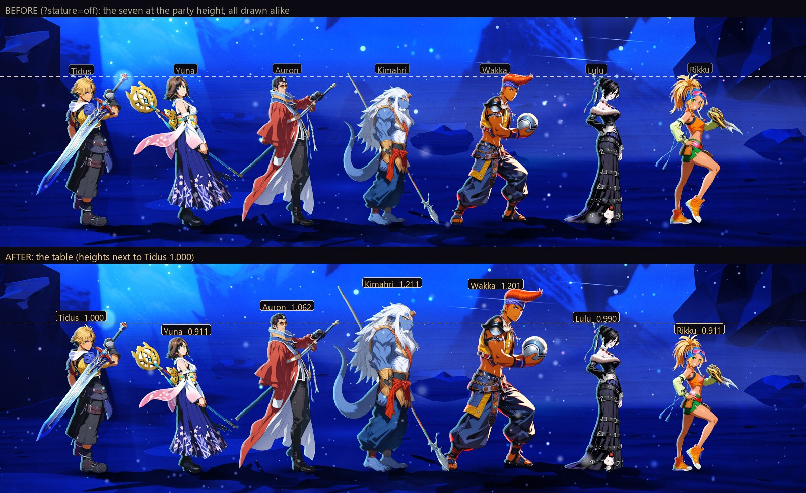

*Both games: the seven heroes staged in one row at one depth in Chapter I's room under the scene's own camera, so height is the only thing that differs: the old heights in one half and the heights measured from Bailey's own copies of FFX and FFX-2 in the other.*

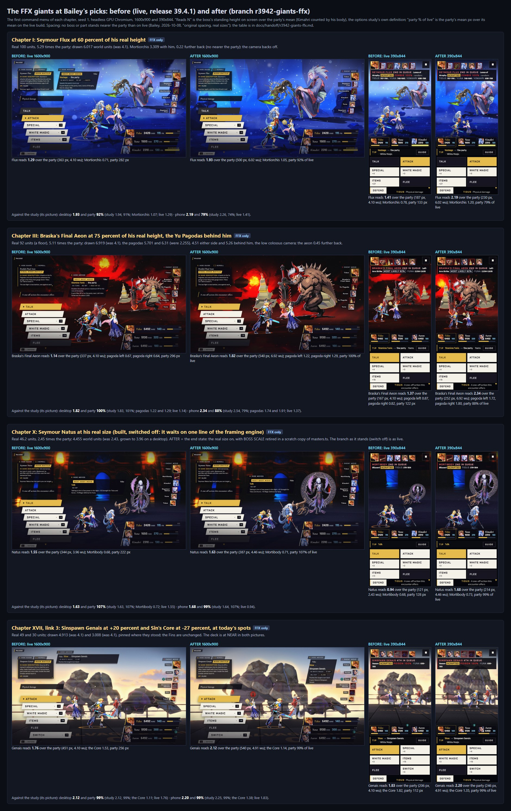

*FFX: the first command menu of the giants' chapters, the live game against the giants at Bailey's picked sizes: Seymour Flux with Mortiorchis, Braska's Final Aeon with the Yu Pagodas, Natus, and Sinspawn Genais and Sin's Core.*

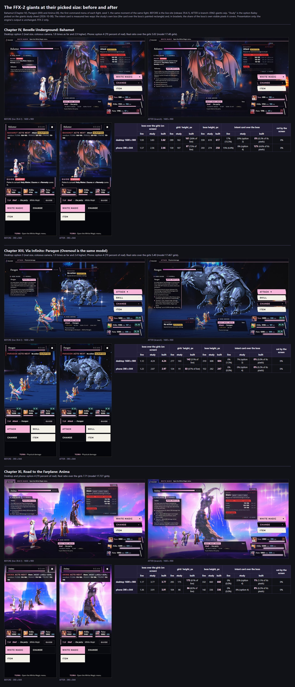

*FFX-2: the live game against the new sizes: Bahamut (Chapter IV) and Paragon with Oversoul (Chapter XIII) at their real size on a desktop with the camera drawn back, and Anima (Chapter XI) at 70 percent.*

## 2026-10-08 · Release 39.4.2 on echoesofspira.com

Address: https://echoesofspira.com (main a021787a, bundle cUSnFK7q)

- **FFX-2:** a hotfix for Chapter VI, the Leblanc Syndicate: the fiends stand where release 39.4
  stood them again, with the same gap to the party and the same camera, and keep the real sizes
  release 39.4.1 gave them (Ormi 1.15 times the girls' height, Logos 1.26, Leblanc 1.05, Dr. Goon
  1.10, Fem-Goon 1.01). This is Bailey's pick "Old spacing, real sizes", after he wrote that the way
  the battles were framed in 39.4.1, "right next to each other", was bad and that the chapter
  "looked way better before". At 1600x900 the fiends stand 0.59 to 0.83 of the girls' height on
  screen (the focused review's own measure on the exact build reads 0.60 to 0.85): in Act I Fem-Goon
  0.72, Dr. Goon 0.70 and Ormi 0.65; in Act II Ormi 0.83 and Logos 0.71; in Act III Ormi 0.83, Logos
  0.80 and Leblanc 0.59. Release 39.4 had them at 0.43 to 0.71 and 39.4.1 at 0.71 to 1.13. The
  nearest fiend is 172 to 223 px from the girls (39.4.1: 118 to 135; 39.4: 182 to 230). The camera
  is the same pose in all three builds and all three acts, and on a phone the girls are within 3
  percent of 39.4's size (39.4.1 had shrunk them 6 to 18 percent).
- **FFX-2:** the enemy-intent card now hangs over the highest fiend's head instead of over the
  acting fiend's, and its text folds to the room above it, so no card covers a head in any act at
  1280x720, 1600x900 or 1920x1080, whichever fiend acts next (39.4 had Ormi 100 percent covered in
  Act I, Logos 70 in Act II and Leblanc 100 in Act III; 39.4.1 had Logos 5 and 10 percent in Acts II
  and III). The move-advisor card is whole again: the cap 39.4.1 gave it in this chapter is out,
  because the nearest feet stand 40 px above its top, so it prints its full text. The hidden
  experimental chapter (the word `leblanc`) plays Chapter VI's room by reference and gets the same
  spots and the same card.
- **Both:** nothing else moved. The fight itself is unchanged: no battle-engine, enemy-data or
  golden file is in the change. FFX-2's Chapter IV and FFX's Chapter I first menus match live in 178
  of 178 and 175 of 175 HUD boxes within 3 pixels, with the same real attack landing; the shared
  enemy-intent mount gained one optional height limit that FFX never passes.
- **Disclosed, FFX-2:** the folded card prints less at the smallest windows: Act I's Blizzard card
  at 1600x900 shows Yuna's and Rikku's damage and folds Paine's row and the odds (F3943-01), and at
  1280x720 every act folds, and the fold can land inside the red DAMAGE banner (Act II's reads
  "DAMAGE · RANDOM" with its second line faded); holding J shows everything. On a phone the docked
  strip touches the top 5 to 7 px of one head in two debug-route captures (Ormi in Act I, Logos in
  Act III; none in five real-route loads; F3943-02), and Act I's first menu can still start with a
  goon partly off the edge of the screen (F3942-01, a defect 39.4 already had; milder here than on
  39.4.1: the worst goon 65 to 81 percent inside the screen at the first menu against 22 to 100 on
  39.4.1). The fiends read 0.60 to 0.85 of the girls instead of their real 1.01 to 1.26 because the
  old spacing keeps them far back (F3942-03: the price of the pick), and in Act III the plate names
  sit under the status rows, as on 39.4 and 39.4.1 (F3942-05).
- **Disclosed, both:** the build carries The Echo's title painting (art/title/echo.webp, 1.36 MB),
  the second title screen release 39.5 will offer, and the regenerated art index lists it; nothing
  loads it, so a player sees no change, but the file can be fetched by its address (F3943-03).
- **Still open, as on 39.4.1:** the carried disclosures F392-01 (pose changes snap in every
  chapter), F392-03 (the Zanmato gauge card on a phone in Chapter IX), F393-01 and F393-02 (the
  hidden chapter's feet and head sizes), F394-01 (Auron's coat in three repaired poses) and F394-02
  (a first menu downloads about 10 percent more art). The deep review is owed on this build: it
  carries 45 earlier builds. Not in this release: the FFX heroes' real heights, the Omnis disc order
  and the other fiends' real sizes (they wait for one combined release), and 39.5 (the second title
  screen, the chapter-select alternates, the voices).
- **Deploy notes:** it shipped under Bailey's owner override ("So have you corrected the Leblanc
  chapter the way I wanted you to? Push it live now please if it's done" and "As a hotfix") because
  45 builds already owe a deep review and the deploy gate would otherwise refuse. The deploy ran
  with the preflight tests skipped and the dirty tree allowed; seven files were uploaded (4,533 were
  already there) in 44.7 seconds and the Worker version is 38185bf4. docs/deploys.log records
  2026-10-09T01:03:34Z, which is 21:03 EDT on 2026-10-08. The three earlier builds are on preview
  addresses so the looks can be compared, each checked file by file: 39.4 at
  https://echoes-of-spira-preview.baileypillon.workers.dev/, 39.3 at
  https://echoes-of-spira-preview-393.baileypillon.workers.dev/ and 39.2 at
  https://echoes-of-spira-preview-392.baileypillon.workers.dev/.
- **How it was checked:** on the candidate (r394-int at a021787a, dist-gate bundle
  index-cUSnFK7q.js, 4,539 files): tsc clean; the 45 Leblanc, Syndicate, intent-card and advisor
  test files (534 tests) green; the full unit suite once with 60-second timeouts on the code head
  d9bbce21: 921 files and 13,640 tests passed. A focused review of the exact build (65 minutes) said
  SHIP, changed area FAIL (the three checks named above and the unrun continuity harness): Chapter
  VI's Acts I to III at 1600x900 and 2000x1012 by real keys (the first menu, target cycling, Escape,
  a real attack and a fiend's own action in each act), the chain to the results screen in 28
  seconds, the hidden word, 35 browser runs with 0 console errors and 0 failed requests, 61 frames a
  second; its own rebuild hashed differently from the deploy's in one generated file (the art
  index), which an addendum reconciles. The deploy compared 50 files byte for byte on both
  addresses. The live check (55 minutes) compared 4,539 of 4,539 files byte for byte, played Chapter
  VI's Act I by real keys from the title, then FFX's Chapter I to its first menu, a real attack, an
  options change and a reload, with 0 console errors and 0 responses of 400 or more, and said PASS.

*FFX-2, Chapter VI: the first command menu of Acts I, II and III at 1600x900 and on a phone
(390x844), release 39.4 on the left of each trio, the live 39.4.1 in the middle and this hotfix on
the right, with each fiend's on-screen height over the girls' beside the real size from the game's
models. The camera is the same in all three; the fiends are back on 39.4's spots at the real sizes,
and the intent card no longer covers a head.*

## 2026-10-07 · Release 39.4.1 on echoesofspira.com

Address: https://echoesofspira.com (main 04cdcd45, bundle DAnPZ-iy)

- **FFX-2:** a hotfix for Chapter VI, the Leblanc Syndicate: every fiend is drawn at its real size
  from the game's HD models, against the three girls. Ormi is 1.15 times the girls' height, Logos
  1.26, Leblanc 1.05, Dr. Goon 1.10 and Fem-Goon 1.01. Before, the goons were drawn at 70 percent of
  the party's height and the real sizes of Logos and Ormi had never been used; the fiends stand well
  behind the girls, so on screen they read as about half a girl. At 1600x900 the fiends stood 0.44 to
  0.72 of the girls' height on screen and now stand 0.71 to 1.15: in Act I Ormi goes from 0.57 to
  1.10, Dr. Goon from 0.44 to 0.97 and Fem-Goon from 0.50 to 0.77; in Act II Ormi from 0.72 to 0.91
  and Logos from 0.57 to 1.15; in Act III Logos from 0.63 to 1.15, Ormi from 0.72 to 0.90 and Leblanc
  from 0.56 to 0.71. This is Bailey's pick of the Leblanc options, "Option 3: bosses forward", after
  he wrote that the characters looked huge and the bosses tiny.
- **FFX-2:** the fiends stand closer to the party, level with each other at the head, so a taller
  fiend stands nearer instead of further back. The camera is unchanged on desktop (the same pose
  within 0.04 units at 1600x900 in all three acts, the same lens), and on a phone it steps back a
  little so the bigger fiends still fit.
- **FFX-2:** the enemy-intent card no longer covers Ormi's head. In Act I it covered all of it (and
  in Act III all of Leblanc's); now it covers none of Ormi's, at most 4 percent of Logos's head in Act
  II and 9 to 10 percent in Act III (Leblanc's own card). No fiend touches the command list or the
  plates at 1600x900 or 2000x1012, and every fiend is inside the frame. The cost: the move-advisor
  card is capped in this chapter so it clears the bigger fiends' feet, which makes it three lines
  instead of up to six (it drops the damage, hit and crit numbers and the "most damage" line there).
  Whether Bailey wants that is his call (F3942-02).
- **FFX-2:** the hidden experimental chapter (the word `leblanc`) plays Chapter VI's room and fiends
  by reference, so it has the same sizes and spots.
- **Both:** nothing else moved. The fight itself is unchanged: the engine's event logs for all three
  acts of Chapter VI are byte for byte the same as on 39.4 over seeds 1 to 20 (and 1 to 10 with a
  1.5-second decision time), and no battle-engine or enemy-data file is in the change. FFX-2's Chapter
  IV and FFX's Chapter I first menus match 39.4 to within 3 pixels in 178 of 178 and 175 of 175 HUD
  boxes, with the same real attack landing. Against 39.4 the build differs in two files: the bundle
  (index-D57LJe-j.js out, index-DAnPZ-iy.js in) and index.html.
- **Disclosed, FFX-2:** on a phone, Act I's first menu can still start with a goon partly off the
  edge of the screen (F3942-01, major, a defect 39.4 already had: it lost a goon there entirely; the
  hotfix improves it and does not finish it). The intent card still grazes Logos's head, up to 10
  percent (F3942-04). Leblanc (0.71) and Fem-Goon (0.77) still read smaller than their real sizes
  (1.05 and 1.01), because the HUD leaves the fiends a window of about 207 px at 1600x900 and the
  shortest fiend of each act stands furthest back (F3942-03). In Act III the plate names sit under the
  status rows, as on 39.4 (F3942-05).
- **Still open, as on 39.4:** the carried disclosures F392-01 (pose changes snap in every chapter),
  F392-03 (the Zanmato gauge card on a phone in Chapter IX), F393-01 and F393-02 (the hidden chapter's
  feet and head sizes), F394-01 (Auron's coat in three repaired poses) and F394-02 (a first menu
  downloads about 10 percent more art). The deep review is owed on this build: it carries 44 earlier
  builds. Not in this release: the FFX heroes' real heights (alone they would make the heroes taller
  while the FFX bosses stay small, so they wait for the boss sizes) and the Omnis disc order (it
  changes battle rules, so it waits for a deep review); the sizes of the other fiends follow chapter
  by chapter.
- **Deploy notes:** it shipped under Bailey's owner override ("Push a hotfix for the sizing and
  perspective problem please") because 44 builds already owe a deep review and the deploy gate read
  the change as needing one first (no save-data file is in it; F3942-06). The deploy ran with the
  preflight tests skipped and the dirty tree allowed; three files were uploaded (4,535 were already
  there) and the Worker version is 1d742335. docs/deploys.log records 2026-10-08T02:33:53Z, which is
  22:33 EDT on 2026-10-07. The same evening Bailey also asked for 39.4 on the preview address,
  https://echoes-of-spira-preview.baileypillon.workers.dev/, so the old and the new sizes can be
  compared side by side: it was published there (version bec5819e, 39.4's bundle D57LJe-j) and the
  address served that bundle at the last check; 39.3 and 39.2 are queued for two more preview
  addresses.
- **How it was checked:** on the candidate (r394-int at 04cdcd45, dist-gate bundle
  index-DAnPZ-iy.js, 4,537 files): tsc clean; the Leblanc tests, the two new test files and the tests
  the diff touches (15 files, 270 tests) green; the full unit suite once with 60-second timeouts: 919
  files and 13,618 tests passed, after one failure was fixed (the new size table lacked the confidence
  tag the citation test wants in every FFX-2 data file). A focused review of the exact build (82
  minutes) said SHIP, changed area FAIL (the phone's Act I framing, which 39.4 already had, and
  polish): Chapter VI's Acts I to III at 1600x900, 2000x1012 and 390x844 by real keys (the first menu,
  target cycling, Escape, a real attack and a fiend's own action in each act), the chain to the
  Victory screen, 18 fresh phone loads, 47 runs with 0 console errors and 0 failed requests, 61 frames
  a second. The deploy compared 46 files byte for byte on both addresses. The live check (40 minutes)
  compared 4,537 of 4,537 files byte for byte, played Chapter VI's Act I by real keys from the title
  (fiends read 1.152, 1.101 and 1.006 of the girls' height from the page's own actors; on screen 1.10,
  0.97 and 0.77), the cancel path, pause and hide, a real attack and a fiend's own action, then FFX's
  Chapter I to its first menu, a real attack, an options change and a reload, with 0 console errors
  and 0 responses of 400 or more, and said PASS.

*FFX-2, Chapter VI: the first command menu of Acts I, II and III at 1600x900 and on a phone (390x844),
the live 39.4 on the left of each pair and the hotfix on the right, with each fiend's on-screen height
over the girls' beside the real size from the game's models. The camera is the same; the fiends are
at their real size and stand nearer, and the intent card no longer covers Ormi's head.*

## 2026-10-07 · Release 39.4 on echoesofspira.com

Address: https://echoesofspira.com (main 55db51dd, bundle D57LJe-j)

- **Both:** the art repairs Bailey approved this morning are installed: 586 character and boss poses
  (218 FFX and 368 FFX-2), 2,063 painting files in all (569 at the base size and 1,494 at the larger
  sizes a sharper screen draws). Nothing was redrawn. The repairs take the jagged white fringe off the
  edges of hair and cloth and make a costume's colour the same from one pose to the next, and every
  repaired painting keeps the exact pixel size of the one it replaces. At battle size the edge repair
  is subtle by design; at 3x the fringe is gone (the pictures below). Bailey's words: "yes install the
  555 repairs, go with your recommendations". 555 of the poses had nothing to decide; the other 31
  came as four calls, and he took the recommendation on each (the next three lines).
- **Both:** where a figure runs off the edge of its painting, a hard straight cut is now a soft fade
  about 30 to 35 pixels wide: 21 poses (12 FFX-2 and 9 FFX).
- **FFX-2:** Paine's Black Mage dress matches her idle in five poses (attack, cast, KO, ready,
  victory). Seven of its poses were violet and the idle is slate-blue; the research notes give no colour
  for the dress, so this was a picture call, and the two poses the repair could not do cleanly (follow
  and item) stay violet. Rikku's Thief critical pose lost one floating blue ellipse (121 pixels) beside
  her right boot; a reviewer could not tell a stray from a deliberate puddle, and Bailey took the
  recommendation to remove it.
- **FFX:** Yuna's skirt matches her idle in four poses (attack, hurt, item, ready).
- **FFX:** Evrae's (Chapter VIII) idle painting is a byte-for-byte twin of its near-idle painting again
  at the base size, 3x and 4x (the 2x never was one). The repairs had made two files out of two
  identical sources, 82,198 of 890,624 pixels apart along the edge, and a test requires the pair to be
  the same file; the near-idle's repaired painting now stands in for both. The pre-repair file is in the
  private art archive.
- **Both:** what was not installed looks as it did: 39 repairs that failed review (a thinner sword
  blade, mottled robes, erased fingers and the like), 5 FFX poses whose fade exists at the smaller
  sizes only, and 7 poses of FF7's fight. Of the 586 installed poses, 475 are repaired at all four
  sizes, 70 at the base size only (a sharper screen draws the older painting), 24 at the base size and
  2x only, and 17 FFX fiend poses (Grothia, Pterya, Spathi) at the larger sizes only (a 1600x900
  screen draws the base size, so it looks as before).
- **Both:** a figure's head keeps its size when it changes pose, a knock-out included (Bailey's pick,
  D-510). The stage now holds each pose's head to its idle's size on screen, under the frame's own
  camera, within 10 percent of the table's scale; `?headlock=off` puts the old behaviour back. In the
  continuity run, the two chapters that failed the head-size test (CHK-026) on 39.2 now pass. Chapter V
  (FFX-2, Vegnagun and Shuyin): the worst head step fell from 3.50 to 0.27 percent and the swaps over 1
  percent from 5 to 0. Chapter XVII (FFX, Sin's fins and core): 3.34 to 0.24 percent and 213 swaps to
  0. The five other chapters measured (I, II, VII, IX, XVIII) pass too, with 0 swaps over 1 percent in
  all seven. With `?headlock=off` on the same build the two still fail (3.51 and 3.78 percent), so the
  lock is the cause. The lock's own counters over seven chapters played by the debug autoplayer read
  56,507 planes held, 0 clamped, 0 warnings; the focused review's own real-key runs read 20,094 planes
  held and 0 clamped, and 0.29 and 0.24 percent worst steps in Chapters V and XVII.
- **FFX-2:** typing `leblanc` on the board opens the hidden chapter's party prep and leaves it up until
  Enter (F393-03). The word's last letter, C, is also the board's START key, and the chapter used to
  drop straight into its pre-battle scene, with party prep on screen for 2 ms.
- **Both:** an arrow pressed after typing part of a secret word is the board's again and moves the
  cursor (F393-04, the one regression 39.3 had against 39.2); the word `limit` for FF7's fight shares
  the fix and types as before. The chapter is FFX-2 only; the board is both games'.
- **FFX-2:** a run of the hidden chapter leaves the main save byte-identical (F393-05). It used to
  write six first-run tips and a timestamp into the save, and a first-time FFX-2 player who found the
  word first would have lost the first-battle hints of the real chapters. The cost: the hidden
  chapter's own hints replay once per page load. The coach code is shared and both games' real chapters
  teach their hints as before.
- **Both:** a new title-screen track: ElevenLabs Music's take "title 1", which Bailey picked by ear
  ("ok ill go with title 1"). A flute opens it and plays once (about 33 seconds), then 12 bars of piano
  repeat (the loop runs from 33.3 to 83.0 seconds of an 86.0-second file); the old file brought the
  piano in at about 8 seconds. Bailey heard the loop's wrap: "it sounds natural, keep it".
- **FFX:** new battle music for Seymour Flux (Chapter I) and Seymour Omnis (Chapter XII, which plays the
  same cue): take A, the epic orchestral one, 44 bars at about 132 bpm (the loop runs from 7.3 to 87.3
  seconds of a 90.3-second file). Bailey: "ill go with this  it sounds epic!". After listening to the
  loop jumps he said "this is the only one that isnt smooth, the other 2 are perfect"; this is one of
  the two.
- **Both:** new music for the chapter select board: take B, the default (Bailey: "I'll go with B"; its
  loop jump is the other one he called perfect). The plan to offer A and C as selectable alternates is
  not in this release.
- **FFX:** Chapters VII (Seymour Anima) and X (Seymour Natus) keep the battle music they had in 39.3.
  Take C, the organ one, had been picked for them ("Split: C early, A late"), but it is the one loop
  Bailey heard as not smooth, and the rework of it was stopped, so C is held out of 39.4.
- **Disclosed, Both:** the project's stereo gate (how the mix holds together in mono) fails on take A
  and take B, and the title passes it only just. Correlation, side-to-mid and mono loss against the 0.60,
  -6 dB and -1 dB it asks for: A 0.29, -2.6, -1.9; B 0.43, -4.0, -1.5; the title 0.602, -6.0, -1.0, and
  only because its 33-second flute opening is nearly mono (its looping piano part alone reads 0.469,
  -4.3, -1.36 and would miss all three). The takes ship as Bailey heard them; "narrow" versions of each
  (0.73 to 0.74 correlation) pass the gate and swap in with one command, and Bailey has not chosen
  between the two widths.
- **Disclosed, Both:** every take is band-limited: a steep wall near 16.6 to 17.1 kHz (27 to 38 dB deep;
  the files they replace had 6 to 12 dB), because the generator hands over a 128 kbps MP3 and the game's
  encode keeps the wall. Only generating again at a higher output format would remove it, and a new roll
  is a different piece of music. The shipped files are transcodes (MP3 to float to MP3).
- **Disclosed, Both:** the three takes are AI-generated, with ElevenLabs Music (model music_v2_5) from
  our own written briefs, cut to a loop and mastered here (one gain to -16 LUFS; no EQ, stereo repair
  or reverb). No prompt names a composer, franchise, character or melody; nobody has checked the
  takes against existing music, and no agent has heard any of it (Bailey chose by ear). They were
  generated on Bailey's paid ElevenLabs plan; the plan, the date and the terms are to be confirmed on
  the day a build ships. If a take cannot load, the game plays the older synthesized score for the cue,
  a different piece. The in-game credits do not name the service yet (the repo's audio credits file
  does).
- **Disclosed, Both:** shipped audio is 87.09 MB of the 90 MB cap.
- **Behind the scenes, Both:** against 39.3 the build holds the same 4,537 files and changes 2,070 of
  them: 1,662 in place (1,656 repaired paintings, the art manifest, the audio manifest, the three music
  files and index.html), 407 paintings that shipped as lossless WebP and now ship as PNG, and the
  bundle (index-Dk9resVW.js out, index-D57LJe-j.js in). The stylesheet, both workers and the other 2,467
  files are byte-identical. The 407 changed format because the repairs gave their edges soft, partly
  transparent pixels (39.3's WebPs had alpha of only 0 and 255; every one of the 407 repaired files now
  has partial alpha and colour under the transparent pixels), and the build ships a WebP only where
  every decoder draws it the same. The shipped total grows from 9,482.6 to 9,670.6 MB (+188.0 MB, 2.0
  percent): the art by 189.4 MB (the 407 from 142.6 to 253.9 MB, the 1,656 others by 78.1 MB) and the
  three music files shrink by 1.4 MB. A player's first menu downloads about 10 percent more art
  (14 to 16 MB, F394-02).
- **Still open, FFX (Auron):** after the colour match, Auron's coat is uneven in his cast, attack and
  victory poses (Chapters II, III, XVII and XVIII): pale blotches, a two-tone coat, flatter fold
  shading (F394-01, polish; it needs Bailey's eye).
- **Still open, FFX-2 (the hidden chapter):** the head lock does not cover it. Its figures still slide
  their feet up to 75 px at an enemy's attack and change size at pose changes (F393-01 and F393-02),
  its 183 placeholder poses stay exactly as 39.3 shipped them (the art repairs replaced 225 paintings of
  Chapter VI, not the hidden chapter's copies), a girl who changes dressphere is drawn in the older
  painting beside the new ones (F393-07), and the pre-battle scene's location label crosses the window
  glow (F393-06).
- **Still open, Both:** as on 39.3, pose changes in every chapter still snap (CHK-027: 0.28 to 0.97
  snaps a minute in the seven chapters measured, against a limit of 0.25), and on a phone in Chapter IX
  (FFX) the Zanmato gauge card hides Yojimbo and his fiends. Opening the chapter board creates an empty
  record for a chapter in memory, and any later save (a HUD toggle, a setting) writes it into the main
  save (F394-03, harmless, a suggestion). The deep review is owed on this build: it carries 43 earlier
  builds.
- **Deploy notes:** it shipped under Bailey's owner override ("yes deploy 39.4") because 43 builds
  already owe a deep review and at most two deploys may go out while one is owed. The deploy ran with
  the preflight tests skipped and the dirty tree allowed (the review's untracked build folder counts as
  one); the full suite had passed on the candidate (below). docs/deploys.log records 14:54 EDT, the
  moment the upload began; 2,061 files were uploaded (2,477 were already there), about 6.4 GB in 35
  minutes, and the byte-for-byte checks and the records ended at 16:12 EDT.
- **How it was checked:** on the candidate before the review (r394-int at 4d282a62, dist-gate bundle
  index-DBDUO1LL.js): tsc clean over 3,091 files; `qa.mjs --strict` 0 findings in 26 music cues, 87.09
  MB of the 90 MB cap; the audio tests 35 files and 585 tests passed; the browser proof on the built
  files: all 26 cues decode to their manifest length with no loop click and no level jump, the title
  and the board play from their files, Chapters I and XII play the new Seymour take and VII and X the
  unchanged one, 17 of 18 chapters play every cue they should (Trema's results screen was not reached,
  as on 2026-09-30), 0 console errors, 0 page errors, 0 failed requests; the door smoke (`leblanc`
  opens party prep and it holds, a party attack lands, 0 console errors, 0 404s) passed; the full unit
  suite ran 917 files and 13,629 tests with 60-second timeouts: 912 files and 13,582 tests passed, the
  rest skipped by design (5 files, 46 tests, 1 todo), 0 failed. Then a focused review of the exact
  build (55db51dd, rebuilt as bundle D57LJe-j; 78 minutes) said SHIP: changed area FAIL, but every
  failure carried or polish (F392-01, F392-03, F393-01, F393-02; new polish F394-01 and F394-02); the
  head-size check passed in Chapters V, XVII, I and IV, the door and the music behaved as above, 2,063
  repaired files all matched the approved list and their old pixel sizes, and 3,346 of 3,346 shipped
  images load in Chromium and WebKit. The deploy compared 2,114 files byte for byte on both
  addresses. The live check (45 minutes) compared 4,537 of 4,537 files byte for byte, played the board,
  `leblanc`, `limit`, Chapter I (FFX) and Chapter IV (FFX-2) by real keys with 0 console errors and 0
  responses of 400 or more, read the new Seymour take looping in Chapter I and the head lock holding
  Yuna's and Tidus's knock-outs at x1.0000, and said PASS.

*FFX, Chapter II: Yuna's idle at 3x in real pixels, the live site (39.3) on the left and this build on the
right. The pale fringe along her hair and cloth edges is gone. At battle size the change is subtle by
design (a 1 to 3 pixel rim); the full six-pose sheet is `ch2-yuna-ffx-before-after.jpg` beside it.*

*FFX-2, Chapter V: Rikku as a Dark Knight, idle at 3x in real pixels, 39.3 beside this build; the six-pose
sheet is `ch5-rikku-dark-knight-ffx2-before-after.jpg`.*

*FFX, Chapter XVII: the frames around Yuna's swap from idle to KO with the head lock on; the head after over
before reads x1.0001. With the lock off the same swap read x1.0378, and on 39.2 x1.0294.*

## 2026-10-07 · Release 39.3 on echoesofspira.com

Address: https://echoesofspira.com (main b80f772f, bundle Dk9resVW)

- **FFX-2:** a hidden experimental chapter, "Experimental: Leblanc (new art)". Type `leblanc` on the
  chapter board, the way `limit` opens FF7's fight, and it opens at once; the board still shows the
  usual 18 cards ("0 of 18 beaten") and nothing on it names the chapter. It is Chapter VI's
  encounter with the same party, fiends, scripts and numbers (the Syndicate at Chateau Leblanc in
  three acts: the entrance, Logos's room and the last room with Leblanc, Logos and Ormi), painted
  again with ChatGPT Images 2.5: 54 new paintings (44 poses the fight needs and 10 rarer ones), 7
  dialogue portraits, 4 pause close-ups and a new moonlit hall for the backdrop, graded toward the
  approved target, "mockup B". Chapter VI itself is unchanged. Bailey picked the word, putting it in
  the live build and shipping the paintings as they are; the individual paintings were chosen by the
  driver under his delegation, each one recorded as a pick he can overturn.
- **Both:** the door is shared plumbing and is neutral everywhere else. Chapters I, IV and VI ask for
  no experimental art and play with 39.2's own numbers; `limit` still opens FF7's fight; a wrong word
  opens nothing; a plain A still moves the cursor left. The chapter's wins and attempts go to its own
  store, so the board's counts do not move: after a win the board still shows nothing cleared.
- **Behind the scenes:** against 39.2 the build adds 691 files (689 of them the chapter's, the other
  two the new bundle and stylesheet), changes 3 (the art manifest, its derived list and index.html)
  and drops the old bundle and stylesheet; every other shipped file is byte-identical. The art
  manifest gained 135 entries, all the chapter's. The chapter's 260 1x paintings and their sidecars
  are archived in the private art repository; the larger size tiers are owed.
- **Still open, FFX-2 (the hidden chapter):** its figures slide their feet up to 75 px at an enemy's
  attack and change size at pose changes (heads up to 35 percent by mass), and 219 of 567 pose
  swaps show a double image: the defects the main chapters had, inside the new chapter (F393-01 and
  F393-02, disclosed). A girl who changes dressphere is drawn in the older painting beside the new
  ones (F393-07, a question for Bailey).
- **Still open, Both (the word):** the word's last letter is also the board's START key, so the
  chapter skips party prep (F393-03); after you type part of the word the first arrow press on the
  board is swallowed, the one regression against 39.2 (F393-04); a run writes six first-run tips and
  a timestamp into the main save, with no progress touched (F393-05); the pre-battle scene's
  location label crosses the pale window glow (F393-06). A fix for the first three is being built
  (branch r394-door); it is not live.
- **Still open, Both:** as on 39.2, pose changes in every chapter still snap, ghost and jerk (0.58
  snaps a minute against a limit of 0.25), and on a phone in Chapter IX (FFX) the Zanmato gauge card
  hides Yojimbo and his fiends. The deep review is owed on this build: it carries 42 earlier builds.
- **Deploy notes:** the full suite ran inside the deploy this time (906 files, 13,474 tests passed).
  It shipped under Bailey's owner override ("Finish 39.2 + hidden chapter (Recommended)") because 42
  builds owe a deep review. 307 files were uploaded and 4,231 were already there.
- **How it was checked:** a focused review of the candidate said SHIP (85 minutes; changed area
  FAIL, the failures being inside the new chapter); the deploy compared 737 files byte for byte on
  both addresses; the live check compared 4,537 of 4,537 files, played the board, `leblanc`,
  `limit`, Chapter I and Chapter IV by real keys with 0 console errors and 0 responses of 400 or
  more, and said PASS.

*Left: the approved target, mockup B (Moonlit Blue Hall). Right: the hidden chapter's Act III first menu on the 39.3 candidate at 1600x900, from the focused review.*

*The pre-battle scene on echoesofspira.com at 1600x900 right after typing the word: the new moonlit hall and Rikku's new portrait. The pink location label at the top left crosses the window glow (F393-06).*

*A Change in the hidden chapter, four frames at 1600x900, from the focused review: Rikku becomes a White Mage and is drawn in the older painting beside Yuna's and Paine's new ones (F393-07).*

## 2026-10-07 · Release 39.2 on echoesofspira.com

Address: https://echoesofspira.com (main 002928c4, bundle BFTPT4o0)

- **FFX:** in Chapter IX Yojimbo holds one size. On 39.1 he swung from 0.99 to 1.34 times the
  party's height from one command menu to the next (285, 216, 216 and 279 px tall at the four menus
  the review sampled at 1600x900); now he stands at 1.13 to 1.20 times at every menu (251, 261, 261
  and 259 px). About 1.15 times was Bailey's pick and it stays an estimate: no source gives the
  proportion and the real game's screen has not been read yet. A phone is unchanged (he is 1.00
  times the party there).
- **Both:** no boss is re-sized between command menus: each is sized once per phase. The change
  reaches FFX's Seymour Natus, Braska's Final Aeon, Evrae and Yojimbo and FFX-2's Bahamut in code;
  measured, it changes Yojimbo and Bahamut (Chapter IV) and nothing else.
- **FFX-2:** in Chapter XIII (Trema) a Retry after Oversoul Paragon no longer replays a lost state.
  When fewer than two girls are standing, Retry opens at Trema's battle start with all three girls up
  at full HP and MP, Protect and Shell kept, the way a Save Sphere would; with two or more standing
  it replays the state as entered, as before. On 39.1 a Retry with one girl standing won 0 of 200
  test fights. The defeat card says nothing about it (an idea for Bailey's yes, F392-09). This was
  Bailey's pick among three measured answers.
- **Both:** REDUCE MOTION shortens the attack lunge. A strike that needed extra reach to touch its
  target now travels half of what 39.1's solver added, in the same 440 ms, so no lunge is longer
  than 2.9 units (4.4 with the setting off): in Chapter IV a fiend's lunge falls from a median 4.4
  units to 2.18. FFX's party and fiends and FFX-2's fiends change; FFX-2's girls have no run-in
  under REDUCE MOTION and are unchanged. The cost: a strike that needed the whole reach now stops
  part-way (up to 149 px short for Seymour Flux's Lance of Atrophy), a question for Bailey (F392-08).
- **FFX-2:** in Chapter IV Bahamut's reveal keeps Yuna in the frame. On 39.1 the camera's push cut
  her (her smallest visible share was 0.43 at 1280x720, 0.42 at 1600x900, 0.83 at 2000x1012 and 0.96
  at 2560x1080, over 12 runs); on 39.2 she is whole (smallest share 1.00) in all 15 of the review's
  runs at those four window sizes, with REDUCE MOTION on and off. Desktop windows only; a phone
  keeps its own framing. For about two seconds as the push ends she stands within 2 to 9 px of the
  left edge (polish, F392-05).
- **FFX:** the last pose-size fixes. In Chapter II Yunalesca's first form is sized by her head like
  every other figure, so her hurt, attack and cast poses are 23 to 33 percent smaller than on 39.1
  (head x0.99 of her idle's; it was x1.48, x1.42 and x1.29): a calmer, consistent picture that
  loses the attack's wide sweep, and Bailey kept it. In Chapter VII Yuna's and Rikku's victory poses
  are registered closer to their idles (x0.948 to x0.976 and x0.967 to x0.983) and the victory
  camera has room for them; Chapter I's feet no longer read as sliding (the check had read the
  figure's own jolt as a registration error: 4.2 px, now 0.9). The critic's pose-size check
  passes in 17 of 18 chapters in this review's run, against 15 of 18 in round 23's run on 39.1.
- **Behind the scenes:** the Bahamut route test has a 60 s timeout of its own (its heal-only case
  takes 10 s alone and 17 to 25 s in the full suite), and the comments in the Trema code and the
  contracts now name Bailey's answer. No game behaviour changed in either.
- **Still open, Both:** pose changes still snap, ghost and jerk in every chapter, as on 39.1: 0.58
  snaps a minute on both builds against a limit of 0.25 (F392-01). A knock-out is still a
  one-frame cut, and in Chapter V (FFX-2) the check found two knock-out swaps whose head changes by
  4 percent (0.4 px, invisible) against 3 allowed. The engine fix for Chapters V and XVII (Bailey's
  pick) is built on a branch and not live.
- **Still open, FFX (Chapter IX):** on a phone the Zanmato gauge card sits over Yojimbo and his two
  fiends (F392-03, as on 39.1; it needs Bailey's look before a layout change).
- **Deploy notes:** the first deploy run stopped at the full-suite gate on one 15 s timeout of
  `tests/unit/ui-pause-stack.test.ts` under load (it passes alone in 1.7 s, and the full suite had
  passed twice on this commit); the second was refused because the review's untracked build folder
  counts as a dirty tree; the third shipped with the preflight tests skipped and the dirty tree
  allowed (the driver's calls), under Bailey's owner override ("Yes, ship 39.2 on SHIP
  (Recommended)"). It went live at 00:25 EDT.
- **How it was checked:** a focused review of the candidate said SHIP (175 minutes; changed area
  FAIL: the pose-size lane's own target, the check in all 18 chapters, was met in 17); the deploy
  compared 46 files byte for byte on both addresses. No separate live check was run, because 39.3
  replaced this build about two hours later; the deep review it owed carries to 39.3.

*Chapter IX (FFX) at command menus 1, 2, 4 and 5, 1600x900, real keys. Top: release 39.1, Yojimbo 285, 216, 216 and 279 px tall. Bottom: release 39.2, 251, 261, 261 and 259 px.*

*Chapter IV (FFX-2) Bahamut's reveal at 2000x1012, the size of Bailey's own window, at 8.0, 8.8, 9.3 and 9.8 seconds. Top: release 39.1 cuts Yuna at the left edge (visible share 0.83). Bottom: release 39.2 keeps her whole (1.00).*

*Chapter XIII (FFX-2), Trema, with one girl left standing after Paragon (staged): the defeat card, then Retry opens at Trema's battle start with all three girls up. Bottom: the control, two girls standing, where Retry replays the state as entered.*

## 2026-10-06 · Release 39.1 on echoesofspira.com

Address: https://echoesofspira.com (main d3fe9fe5, bundle B6DQPYhY)

- **Both:** a new title screen. Yuna, Rikku and Paine look out over a lavender flower field to a golden
  crystal spire: the painting Bailey approved in the Art Room. The "Echoes of Spira" panel sits at the
  top left, above the three heroes, and the two black Tidus and Yuna cut-outs are gone. A phone shows
  all three heads. The picture, the panel's place and the cut-outs' removal are Bailey's picks.
- **Both:** characters and bosses show their paintings' own colours. The colour chain had never
  applied the display encode, so every painting was drawn with its gamma applied twice: darker, more
  saturated, white clothes and hair tinted lavender. Figures now go through it and read paler and
  calmer against the backdrops; Bahamut's wings go from deep red to the painting's salmon. Adding
  `?figtrue=0` to the address brings release 39's look back. This was Bailey's pick. Still open:
  Bahamut's dark body also lifts from near-black toward charcoal, and that is under investigation.
- **FFX:** every attack reaches its target. The lunge is worked out against the painted figures on
  screen, so a strike ends where the two paintings touch instead of at a fixed 1.4 units. In
  Chapter I Tidus used to stop 159 px short of Seymour Flux; the party's strikes there now end at
  0 px (3 of 3 within 12 px). Over the FFX chapters 73 to 80 percent of the party's strikes and 65 to
  82 percent of the fiends' end within 12 px of their target.
- **FFX-2:** fiends reach their target too (Bailey's call: the sources say nothing about how an FFX-2
  fiend approaches), and a girl who runs in reaches after her run-in. A girl who fires from where she
  stands (Gunner, Lady Luck and the other long-range dresspheres) still does not step in. Bahamut's
  strike at Yuna in Chapter IV left a 153 px gap and now closes it at the apex; Dr. Goon's gap to
  Rikku in Chapter VI fell from 560 px to 174 and Ixion's median gap from 231 px to 27.
- **Both:** a figure keeps its head size and stays planted when it changes pose, in every chapter.
  All 24 dresspheres, Lady Luck's three sets and the FFX party have measured head and foot positions,
  42 foes and bosses have a measured stance, and a KO's lying painting is compensated. In the
  critic's 18-chapter run on the live build, head swaps over the tolerance fell from 1,688 to 5 and
  feet slides from 1,749 to 1 of 10,500 measured swaps (the worst slide is 4.2 px). A KO still
  cuts in one frame (see "Still open").
- **FFX:** Lulu's critical pose stands lower and its head matches her idle's (head x1.08 of her idle's
  before, x0.98 now). **FFX-2:** Rikku's Berserker ready pose the same (x1.14 before, x1.00 now). Both
  were the one pose of their game where the minimum height rule had kept the head large; every other
  pose keeps the rule. This was Bailey's pick. No chapter's Garment Grid offers Berserker yet, so no one
  will see Rikku's until it does.
- **Both:** fewer 100 to 300 ms hitches when a sharp painting arrives. Release 39 swapped a 2x to 4x
  painting in mid-turn and the graphics card took 145 to 216 ms to accept it. Now the painting is sent
  ahead a slice at a time and swapped in between two draws. In Chapters I, IV and VIII at 1440p the
  frames over 50 ms that carried an upload fell from 13, 9 and 8 to 4, 0 and 0. It costs memory:
  Chapter I's first menu holds 1,338 MB of textures, up from 715. `?stage=off` puts the old path back.
  The critic's run did not see fewer slow frames in FFX-2's Vegnagun and Fallen Aeons.
- **FFX:** in Chapter XII Tidus, Yuna and Auron stand apart instead of in a heap: at the first menu the
  biggest overlap of two figures fell from 0.69 to 0.08 to 0.11 and the least visible figure rose from
  0.20 to 0.82 to 0.84 of itself. The cost is a party about a fifth smaller on screen. The four
  Mortiphasm discs stand 0.30 of Seymour's height higher, so none sits behind the party or the intent
  card.
- **FFX:** Seymour Natus's Sensor card no longer touches his wing tips at 1280x720 and 1366x768 (it
  covered 6.9 to 7.8 percent of him, now 0).
- **Both:** the move advisor's card never ends a sentence in "..." any more: a reason is whole or
  gone, and Chapters XII and XVIII print the card's effect.
- **Both:** the strategy guide never shows half a line and says it scrolls: a `[ ] SCROLL` chip
  beside G HIDE GUIDE (R-STICK SCROLL with a pad) and arrow marks at its foot. In the measured test
  64 of 72 states cut a line before and 0 do now. The phone's sheet is unchanged.
- **FFX-2:** the guide no longer disappears at TEXT SIZE 115 and 130 in Chapters IV and VI: it folds
  to its G GUIDE tab and G opens it over the boss strips, never over a girl.
- **FFX-2:** the dressphere close-up. The guide and the move advisor step out of the way while it is
  held, and it waits up to 1.0 s (was 0.6 s) for an enemy action already under way. In the test
  (Leblanc, Den of Woe, Fallen Aeons, Vegnagun) the close-up was shown in 23 of 32 changes, up from 20.
- **FFX-2:** the boss reveal in the Den of Woe and Fallen Aeons keeps every girl in the frame:
  Yuna's smallest visible share was 0 and is now 1.00, and the 6.0 s opening is as long as before.
  Bahamut's reveal in Chapter IV still lets Yuna out of the frame for about 2 s; fixing it would
  shrink the camera's push, which is Bailey's call.
- **FFX-2:** in Chapter IV the white blob in the gap of Bahamut's neck is gone: the lit pane strip of
  the Bevelle plate behind it is held down to 45 percent.
- **FFX:** in Chapter IX Yojimbo's blue sakura arrival is over in 3.6 s instead of 5.8 s (2.3 s when
  the opening is hurried).
- **Both:** the pause screen in a 4K or ultrawide window: where the window is larger than the 3360x1920
  plate, the same pause painting continues behind it, blurred and darkened, instead of a flat dark
  strip. A 1600x900 window is unchanged.
- **FFX:** in a 21:9 window the painted backdrops fade their side edges into the scene's colour where
  the painting ends inside the frame. Yunalesca's frame changes 9.2 percent at 2560x1080; at 1600x900 no
  FFX chapter changes a pixel. FFX-2's backdrops are untouched.
- **Behind the scenes:** a hidden mark key (the backtick) saves a record of a battle moment, shows
  nothing on screen and copies a short code you can paste to Bailey; `tools/replay-mark.mjs` plays it
  again. An FFX replay gives the same fight; an FFX-2 replay is near the moment, not it, because its
  ATB clock runs on real time. The critic did not exercise this key.
- **Behind the scenes:** the old title paintings were archived in a private art repository before
  the swap, with the history of every approved painting. The live site holds the same 3,289 art
  files, 8.3 GB in all.
- **Still open, Both:** a KO is still a one-frame cut from the standing painting to the lying one (78 of 96
  measured snaps; 0.58 snaps a minute against a limit of 0.25), and most pose changes still show two
  copies of the figure for a few frames (161 swaps at 0.40 or more). Big paintings still jump in one
  frame: Vegnagun's tail by 807 px, Sin's fins, Braska's pagoda hands by 550 px.
- **Still open, FFX-2 (Chapter XIII, Trema):** after a lost second link, Retry restarts from the state Paragon's
  fight ended in; with one girl standing it won 0 of 200 test fights, with nothing told to the player.
  This was already so on release 39. Bailey has three measured options to pick from.
- **Still open, FFX-2 (Chapter XIII, Trema):** the review saw no victory by real keys in 26 attempts and two long
  runs, so Trema's victory scene is still unseen for the sixth review in a row.
- **Still open, FFX (Chapter XVII):** following the move advisor's chain clears 97 of 200 test seeds; Genais's
  Sigh on link 3 is 60 of the 103 losses.
- **Still open, Both:** Bailey's listening verdict for the new music and sound effects is still missing, so audio
  is unscored; chapter rows still play stand-in cues; and the hidden FF7 fight's black screen on a
  cold cache is not yet confirmed fixed.
- **Not shown by the review:** the FFX-2 fiend and run-in reach, the Berserker and Lulu frames and the
  guide at larger TEXT SIZE were not each captured on the live build.
- **How it was checked:** a focused review of the candidate said SHIP (changed area unverified);
  the live check compared 3,848 of 3,848 files byte for byte with 0 console errors; deep review round 23
  on the live build said SHIP with the changed area FAIL, 17 of 18 chapters won by real keys, and the
  milestone not accepted.

*The new title screen on the release 39.1 build at 1600x900: the approved Gullwings painting, the title panel at the top left.*

All pictures for this build: [docs/changelog/release-39-1.md](docs/changelog/release-39-1.md)

## 2026-10-05 · Release 39 on echoesofspira.com

Address: https://echoesofspira.com (main 816d80f9, bundle DIf_suBq)

- **Both:** high-resolution art. Paintings draw from 2x, 3x and 4x files wherever your window and
  graphics card can use them, so backdrops, floors and figures are far sharper at 1440p and 4K. A
  phone or a weak card keeps the lighter files, and a first battle on a strong desktop loads nearly
  twice as much art.
- **Both:** "F plus" is the new default way to draw a battle on a strong graphics card: twice the
  width and height, shrunk with a sharper filter, which brings out fine lines. It steps down by
  itself on a slower card, and a phone draws as before.
- **Both:** almost every character and boss painting has a smooth outline, with the white fringe taken
  out.
- **Both:** a figure keeps its size and stays planted when it changes pose. In our measured test
  battles the worst head-size jump fell from 57 percent to 8, and feet no longer slide sideways.
  Some size jumps and snaps are left; they are the next job.
- **FFX:** in Chapter III Braska's Final Aeon stands further right and back, clear of the party, the
  camera is calmer while a menu is open, and the strike runs far enough to reach him.
- **FFX:** Seymour Natus is bigger in Chapter X: 346 px tall at 1600x900, up from 207. His Sensor
  card stands above him, clear of his painting, in windows 1440x810 and wider.
- **FFX-2:** four visual fixes. The white rectangle at the start of an outfit change is gone, the
  close-up on a change starts with it, the camera keeps every girl in the frame when one runs in to
  attack, and the dark pipe slabs at the edges of Bevelle's plate in wide windows (Chapters IV and
  XIII) are gone.
- **FFX:** Defend is on a tab under the command window: Triangle on a pad, Q on a keyboard, a tap on
  a phone.
- **FFX:** Bushido and Swordplay answer taps and clicks, and the Bushido chips name the key for your
  device. The press that closes the last first-turn tip no longer also picks Attack.
- **Both:** the move advisor's card no longer shrinks to a stub in the narrow boxes of Chapters VII,
  IX, XII, XVII and XVIII: it keeps its cost and its effect.
- **FFX-2:** TEXT SIZE (115 and 130 percent) now reaches the battle screen, as it already did in
  FFX, and both games' pause screens follow it.
- **FFX-2:** Lady Luck joins the Garment Grid in Chapters V, XI, XIII, XV and XVI, with 45 new
  paintings for Yuna, Rikku and Paine. Her reels are timed by you: three reels run on a slow strip
  of pictured symbols, 5 a second, and a press stops the reel the pink arrow marks on the symbol on
  the gold line. A 12 second timer stops any reel left. The slow strip was Bailey's pick; the speed
  and the timer are our estimates.
- **Both:** the strategy guide is a scrolling page for each boss. It opens on the boss on the field
  and scrolls with the wheel, the `[` and `]` keys or the pad's right stick. In Chapter I it no
  longer says Defend answers Total Annihilation, which is a Magic attack: Shell does.
- **Both:** six backdrops get new 2x paintings that stay true to the originals (Mt. Gagazet, the
  Garden of Pain, Via Purifico and the Road to the Farplane among them), and Evrae has ten new
  high-resolution paintings in Chapter VIII.
- **FFX:** Tidus's four Swordplay moves now differ. Spiral Cut has the widest gold zone (22 percent)
  on the slowest sweep, Blitz Ace the narrowest (9 percent) on the fastest, and the timers are
  unchanged. The numbers are our estimate.
- **Both:** turning an EYE CANDY look on now switches its parts on too, when all of them were off. A
  part you turn off afterwards stays off.
- **Both:** interface polish. Battle labels keep a 14 px floor in 4:3 windows (they drew as small as
  8 px), the phone's pause text is 14 to 15 px (it was 12 to 13), and the chosen row of an Overdrive
  list is filled. In FFX the OD label stays inside a 1024 px window at every TEXT SIZE. In FFX-2 a
  queued command shows its chip over the girl at once, and the enemy-move card keeps off the girls
  at Yuna's White Magic list.
- **Both:** the first-run tip says "Start with this one." when you pick a chapter other than the
  first.
- **Behind the scenes:** the critic now measures pose size jumps and snapping frame by frame (two
  new checks, with score caps), and every deep review adds a first-time-fan reviewer. The live site
  now holds 3,289 art files, 8.3 GB in all (0.8 GB before). A figure true-colour switch is built in,
  off by default, waiting for Bailey's pick.

*Chapter I's first menu on the release 39 build at 2560x1440: sharper paintings, the scrolling guide at the top left and the new Defend tab at the bottom left.*

All pictures for this build: [docs/changelog/release-39.md](docs/changelog/release-39.md)

## 2026-10-04 · Old address: the "we've moved" note

Address: https://baileypillon.github.io/pyrefly-reprise/ (main dae5ed9e)

- **Both:** the old GitHub address now shows a note on its title screen: "Echoes of Spira has moved to
  echoesofspira.com · Saves made here stay here". Clicking it opens echoesofspira.com. The game there
  is still release 38, so saves made there keep working.

*The old address's title card with the note at the top right.*

All pictures for this build: [docs/changelog/legacy-moved-note.md](docs/changelog/legacy-moved-note.md)

## 2026-10-04 · Release 38 on echoesofspira.com

Address: https://echoesofspira.com (main 8136f2ed)

- **Both:** the game has its own address, **echoesofspira.com**, served by Cloudflare.
  www.echoesofspira.com forwards to it. It is release 38, unchanged: all 1,932 files were checked
  byte for byte on the new address after the upload.
- **Both:** saves are kept per address, so echoesofspira.com starts with fresh saves. The old
  GitHub address keeps its own saves and stays up.
- **Behind the scenes:** releases now go to Cloudflare by default. Only changed files are uploaded,
  earlier versions can be rolled back in seconds, and the critic and the tools follow the new address.

*The title card on echoesofspira.com at 1600x900.*

All pictures for this build: [docs/changelog/release-38-echoesofspira.md](docs/changelog/release-38-echoesofspira.md)

## 2026-10-04 · Cloudflare preview (release 38)

Address: https://echoes-of-spira-preview.baileypillon.workers.dev

- **Both:** release 38, unchanged, served from Cloudflare for the first time. It is the same files as
  the live build, served from the site root, and all 1,932 files were checked byte for byte after the
  upload.
- **Both:** saves are kept per address, so this preview starts with no saves. GitHub Pages keeps its
  own.

*Release 38's title card as checked on the live build. The Cloudflare preview serves the same files.*

All pictures for this build: [docs/changelog/cloudflare-preview.md](docs/changelog/cloudflare-preview.md)

## 2026-10-04 · Release 38

Address: https://baileypillon.github.io/pyrefly-reprise/ (main 6461999e)

- **Both:** the game is now called **Echoes of Spira**. It shows on the title card, the browser tab,
  the pause screen and the error screens. Saves from earlier builds still load.
- **Both:** 119 new paintings. They include the Yuna Thief, Rikku Warrior and Paine Thief dresspheres,
  which used to show stand-in figures. Also new: re-rolled poses, boss wind-ups, Lulu's Fury and 25
  sharper 2x versions.
- **Both:** spells and shots fly to their target, and the damage number lands with the hit.
- **FFX-2:** a girl runs to the enemy for a plain Attack and runs home. LOW EFFECTS and REDUCE MOTION
  keep the old attack.
- **FFX:** Evrae is repainted with a longer neck, so its coil no longer swallows the party
  (Chapter VIII). On narrower windows the camera stands back.
- **FFX:** in Chapter II the party and Yunalesca no longer stand inside each other at the first menu.
- **FFX-2:** Chapters IV and XV get painted backdrop edges instead of mirrored copies, so lamps no
  longer appear doubled.
- **FFX:** Seymour Flux's Lance of Atrophy and Braska's Final Aeon's Ultimate Jecht Shot hold on a
  warning painting first.
- **FFX:** Bushido plays the Overdrive you chose.
- **FFX:** a hurried opening of Chapter IX still plays the night-sakura arrival.
- **FFX-2:** where no clean close shot exists, the dressphere-change shot pushes in instead.
- **FFX-2:** the Trigger Happy bar and Lady Luck's reels sit above the enemy-intent card, with labels
  of at least 14 px.
- **Both:** the move advisor's card keeps its effect and number lines in the big-boss layouts, and the
  "Guide's pick" tag is gone.
- **Both:** smaller downloads. Art ships as lossless WebP wherever every browser draws the same
  pixels, and every image is load-tested in Chromium and WebKit before a deploy.
- **Both:** the title key art loads from the right address in every build.

*The new title card, Echoes of Spira, at 1600x900.*

All pictures for this build: [docs/changelog/release-38.md](docs/changelog/release-38.md)

## 2026-10-03 · Release 37.1

Address: https://baileypillon.github.io/pyrefly-reprise/ (main f4244e1f)

- **FFX-2:** Trigger Happy counts gamepad R1 and taps or clicks on its bar, not only the R and Page
  Down keys, and its prompt names the right button for your device (MASH R, MASH R1, MASH TAP or MASH
  CLICK). Enter does not count, because it is not the bound button.
- **FFX:** in Chapter IX, Yojimbo and Daigoro appear at the first menu after a hurried opening.

*Trigger Happy on a phone, release 37 (left) and 37.1 (right): the bar was hidden under the intent card and could not be tapped; now it sits on top and three taps count as three hits.*

All pictures for this build: [docs/changelog/release-37-1.md](docs/changelog/release-37-1.md)

## 2026-10-03 · Release 37

Address: https://baileypillon.github.io/pyrefly-reprise/ (main cd9dbbb0)

- **Both:** the pause screen's ten portraits come alive: they blink, glance aside, and their eyes
  follow the highlighted tab or row. LIVING PAINTINGS and REDUCE MOTION switch it off.
- **Both:** eight more backdrops get depth layers and a slow drift, with the far layers softening as
  the camera moves. FFX: Zanarkand, Dream's End, the Garden of Pain, Via Purifico. FFX-2: the
  Farplane, Leblanc, Via Infinito, the Den of Woe.
- **FFX-2:** all 77 dressphere twirl keys are in (the last 8 added), and the close-up now holds its
  full 1.6 seconds, so a change takes about a second longer. The coach line steps aside for it.
- **Both:** 35 more boss paintings. FFX-2: Bahamut, Vegnagun's tail, Leblanc and her gang, Trema,
  the Den of Woe shades, the Magus Sisters. FFX: Sin's fins and Genais, the Guado Guardian, Evrae,
  Mortibody.
- **FFX:** in Chapter IX, Lady Ginnem gets a breathing cool halo and a shell of pyrefly motes, in
  the fight and in the scene after it.
- **FFX-2:** Lady Luck's reels follow the sourced pay table (a spin pays or is a Dud) and your own
  spin reaches the battle. No dressphere grid offers her yet.
- **FFX-2:** Trigger Happy now takes your own press count instead of rolling 6 to 16 hits, but only
  the R and Page Down keys count; gamepad and touch get one hit until 37.1.
- **FFX-2:** the enemy's message and telegraph clear at the last blow, and on windows 2000 px wide
  and up Chapters IV and XV fill the frame with a mirrored backdrop edge (Chapter IV's lamp shows
  doubled).
- **Both:** a knocked-out party member lies clear of the status rows, and holding skip through a
  hurried opening reaches the first menu in about 4 seconds, not 12.
- **FFX:** the Chapter XVII move advisor follows the sensible line's priorities, so its top pick now
  wins about half the time, up from about 4 percent.
- **FFX:** overkilled enemies drop double items, Auron gives a one-time disc tip in Chapter XII,
  Braska's Final Aeon's Talk beat gets a smaller line card, and Ronso Rage is no longer called a
  timed input.
- **Behind the scenes:** no source maps ship any more (22.8 MB lighter), and the audio checks gain
  an automated listener that screens new music.

*Tidus's pause portrait, smiling: one moment of the loop in which the portraits blink, glance aside and follow the highlighted tab.*

All pictures for this build: [docs/changelog/release-37.md](docs/changelog/release-37.md)

## 2026-10-03 · Release 36

Address: https://baileypillon.github.io/pyrefly-reprise/ (main c69de96a)

- **Both:** a new EYE CANDY page in OPTIONS gives each part of the three looks (CINEMA LIGHT, LIVING
  PAINTINGS, BATTLE SPECTACLE) its own switch, nine in all. A look turned OFF turns its parts off,
  and the page says OFF HERE or LESS HERE where a phone or the low tier trims a part.
- **Both:** a big visuals pass, the MAX mix: big bosses framed larger with the party where the
  backdrop allows (Yojimbo, Bahamut), a depth-of-field blur, room fog, smoother edges, figures that
  breathe and buckle when knocked out, and splash art cropped to its focus.
- **FFX:** on desktop, the camera holds a close shot of the attacker during an Overdrive input, and
  the name banner sits clear of the party.
- **FFX-2:** a dressphere change plays a painted twirl (69 of the 77 keys). On desktop it also holds
  a close-up of the girl, skipped where a dressphere still has only a stand-in figure.
- **Both:** 122 paintings (42 replace older ones): Kimahri's single broken horn on all twelve of his
  paintings, whole wings for Valefor and Pterya, redone Yu Yevon, Yunalesca and Seymour Flux poses,
  new party poses, and new hurts for Leblanc, Ormi, Trema and the goon.
- **Behind the scenes:** the new switches change the save format, so the build was reviewed in depth
  before it went live, and every switch is proved to stop its effect by real keys and touch in both
  games.

*The new EYE CANDY page in OPTIONS (FFX): three looks, each with its own switches.*

All pictures for this build: [docs/changelog/release-36.md](docs/changelog/release-36.md)

## 2026-10-02 · Release 35

Address: https://baileypillon.github.io/pyrefly-reprise/ (main ef3f6bbf)

- **Both:** 80 painted poses: wind-up, impact, follow-through, cast, item and victory paintings for
  the party (FFX: Tidus, Yuna, Auron, Wakka, Lulu, Rikku; FFX-2: 15 dresspheres) and hurt, KO and
  attack paintings for 31 bosses (13 FFX, 18 FFX-2). On desktop, 24 of the biggest paintings
  (Vegnagun's tail, Sin's fins, Overdrive Sin, Evrae and others) also ship sharper 2x masters;
  phones keep the 1x art.
- **Both:** attacks play in painted beats: the wind-up until the lunge reaches its apex, the impact
  painting at the apex, the follow-through when the hit lands. The lunge now holds at its apex until
  the hit or miss plays, so blows land on the strike.
- **FFX-2:** Yuna's White Mage dressphere wears her hood in its cast, item and victory paintings.
- **Both:** a knocked-out party member stays down through the victory instead of standing up to
  cheer, KO paintings are drawn at the standing figure's size, and a member with no KO painting lies
  on the floor.
- **FFX:** Mortiorchis leaves with Seymour Flux in a pyrefly dissolve instead of standing through
  the victory.
- **Both:** shadows follow the figure's shape instead of a box, and eye candy's rim light is capped
  at 1.5 screen pixels so low-density bosses lose their sticker halo.
- **FFX-2:** the Den of Woe returns toward its approved look (no star flares, teal floor and walls),
  the Road to the Farplane carries its stone below the frame instead of a flat violet band, and
  bloom stays off the girls on the bright Farplane plate.
- **Both:** layout fixes: panels fade while an Overdrive or Special splash prints through them,
  clipped labels wrap instead of ending in dots, panels stop covering the intent text and the enemy
  it describes, and the status line queues its messages (Esuna on three statuses shows every line).
- **FFX:** the first Esc at Chapter I's first command menu opens the pause, and after a victory or
  defeat the last enemy action's banner and the advisor card clear off the field.
- **FFX:** both Sin chapters show the advisor card at the first command menu, Chapter XVII's link on
  Sin's back lists no dead PULL BACK or CLOSE IN rows, and the Sphere Grid's AUTO-LEARN and ? button
  get key and gamepad routes.
- **Behind the scenes:** the deploy tool falls back to pushing changed files only when a full upload
  times out, and a stray 404 on battle entry is gone.

*Tidus's attack in Chapter I plays in painted beats: the wind-up, then the follow-through.*

All pictures for this build: [docs/changelog/release-35.md](docs/changelog/release-35.md)

## 2026-10-01 · Release 34

Address: https://baileypillon.github.io/pyrefly-reprise/ (main 25faec70)

- **Both:** new soundtrack renders for 23 cues: FFX's 16 are played by a sampled orchestra, FFX-2's
  seven get a band sound. The title, chapter-select and pause cues are unchanged.
- **Both:** a new recorded sound-effects set of 98 layered sounds, each game with its own voice (FFX
  sounds and weapons in FFX, FFX-2 twins in FFX-2). The title and board menus keep the old set.
- **Both:** a CREDITS row under ABOUT in the pause OPTIONS tab opens a scrolling list of every
  music, sound, type and tool credit.
- **FFX:** Overdrive inputs follow the sources: a wrong Swordplay or Bushido press restarts the
  sequence and only the timer running out fails, a failure deals the weaker sourced hit with no
  bonus or status, Blitz Ace ends with its Last Hit, and Tornado's timer is 3 seconds.
- **FFX:** in Chapter XVII, losing on Sin's back (link 3) retries at link 3, not from the Left Fin,
  and in the Sin chapters the move advisor weighs the race against Overdrive Sin's clock.
- **Both:** party members hunch when asleep and slouch (FFX, under half HP) or kneel (FFX-2, under a
  third) when low, in new paintings for Tidus, Yuna, Auron, Wakka, Lulu, Rikku and Kimahri and for
  FFX-2's Yuna Gunner, Rikku Thief and Paine Warrior.
- **FFX-2:** Bahamut's Mega Flare gets a splash painting in Chapter IV, and Paine's Songstress gets
  attack and hurt paintings.
- **Both:** Seymour kneels and falls in his own paintings at the end of Chapter VII and when he is
  knocked out, Isaaru and Shuyin kneel in theirs, and the silent 1.7-second empty plate before the
  Chapter VII results is gone.
- **Both:** pause and flow fixes: QUIT TO TITLE no longer shows two titles, RESTART ENCOUNTER no
  longer leaves the title over the fight, REPLAY BRIEFING can be dismissed, a click on RESUME closes
  the pause, and on a phone the first tap on a target aims and the second commits (a Hi-Potion can
  no longer kill a Zombie ally in one tap).
- **Both:** the cure-hint card keeps its text at 14 px or more and stays clear of the party chips,
  and changing TEXT SIZE from the pause with a menu open resizes the FFX command list (it used to
  cover the Talk row).
- **FFX-2:** Chapter XV's chain links open full-bleed instead of with the last link's victory arc
  still showing.
- **Behind the scenes:** three.js's licence notice now ships with the game, and the audio budget
  rose from 85 to 90 MB so the new effects ship at full MP3 quality.

*Chapter IV: Yuna asleep and Paine kneeling at low HP, in their new resting paintings.*

All pictures for this build: [docs/changelog/release-34.md](docs/changelog/release-34.md)

## 2026-09-30 · Release 33

Address: https://baileypillon.github.io/pyrefly-reprise/ (main f302f163)

- **Both:** eye candy is on by default: golden-hour light and haze, drifting flakes and steam, a
  gentle figure sway, hit-stop, hit rings and splash cut-ins (FFX gold and calm, FFX-2 pink and
  quick). OPTIONS gets CINEMA LIGHT, LIVING PAINTINGS and BATTLE SPECTACLE rows to turn each off.
- **Both:** statuses show on the figures in their sourced looks, each game with its own table
  (Zombie's green glow, Poison bubbles, Sleep Z's, Stop's freeze and more), with drawn status icons
  on the plates and a one-line message when one lands or wears off.
- **Both:** guard rails: a healing item aimed at a Zombie ally shows a red warning with the damage,
  the guide's cure hint names the cure for the status in play, and a caption says when a status
  takes the command away.
- **Both:** a guided first run: after Auron's briefing, a three-step pointer shows the first
  chapter, START BATTLE and (in FFX) ATTACK. A returning player never sees it.
- **Both:** the camera is calmer by default: shorter, slower moves, no roll, no shake on routine
  hits.
- **FFX:** the Sphere Grid gets a first-time explainer card, AUTO-LEARN with undo, and a bigger
  layout with a node preview and route, a legend in words and a phone page.
- **Both:** the whole score is re-encoded at higher MP3 quality, so the music download grows from
  about 40 MB to about 78 MB.
- **Both:** sound effects are louder by default (+6 dB): new profiles start at 70 percent, a saved
  35 percent moves up to 70 once, and levels you set are kept.
- **Both:** battle pacing is steadier by default: FFX actions run 20 percent longer and damage
  numbers 30 percent longer, FFX-2 10 and 25 percent.

*Chapter I with the three looks on by default: golden-hour light, haze and drifting flakes.*

All pictures for this build: [docs/changelog/release-33.md](docs/changelog/release-33.md)

## 2026-09-30 · Release 32

Address: https://baileypillon.github.io/pyrefly-reprise/ (main 1a6fd3cc)

- **Both:** OPTIONS gains TEXT SIZE (100, 115 or 130 percent), REDUCE MOTION and LOW EFFECTS. TEXT
  SIZE enlarges the text in FFX's battle HUD and in dialogue cards (FFX-2's battle HUD and the pause
  stay at 100); REDUCE MOTION turns camera moves into cuts and stops shake; LOW EFFECTS thins hit
  sparks.
- **FFX:** six Sphere Grid fixes after a friend's playtest: a travelled step shows its real S.Lv
  price, an opened lock reads as open and stays open when you leave party prep and come back, HP and
  MP nodes add to the base stat, walk mode keeps the cursor on nodes you can reach, and clicks say
  what they do.
- **FFX:** a Zombie now shows first, in green, on the party plate, and aiming a healing item at a
  Zombie ally warns "Zombie: 1,000 damage" or "this KOs". A Hi-Potion on a zombified Kimahri in
  Chapter I used to hurt him with no warning.
- **Both:** long command lists scroll: the wheel and triangles work in FFX, and the highlight
  follows the scroll in FFX-2.
- **Both:** a miss plays a whiff instead of the menu's cancel tone.
- **Both:** the first-time coach line comes down with a tap or click on the menu, and says TAP on a
  phone.
- **Both:** the advisor card, guide rail and coach line step once per shot instead of sliding while
  the camera moves.
- **Behind the scenes:** calmer-camera, steadier-pacing and louder-effects presets can be tried with
  web-address switches (off by default). They became the defaults in release 33.

*The FFX battle HUD at the new TEXT SIZE of 130 percent.*

All pictures for this build: [docs/changelog/release-32.md](docs/changelog/release-32.md)

## 2026-09-29 · Release 31a

Address: https://baileypillon.github.io/pyrefly-reprise/ (build 52a431d0, cut from a side branch)

- **Both:** the whole score is re-mastered to fix the thin, hollow sound: the left and right
  channels were out of step with each other, and the bass is now centred. 23 of 25 cues change;
  Vegnagun's boss theme and the Bevelle Underground scene keep the old render.
- **Both:** chapter music and menu music no longer play together after you choose a chapter. A cue
  replaced before it was heard is stopped, not faded out from full volume.
- **FFX:** on a phone, long command lists get two page buttons and an "N-M OF T" counter in place of
  the tiny marks.
- **Behind the scenes:** this is release 31 without the OPTIONS accessibility rows, which change the
  save format and waited for a review. They came in release 32.

*The phone Items list in Chapter IX with its two page buttons and an "N-M OF 27" counter.*

All pictures for this build: [docs/changelog/release-31a.md](docs/changelog/release-31a.md)

## 2026-09-29 · Release 30

Address: https://baileypillon.github.io/pyrefly-reprise/ (main 1475ff6b)

- **FFX:** Sin arrives as two new chapters, bringing the board to 18. Chapter XVII, Sin: the Fins
  and the Core, has you tear off both fins, jump onto its back and destroy its Core, with no healing
  between links. Chapter XVIII, Sin: the Face, is a fight against the clock as its mouth opens.
- **FFX:** both Sin chapters come with new paintings (the head, both fins, Genais, the Core,
  backdrops, pause art and turn-list icons) and new HUD pieces: a mouth-ring clock in XVIII and a
  range-and-charge plate for the fins in XVII.
- **FFX-2:** Rikku and Paine get their own Songstress paintings, and the party rows frame their
  faces.
- **FFX:** a sharper move advisor: it now searches several turns ahead, in a background worker, on
  every device.
- **FFX:** Chapter VII's battle card shows Seymour instead of a Guado Guardian, the aftermath shows
  Seymour on screen with the kneel, fall and sending captioned (it was an empty plate), and the
  first Boost callout says "half again", not twice.
- **Both:** the move advisor no longer offers a revive on an enemy or on a living ally (it had
  offered Phoenix Down on the knocked-out Guado Guardian).

*Chapter XVII, Sin: the Fins and the Core: the first menu on the Fahrenheit's deck, with the Left Fin overhead.*

All pictures for this build: [docs/changelog/release-30.md](docs/changelog/release-30.md)

## 2026-09-29 · Release 29

Address: https://baileypillon.github.io/pyrefly-reprise/ (main 49005f73)

- **FFX:** Chapter VII (Seymour and Anima at Macalania Temple) is open for play, with its own scene
  music. The board now has 16 chapters.
- **FFX:** Chapters II and III use the sourced Zanarkand and inside-Sin aeon stats, so no aeon is
  weaker later in the story. Chapter II plays easier, and Chapter III's possessed-aeon gauntlet runs
  about 37 percent longer (the whole chapter, measured on release 38: about 27 minutes of fighting,
  seven links, a bench median of 137 turns).
- **FFX-2:** Chapter IV's pause portrait is the approved painting of Yuna and Bahamut again, in
  place of a darker re-render.
- **FFX-2:** a gamepad now drives the command menu.
- **Both:** a cold first load is much faster. On a 25 Mbit/s line the loading card used to hold for
  about 18 to 26 seconds in Chapters I and IV and now holds for 1 to 2 seconds. Each screen's art
  loads before the board's strips, in the order you need it.
- **Both:** audio fixes: a quick Esc-Esc no longer leaves the pause music over the fight, a gamepad
  press now starts the sound in Chromium browsers, and new profiles start with sound effects at 35
  percent (they were 90). Existing saves keep their level.
- **Both:** on a phone, a tap on overlapping target brackets picks the one under your finger (a
  Hi-Potion tapped on Yuna could land on Auron), and the first-time coach line no longer blocks taps
  on party reticles.
- **Both:** coach lines stay off the fighters' faces and weapons on desktop, and the battle PAUSE
  chip is back in Ink & Gold style at 14 px.
- **FFX:** Chapter VIII's Orders row greys out when no order is possible and says why, the enemy
  read-out no longer covers the turn list's names, and on a phone the Grand Summon subtitle wraps
  inside its panel.
- **Both:** clearer words: the advisor gives real reasons and no longer says "always hits" for Talk
  or heals, FFX results say why a member earned no AP, and Auron's Chapter III warning is reworded.
- **FFX-2:** Darkness's cost names who pays, the guide waits while a heal is charging, Chapter V's
  ending is captioned "The Farplane Glen", the Farplane voices get a FARPLANE plate and a faded
  portrait, and the Gullwings crew get name plates.

*Chapter VII, Seymour and Anima, selected on the desktop board: it is open for play.*

All pictures for this build: [docs/changelog/release-29.md](docs/changelog/release-29.md)

## 2026-09-28 · Release 28

Address: https://baileypillon.github.io/pyrefly-reprise/ (main 6ea8528f)

- **FFX-2:** on a phone, Ixion in Chapter XVI stands on lit stone instead of a dark slab.
- **FFX:** on a phone, Chapter IX's Grand Summon list stays above the Zanmato gauge and shows all
  five aeons.
- **FFX:** an aeon's status row shows its own portrait, the one on the turn list, instead of a letter.
- **FFX:** in Chapter III the folded Sensor chip lifts clear of the target while you aim.
- **FFX:** on a phone, Seymour Flux's hair tips no longer touch the right edge (Chapter I).

*Chapter XVI on a 390x844 phone: Ixion stands on lit stone instead of a dark slab.*

All pictures for this build: [docs/changelog/release-28.md](docs/changelog/release-28.md)

## 2026-09-28 · Release 27

Address: https://baileypillon.github.io/pyrefly-reprise/ (main be1e964a)

- **FF7 (hidden):** the hidden Guard Scorpion fight gets a high-fidelity pass. The sides are switched:
  your party stands on the left facing right, and the boss is on the right.
- **FF7 (hidden):** new painted "Film" art for Cloud, Barret and Guard Scorpion.
- **FF7 (hidden):** stronger "Spectacle" spell and hit effects with a white hit flash, an opening swirl
  with a short camera move, and a punchier menu look.
- **FF7 (hidden):** results in two windows, a Game Over that pans up, silent victory poses, and a phone
  framing that moves in on the party.
- **FF7 (hidden):** the boss stays solid through every hit (a flash had made its lower body look
  see-through), and Barret's aim stance no longer tilts and slides.
- **Both:** no change to any FFX or FFX-2 chapter.

*The hidden Guard Scorpion fight after its high-fidelity pass: Cloud and Barret on the left, the boss on the right.*

All pictures for this build: [docs/changelog/release-27.md](docs/changelog/release-27.md)

## 2026-09-28 · Release 26

Address: https://baileypillon.github.io/pyrefly-reprise/ (main d89541b6)

- **FFX-2:** new Chapter XVI, Ixion at Djose. One boss fight against Ixion in the Chamber of the
  Fayth, then a story close: Yuna's fall into the Farplane Abyss, Shuyin, and the four whistles. The
  Chamber and Abyss paintings are provisional.
- **FFX-2:** the move advisor counts commands already underway, so it no longer tells you to use a
  Mega-Potion you just chose, or a move you are holding.
- **Both:** the advisor puts a raise on top for a fallen ally the chapter's line would leave down.
- **FFX-2:** a hit an enemy is immune to no longer opens a chain. In Chapter VI, Leblanc's failsafe
  fires once and turn 5 is Fan Slap.
- **FFX:** Yuna's aeons use the sourced Mt. Gagazet stats in Chapters I and IX (for example Valefor
  1,530 HP and Bahamut 2,935 HP), and Bahamut in Chapters X and XIV takes the same row.
- **FFX-2:** an Itchy girl's card names Change, the only row her menu offers. Intent cards say what a
  move really does: Delta Attack leaves the party at 1 HP and 0 MP, and a Dispel removes buffs.
- **FFX-2:** advisor and intent cards step back while an action plays over a fighter, disabled command
  rows are opaque so every row state reads clearly, and on a phone the enemy-move line steps off
  Vegnagun's leg in Chapter V.
- **Both:** pause screen: the CHAPTER tab names the scene properly ("Cavern of the Stolen Fayth") and
  keeps the Chapter II and IX boss faces clear, the H key's legend says what it does, and long names
  are no longer cut.
- **Both:** on the chapter board, selecting a card no longer nudges the cards below it, and the chosen
  chapter's battle starts loading while you read its card (a cold first visit used to wait 14 to 20
  seconds).
- **Both:** small text is at least 14 px on the advisor and intent cards and on the phone title and
  chapter select. Yuna's portrait chips no longer crop through her hair, and the pause plate fades out
  at 4K instead of ending in a hard black edge.

*New Chapter XVI: Ixion, in his violet possessed look, faces Yuna, Rikku and Paine in the Chamber of the Fayth (provisional painting).*

All pictures for this build: [docs/changelog/release-26.md](docs/changelog/release-26.md)

## 2026-09-27 · Release 25

Address: https://baileypillon.github.io/pyrefly-reprise/ (main 79adc4ff)

- **Both:** a battle opens with a transition chosen by situation, not the old swirl: FFX blurs out of
  a scene and shatters on a skip or retry, FFX-2 has its own shatter, and REDUCE MOTION cuts.
- **Both:** the party holds its battle stance after Yunalesca, Bahamut, Shuyin and Trema, with no
  victory pose.
- **FFX:** the enemy's ability name shows in the top help bar while it acts. It was never shown.
- **FFX:** attacking a lone enemy opens the target step first, as in the original game, and a target
  that is immune to Sensor says "Immune to sensors." instead of showing nothing.
- **FFX:** the TARGET plate names the aimed target and stays off the advisor card. In Chapter III the
  Sensor card folds while you aim, and cards fade while an action plays.
- **FFX:** a stalemate you cannot win ends on a WITHDREW card with RETRY.
- **FFX:** Yunalesca's hair and Valefor's wing no longer fade into a straight pale column. Chapter
  IX's sakura canopy ends on its own blossom, its tree is grounded, and the enemy shot clears the
  party's heads.
- **FFX:** on a phone, Seymour Flux stays below the HUD's top strips.
- **FFX-2:** Chapter XI names the Magus Sisters at their seam, and Chapter VI's Syndicate stands across
  the floor from the party.
- **FFX-2:** after a retry from a checkpoint, the summed spoils include the links you won before it.

*Chapter II: choosing Attack against the lone Yunalesca goes straight to aiming, as in the original game.*

All pictures for this build: [docs/changelog/release-25.md](docs/changelog/release-25.md)

## 2026-09-27 · Release 24 (hotfix)

Address: https://baileypillon.github.io/pyrefly-reprise/ (main bc4e70ee)

- **FFX:** Yuna's Grand Summon now calls the aeon you pick. A crash in the picker had made it put
  Valefor out every time.
- **FFX:** backing out of Grand Summon, Mix or Rage with Esc returns you to the character's menu with
  the Overdrive gauge kept.
- **FFX:** Rikku's Mix list no longer opens empty.
- **FFX:** the Overdrive lists scroll to follow the cursor (Bahamut, the fifth Grand Summon row, was
  chosen out of sight).
- **FFX:** while an aeon is out the party leaves the field and returns when it is dismissed, KO'd or
  banished, and the status rows show the aeon's row alone.

*Chapter IX: the Grand Summon picker opens with Ixion chosen on its third row, and Ixion is the aeon that comes out.*

All pictures for this build: [docs/changelog/release-24.md](docs/changelog/release-24.md)

## 2026-09-27 · Release 23

Address: https://baileypillon.github.io/pyrefly-reprise/ (main ff3884fb)

- **FF7 (hidden):** a hidden Final Fantasy VII experiment: a Guard Scorpion fight in the No. 1 Reactor,
  with its own ATB battle, menus and Tail Laser warning, behind a secret door on the chapter select.
  It keeps its own record and never touches your save.
- **Both:** the camera rolls on an attack's first hit instead of its swing, and adds no time.
- **Both:** the party stays in frame. A push-in stops short of cutting a standing fighter, and FFX-2
  shots keep the enemy and the girls on screen.
- **Both:** on an upright phone every chapter stands the camera back at the start until the fight
  fits, and actions stay on that shot.
- **Both:** the first menu opens sooner, because opening callouts and the Sensor read now run under the
  fight.
- **Both:** a battle that takes more than 0.4 seconds to load shows the battle-start card, with a gold
  hairline.
- **FFX-2:** the next girl's cut-in is held for 0.8 seconds at most, so a charge's effect tag reads
  first. Vegnagun's parts get contact shadows where they meet the Farplane in Chapter V.
- **FFX:** Chapter IX's Yojimbo shot opens upward only on a 4:3 screen, so heads stay in frame.

*The hidden Final Fantasy VII fight: the first command window in the No. 1 Reactor, with its time gauges.*

All pictures for this build: [docs/changelog/release-23.md](docs/changelog/release-23.md)

## 2026-09-27 · Release 22

Address: https://baileypillon.github.io/pyrefly-reprise/ (main a44297ca)

- **Both:** mid-battle story lines show on a small card that stays clear of the party and of whoever
  is speaking.
- **Both:** a fiend that is sent dissolves into pyreflies from the feet up with a gold burn. Pyreflies
  drift only where the story puts them: none in the Chateau Leblanc, and Macalania's Chamber-door
  motes wait until Seymour falls.
- **Both:** the arena's light shifts on key beats (Seymour Flux's Reflect, Yunalesca's later forms,
  Anima, Bahamut's countdown, Vegnagun's links), and shadows under fighters read on dark floors.
- **Both:** Spiral Cut (FFX) and Mega Flare (FFX-2) are drawn as particle effects.
- **FFX-2:** in Chapter V, losing to Shuyin retries from Shuyin with your HP carried, Vegnagun's
  Bulwark rings are flattened to the picked frame, and the enemy-move card stays off Vegnagun's face
  and weapons.
- **FFX-2:** a chained fight shows the spoils of every battle, not just the last, and an
  all-petrified party is a Game Over at once.
- **FFX:** Chapter X's Talk gives Tidus, Auron and Yuna a line each, and Seymour answers. Mid-battle
  lines are spoken only by characters who are fielded, with stand-ins.
- **FFX:** in Chapter VIII, Rikku starts at sphere level 41 (our estimate; it was 53), and her line
  after Brother's is reworded.
- **FFX:** the target name plate sits off the party's faces, an Overdrive shows a "Tidus · Overdrive"
  plate, aeon tiles on the turn list show the aeon's painting instead of letters, and the Zanmato
  gauge holds until Yojimbo's strike ends. Kimahri's first turn has no dead key press.
- **Both:** the title opens on the picture, never black. The chapter board comes back on the last
  chosen chapter after a prep Esc, a results CONFIRM or a reload. The pause music stops when you
  resume a scene with no music, and a painting reloads once if a network hiccup drops it.
- **Both:** a smaller download: unused audio auditions and raw art renders no longer ship (about 180
  fewer files).

*Chapter V: Shuyin's line on a small card that stays clear of the girls and of Shuyin himself.*

All pictures for this build: [docs/changelog/release-22.md](docs/changelog/release-22.md)

## 2026-09-26 · Release 21

Address: https://baileypillon.github.io/pyrefly-reprise/ (main d8837334)

- **Both:** every spell now draws its own effect. Fire, Ice, Thunder, Water, Holy, Cure and physical
  blows get particle effects (a gold ring in FFX, a pink one in FFX-2), and the damage number waits
  until the spell lands. LOW EFFECTS and REDUCE MOTION keep the old glow.
- **FFX-2:** Chapter V stages Vegnagun as a colossus. Each part stands 4 to 6 girls tall under a low
  camera that looks up at it.
- **Both:** a boss draws its attack painting for a physical attack when it has one, and seven new boss
  poses arrive: Yojimbo's attack and hurt (FFX), and hurt poses for Trema, Logos, Leblanc, Ormi and a
  Syndicate goon (FFX-2).
- **Both:** on an upright phone the results page fills the screen: the painting full-bleed, ink
  tallies, party chips, and a CONFIRM or RETRY dock under your thumb.
- **FFX-2:** on a phone, Chapter XI's camera steps back on each Road link so every fighter is whole.
  On very wide windows the frame fills the whole window, the ALL ENEMIES / ALL ALLIES label scales
  with the stage, and a leftover menu cursor no longer shows as a corner reticle.
- **FFX:** in Chapter IX Kimahri no longer arrives with Doom already learned. The card's Doom row
  reads ??? until you lose once, and the guide teaches the race instead.
- **Both:** P opens and closes the pause, also over a pre-battle scene. On a touch screen the scene
  strip and Auron's briefing name taps, not keys.
- **Both:** advisor and intent text is plainer, the phone tip says which menu a move lives in, the
  "Guide's pick" tag only shows beside the move the guide names, and coach hints wait while a story
  card is up. FFX-2's advisor no longer says "call an aeon".
- **FFX-2:** Shuyin stands on the Farplane in Chapter V's close, the Farplane voice plays at most twice
  a battle, Chapter VI's Act III beats hold in either kill order, Leblanc's stray asterisks are gone,
  and Chapters VI and XV name their bosses on the card.
- **FFX:** Chapter VIII's party sound like themselves again and Evrae's Orders read as orders. In
  Chapter XII the advisor plans around Omnis's disc turns.
- **Behind the scenes:** tests now load a save from release 20 and check it still plays.

*Chapter V, link 3: Vegnagun's body fills the top of the picture and the girls stand at its feet.*

All pictures for this build: [docs/changelog/release-21.md](docs/changelog/release-21.md)

## 2026-09-26 · Release 20

Address: https://baileypillon.github.io/pyrefly-reprise/ (main ce05b02c)

- **FFX-2:** an all-target move now hits each target once. It used to wrap onto a girl already hit and,
  in Chapter V, skip a living Redoubt. Acta Est Fabula heals only the two Redoubts.
- **FFX-2:** an enemy's plain hit no longer closes your open command menu. Only a Delay or
  Action-cancel ability does.
- **FFX-2:** 23 new battle poses for the girls' dresspheres (Gunner, Warrior, Dark Knight, Alchemist,
  Songstress, White Mage, Black Mage and Rikku's Thief), seen in Chapters IV, V, VI and XIII.
- **FFX:** Sensor no longer opens a plate (a name, dashes and "SENSOR FAILED") for a target that is
  immune to it, such as Yojimbo, Isaaru and Seymour Omnis.

*Twenty of the 23 new dressphere poses as they play in Chapters IV, V, VI and XIII.*

All pictures for this build: [docs/changelog/release-20.md](docs/changelog/release-20.md)

## 2026-09-26 · Release 19

Address: https://baileypillon.github.io/pyrefly-reprise/ (main 43dca986)

- **FFX-2:** new Chapter XV, the Den of Woe. Three fights in a row against the shades of Baralai,
  Gippal and Nooj. You arrive with three Hero Drinks and eight extra levels.
- **FFX:** in Chapter III the advisor no longer sends a healing item at a Zombie ally, and it letters
  the twin Yu Pagodas A and B on its card, the strategy panel and the target plate.
- **Both:** the intent card lists every possible target of a random-target move, and the phone intent
  strip keeps its SCRIPTED / MOST LIKELY badge so a guess never reads as certain.
- **FFX-2:** Shuyin's charge bar names the spell he is casting (Chapter V).
- **Both:** the advisor card keeps the chip that names the menu a move lives in, even at its smallest
  size.

*New Chapter XV, the Den of Woe: the first menu against Baralai's shade.*

All pictures for this build: [docs/changelog/release-19.md](docs/changelog/release-19.md)

## 2026-09-26 · Release 18

Address: https://baileypillon.github.io/pyrefly-reprise/ (main b975397b)

- **Both:** a new chapter select. Every card paints its boss on its own scene, the list keeps a fixed
  shape so a second click always starts the card you picked, and a beaten chapter wears a VICTORY sash
  and a ribbon with your best time. A strip counts your clears ("5 OF 13 BEATEN"), and a COMING card
  holds Chapter VII's place.
- **FFX:** Chapter X, Seymour Natus, is playable: the fight on the Highbridge of Bevelle. Its guide
  teaches Hasting only Tidus and Auron.
- **FFX:** Chapter XII, Seymour Omnis, is playable in the Garden of Pain, with painted discs, a disc
  strip and an intent line on the HUD.
- **FFX:** Chapter XIV, Isaaru, is playable: Yuna's aeons face Isaaru's three, Grothia, Pterya and
  Spathi, in the Via Purifico.
- **FFX-2:** Chapter XI, the Fallen Aeons, is playable: Shiva, the Sisters and Anima in a row on the
  Road to the Farplane. Each action takes 3 seconds to play out, which makes the chapter much easier
  to win at a human pace.
- **Both:** a cutscene's fade to black no longer hides the dialogue. Lines after a fade used to play
  over a blank screen in Chapter I's epilogue, the post scenes of Chapters II to VIII and Chapter XIV's
  close.
- **FFX:** Mortiorchis (Chapter I) and Mortibody (Chapter X) come back on stage when Mortibsorption
  revives them, instead of fighting on unseen.

*The new chapter select: the boss painted on its own scene, a fixed list, and a strip that counts your clears.*

All pictures for this build: [docs/changelog/release-18.md](docs/changelog/release-18.md)

## 2026-09-25 · Release 17.1

Address: https://baileypillon.github.io/pyrefly-reprise/ (main 1a680e41)

- **FFX-2:** the results screen's portrait wedge shows Yuna, Rikku and Paine in their FFX-2 art; it had
  drawn their FFX versions. A fallen leader lies down in the dressphere she wore. FFX results are unchanged.
- **FFX-2:** on phones, tapping a menu row now moves the cursor to that row first, so the target card and
  Confirm name the command you tapped.

*Chapter VI results: Yuna stands in the portrait wedge in her FFX-2 art, not her FFX one.*

All pictures for this build: [docs/changelog/release-17-1.md](docs/changelog/release-17-1.md)

## 2026-09-25 · Release 17

Address: https://baileypillon.github.io/pyrefly-reprise/ (build e45ed3c1, cut from a side branch)

- **FFX-2:** 22 new painted battle poses for Yuna, Rikku and Paine in their dresspheres. Those moments used
  to show the standing painting.
- **Both:** the phone battle screen is repaired. ALL-target commands (Pray, Mega-Potion, group spells) get
  a touch Confirm step, the field slides to keep your party and the aimed figure whole, and every phone
  battle text is at least 14 px.
- **Both:** the results screen stands the speaker of the victory line in the portrait wedge, and the lines
  now rotate through the party. Chapter III's results card goes quiet.
- **FFX:** Chapter IX plays four mid-battle callouts, from Lulu, Auron, Kimahri and Yuna.
- **Both:** Chapter IX no longer draws placeholder silhouettes after an update. The browser re-checks the
  art list instead of trusting an old copy.
- **FFX-2:** Chapter XIII polish: the enemy-move card steers clear of the target ring, the pause CHAPTER tab
  leaves Trema's face clear and prints DRESSPHERE and GARMENT GRID in full, the phone view shows the
  Cloister fighters at full size, and the guide names the current link.
- **FFX-2:** an enemy hit on a girl whose command menu is open closes that menu, and she gets a fresh one
  at once.
- **Both:** a chapter's first attempt no longer always plays the same fight. It draws a fresh seed, so a
  newcomer's first try at Chapter I is no longer always the same loss.
- **FFX:** Chapter I's guide stops calling Protect a defence and stops promising a Holy Water turn.
- **FFX-2:** the guides for Chapters V and VI open with the Wait habit: pick a command at once, because the
  clock keeps running until you do.
- **Both:** Auron's briefing says plainly when each clock runs: in the FFX fights nothing moves until you
  act, and in the FFX-2 fights the clock keeps running until you pick a command.

*Chapter IV: Rikku's new Black Mage cast painting in play.*

All pictures for this build: [docs/changelog/release-17.md](docs/changelog/release-17.md)

## 2026-09-25 · Release 16

Address: https://baileypillon.github.io/pyrefly-reprise/ (main fc7f1a20)

- **FFX-2:** Chapter XIII, Trema, is playable: the optional superboss on Cloister 100 of the Via Infinito,
  Paragon first and then Trema, with a level 99 party.
- **FFX-2:** Paragon's Oversoul gets its own look: an "Oversoul!" caption, then a blue cast, rim and motes.
- **FFX-2:** in Chapter XIII, Beguiling Mire's Stop and Paragon's Confuse wear off, and normal Paragon's
  physical attacks always land, as the sources say.
- **FFX-2:** a dressphere change no longer drops a girl's accessories (Crystal Bangle, Rabite's Foot) for
  the rest of the battle.
- **Both:** the phone battle screen is rebuilt as a compact rail: the turn list or boss gauge on top, big
  command tiles in thumb reach, the advisor as a one-line tip with GUIDE, three party chips, and a target
  card with Back and Confirm.
- **FFX:** in Chapter VIII the party is laid along the rail, so the command stack no longer covers Tidus.
- **FFX-2:** in Chapter V the Body stands on a new spot so the Left Bulwark's ring and plate clear the
  command window, and the Bulwark name plates dock clear of the enemy-intent card.
- **FFX-2:** the enemy-move card now sits above the fighters, keeps its chip with it, and clears when its
  enemy is KO'd.

*New Chapter XIII, Trema: the first menu against Paragon.*

All pictures for this build: [docs/changelog/release-16.md](docs/changelog/release-16.md)

## 2026-09-25 · Release 15

Address: https://baileypillon.github.io/pyrefly-reprise/ (build 5be4babe, cut from a side branch)

- **FFX:** Chapter IX, Yojimbo, is playable: Lulu, Kimahri and Yuna face Yojimbo, Lady Ginnem and Daigoro in
  the last chamber of the Cavern of the Stolen Fayth, under a night-sakura tree, to a battle theme of its own.
- **FFX:** a gauge under Yojimbo's name shows how close his Zanmato is, and Doom's countdown shows over the
  doomed head and on the target plate.
- **FFX:** after the win Yojimbo and Daigoro are recalled, and Yuna's sending of Lady Ginnem is shown, not
  just told.
- **FFX:** summoned aeons no longer get the party's Items; an aeon's menu has no Item row.
- **Both:** petrified fighters now turn to stone: a grey tint with chips falling away.
- **FFX:** an enemy's Sensor chip leaves with the enemy instead of lingering after its fall.
- **FFX-2:** the top-right banner now shows Steal, Pilfer Gil and every other battle message, and a steal
  names its reward (Bahamut's says Mute Shock).
- **FFX-2:** Leblanc's fan is fully open in Chapter VI.
- **Both:** Auron's briefing counts the playable fights by itself, and the coaching lines stop calling the
  command menu a "list".
- **Both:** battles load in the background behind party prep and the opening scene, and the board's
  paintings are ready before the title wipes away, so the first menu comes up sooner.
- **Both:** chain fights keep one music track at a time: Chapter III's aeon gauntlet stays under Yu Yevon's
  theme, and Chapter V no longer starts Shuyin's theme early.
- **Behind the scenes:** the paintings for the next chapters (Omnis, Trema, Isaaru, Den of Woe) ride along
  in this build, but those chapters are not playable yet.

*New Chapter IX, Yojimbo: the first menu, with the Zanmato gauge under his name.*

All pictures for this build: [docs/changelog/release-15.md](docs/changelog/release-15.md)

## 2026-09-25 · Release 14

Address: https://baileypillon.github.io/pyrefly-reprise/ (main 1c22066e)

- **FFX:** Chapter I: a Poison tick that carries Seymour Flux below half health no longer opens his second
  phase. Only a real hit does, as the sources say.
- **FFX:** Chapter I's target bracket clears the advisor's card again, and Rikku stands clear of the command
  stack again in Chapter VIII.
- **FFX:** formations repaired after release 13: Yunalesca stands where she stood before, and Auron and
  Yuna are eased apart in Chapter III.
- **FFX-2:** Chapter V's Vegnagun Body is drawn where it stood before release 13.
- **FFX-2:** Vegnagun's parts get clearer labels: the Left Bulwark's plate leaves the CHANGE row, the
  overhead Nodes get arrow markers at the top edge, and the first aim lights its row.
- **Both:** on phones, the pause screen lifts its columns clear of the chapter caption when they would
  overlap.

*Chapter V, third link: Vegnagun's Body, before (left) and after (right) it is drawn where it stood before release 13.*

All pictures for this build: [docs/changelog/release-14.md](docs/changelog/release-14.md)

## 2026-09-24 · Release 13

Address: https://baileypillon.github.io/pyrefly-reprise/ (main a999d133)

- **FFX:** in Chapters I and III Yuna has a new slot, so the command stack no longer hides her.
- **FFX:** the command menu is drawn above the turn cut-in instead of under it.
- **FFX:** the ALL ALLIES and ALL ENEMIES chip hangs off the chosen row, and the ITEMS breadcrumb no longer
  hides under the help card.
- **FFX:** Chapter I: Mortibsorption now runs Seymour's Protect and Reflect threshold counters instead of
  dropping them, as the sources say.
- **FFX-2:** magic never rolls to miss, on either side. Enchanted Ammo keeps its sourced roll.
- **FFX-2:** aiming shows a TARGET plate, the acting girl's name and dressphere, and a controls hint; a
  victory that lands under an open menu closes it.
- **Both:** on the pause screen faces stay clear of the stat columns: the portrait slides when nothing else
  clears the face, and Paine's column stacks in Chapters V and VI.
- **Both:** on phones the party-prep chapter card is one stacked, scrolling page with readable text (it was
  about 3 px); on desktop PG UP and PG DN scroll the chapter columns.
- **Behind the scenes:** Chapters IX (Yojimbo), X (Natus) and XI (Fallen Aeons) ride along switched off.
  The chapter board still lists seven playable chapters, with Chapter VII as COMING.

*Chapter III's first menu: Yuna stands in view beside the command stack.*

All pictures for this build: [docs/changelog/release-13.md](docs/changelog/release-13.md)

## 2026-09-24 · Hotfix 12.3

Address: https://baileypillon.github.io/pyrefly-reprise/ (build e3b8c2a3, cut from a side branch)

- **FFX-2:** Wait mode now works as in the original: the clock keeps running while a girl's top-level
  command list is open and holds only once you open a submenu or the target cursor. A skill you chose now
  plays out while the next girl is choosing, instead of everything waiting for all three.
- **FFX-2:** the coaching lines for Wait mode (the first-turn bubble, the briefing line and the badge) are
  reworded to match.
- **Both:** leaving a battle before its fight has started (Escape during the opening) no longer throws an
  error or leaves an invisible fight running.

*Chapter IV under Wait mode: the reworded coaching line says the gauges keep running while a list holds them.*

All pictures for this build: [docs/changelog/hotfix-12-3.md](docs/changelog/hotfix-12-3.md)

## 2026-09-24 · Hotfix 12.2

Address: https://baileypillon.github.io/pyrefly-reprise/ (build dc2669ac, cut from a side branch)

- **Both:** the target cursor opens on the sensible side: an enemy for attacks, debuffs and Dispel, a party
  member for cures, and a KO'd one first for revives. It used to open on the leftmost figure, often a
  party member.
- **FFX-2:** a faithful Wait mode (the clock runs while a girl's top list is open) is built but switched
  off; add ?wait=split to the address to try it.

*Chapter IV: choosing Power Break now opens the target cursor on the enemy, not on Yuna.*

All pictures for this build: [docs/changelog/hotfix-12-2.md](docs/changelog/hotfix-12-2.md)

## 2026-09-24 · Hotfix 12.1

Address: https://baileypillon.github.io/pyrefly-reprise/ (build bcbdb483, cut from a side branch)

- **Both:** Chapter II's pause CHAPTER tab no longer lets Auron's snapshot blow up across the chapter text.

*Chapter II's pause CHAPTER tab: Auron's snapshot sits back in its strip.*

All pictures for this build: [docs/changelog/hotfix-12-1.md](docs/changelog/hotfix-12-1.md)

## 2026-09-24 · Release 12

Address: https://baileypillon.github.io/pyrefly-reprise/ (main 76f587c3)

- **FFX-2:** in Chapter VI, Dr. Goon and Fem-Goon are painted figures instead of stand-ins.
- **FFX-2:** Brother and Nooj speak with new dialogue portraits (Chapters VI and V).
- **FFX-2:** the one-line command-help band is back, pinned across the top of the screen. It clears the
  PAUSE chip and the enemy-intent card, and reads at phone width.
- **FFX-2:** while a command menu is open the camera stays on the idle frame instead of pushing in on the
  attacker, so the party and the target ring stay in view. Victory and story cameras still play.
- **FFX-2:** Vegnagun's tail has a steel tip instead of a green one (Chapter V).
- **Both:** on the pause screen each face is framed clear of the stat columns and stays on screen through
  the slow push-in; a resize glides to the new framing instead of jumping.
- **FFX:** Evrae's fall uses only approved paintings; its KO art no longer shows.
- **FFX:** the ALL ALLIES and ALL ENEMIES chip now clears the help card.
- **FFX:** the victory fanfare no longer plays through the aftermath scenes of Chapters I and II.

*Chapter VI: Dr. Goon (green) and Fem-Goon (pink) painted, with Ormi, facing Yuna, Rikku and Paine.*

All pictures for this build: [docs/changelog/release-12.md](docs/changelog/release-12.md)

## 2026-09-23 · Release 11

Address: https://baileypillon.github.io/pyrefly-reprise/ (main d9decadb)

- **FFX:** Chapter VIII, Evrae, the airship-deck fight, is unlocked and playable. The wyrm of Bevelle
  attacks the Fahrenheit's deck from range: tell Cid to pull back or move in, and the stage re-sets near
  and far. Chapter VII still waits as "Coming".
- **FFX:** Evrae has its own scene and boss music, and the aftermath plays in silence: the victory
  fanfare is cut where the Bevelle scene begins.
- **FFX:** Evrae shrinks as it falls out of the sky when it is beaten.
- **FFX:** Sensor no longer reveals Cid, so a blank enemy card for him no longer takes over Evrae's
  enemy plate.
- **FFX:** Wakka's callout waits a beat after the camera cuts to Evrae's Inhale, so you can read the
  warning first.
- **FFX:** with a breath charged at range, the advisor offers a spare Potion, never a Defend row the
  menu does not have and never a move that names Evrae.
- **Both:** a second open tab no longer overwrites the first tab's saves. Settings, unlocks, clears and
  best times are merged (a volume change could be lost on reload).

*Chapter VIII, Evrae, selected on the chapter board: it is open for play, and Chapter VII still shows COMING.*

All pictures for this build: [docs/changelog/release-11.md](docs/changelog/release-11.md)

## 2026-09-23 · Release 10

Address: https://baileypillon.github.io/pyrefly-reprise/ (main 5348c2e3)

- **FFX-2:** Chapter VI is finished to the chosen look. Leblanc, Logos and Ormi use their cast painting
  for every move and their idle when hit, Ormi's shield carries the Syndicate heart, and a beaten
  villain steps back and leaves instead of dissolving.
- **FFX-2:** Rikku's Steal and Pilfer Gil work in Chapter VI (they did nothing), and Grenades no longer
  always land a critical hit.
- **FFX-2:** Vegnagun's parts get their sourced steals and names (Node A to C, Right and Left Bulwark,
  Right and Left Redoubt) with no extra HUD letters, and the guide no longer suggests Reflecting the Leg.
- **FFX:** Doublecast now asks for a spell and an enemy target. Before, it cast twice on Lulu herself.
- **Both:** each party member's first turn opens with the turn cut-in, without delaying the menu, and a
  Confirm press skips the battle's opening camera sweep.
- **Both:** the pause owns the screen. Nothing paints over it, OPTIONS scrolls on a phone, the CHAPTER
  tab shows the chapter's own plate, and the text sits on the empty side of every portrait.
- **Both:** the enemy-intent panel hides under the pause, its odds match the move that was rolled, and
  a MORE key reveals clipped text.
- **Both:** a KO'd fighter lies on the floor, the target ring sits on the floor under lifted figures
  such as the Yu Pagodas, and the dim on non-targets is stronger.
- **FFX-2:** white costumes (Yuna's Gunner top, Leblanc's dress) no longer blow out under the bloom.
- **FFX-2:** Chapter V's fifth linked fight opens its menu on Shuyin and all three girls, and HP and MP
  carried into the next linked fight no longer read above the maximum.
- **FFX-2:** the first-time gauge hint speaks Wait mode instead of telling you not to wait.

*Chapter VI's cast: the idle paintings of Leblanc, Logos and Ormi.*

All pictures for this build: [docs/changelog/release-10.md](docs/changelog/release-10.md)

## 2026-09-23 · Release 09

Address: https://baileypillon.github.io/pyrefly-reprise/ (main 5ddfde30)

- **FFX-2:** Chapter VI, The Leblanc Syndicate, is playable: "A Farce, Armed" at Chateau Leblanc, in
  three acts against Ormi, Logos and Leblanc. Its poses are the best candidates so far, and it borrows
  Chapter IV's music for now.
- **FFX-2:** Wait is the default battle mode again: an open command menu holds the clock. Active and an
  ATB speed (Slow, Normal, Fast) are options in the pause menu, and older saves flip to Wait once.
- **FFX-2:** a girl whose command is chain-locked keeps her menu and her command instead of losing the
  menu to the next ready girl.
- **FFX-2:** heals and items on your own side never miss, Leblanc's White Wind now heals and cures her
  crew, and the Syndicate stands at party scale (Ormi had towered over the party).
- **FFX-2:** the advisor no longer spends a cure, raise or item that another girl already has charging,
  and its card stays off the party's HP rows between linked fights.
- **FFX-2:** the first-turn badge reads correctly under Wait.
- **Both:** scene, boss and phase music now fades in at the right speed. It had been sitting near
  silence for whole fights.
- **Both:** the enemy-intent panel (E) fills in again. It had been opening empty.
- **Both:** the victory screen keeps the leader's whole head, the pause CHAPTER tab's pictures load and
  its captions wrap, the pause no longer lets mouse clicks through to the battle, and the advisor
  card's text is at least 12 px on desktop and phone.
- **FFX:** Auron's first-turn hint no longer covers the advisor card or the command list.
- **Both:** chapter select shows Chapter VI as playable and Chapters VII and VIII as locked "Coming"
  cards.

*New Chapter VI: the first fight at Chateau Leblanc.*

All pictures for this build: [docs/changelog/release-09.md](docs/changelog/release-09.md)

## 2026-09-21 · Release 08

Address: https://baileypillon.github.io/pyrefly-reprise/ (main 1b339718)

- **Both:** the pause screen is remade as a character screen with one painted close-up per member: a
  tab strip (each member, CHAPTER, GUIDE, OPTIONS, CONTROLS, MUSIC), thin meters over the painting, and
  the chapter's goal in one big line. RESTART ENCOUNTER now works from a chapter entered normally.
- **Both:** Auron's briefing is on: 20 skippable seconds in Auron's voice on a first launch, then a
  one-line hint the first time each mechanic matters. Replay it from the pause menu or the title, or
  switch the hints off.
- **FFX-2:** Active ATB: the clock keeps running while a command menu is open, and a command always
  goes to the girl whose menu was open.
- **Both:** the move advisor plans one enemy turn ahead and never recommends a move that does nothing.
  A test player that always follows its top pick now wins Chapter III in 39 of 40 runs, where it won none
  before.
- **Both:** the dialogue card fits every portrait to its slot, Jecht's face is fixed, and the card fits
  a phone.
- **FFX-2:** party prep, results and chapter select show real faces for Rikku and Paine instead of
  letters.
- **FFX:** Nulblaze, Nulfrost, Nulshock and Nultide cover the whole party.
- **FFX-2:** Eject now really removes its target from the fight. Before, it only showed a badge.
- **Both:** the 31 repainted poses from Build B.1 go back to the earlier paintings, which look better
  at full size. The 11 poses that filled gaps stay.
- **Both:** title and chapter select text is at least 14 px (12 on a phone), and on touch you can tap
  anywhere on the title plate to start.
- **Both:** the first-turn hint keeps the command menu visible, the pause tab strip scrolls to the
  selected tab, and phone tap targets and HUD labels are larger.

*The remade pause screen: Tidus's page in Chapter I, with a painted close-up, thin meters and the chapter's goal in one line.*

All pictures for this build: [docs/changelog/release-08.md](docs/changelog/release-08.md)

## 2026-09-21 · Build B.1

Address: https://baileypillon.github.io/pyrefly-reprise/ (main 8f482378)

- **Both:** the title screen moves. Painted layers drift with the pointer, stick and time, the two
  figures on the shore are ink silhouettes, and pyreflies rise through the frame, all on the approved
  key art.
- **Both:** chapter select is a board of eight cards in two game groups. An uncleared chapter shows its
  boss as an ink silhouette, a cleared one shows the painting, and three new chapters wait as locked
  "Coming" cards. Both screens are now full-bleed.
- **FFX:** new poses for Lulu, Rikku, Kimahri, Yunalesca's second and third forms, the Yu Pagoda and
  Jecht, part of 42 approved poses installed in this build.
- **FFX-2:** the rest of the 42: four Yuna dresspheres, both Paine dresspheres, the possessed Bahamut
  and three Vegnagun parts, plus Lenne's portrait.
- **Behind the scenes:** new release rules: ship when a build is better than the live one, with the
  deep review following on the live build.

*The new chapter board: eight cards in two game groups, with each uncleared boss as an ink silhouette.*

All pictures for this build: [docs/changelog/build-b-1.md](docs/changelog/build-b-1.md)

## 2026-09-21 · Build A.2

Address: https://baileypillon.github.io/pyrefly-reprise/ (build fd0ae96d, cut from a side branch)

- **FFX:** Threaten and Sleep now play out. An enemy hit by either used to vanish from the turn queue,
  so the status never ran out, and a Threatened boss now stops countering.
- **FFX:** Yu Yevon: only your own actions draw his Curaga, and Gravija reaches everyone on the field,
  Pagodas included, so wearing him down works.
- **Both:** a party row no longer shows a downed ally alive for two seconds, and numbers no longer run
  ahead of their bars. The rows now move with each blow.
- **FFX:** results credit AP and S.Lv to whoever took a turn, and duplicate enemies keep their A and B
  letters when one dies.
- **Both:** wording fixes: single-target Haste is no longer called party-wide, the intent panel drops
  its empty Damage section for status moves, the pause says "Battle 2 of 4" instead of "Link", and the
  strategy guide always ends on a whole line.
- **Both:** saved volume and mute apply at start-up, not only after opening the pause.
- **FFX-2:** the Attack submenu no longer lists two ATTACK rows, the command list's scroll arrow sits
  on the list, and a Berserked girl with no Attack command no longer locks the battle on an empty menu.
- **FFX:** new dialogue portraits for young Auron, the Fayth boy, Braska and Yu Yevon.
- **FFX-2:** new dialogue portraits for Paine, Shuyin, Yuna and Rikku. Their names no longer print as
  "Yuna X2" and "Rikku X2".
- **Behind the scenes:** every deploy now ships a list of every file with its hash, so the live site
  can be checked byte for byte against the build.

*The eight new dialogue portraits as face crops, with the eye line drawn on.*

All pictures for this build: [docs/changelog/build-a-2.md](docs/changelog/build-a-2.md)

## 2026-09-19 · Build A

Address: https://baileypillon.github.io/pyrefly-reprise/ (main 7191674d)

- **Both:** fights end properly. Chapter IV no longer freezes after Bahamut's last blow, and the closing
  scenes of Chapters I, II, III and V now play their dialogue. They had never shown it.
- **Both:** every boss fight plays its own theme (the first fight of each chapter had played the
  generic battle music), and the scene, victory, ending and pause music is wired in. The battle theme
  is re-rendered, as the shipped file came from an older score.
- **Both:** a BATTLE START card introduces each fight with the boss's painting, the chapter name and
  your party's faces. Enter now moves story scenes along, and holding it skips them.
- **FFX:** Wakka's Slots and Attack Reels deal real damage, Lulu's Fury casts every Black Magic spell
  she knows, and Steal, Mix, Death Fury and Zanmato now do what the menu says. Before, they spent a
  turn, often a full Overdrive gauge, on nothing.
- **FFX:** Talk works. It can zero Jecht's gauge, and against Seymour Flux it gives Kimahri +10 Strength
  and Yuna +10 Magic Defense, once each.
- **FFX:** Yu Yevon can be beaten (Doom through the Candle of Life, or Reflect), and Seymour Flux
  follows its Flare, wait, Flare loop.
- **FFX-2:** Charon now costs the girl who casts it. It had been a free, repeatable nuke.
- **FFX-2:** one Change command opens the dresspheres by name, a spherechange plays its flourish (a
  white column, petals, a ring from her feet, the outfit named), the chain counter shows a big numeral,
  and party prep gains a STATS tab.
- **Both:** the advisor (N) always answers for a fallen ally, even a Zombie.
- **Both:** target selection is clear: a pointing hand in FFX, a six-petal flower in FFX-2, a bracket
  sized to the figure, an ink name plate with its letter, an ALL label for party-wide moves, and a
  quiet dim on everyone else. No enemy hides behind another any more (the Yu Pagodas had been hidden).
- **FFX:** a party Switch no longer leaves the incoming member off the field, the Sensor card folds to
  a chip after seven seconds, and unscanned enemies show ??? with no HP bar.
- **Both:** the pause screen copes with 4:3 and small windows. The quote no longer prints across the
  menu rows.

*Chapter IV: Paine's spherechange flourish, a pale column and a ring at her feet.*

All pictures for this build: [docs/changelog/build-a.md](docs/changelog/build-a.md)

## 2026-09-19 · Build of 2026-09-19 (main 5a82e712)

Address: https://baileypillon.github.io/pyrefly-reprise/ (main 5a82e712)

- **Both:** a new score. 21 pieces are re-recorded with sampled orchestral instruments and played from
  files, with the old in-browser synth as a fallback, and loops no longer click when they wrap. The
  title, chapter select and battle pieces play now; the scene, boss, victory and ending pieces reach
  the fights in Build A.
- **Both:** all 134 sound effects are rebuilt from struck glass, bells, harp, choir and breath, and sit
  in the music's hall.
- **Both:** the move advisor only recommends what the acting character can press, says which menu a
  move lives in ("Poison Fang, in Items"), hands the turn to whoever owns the move, and prices a revive
  from the board. Research citations leave the card, and its tag becomes "Guide's pick".
- **Both:** the pause screen's painting is full-bleed at any window shape, with 2x plates and type that
  scales, and its phone layout is fixed.
- **Both:** portrait crops are read from each painting, so heads are no longer cut through the chin
  (Auron's was).
- **FFX:** the HUD stays clean. The old "Choose a Rage" slab no longer lingers on the field, turn-list
  names fit, the advisor card finds free space instead of covering Tidus and Kimahri, and one tap of
  Esc backs out of a menu without also opening the pause.
- **FFX-2:** party prep gets Dresspheres (with the Garment Grid), Accessories and Items tabs, party rows
  show painted faces (Paine gets one at last), and the intent slab and advisor stop standing on the
  girls.
- **Both:** the strategy guide says "the party" when a move hits the party.

*Chapter IV's party rows now carry painted faces, Paine's at last.*

All pictures for this build: [docs/changelog/build-5a82e712.md](docs/changelog/build-5a82e712.md)

## 2026-09-18 · Build of 2026-09-18 (main 822ae16a)

Address: https://baileypillon.github.io/pyrefly-reprise/ (main 822ae16a)

- **Both:** Esc and P open the pause screen for real, even at the battle command menu. Esc still backs
  out of a submenu or targeting first, and H hides the pause panels to show the scene behind.
- **Both:** N opens a move advisor for the character whose turn it is, showing what each option is
  likely to do.
- **Both:** E opens an enemy-intent panel: the boss's next move, its damage and status ranges, and the
  counters that matter.
- **Both:** new painted art for the aeons, the FFX-2 cast and the remaining bosses.
- **FFX-2:** Chapter V's Lenne, Shuyin and Vegnagun head now show their shipped paintings.
- **Behind the scenes:** art is served through a generated manifest, so a missing variant no longer
  comes back as the page in place of an image and the network panel stays clean.

*The new move advisor card for Tidus in Chapter I (bottom centre), with the enemy-intent panel open above it.*

All pictures for this build: [docs/changelog/build-822ae16a.md](docs/changelog/build-822ae16a.md)

## 2026-09-18 · Build of 2026-09-18 (main 0c45fc8a)

Address: https://baileypillon.github.io/pyrefly-reprise/ (main 0c45fc8a)

- **Both:** a pause screen in the Ink & Gold style: a hero painting and command column over the frozen
  battle, chapter notes that check the objectives against the real battle, encounter progress and play
  time, party cards, a music player and a photo mode. Resume picks the fight up on the same turn.
- **Both:** the party-prep screens get a CHAPTER tab with the same notes, and FFX-2 prep gets its first
  tab.
- **Both:** expressive hero close-ups for all five chapters and the cast.
- **Both:** a strategy guide panel (G) with per-chapter rules, on by default in both battle HUDs.
- **Both:** fighters face their opponents and come alive: idle drift, a hit flash and a fall on KO,
  plus a quick turn in 3D.
- **Both:** battle moments: a swirl into battle with the party sliding on and a slow reveal of the
  boss's name, a punch-in on the acting fighter, a hard cut to the target on impact, and a charge
  warning with a zoom and a heartbeat vignette. FFX Overdrives get a banner with letterbox.
- **FFX-2:** Chapter IV's pause pictures no longer show an all-black tile.

*The new Ink & Gold pause screen over Chapter I.*

All pictures for this build: [docs/changelog/build-0c45fc8a.md](docs/changelog/build-0c45fc8a.md)

## 2026-09-17 · Build of 2026-09-17 (main aaf8362a)

Address: https://baileypillon.github.io/pyrefly-reprise/ (main aaf8362a)

- **Both:** essentially the same game as the morning build.
- **FFX:** newer paintings for most of the party (Tidus, Yuna, Auron, Kimahri, Wakka, Lulu, Rikku) and
  for several bosses (Mortiorchis, Seymour Flux, Braska's Final Aeon, Yunalesca, Yu Yevon and the Yu
  Pagodas).
- **Behind the scenes:** the first build pushed by the new deploy script, which also writes every
  deploy into a log.

*Paintings that changed in this build: Yunalesca's first form (before, then after), Auron hurt and Wakka casting.*

All pictures for this build: [docs/changelog/build-aaf8362a.md](docs/changelog/build-aaf8362a.md)

## 2026-09-17 · Build of 2026-09-17, 11:14 (before deploys were logged)

Address: https://baileypillon.github.io/pyrefly-reprise/ (hand-built from the working tree, no main sha)

- **Both:** all five chapters can be won with the canon tactics, and the wrong tactics still lose. No
  boss was weakened to get there.
- **FFX:** Switch works. Every Switch row had been disabled, so four of the seven guardians could never
  enter a battle.
- **FFX:** Chapter I follows the research: Seymour Flux's attack cycle runs in the right order and
  Cross Cleave uses Seymour's stats instead of the mount's, Kimahri's Ronso Rage uses the Rage you pick
  (it always came out as Jump), and the aeons start with their researched Overdrive gauges.
- **FFX:** Chapter II's party carries Confuse Ward as the research says, and Chapter III's possessed aeons
  match the research (Passado hits 15 times).
- **FFX-2:** Vegnagun is the real fight. Darkness costs an eighth of the caster's max HP, the Bulwarks
  retaliate, the Nodes spin and Odi Et Amo fires.
- **FFX:** the Sphere Grid tab is a real, readable grid (it was a dark strip), party prep's Stats tab
  reflects equipment, the CTB turn list shows portraits instead of letters, Sensor shows element chips,
  and Dream's End's drifting fragments have real textures.
- **FFX-2:** the three girls stand in three slots (Yuna and Rikku had been drawn on top of each other),
  boss gauges carry names and numerals, and damage numbers appear in FFX-2 battles for the first time.
- **Both:** damage numbers sit on the fighters, fan out of one lane and dodge the menus, so multi-hit
  and chain numbers no longer stack. Enemies no longer hide behind the right-hand HUD column.
- **Both:** the results screen shows the real fight time (it read 0:00) and a distinct defeat panel,
  and best times are recorded.
- **Both:** a cast no longer blows Rikku out to pure white, and Braska's Final Aeon no longer turns into
  a flat green shape when it is healed.
- **Both:** chapter select and dialogue layouts are rebalanced, and mid-battle story lines play for
  every trigger and keep the HUD.

*Chapter IV: the three girls stand in three slots, where Yuna and Rikku had been drawn on top of each other.*

All pictures for this build: [docs/changelog/build-0917-1114.md](docs/changelog/build-0917-1114.md)

## 2026-09-16 · Alpha 3

Address: https://baileypillon.github.io/pyrefly-reprise/ (hand-built from the working tree, no main sha)

- **Both:** a hurt or KO'd fighter is no longer drawn oversized. A downed Tidus had lain at about twice
  his standing scale and overlapped the fighters beside him.
- **FFX:** the Zanarkand scene is relit.
- **FFX:** the command menu drops the Defend row, which is not a row in FFX's command window.
- **Both:** the story scripts are wired into the chapters.

*The Zanarkand Dome scene after the relight.*

All pictures for this build: [docs/changelog/alpha-3.md](docs/changelog/alpha-3.md)

## 2026-09-16 · Alpha 2

Address: https://baileypillon.github.io/pyrefly-reprise/ (hand-built from the working tree, no main sha)

- **Both:** the Ink & Gold battle HUD work, audio and chapter-content wiring done since alpha 1.
- **FFX:** updated character paintings for Kimahri, Lulu and Yuna and for the second forms of Braska's
  Final Aeon and Yunalesca.

*Chapter IV in Alpha 2, with the Ink & Gold battle HUD.*

All pictures for this build: [docs/changelog/alpha-2.md](docs/changelog/alpha-2.md)

## 2026-09-16 · Alpha 1 (the first public build)

Address: https://baileypillon.github.io/pyrefly-reprise/ (hand-built from the working tree, no main sha)

- **Both:** the first public build, pushed by hand to GitHub Pages as an early alpha with all five
  planned chapters in place.
- **FFX:** Chapter I, Seymour Flux and Mortiorchis on Mt. Gagazet. Chapter II, Lady Yunalesca in three
  forms in the Zanarkand Dome. Chapter III, at Dream's End, is Braska's Final Aeon, five possessed aeons
  and then Yu Yevon, one link after another (measured on release 38: about 27 minutes of fighting,
  seven links, a bench median of 137 turns). Battles run on the Conditional Turn-Based rules.
- **FFX-2:** Chapter IV, Bahamut in Bevelle Underground. Chapter V, Vegnagun and then Shuyin on the
  Farplane. Battles run on Active Time Battle gauges, with dresspheres, spherechange and chains.
- **Both:** painted 2.5D from the start: a painted backdrop for each of the five scenes, painted title
  and chapter-select pictures, and painted party, aeon and boss figures, about 700 painted files in all.
- **Both:** Ink & Gold menus, gold for FFX and pink for FFX-2, across the title, chapter select, party
  prep (Sphere Grid, equipment, items and Overdrive modes, or the Garment Grid for FFX-2), dialogue,
  battle and results screens.
- **Both:** 18 original music tracks and sound effects, synthesised in the browser.
- **FFX:** 343 abilities and 69 items are wired into battle.

*The title screen of the first public build.*

All pictures for this build: [docs/changelog/alpha-1.md](docs/changelog/alpha-1.md)

## 2026-09-15 · Project start

- **Both:** the project begins as an unofficial, non-commercial fan tribute under the working title
  Pyrefly Reprise (it became Echoes of Spira on 2026-10-04): five of the most memorable boss
  encounters from Final Fantasy X and X-2, with faithful combat. All code, art, music and writing are
  original.
- **FFX:** three FFX encounters are planned: Seymour Flux and Mortiorchis on the Mt. Gagazet trail,
  Lady Yunalesca in the Zanarkand Dome, and Braska's Final Aeon through the possessed aeons to Yu Yevon
  at Dream's End.
- **FFX-2:** two FFX-2 encounters are planned: Bahamut in Bevelle Underground, and Vegnagun and then
  Shuyin on the Farplane.
- **Both:** built for the web with TypeScript, Vite and Three.js, with menus in HTML and CSS and music
  made in the browser. It was chosen over Unreal so a friend can open a link and play. FFX fights get a
  Conditional Turn-Based engine and FFX-2 fights an Active Time Battle engine.
- **Both:** the look was planned as pixel-art sprites in small 3D scenes. After the first screenshots
  read as a retro prototype, it changed the same day to painted 2.5D, with painted backdrops and
  painted character poses standing in lit 3D scenes.

*The painted 2.5D battle concept the project switched to on its first day.*

All pictures for this build: [docs/changelog/project-start.md](docs/changelog/project-start.md)
